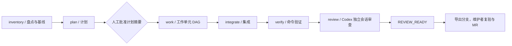

# Ergora

**面向代码仓库开发与训练实验的多 agent 协作协议与参考执行框架。**

Ergora 用任务合同明确目标、角色、修改范围和验收标准，把人工审批、并行工作、命令验证、独立审查与执行证据连接成可追溯的流程。开发者可以在自己的项目仓库和工单体系中使用它，逐步接入现有执行器、服务和实验环境。

仓库提供独立的 **`ergora` CLI / 本地图形控制面**，以及保持内容一致的 **v2.2 `agentflow` 参考发行**。新入口支持分层工具绑定、持久记忆、skill 候选评价与采用回退、有界资料观察、可选 Temporal 调度，以及模板与工作单元 DAG 草稿；完整六阶段执行仍通过参考发行安装。实际验收进度记录在 [持续计划](docs/PLAN.md)。

[安装与日常使用](docs/USAGE.md) · [Windows 安装](docs/WINDOWS.md) · [训练优化手册](docs/TRAINING.md) · [Agent 选择与正式执行](docs/AGENT_BACKENDS.md) · [工具接入](docs/INTEGRATIONS.md) · [单文件参考发行](docs/distribution/multi-agent-development-platform.html) · [计划与进度](docs/PLAN.md)

```bash
git clone --branch main https://github.com/626619403/Ergora.git
cd Ergora
bash scripts/install.sh
"$HOME/.local/bin/ergora" serve
```

以上是 Linux 的 Git / Python 3.11+ 安装路径；Windows 使用 [PowerShell 安装器](docs/WINDOWS.md)。打开 `http://127.0.0.1:8977`，注册已有仓库即可使用。网页资源随包安装，无需 Node 构建或外部工单。可选工具有各自的安装、认证与服务要求，见 [使用手册](docs/USAGE.md)。

## 用来做什么

|场景|模板|提供的工作方式|
|---|---|---|
|整理已有仓库、约束模块依赖、沉淀项目知识|`repository-governance`|盘点基线、建立导航与架构检查，在限定范围内修改并验证|
|跨模块功能、接口调整、可回滚迁移|`large-change`|按依赖和路径所有权拆工作单元，增加集成、兼容、迁移回滚检查|
|训练性能或配方实验|`training-optimization`|冻结 workload、基线和实验清单，运行可信 runner，保存证据并经人工放行|

适合需要管理多个 agent 的交接、恢复长任务、保留验收依据的项目维护者。每个业务项目拥有自己的 Git 仓库和工单；每个开发任务导出自己的分支。平台共享工具和运行记录。

## 当前工作流

开发流程采用固定的 `development-v1` 六阶段：



六阶段分别对应 inspector、planner、implementer、integrator、verifier、reviewer。可配置的是 `work_units` 的依赖 DAG、允许路径和任务输入；当前编译器只接受这套阶段拓扑。工作单元依赖必须无环，并行单元写入范围重叠时必须建立依赖。治理模板最多 4 个工作单元、并行 2 个；大型变更最多 24 个、并行 4 个。

- **先冻结任务，再执行。** 任务输入、工作流包、项目策略和服务绑定共同编译为执行合同；同一任务 ID 不能换一份输入继续运行。
- **审批绑定具体材料。** 计划批准引用精确计划 SHA；验证和审查绑定具体候选提交，训练放行绑定具体证据摘要。
- **实现与审查分开上下文。** Codex 实现后，由新的 ephemeral Codex 会话审查。执行器检测审查前后的工作区和 HEAD 变化，发现改动就拒绝通过。
- **恢复沿用原任务身份。** 长任务历史由 Temporal 保存；超时、去重和取消 fence 管理外部作业。结果不明时用原 ID 对账，取消请求仍需确认实际终态。

独立会话与 SHA 绑定用于上下文分离和证据一致性。自带执行器使用当前容器、当前 Unix 用户，agent 可以访问该用户文件；工作区变化检测不提供每 agent 的 OS 隔离。该执行配置面向可信项目。

## 现有工具栈

独立控制面使用 Python、SQLite、FastAPI / Uvicorn 和随包 Cytoscape.js。各项目可按盘点、规划、实现、审查及训练角色选择 Codex / Claude Code / 自定义命令，实现角色也可选择 mini-swe-agent；kernel 层可接原生 ForgeKernel。记忆、优化和调度分别选择 SQLite / ReMe、手动 / GEPA、手动 / Temporal。前端和 CLI 共用应用函数，不复制评价、采用或合同校验逻辑。

下表为完整六阶段**参考发行**的工具栈：

|职责|当前使用|边界|
|---|---|---|
|代码实现与独立审查|Codex CLI|共用模型 API 配置，分别启动会话|
|开发与实验生命周期|Temporal + Python SDK|保存状态、审批等待与恢复历史；本地部署使用开发服务|
|远程工单入口|Symphony|按项目绑定 GitHub / GitLab；本地 CLI 接入可先运行|
|跨服务协议|A2A SDK|提供 Agent Card 与 HTTP/JSON-RPC 接口|
|服务管理|Supervisor|管理本地服务，无需 systemd|
|实验观测|MLflow|记录参数、指标、指纹与产物|
|候选提案|LangGraph + SQLite checkpoint|每次 1–5 个提案，不自动实施或运行实验|
|训练证据比较|perfctl + 可信 runner|重新计算统计与门禁；项目负责实际训练环境|
|安装与依赖|Bash、uv、Python、Node.js|安装器固定工具版本与 Python 依赖|

Ergora 控制台提供项目总览、工具绑定、记忆修订、候选比较 / 评价 / 采用、资料提案和受约束的工作单元关系编辑。正式任务的运行历史、审批和训练观测继续使用参考 CLI、Temporal UI 和 MLflow；页面不会自行产生正式验收状态。

## 源码组织

新入口位于 `src/ergora/`，测试在 `tests/`。`src/ergora/data/reference/` 保存从已发布 HTML 提取的 283 个原始文件，身份清单为 `reference-manifest.json`。复现提取使用 `python scripts/import-reference.py`，参考文件保持原内容以便对照。工程计划与每切片证据在 `docs/PLAN.md` 和 `docs/delivery/`。

```text
src/ergora/
├── projects.py / tools.py          项目修订、工具绑定与独立调用
├── agents.py / reference_executor.py 原生 Agent 适配与可选六阶段桥接
├── kernel.py / data/drivers/        原生 Forge campaign 与独立 SDK 驱动
├── memory.py / state.py            项目记忆、来源与持久状态
├── skills.py / evaluation.py       版本资产、固定评价与采用回退
├── optimization.py                可选 GEPA 候选搜索
├── research.py / scheduling.py     有界资料观察与 Temporal 适配
├── reference.py / drafts.py        冻结参考合同与可编辑输入草稿
├── cli.py / web.py                 共用业务逻辑的两个入口
└── data/console/                   随包页面、样式、图组件与许可证
```

以下是**安装后参考实现**的目录，亦对应完整部署包的 `platform/`：

```text
multi-agent-platform/
├── local/agent_platform/        CLI、项目注册、执行器、服务与本地集成
├── upstream/
│   ├── platform/
│   │   ├── dev_platform/
│   │   │   ├── contracts.py     确定性的合同校验，不做文件/网络 IO
│   │   │   ├── portable.py      任务包、输入、策略、绑定的编译
│   │   │   ├── workflow.py      Temporal 开发工作流
│   │   │   ├── adapter.py       执行协议与可信文件交换适配器
│   │   │   └── a2a_gateway/     A2A 接入
│   │   ├── portable/           Schema、工作流包、示例
│   │   ├── task-types/         显式启用的任务类型
│   │   └── harness/            范围与架构检查
│   ├── temporal/               训练实验控制流
│   ├── symphony/               工单、workspace 与桥接
│   └── perfctl.py              训练证据和统计门禁
├── templates/                  三个工作流模板
├── bootstrap/                  安装、版本锁、模型配置与修复
├── README.zh-CN.md              部署与日常使用手册
└── docs/TRAINING.md             训练优化手册
```

已有的 `DevelopmentAdapter` 接口包含 `submit`、`poll`、`authorize`、`fence`。`FileAdapter` 负责可信目录中的请求、回执、审批与取消屏障交换，实际执行由外部执行器完成。`local/agent_platform/` 把这些组件接成可用的本地工作流，仍包含安装路径、服务地址和环境配置方面的耦合。

## 安装

独立控制面支持 Linux 和原生 Windows，要求 Python 3.11+、Git；无需先启动外部服务。Linux 从源码安装：

```bash
python3 -m venv .venv
.venv/bin/pip install '.[web]'
.venv/bin/ergora reference verify
.venv/bin/ergora templates list
.venv/bin/ergora templates copy repository-governance ./workflow-governance
.venv/bin/ergora workflow --help
.venv/bin/ergora serve
```

Windows PowerShell 在源码根目录运行：

```powershell
powershell.exe -NoProfile -ExecutionPolicy Bypass -File .\scripts\install.ps1 -AddToPath
& "$env:LOCALAPPDATA\Ergora\bin\ergora.exe" serve
```

空环境可加 `-InstallPrerequisites` 通过 winget 安装缺失的 Python / Git。安装、认证、目录、升级及功能范围见 [Windows 手册](docs/WINDOWS.md)。原生支持项目、模板设计、角色调用、记忆与持续改进；完整六阶段参考执行器、mini-swe-agent 驱动和 ForgeKernel 使用 WSL2/Linux，正式执行器还要求可信 Linux 容器。旧 HTML 保持 Linux v2.2 内容。

开发检查：安装 `.[dev,web,gepa,temporal]` 后运行 `python -m pytest tests`；真实 Temporal 回归需通过 `ERGORA_TEMPORAL_TEST_ADDRESS` 明确指定隔离服务，否则跳过。`ergora workflow` 直接调用随包的原合同编译器，支持 `compile`、`validate`、`convert-v2`、`export-v2`，不自动安装或启动执行服务。

新入口也支持注册自己的 Git 项目并按角色调用工具：

```bash
ergora project add my-project --repo "$HOME/projects/my-project"
ergora project show my-project
ergora tools list
ergora tools doctor my-project
# binding.json 示例：{"tool":"codex","model":"YOUR_MODEL_ID"}
ergora project bind my-project reviewer --binding binding.json --revision 1
ergora agent run my-project reviewer --prompt review-request.md --timeout 300
ergora agent runs my-project
```

各 Agent 角色选择 `codex`、`claude-code` 或 `command`；实现角色额外支持 `mini-swe-agent`。普通自定义命令 `{"tool":"command","argv":["/path/to/tool"]}` 接收 stdin 文本；模板产物和正式阶段使用明确的 stage-json 协议。工具沿用自己的登录和环境变量，配置内不存密钥。保存绑定时传入 `project show` 的当前修订号以避免覆盖别人的修改。状态与输出在 Linux 默认保存在 `~/.local/share/ergora/`（遵循 XDG），Windows 默认为 `%LOCALAPPDATA%\Ergora\data`，可通过 `ERGORA_HOME` 或 `--home` 改为其他持久目录。升级前停止相关工作并备份整个目录；自动迁移保存的 DB 快照不包含文件资产，见 [升级与恢复说明](docs/architecture/state-migrations.md)。

`agent run` 是独立工具调用，成功不产生正式合同的验证/审查结论。`--template TEMPLATE` 可要求该角色的结构化产物。需要绑定作用于正式六阶段时，显式启用 `ergora reference executor --installation INSTALLATION`：复用参考执行器及门禁，在新任务首次接入时冻结角色工具。完整配置、安装可选 Agent、原生 Forge campaign 与恢复操作见 [Agent 手册](docs/AGENT_BACKENDS.md)。可执行文件存在不代表已认证，实际调用失败和超时会保留在运行记录。

项目记忆通过 `ergora memory save/search/history/restore/delete/sync` 管理，默认使用同一持久目录里的 SQLite 文件，也可将记忆层绑定到 ReMe HTTP 检索投影。来源与修订是必填信息，跨项目结果会过滤，远程服务故障不会自动换后端。配置和完整命令见 [工具接入手册](docs/INTEGRATIONS.md)；ReMe 引擎的目标环境验收与质量比较仍需单独完成。

skill 使用标准 `SKILL.md` 目录，完整内容按 SHA 保存。`skill import`、`evaluation register/run/compare`、`skill adopt/rollback` 组成可审查闭环，可选 `.[gepa]` 接真实 GEPA 搜索；搜索不自动采用。后续 `agent run --skill NAME --recall QUERY` 消费当前采用版本与项目记忆。评价合同、提案协议和边界见 [接入手册](docs/INTEGRATIONS.md#skill-候选评价与采用)。

`research run` 观察明确 URL，保留内容 SHA、快照、去重和资料提案；总正文、时间、取消和失败可见。`.[temporal]` 提供持久 Schedule / worker，创建默认暂停。来源正文不执行，也不自动写入有效记忆。配置与恢复边界见 [有界资料检查](docs/INTEGRATIONS.md#有界资料检查与定时触发)。

下述**完整参考发行**支持 **Ubuntu 24.04 / Linux x86_64**。Linux 包安装需要目标系统或容器内的 root/sudo 权限；安装器会补齐 Python 3.12、Node.js、uv 及所需工具。安装过程需要访问软件源、GitHub、npm 和 Python 包索引。

1. 下载 [单文件 HTML](docs/distribution/multi-agent-development-platform.html)。在 GitHub 文件页使用 **Download raw file** 保存后，用本地浏览器打开。
2. 点击“下载全新环境一键安装器”。HTML 同时内嵌完整源码部署包、三个模板、**部署与日常使用手册**和**训练优化手册**，可直接阅读和单独下载。
3. 在目标环境执行以下命令；下载目录不同则替换路径。

```bash
bash ~/Downloads/install-agentflow.sh
source ~/multi-agent-platform/env.sh
agentflow doctor
```

HTML 的阅读与内嵌文件导出可以离线完成，完整安装仍需要联网。也可以下载完整 ZIP，解压后在含有 `install-from-report.sh` 和 `platform/` 的目录执行 `bash install-from-report.sh`；追加 `--check` 可只检查包与缓存条件。

工具安装到 `~/multi-agent-platform/`，配置在 `~/.config/multi-agent-platform/`，数据库、日志、worktree 和证据在 `~/.local/state/multi-agent-platform/`。容器中使用时，应持久化并备份 home 和业务项目。

### 配置模型与执行环境

当前 Codex adapter 使用 Responses API。选择服务支持的模型 ID，配置元数据，并通过自己的 shell 或 Secret 管理器提供 `OPENAI_API_KEY`：

```bash
python3 ~/multi-agent-platform/bootstrap/configure-model.py \
  --model YOUR_SUPPORTED_MODEL_ID \
  --base-url https://api.openai.com/v1 \
  --env-key OPENAI_API_KEY
```

使用兼容网关时替换地址、模型 ID 与凭据变量名。实现与审查共用此配置；仅登录 Codex 订阅账号不会自动提供该 adapter 所需的 API 凭据。

控制面可安装在裸 Linux；**自带执行器需要检测到当前处于 Docker/Podman 容器中，并由操作者明确启用**。执行直接使用当前容器，不要求在其中启动嵌套容器。全新主机的容器准备示例在 HTML 部署手册中。

接受前述可信项目执行边界后，在该容器中运行：

```bash
agentflow sandbox probe
agentflow execution enable --trusted-current-container
agentflow services start
agentflow doctor
```

安装默认不启用执行，不登录模型，也不运行项目或训练任务。`doctor` 用于检查组件、凭据和项目条件，首次接入项目后再检查其任务就绪状态。更换执行容器后需重新探测和启用。

## 首个开发任务

下面使用本地入口，准备好模型与执行环境后即可接入自己的 Git 仓库。所有项目名、目录、工单编号和摘要都应替换为实际值。

参考任务 CLI 从当前 shell 读取 Temporal 连接。使用上述本机开发服务时，在运行 `task` 命令的 shell 中设置：

```bash
export TEMPORAL_ADDRESS=127.0.0.1:7233
export TEMPORAL_NAMESPACE=default
export TEMPORAL_LOCAL_DEV=1
```

`TEMPORAL_LOCAL_DEV=1` 仅用于 loopback 开发服务；生产服务按其认证配置连接。参考生成的 `env.sh` 当前不导出这三项。

### 1. 准备项目与可信检查

项目必须是已有提交的 Git 仓库。先提交需要作为任务基线的准备内容；注册会记录当时的 HEAD。复制模板到尚不存在的目录：

```bash
agentflow templates copy repository-governance \
  "$HOME/projects/my-project/workflow-governance"
```

填写模板的 `input.json`：`goal`、`allowed_paths`、`acceptance`、`constraints`、`risk`、`work_units`。每个工作单元声明 `id`、`depends_on`、`paths`、`instructions`。任务路径必须位于项目授权范围内。

由维护者提供项目自己的 `checks.json`，键为检查 ID，值为**非空 argv 数组**。治理任务需要 `behavior`、`architecture`、`knowledge`；大型变更额外需要 `integration`、`compatibility`、`migration-rollback`。`scope` 和 `baseline-regression` 由执行器处理。

检查命令应调用项目实际环境，参数可用 `{repo}` 指向待验 checkout；worktree 不会复制被 Git 忽略的 `.venv`，因此解释器应使用正确的绝对路径。示例 PASS、空命令或通用 lint 不能代替项目验收。

### 2. 注册、创建并启动

```bash
agentflow project add my-project \
  --repo "$HOME/projects/my-project" \
  --tracker local --project local/my-project \
  --allowed-path src --allowed-path tests --allowed-path docs \
  --allowed-path AGENTS.md --allowed-path ARCHITECTURE.md \
  --checks-json "$HOME/projects/my-project/checks.json"

agentflow task create --project my-project --type repository-governance \
  --id my-project-123-r1 --issue 123 \
  --input "$HOME/projects/my-project/workflow-governance/input.json"
agentflow task start my-project-123-r1
agentflow task status my-project-123-r1
```

`local` 工单编号仅作本地关联。`task create` 编译并冻结任务，`task start` 才启动流程。修改冻结输入需要新的任务修订 ID。

### 3. 人工批准计划

状态到达 `AWAITING_PLAN_APPROVAL` 后，阅读 `~/.local/state/multi-agent-platform/artifacts/任务ID/` 中的计划、所有权和回滚材料，确认后使用状态返回的精确摘要：

```bash
agentflow task approve my-project-123-r1 --plan-sha256 PLAN_SHA256
agentflow task status my-project-123-r1
```

`PLAN_SHA256` 必须替换为实际值。批准后，工作单元实现、集成、命令验证与独立审查继续执行。

### 4. 审阅结果并导出分支

```bash
agentflow task result my-project-123-r1
# 仅 REVIEW_READY 结果可以导出
agentflow task export my-project-123-r1 --branch agent/123-description
```

`result` 在结果未产生时会等待；查看进度用 `status`。导出在业务仓库创建分支，之后由维护者审阅、按当前目标分支复验，并按项目流程推送和创建 PR/MR。

需要中止时：

```bash
agentflow task cancel my-project-123-r1 --reason '说明原因'
agentflow task result my-project-123-r1
```

取消请求仍需核对最终作业状态。遇到 `NEEDS_RECONCILIATION` 或未知结果时，检查原任务的进程、回执和产物，沿用原 ID 对账。

## 工单、搜索与训练

**工单按业务项目接入。** 注册时选择 `--tracker github` 或 `--tracker gitlab`，并指定该项目自己的远程标识。以 GitLab 为例，完成对应注册后：

```bash
agentflow symphony configure my-project \
  --repo-url https://gitlab.example.com/group/repo.git
# 核对生成的该项目配置，按需设置 api_url、token_env 和凭据环境变量
agentflow symphony enable my-project
```

轮询入口与请求执行准入分开处理，具体见安装后 `upstream/symphony/README.md`。已有本地注册的基线、检查和 tracker 绑定应按修订管理；迁移前先结束并对账在途任务，建立新注册时避免重复工单归属。

**候选搜索只生成提案。** 选中提案后，再创建开发任务或训练实验：

```bash
agentflow search --project my-project --id my-project-search-r1 \
  --goal '一个可检验的优化目标' --limit 3
# 同一输入恢复检查点时追加 --resume
```

**训练采用独立实验流程。** 复制 `training-optimization` 模板，准备真实 workload 合同、baseline、experiment manifest 与可信 runner。通常顺序为：

```text
training init / runner-add → prepare → worker-start → start
→ 明确选择实验并以 manifest SHA 执行 run-local
→ 证据和统计门禁 → 人工批准 evidence SHA → 集成/复验任务 JSON
```

完整参数和证据格式见 HTML 中的**训练优化手册**，或安装后的 `docs/TRAINING.md`。当前 `run-local` 逐实验手动调用，无常驻训练队列消费者。项目负责 CUDA/PyTorch、数据、GPU 资源、训练质量和恢复验证；平台不提供每实验 GPU/cgroup 配额。人工放行后，维护者继续在项目中完成集成、复验与采用。

## 日常交互与运维

```bash
source ~/multi-agent-platform/env.sh
agentflow services start
agentflow services status
agentflow services logs executor
agentflow services logs worker --stderr
agentflow doctor
agentflow verify
```

|入口|默认地址 / 用途|
|---|---|
|CLI|`agentflow`：项目、任务、审批、取消、导出与训练|
|Temporal UI|`http://127.0.0.1:8233`：流程历史和故障排查|
|MLflow|`http://127.0.0.1:5000`：实验参数、指标与产物|
|A2A Agent Card|`http://127.0.0.1:8765/.well-known/agent-card.json`|
|A2A JSON-RPC|`http://127.0.0.1:8765/a2a`，使用 token 与 `A2A-Version: 1.0`|

地址均指服务所在环境的 localhost；远程或容器访问按部署手册配置端口转发。修改模型等环境变量后先 `agentflow services stop`，再从持有新变量的 shell 中 `agentflow services start`。仅 `services restart` 会沿用 Supervisor 的旧环境。 `services stop` 返回后，先确认原服务进程和 Supervisor socket 已退出，再启动；否则可能遇到旧 socket 仍占用的错误。

可选训练 worker 默认关闭，`services status` 可能因 STOPPED 项返回退出码 3，应查看每项实际状态。停止服务与取消外部作业是不同操作；维护和备份前先确认在途作业的状态。备份平台、私有配置、state 和各业务仓库。更多步骤见 HTML 部署手册与安装后的 `docs/VALIDATION.md`。

## 解耦与后续工作

合同、业务状态、工具调用和入口已有独立归属；冻结参考执行器仍有待逐步迁移。以下边界指导后续扩展，当前没有通用插件发现或任意后端切换能力。

|层|应拥有的内容|接入边界|
|---|---|---|
|协议与工作流定义|任务、角色、DAG、审批、证据、版本与编译规则|纯数据和确定性校验，避免执行器或工单 SDK 依赖|
|运行控制|生命周期、恢复、调度、超时和取消语义|复用现有 Temporal 参考运行时|
|执行适配|提交、查询、回执、幂等和取消屏障|Codex、本地 runner；后续按需求接入其他 agent 或集群|
|工单与通信适配|项目工单映射、外部消息与协议转换|GitHub/GitLab、A2A、其他服务|
|证据与观测|产物、指纹、比较与查询|MLflow、文件归档及项目评估工具|
|用户入口|CLI、配置表单、运行视图、人工审批|调用同一合同编译与运行接口|

这样可以保留当前工作流，并让工单来源、通信渠道和执行后端分别演进。提取时应以同一个本地任务能够完整运行和恢复为验收，再扩展新的后端。

**图形页面已提供分层绑定与有约束的工作单元编辑。** 编辑器只调整允许的依赖和路径所有权，保存为任务输入草稿；正式任务冻结、审批和执行继续使用参考工作流。支持新的阶段拓扑，需要先扩展并验证合同与运行时。

进一步的 [工具调研与产品方案](docs/research/2026-10-28-multi-agent-landscape.md) 比较了 40 个代表性工具或产品家族，讨论 Agent Spec 等现有关系格式、组件复用和各层工具绑定。建议面向用户提供统一安装、配置与任务视图的 all-in-one 体验，内部逐步验证可替换组件；这些仍是后续方案。术语见 [领域词汇表](CONTEXT.md)。

[长期记忆与持续演进调研](docs/research/2026-10-28-continuous-evolution.md) 进一步梳理 24 份项目官方 README。本轮已实现项目记忆、可选 ReMe 协议接入、真实 GEPA 有界候选搜索、资料快照和持久调度入口；候选改进仍须评价、审阅和明确采用，不声明真实模型或 GPU 效果收益。

三个模板的角色现可独立于工具选择；[选型调研](docs/research/2026-10-31-template-agents.md) 说明首批适配和未接入工具的优缺点。ForgeKernel 作为可选原生候选生成工具，其内部 judge 不替代可信训练门禁；模型质量和 GPU 性能比较需要真实项目证据。固定官方版本及实际检查范围记录在 [计划](docs/PLAN.md) 和各切片交付记录。

## 项目状态与许可

当前参考分发面向单机和可信容器。团队级身份、独立执行隔离、生产 Temporal 部署及其他执行后端需要后续工程接入和验收。任务中的角色字段和摘要不构成团队身份认证。

项目许可证尚待维护者确定；第三方组件适用各自许可证，来源与随包许可见 [THIRD_PARTY_NOTICES.md](THIRD_PARTY_NOTICES.md)。当前源码与研究分支不代表已完成开源许可证发布。
