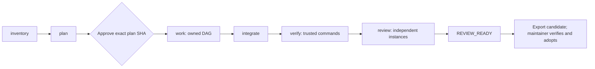

# Ergora

English · [简体中文](README.zh-CN.md)

**Multi-agent collaboration contracts and a reference runtime for repository development and training experiments.**

Ergora connects task goals, roles, permitted changes, human decisions, parallel work, trusted checks, independent review and original execution evidence. Each business project keeps its own Git repository and issue namespace; tasks export their own candidate branches.

The repository provides the `ergora` CLI and local graphical control plane, plus a frozen v2.2 `agentflow` reference distribution. Formal execution reuses the reference runtime and its original approval, cancellation, recovery and evidence records. The [documentation index](docs/README.md) identifies each guide's language; [the live plan](docs/PLAN.md) records delivery and remaining acceptance work.

[Quick start](#quick-start) · [Documentation](docs/README.md) · [Template walkthroughs](docs/TEMPLATE_WALKTHROUGHS.md) · [Training](docs/TRAINING.md) · [Architecture](docs/architecture/current.md) · [Reference HTML](docs/distribution/multi-agent-development-platform.html)

<a id="当前试用范围"></a>
## Current scope

Use the current development version for small trials on one machine with trusted projects. Start with governance or behavior-preserving refactoring in a small Git repository, and inspect plan approval, command checks, independent reviews and candidate export.

- **Control plane:** Linux and native Windows CLI/web interfaces for projects, layered tool bindings, Agent/Workflow definitions, formal tasks and evidence handoff. Web assets are packaged; no Node build or runtime CDN is required.
- **Composition:** versioned specialists, nested workflows, inherited Skills/context, per-instance supported backends and permissions narrowed along the structural parent chain. Formal development retains the six-stage runtime and its supported work/review DAGs.
- **Recorded real runs:** the [governance](docs/delivery/2026-11-13-six-stage-native-journey.md) and [refactoring](docs/delivery/2026-11-13-refactoring-journey.md) journeys used real Codex calls, candidate verification and original-ID recovery. Their reports define exactly what was checked.
- **Execution platform:** complete development execution uses the Linux/WSL2 reference stack in a trusted container. Native Windows supports the control plane; see [platform boundaries](docs/WINDOWS.md).

Source checks, a new wheel installation, a real service run, model behavior, training quality and a candidate's [GitHub Actions](https://github.com/626619403/Ergora/actions) are separate evidence. A plan, template, installed SDK or successful standalone Agent call does not establish all of them.

<a id="快速试用"></a>
## Quick start

The features described here are delivered on `refactor/architecture-foundations`. The repository's default branch is `main`, which has a different feature baseline. Select the development branch explicitly; to reproduce an acceptance record, pin its complete Git commit before installation. The `0.2.0` package version alone does not identify equivalent source.

On Linux, provide Git, Python 3.11+, venv/pip and access to dependency sources. Use a source destination that does not already exist:

```bash
git clone --branch refactor/architecture-foundations \
  https://github.com/626619403/Ergora.git "$HOME/Ergora"
cd "$HOME/Ergora"
bash scripts/install.sh
export PATH="$HOME/.local/bin:$PATH"

ergora composition presets
ergora composition install-preset repository-governance
ergora composition install-preset refactoring
ergora composition install-preset refactoring
ergora serve
```

Open `http://127.0.0.1:8977` on the serving machine to inspect and configure imported specialists and templates. For native Windows, run the [PowerShell installer](docs/WINDOWS.md) from the same branch or fixed commit.

|Installation profile|Installed extras|Still configured separately|
|---|---|---|
|`control` (default)|Web control plane|Agent CLI/authentication and project tools|
|`development`|Web and Temporal SDK|Reference runtime, services and Agents|
|`research`|Web, Temporal and GEPA SDKs|Trusted evaluators, proposers, experiment services and workload tools|

Use `bash scripts/install.sh --profile development` or `--profile research`; Windows uses `-Profile`. `ergora tools profiles` describes the recipes. A profile does not install every Agent, start services or run training. Task-MCP and GPU tools have their own prerequisites in the relevant guide.

Before a formal run, [authenticate the selected backend](docs/USAGE.md#安装与认证-agent-cli), [register a committed business repository and real trusted checks](docs/PROJECTS.md), then follow the [complete manifest/template journey](docs/TEMPLATE_WALKTHROUGHS.md). A local manual issue tracker is sufficient to start.

<a id="用来做什么"></a>
## Choose a workflow

|Goal|Entry point|Behavior|
|---|---|---|
|Govern an existing repository|`repository-governance`|Inventory, architecture/knowledge checks and scoped changes|
|Develop a cross-module change|`large-change`|Owned work units, integration, compatibility and migration/rollback checks|
|Preserve behavior while refactoring|`refactoring`|Preparation, refactoring, compatibility validation and three independent review specialties within the original six stages|
|Prepare training optimization|`training-optimization`|Source-anchored flow map, bottleneck analysis, kernel assessment and measurement review; explicitly invoked proposal leaves|
|Collect exact PR/MR review material|[Local review](docs/LOCAL_REVIEW.md)|Complete Git source, requirements and explicit context; collection itself does not call a review model|
|Write a readable report from existing evidence|[Evidence reports](docs/EVIDENCE_REPORTS.md)|One explicit read-only author call; Markdown and self-contained HTML with source/coverage limits|
|Review pretraining/posttraining code|[Training review](docs/TRAINING_REVIEW.md)|Domain reviewers composed with general review, plus CPU contract examples|
|Use a retrospective in a later task|[Improvement workflow](docs/IMPROVEMENT_WORKFLOW.md)|Separate memory, Skill and Workflow candidates, explicit adoption and a new task freeze|
|Move or recover historical tasks|[Backup and recovery](docs/BACKUP_RECOVERY.md)|An offline, coordinated snapshot of control data, execution state, Temporal and business Git|

`ergora composition presets` lists the current 33 bundled presets and exact versions. They include the four main workflows, retained training v1/v2, eighteen optimization directions, performance diagnosis, three retrospective types, pretraining/posttraining review, a training flow map and evidence reporting. See [composition](docs/WORKFLOW_DEFINITIONS.md) and [training directions](docs/TRAINING.md#独立的优化方向子模板) for full IDs and inputs.

The optimization directions cover memory/recompute/offload, CUDA Graphs/packing, parallelism/FSDP/hierarchical CP, communication/MoE, profiling/memory snapshots, recipes/model verification, cluster recovery, low precision and kernels. Proposal leaves run one explicitly selected leaf at a time; the operator supplies complete predecessor results. Installing a preset does not execute its graph or submit a training job.

Specialist definitions, prompts and bundled Skills are Ergora implementations informed by the cited [engineering](docs/research/2026-11-14-local-engineering-skills.md) and [composition](docs/research/2026-11-08-agent-composition.md) research. Codex and Claude Code are selectable execution backends. `refactoring` includes repository conventions, real-caller and test-value guidance through inherited resources while retaining existing roles and runtime contracts.

<a id="当前工作流"></a>
## Formal development workflow



The `development-v1` stages map to inspector, planner, implementer, integrator, verifier and reviewer. Work-unit dependencies must be acyclic; overlapping parallel write scopes require a dependency. Governance allows up to four work units/two concurrent units; large-change allows 24/four. Supported specialist work/review graphs compile into the original execution owner.

- Freeze task input, complete workflow assets, project policy and bindings before execution. Reusing an ID does not allow replacing its frozen input.
- Bind plan approval to the exact plan SHA; bind verification/review to the candidate commit and training approval to the exact evidence SHA.
- Give implementation and review independent sessions. Prefer different backends; record the actual fallback when one backend is unavailable. Workspace/HEAD changes during review prevent acceptance.
- Recover through original task/run/intent identities. A missing response means unknown: reconcile the original record before any further side effect. Cancellation requires observation of the actual terminal state.

The bundled executor uses the current trusted container and Unix user. Independent sessions and candidate checks provide evidence boundaries; processes can access files available to that user. Per-Agent operating-system isolation and team identity are separate engineering work.

<a id="安装"></a>
## Installation and reference runtime

For a source installation into your own Linux environment:

```bash
python3 -m venv .venv
.venv/bin/pip install '.[web]'
.venv/bin/ergora reference verify
.venv/bin/ergora templates list
.venv/bin/ergora templates copy repository-governance ./workflow-governance
.venv/bin/ergora serve
```

From the selected source checkout on Windows PowerShell:

```powershell
powershell.exe -NoProfile -ExecutionPolicy Bypass -File .\scripts\install.ps1 -AddToPath
& "$env:LOCALAPPDATA\Ergora\bin\ergora.exe" serve
```

`-InstallPrerequisites` can install missing Python/Git via winget. Native Windows and WSL2 have separate installation/state boundaries; do not share a live SQLite database or move a venv between them. [Installation](docs/USAGE.md), [Windows](docs/WINDOWS.md) and [testing](docs/TESTING.md) cover offline wheels, upgrades, development checks and wheel-based CI. The optional [editor comparison](examples/editor-comparison/README.md) uses Node for its own build; the packaged application does not.

The [single-file HTML distribution](docs/distribution/multi-agent-development-platform.html) embeds the frozen Linux v2.2 reference source, installer, three templates and reference deployment/training manuals. Download the raw file and open it locally. Reading and exporting its embedded files can be offline; full installation needs network access and Ubuntu 24.04/Linux x86_64 system-package privileges. It does not include later control-plane features merely because this README links to it.

After exporting its installer, use the reference guide for your chosen installation path. Its default commands are:

```bash
bash "$HOME/Downloads/install-agentflow.sh"
source "$HOME/multi-agent-platform/env.sh"
agentflow doctor
```

<a id="配置模型与执行环境"></a>
### Configure models and execution

Standalone backend calls use each backend's login/configuration and inherited credential environment. The original reference Codex adapter uses the Responses API and a separately configured model/API credential:

```bash
python3 "$HOME/multi-agent-platform/bootstrap/configure-model.py" \
  --model YOUR_SUPPORTED_MODEL_ID \
  --base-url https://api.openai.com/v1 \
  --env-key OPENAI_API_KEY
```

Supply the variable through your shell or secret manager. A compatible gateway needs its actual URL, model and environment-variable name. A subscription login alone does not configure this reference adapter. Do not store secrets in project JSON, prompts or reports.

The reference executor requires a detected Docker/Podman container and the operator's explicit trusted-container choice:

```bash
agentflow sandbox probe
agentflow execution enable --trusted-current-container
agentflow services start
agentflow doctor
```

This uses the current container without nested containers. Installing the control plane does not enable execution or run tasks. See [backend modes and admission](docs/AGENT_BACKENDS.md).

<a id="首个开发任务"></a>
## First formal development task

Use this sequence after preparing the Linux/WSL2 reference stack, model access and trusted execution container. Keep control data, execution config/state and the committed business repository in persistent locations; config/state belong outside that repository. Replace uppercase placeholders with values from the current command receipts.

<a id="1-登记项目和角色"></a>
### 1. Register the project and roles

Prepare `project.json` using [project registration](docs/PROJECTS.md#统一注册): real repository/template/execution paths, tracker, allowed paths and trusted checks. Governance requires behavior/architecture/knowledge checks; large-change also requires integration/compatibility/migration-rollback checks. Use argv and the real interpreter; `{repo}` denotes the candidate checkout.

```bash
ergora project register project.json --revision 0
ergora project config my-project
ergora tools doctor my-project --probe
ergora services start my-project temporal worker executor a2a \
  --revision CURRENT_REVISION --timeout 30
```

Use the revision from `project show`; saving configuration increments it. One execution state directory shares one service stack. Confirm the previous Supervisor/socket/processes have stopped before starting another stack. Current submission admission also requires local A2A. Credential, version and process checks each report their actual scope.

<a id="2-预览创建和提交"></a>
### 2. Preview, create and submit

Copy a template, prepare a complete [task definition](docs/USAGE.md#预览与创建正式任务), and inspect paths, work units, bindings and baseline before confirming the returned preview SHA:

```bash
ergora task preview my-project --definition task-definition.json --revision CURRENT_REVISION
ergora task create my-project --definition task-definition.json --revision CURRENT_REVISION --preview-sha256 PREVIEW_SHA
ergora task start my-project TASK_ID --revision CURRENT_REVISION --creation-sha256 CREATION_SHA
ergora task status my-project TASK_ID --run-id RUN_ID
```

`CREATION_SHA` is the creation receipt's `intent_sha256`; `RUN_ID` comes from the submission receipt. Creation freezes the contract; submission records the original run. Neither proves workflow success. A repeated start follows the original submission; unknown delivery must use its original intent/recovery path.

<a id="3-审阅并批准精确计划"></a>
### 3. Review and approve the exact plan

At `AWAITING_PLAN_APPROVAL`, inspect the complete execution/ownership/rollback material and approve the exact original plan:

```bash
ergora task plan my-project TASK_ID --run-id RUN_ID --plan-sha256 PLAN_SHA
ergora task approve my-project TASK_ID --revision CURRENT_REVISION \
  --decision-id owner-one --run-id RUN_ID --plan-sha256 PLAN_SHA --confirm
```

The plan SHA binds the complete accepted receipt. Delivery of a decision does not itself prove owner validity or workflow continuation. [The task guide](docs/USAGE.md#批准精确计划与恢复投递) covers limits, original owner/expiry/revocation and interrupted delivery.

<a id="4-审阅结果导出和异常恢复"></a>
### 4. Inspect, export and recover

For a closed `REVIEW_READY` run, confirm that candidate, trusted checks and reviews identify the same commit:

```bash
ergora task evidence my-project TASK_ID --run-id RUN_ID --timeout 20
ergora task export my-project TASK_ID --revision CURRENT_REVISION \
  --run-id RUN_ID --candidate-sha CANDIDATE_SHA --branch agent/TASK_ID --confirm
ergora task export-status my-project TASK_ID
```

Export creates a local branch and records applicable lease release; it does not check out, merge or push. The maintainer verifies the exact candidate in an independent worktree before project adoption. `REVIEW_READY` alone does not release the issue lease. To close without exporting, use [external status and explicit reconciliation](docs/USAGE.md#正常任务完成后的关闭).

To cancel, preserve a stable request ID and then inspect the original run and external work:

```bash
ergora task cancel my-project TASK_ID --revision CURRENT_REVISION \
  --request-id stop-one --run-id RUN_ID --reason 'Stop this task' --confirm
ergora task status my-project TASK_ID --run-id RUN_ID
ergora task external-status my-project TASK_ID --run-id RUN_ID
# Reconcile only after the original run is closed and external facts are available:
ergora task reconcile my-project TASK_ID --revision CURRENT_REVISION --run-id RUN_ID --confirm
```

Cancellation signals do not prove stopped processes. Preserve `CANCEL_UNCONFIRMED`/unknown and the lease when evidence is missing; do not replace reconciliation with database edits or a service shutdown. [Events and original job evidence](docs/USAGE.md#分段读取原运行事件) provide bounded, explicit reads of the original run. Closed-run evidence indexes and [handoff ZIPs](docs/USAGE.md#收集与离线核对交接包) can be inspected offline:

```bash
ergora task handoff my-project TASK_ID --run-id RUN_ID --output ./task-handoff.zip --timeout 20
ergora handoff verify ./task-handoff.zip --sha256 EXPECTED_PACKET_SHA256
```

Obtain the expected digest through an independent channel. Internal byte/identity checks do not authenticate origin or certify execution success. Missing billing/usage sources remain unknown.

<a id="现有工具栈"></a>
<a id="工单搜索与训练"></a>
## Agents, issues, training and improvement

The Python/SQLite control plane uses FastAPI/Uvicorn and packaged Cytoscape.js. [Backend guidance](docs/AGENT_BACKENDS.md) distinguishes role/mode support: Codex, Claude Code, structured `command`, an implementation-role mini-swe-agent driver, and a fixed DeepSeek Harness adapter for supported read-only leaves. Harness workspace writes/formal-task recovery and OpenHands admission are not available. Reasoning settings are selected per binding (`reasoning_effort` for Codex, `effort` for Claude); the selected model/backend decides which requested level is accepted. Selection is explicit; automatic task-based level selection remains planned.

For a standalone call, add an existing Git project, inspect effective bindings and select a backend using the current project revision:

```bash
ergora project add my-project --repo "$HOME/projects/my-project"
ergora project show my-project
ergora tools doctor my-project
# binding.json: {"tool":"codex","model":"YOUR_MODEL_ID"}
ergora project bind my-project reviewer --binding binding.json --revision CURRENT_REVISION
ergora agent run my-project reviewer --prompt review-request.md --timeout 300
ergora agent runs my-project
```

Standalone success does not produce formal verification/review acceptance. [Agent definitions](docs/AGENT_DEFINITIONS.md) separate specialists/resources from backend choice; [workflow definitions](docs/WORKFLOW_DEFINITIONS.md) describe full manifests, immutable revisions, nested permissions and explicit leaf calls. `check-input` reports admission without starting a model; actual calls recheck and retain original records.

[Issue workflows](docs/USAGE.md#保存工单与关联任务上下文) support manual/GitHub/GitLab sources, immutable snapshots, exact task-creation links and source-based task preparation. Candidate comments and supported GitHub label appends require their own prepare/confirm/send flow; unknown results are observed without resending. Candidate remote checks and explicit existing PR/MR associations do not collect/review arbitrary external PRs or automatically approve/merge. GitLab label append remains unsupported.

[Training](docs/TRAINING.md) keeps workload/baseline/runner/experiment preparation, submission/cancellation, archived evidence, statistical/quality gates and exact owner evidence approval distinct. Existing experiments are visible in the CLI/console. Explicit managed execution uses an original capable budget owner and the same native job; a collection/index is advisory. Kernel experts remain in the v3 proposal path, including the option to recommend no kernel change. The project supplies CUDA/PyTorch, data, devices, trusted runners and independent quality checks; no per-experiment GPU/cgroup quota is supplied.

[Improvement](docs/IMPROVEMENT_WORKFLOW.md) uses source-bound memory/Skill/Workflow proposals, trusted evaluation where required, explicit adoption/rollback and a new task's frozen selection. [Integrations](docs/INTEGRATIONS.md) document SQLite/ReMe projection, GEPA candidate search and bounded URL research/paused Temporal schedules. Generation/search does not adopt candidates, execute source text or prove quality/performance.

<a id="仍在补齐的模板与功能"></a>
## Work still requiring implementation or acceptance

The new versioned training-cycle schema3 path has closed runtime topology/lifecycle work, but its real controller effects remain disabled. It does not offer an automatic multi-candidate optimization loop. Full SDK capacity, real-service recovery/stop behavior, two-candidate CPU runs and actual GPU quality/performance need their own current-candidate acceptance. Existing explicitly selected experiments retain their documented path.

Mandatory design/knowledge gates, trusted non-Agent validation nodes, general bounded Repeat and mixed workflow canvases remain staged work. A design decision or statically valid definition does not make those topologies executable. Full nested ForgeKernel sessions still need complete parent resource/permission, total-budget, cancellation and unknown-result accounting; its native judge does not replace trusted training gates. Other research tools follow the [adoption matrix](docs/research/2026-11-12-specialist-adoption.md) and their actual availability.

Team authentication, per-Agent execution isolation, remote execution, production Temporal deployment and additional backends have separate implementation/admission requirements. Consult the [live plan](docs/PLAN.md) for the active candidates and limitations. The frozen HTML keeps its own original scope.

<a id="源码组织"></a>
<a id="接入边界与扩展"></a>
## Source ownership and extension

|Owner|Responsibility|
|---|---|
|`contracts`, `components`, `bindings`, `projects`, `registrations`|Versioned contracts, tool metadata, effective bindings and project registration|
|`agent_definitions`, `workflow_definitions`, `definition_bundles`, `asset_trees`|Specialists, nested graph compilation and complete immutable resources|
|`tasks`, `reference_inputs`, `reference_workflows`, `reference_executor`|Formal lifecycle, versioned input, original Temporal stages and native execution|
|`agents`, `agent_backends`, `agent_runs`, `task_mcp`|Backend contracts, per-invocation records and fixed authorized resources|
|`issue_backends`, `issue_sources`, `issue_snapshots`, `issue_writebacks`|Native issue protocols, full source identity and explicit external actions|
|`training`, `training_cycles`, `reference_training_*`|Experiment/cycle contracts, budget admission, native operations and recovery|
|`memory`, `skill_assets`, `evaluation`, `optimization`, `research`, `retrospectives`|Versioned knowledge, trusted evaluation and source-bound proposals|
|`state`, `backups`, `services`, `cli`, `web`, `data/console`|Persistence, offline backup, explicit service management and shared application entry points|

Start with [current architecture](docs/architecture/current.md), [component change protocols](docs/architecture/component-change-protocols.md), [contract identities](docs/architecture/contracts-and-identities.md), [reference boundaries](docs/architecture/reference-boundary.md) and the [domain glossary](CONTEXT.md). Dated inventories describe their recorded commits. The frozen reference's `DevelopmentAdapter`/`FileAdapter` owns original request/receipt/approval/fence exchange; this repository does not introduce another formal scheduler or general plugin-discovery bus.

<a id="日常交互与运维"></a>
## Operations and recovery

Linux control data defaults to `~/.local/share/ergora/` (XDG-aware); Windows uses `%LOCALAPPDATA%\Ergora\data`. Choose another persistent location with `ERGORA_HOME` or global `--home`. The reference installation/config/state and business repositories are separate and must be backed up together for historical task recovery. See [database upgrades](docs/architecture/state-migrations.md) and [full-stack backup](docs/BACKUP_RECOVERY.md).

Use the registered project's explicit `ergora services status/start/stop/logs/shutdown` operations. After credential/environment changes, stop the original stack, confirm its processes/socket have exited, and start from the shell containing the new environment. A Supervisor restart can retain the previous environment. Optional training workers may legitimately be stopped; inspect individual statuses. Stopping a service does not cancel or reconcile external jobs.

Default reference endpoints are Temporal UI `127.0.0.1:8233`, MLflow `127.0.0.1:5000` and A2A `127.0.0.1:8765` (Agent Card at `/.well-known/agent-card.json`, token-protected JSON-RPC at `/a2a` with `A2A-Version: 1.0`). They refer to the service environment's localhost; remote/container access needs explicit forwarding. Consult the reference deployment manual for a changed installation.

<a id="项目状态与许可"></a>
## License

Ergora code and documentation use [Apache-2.0](LICENSE), with [NOTICE](NOTICE). Third-party material keeps its own license; material whose original license is unresolved receives no new grant. See [THIRD_PARTY_NOTICES.md](THIRD_PARTY_NOTICES.md).
