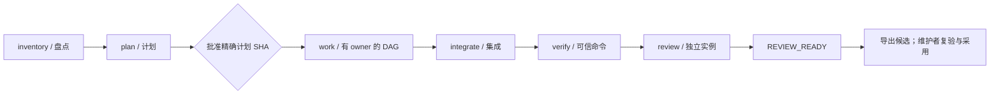

# Ergora

[English（默认）](README.md) · 简体中文

**面向代码仓库开发与训练实验的多 Agent 协作合同与参考执行框架。**

Ergora 将任务目标、角色、允许的修改、人工决定、并行工作、可信检查、独立审查和原始执行证据连接起来。每个业务项目保留自己的 Git 仓库和工单命名空间；任务各自导出候选分支。

仓库提供 `ergora` CLI 与本地图形控制面，以及冻结的 v2.2 `agentflow` 参考发行。正式执行复用参考运行时及其原审批、取消、恢复和证据记录。[文档入口](docs/README.zh-CN.md)标明各指南的语言；[持续计划](docs/PLAN.md)记录交付及剩余验收工作。

[快速试用](#快速试用) · [文档](docs/README.zh-CN.md) · [模板入门旅程](docs/TEMPLATE_WALKTHROUGHS.md) · [训练](docs/TRAINING.md) · [架构](docs/architecture/current.md) · [参考 HTML](docs/distribution/multi-agent-development-platform.html)

## 当前试用范围

当前开发版本适合单机、可信项目的小范围试用。先在小型 Git 仓库运行治理或行为保持重构，核对计划批准、命令检查、独立审查与候选导出。

- **控制面：** Linux 和原生 Windows 的 CLI／网页入口，提供项目、分层工具绑定、Agent／Workflow 定义、正式任务与证据交接。网页资源随包安装，不需要 Node 构建或运行时 CDN。
- **专家组合：** 版本化专家、嵌套工作流、继承的 Skill／上下文、逐实例受支持后端，以及沿结构父链收窄的权限。正式开发保留六阶段运行时及其支持的工作／审查 DAG。
- **已记录的真实运行：** [治理](docs/delivery/2026-11-13-six-stage-native-journey.md)与[重构](docs/delivery/2026-11-13-refactoring-journey.md)旅程使用了真实 Codex 调用、候选复验和原 ID 恢复。精确检查范围以各自报告为准。
- **执行平台：** 完整开发执行使用 Linux／WSL2 参考栈和可信容器。原生 Windows 支持控制面；详见[平台范围](docs/WINDOWS.md)。

源码检查、新 wheel 安装、真实服务运行、模型行为、训练质量，以及某候选自己的 [GitHub Actions](https://github.com/626619403/Ergora/actions) 各有独立证据。计划、模板、已安装 SDK 或成功的独立 Agent 调用不能同时证明这些范围。

## 快速试用

本文功能随 `refactor/architecture-foundations` 开发分支交付。仓库默认分支为 `main`，其功能基线不同。安装时显式选择开发分支；复现验收记录时，先固定记录中的完整 Git 提交。仅凭 `0.2.0` 包版本号不能确认源码等价。

Linux 需准备 Git、Python 3.11+、venv／pip，并能访问依赖源。使用一个尚不存在的源码目录：

```bash
git clone --branch refactor/architecture-foundations \
  https://github.com/626619403/Ergora.git "$HOME/Ergora"
cd "$HOME/Ergora"
bash scripts/install.sh
export PATH="$HOME/.local/bin:$PATH"

ergora composition presets
ergora composition install-preset repository-governance
ergora composition install-preset refactoring
ergora composition install-preset refactoring-quality
ergora serve
```

在服务所在机器打开 `http://127.0.0.1:8977`，查看并配置已导入的专家和模板。原生 Windows 从同一分支或固定提交运行 [PowerShell 安装器](docs/WINDOWS.md)。

|安装组合|安装的 extras|仍需另行配置|
|---|---|---|
|`control`（默认）|Web 控制面|Agent CLI／认证和项目工具|
|`development`|Web 和 Temporal SDK|参考运行时、服务与 Agent|
|`research`|Web、Temporal 和 GEPA SDK|可信评价器、提案器、实验服务和工作负载工具|

使用 `bash scripts/install.sh --profile development` 或 `--profile research`；Windows 使用 `-Profile`。`ergora tools profiles` 展示同源配方。安装组合不安装所有 Agent、不启动服务、不运行训练。Task-MCP 和 GPU 工具各有对应指南中的前置条件。

首次正式运行前，[认证所选后端](docs/USAGE.md#安装与认证-agent-cli)、[登记已有提交的业务仓库及真实可信检查](docs/PROJECTS.md)，再沿[完整 manifest／模板旅程](docs/TEMPLATE_WALKTHROUGHS.md)操作。可以先使用本地手动工单来源。

## 用来做什么

|目标|入口|实际行为|
|---|---|---|
|治理已有仓库|`repository-governance`|盘点、架构／知识检查和限定范围的修改|
|开发跨模块变更|`large-change`|有 owner 的工作单元、集成、兼容及迁移／回滚检查|
|保持行为的重构|`refactoring` 或 `refactoring-quality`|准备、重构、兼容验证，以及原六阶段中的三类独立审查|
|准备训练优化|`training-optimization-v3`|源码流程图谱、瓶颈分析、kernel 评估和测量审查；显式调用提案叶|
|收集精确 PR／MR 审查材料|[本地审查](docs/LOCAL_REVIEW.md)|完整 Git 源、需求与显式上下文；采集本身不调用审查模型|
|将已有证据整理成可读报告|[证据报告](docs/zh-CN/EVIDENCE_REPORTS.md)|一次明确的只读作者调用；Markdown 与自包含 HTML，保留来源／覆盖范围|
|审查预训练／后训练代码|[训练领域审查](docs/TRAINING_REVIEW.md)|领域专家与通用审查组合，附 CPU 合同示例|
|将复盘用于后续任务|[完整改进旅程](docs/IMPROVEMENT_WORKFLOW.md)|记忆、Skill 和 Workflow 各自产生候选，明确采用并在新任务冻结|
|换机或恢复历史任务|[备份与恢复](docs/zh-CN/BACKUP_RECOVERY.md)|控制数据、执行状态、Temporal 与业务 Git 在同一离线窗口中的联合快照|

`ergora composition presets` 列出当前 33 个内置 preset 及精确版本：四个主流程、保留的训练 v1／v2、十八个优化方向、性能诊断、三类复盘、预训练／后训练审查、训练流程图谱和证据报告。完整 ID 与输入见[工作流组合](docs/WORKFLOW_DEFINITIONS.md)及[训练方向](docs/TRAINING.md#独立的优化方向子模板)。

优化方向涵盖显存／重算／卸载、CUDA Graphs／packing、并行／FSDP／层次 CP、通信／MoE、profiling／显存快照、配方／模型核验、集群恢复、低精度与 kernel。提案叶每次显式选择一叶，操作者提供完整前驱结果。安装 preset 不会执行整张图或提交训练。

专家定义、提示和随包 Skill 属于 Ergora 自有实现，设计参考已列明的[工程调研](docs/research/2026-11-14-local-engineering-skills.md)与[组合研究](docs/research/2026-11-08-agent-composition.md)。Codex 与 Claude Code 是可选择的执行后端。`refactoring-quality` 通过继承资源补充目标仓库规范、真实调用者和测试价值指导，保留既有角色与运行时合同。

## 当前工作流



`development-v1` 六阶段对应 inspector、planner、implementer、integrator、verifier、reviewer。工作单元依赖必须无环；并行写入范围重叠时必须建立依赖。治理最多四个工作单元、并行两个；大型变更最多 24 个、并行四个。受支持的专家工作／审查图编译到原执行 owner。

- 执行前冻结任务输入、完整工作流资产、项目策略和绑定。复用 ID 不允许替换原冻结输入。
- 计划批准绑定精确计划 SHA；验证／审查绑定候选提交；训练批准绑定精确 evidence SHA。
- 实现与审查使用独立会话。优先不同后端；后端不可用时记录真实回退原因。审查期间工作区／HEAD 改动会阻断验收。
- 恢复沿原 task／run／intent 身份。丢失回复表示 unknown：再次产生副作用前先对账原记录。取消需要观察实际终态。

自带执行器使用当前可信容器和 Unix 用户。独立会话与候选检查提供证据边界；进程能访问该用户有权访问的文件。每 Agent 的操作系统隔离与团队身份属于另行工程工作。

## 安装

在自己的 Linux 环境中从源码安装：

```bash
python3 -m venv .venv
.venv/bin/pip install '.[web]'
.venv/bin/ergora reference verify
.venv/bin/ergora templates list
.venv/bin/ergora templates copy repository-governance ./workflow-governance
.venv/bin/ergora serve
```

在所选源码 checkout 的 Windows PowerShell 中运行：

```powershell
powershell.exe -NoProfile -ExecutionPolicy Bypass -File .\scripts\install.ps1 -AddToPath
& "$env:LOCALAPPDATA\Ergora\bin\ergora.exe" serve
```

`-InstallPrerequisites` 可通过 winget 安装缺少的 Python／Git。原生 Windows 与 WSL2 的安装和状态分别管理；不要共享正在写入的 SQLite 或在二者之间搬移 venv。[安装手册](docs/USAGE.md)、[Windows 手册](docs/WINDOWS.md)和[测试维护](docs/zh-CN/TESTING.md)覆盖离线 wheel、升级、开发检查及基于 wheel 的 CI。可选的[编辑器比较示例](examples/editor-comparison/README.md)仅在自身构建时需要 Node，随包应用无需 Node。

[单文件 HTML 发行](docs/distribution/multi-agent-development-platform.html)内嵌冻结的 Linux v2.2 参考源码、安装器、三个模板，以及参考部署／训练手册。下载 raw 文件后在本地打开。阅读和导出内嵌文件可以离线；完整安装需要联网及 Ubuntu 24.04／Linux x86_64 系统包安装权限。后续控制面功能不会因本 README 链接到它而自动进入旧包。

导出安装器后，按参考手册使用所选安装路径。默认命令为：

```bash
bash "$HOME/Downloads/install-agentflow.sh"
source "$HOME/multi-agent-platform/env.sh"
agentflow doctor
```

### 配置模型与执行环境

独立后端调用使用各自的登录／配置及继承的凭据环境。原参考 Codex adapter 使用 Responses API，模型／API 凭据需单独配置：

```bash
python3 "$HOME/multi-agent-platform/bootstrap/configure-model.py" \
  --model YOUR_SUPPORTED_MODEL_ID \
  --base-url https://api.openai.com/v1 \
  --env-key OPENAI_API_KEY
```

通过 shell 或 Secret 管理器提供变量。兼容网关需要实际 URL、模型和环境变量名。仅登录订阅账号不会配置这个参考 adapter。不要将密钥写入项目 JSON、提示或报告。

参考执行器要求检测到 Docker／Podman 容器，并由操作者明确选择信任当前容器：

```bash
agentflow sandbox probe
agentflow execution enable --trusted-current-container
agentflow services start
agentflow doctor
```

它直接使用当前容器，无需嵌套容器。安装控制面不会启用执行或运行任务。详见[后端模式与准入](docs/AGENT_BACKENDS.md)。

## 首个开发任务

准备好 Linux／WSL2 参考栈、模型访问和可信执行容器后，再使用以下顺序。控制数据、执行配置／状态和已有提交的业务仓库使用持久目录；配置／状态应放在业务仓库外。大写占位符须替换为本次命令回执中的实际值。

### 1. 登记项目和角色

按[项目登记](docs/PROJECTS.md#统一注册)准备 `project.json`：真实仓库／模板／执行路径、tracker、允许路径及可信检查。治理需要 behavior／architecture／knowledge；大型变更另需 integration／compatibility／migration-rollback。检查使用 argv 与真实解释器；`{repo}` 表示待验候选 checkout。

```bash
ergora project register project.json --revision 0
ergora project config my-project
ergora tools doctor my-project --probe
ergora services start my-project temporal worker executor a2a \
  --revision CURRENT_REVISION --timeout 30
```

修订号取自 `project show`；保存配置会增加修订。一个执行 state 目录共享一套服务。启动另一套栈前，确认原 Supervisor／socket／进程已经停止。当前提交准入还需要本地 A2A。凭据、版本和进程检查各自报告实际范围。

### 2. 预览、创建和提交

复制模板，准备完整[任务定义](docs/USAGE.md#预览与创建正式任务)，检查路径、工作单元、绑定和基线后，再确认本次 preview SHA：

```bash
ergora task preview my-project --definition task-definition.json --revision CURRENT_REVISION
ergora task create my-project --definition task-definition.json --revision CURRENT_REVISION --preview-sha256 PREVIEW_SHA
ergora task start my-project TASK_ID --revision CURRENT_REVISION --creation-sha256 CREATION_SHA
ergora task status my-project TASK_ID --run-id RUN_ID
```

`CREATION_SHA` 是创建回执的 `intent_sha256`；`RUN_ID` 取自提交回执。创建冻结合同，提交记录原 run，两者都不证明工作流成功。重复 start 沿原提交记录返回；投递未知时必须使用原 intent／恢复流程。

### 3. 审阅并批准精确计划

在 `AWAITING_PLAN_APPROVAL` 阶段，读取完整执行／所有权／回滚材料，再批准同一原计划：

```bash
ergora task plan my-project TASK_ID --run-id RUN_ID --plan-sha256 PLAN_SHA
ergora task approve my-project TASK_ID --revision CURRENT_REVISION \
  --decision-id owner-one --run-id RUN_ID --plan-sha256 PLAN_SHA --confirm
```

计划 SHA 绑定完整已接受回执。决定投递成功不直接证明 owner 有效或工作流已继续。[任务手册](docs/USAGE.md#批准精确计划与恢复投递)说明容量、原 owner／过期／撤销及中断投递流程。

### 4. 审阅结果、导出和异常恢复

原 run 闭合且为 `REVIEW_READY` 时，核对候选、可信检查和审查指向同一提交：

```bash
ergora task evidence my-project TASK_ID --run-id RUN_ID --timeout 20
ergora task export my-project TASK_ID --revision CURRENT_REVISION \
  --run-id RUN_ID --candidate-sha CANDIDATE_SHA --branch agent/TASK_ID --confirm
ergora task export-status my-project TASK_ID
```

导出创建本地分支并记录适用租约释放，不 checkout、merge 或 push。维护者在独立 worktree 中复验精确候选后，再按项目规则采用。`REVIEW_READY` 自身不释放工单租约。暂不导出时，使用[外部状态与显式对账](docs/USAGE.md#正常任务完成后的关闭)关闭。

取消时保留稳定 request ID，再检查原 run 和外部工作：

```bash
ergora task cancel my-project TASK_ID --revision CURRENT_REVISION \
  --request-id stop-one --run-id RUN_ID --reason 'Stop this task' --confirm
ergora task status my-project TASK_ID --run-id RUN_ID
ergora task external-status my-project TASK_ID --run-id RUN_ID
# 仅在原 run 已闭合且外部事实可核时对账：
ergora task reconcile my-project TASK_ID --revision CURRENT_REVISION --run-id RUN_ID --confirm
```

取消信号不证明进程已停。证据缺失时保留 `CANCEL_UNCONFIRMED`／unknown 与租约；不要用修改数据库或关闭服务替代对账。[事件和原 job 证据](docs/USAGE.md#分段读取原运行事件)支持显式分窗读取。闭合运行的证据索引及[交接 ZIP](docs/USAGE.md#收集与离线核对交接包)可以离线核验：

```bash
ergora task handoff my-project TASK_ID --run-id RUN_ID --output ./task-handoff.zip --timeout 20
ergora handoff verify ./task-handoff.zip --sha256 EXPECTED_PACKET_SHA256
```

预期摘要应从独立渠道获得。内部字节／身份检查不认证来源，也不认证执行成功。没有来源的计费／usage 保持未知。

<a id="现有工具栈"></a>
<a id="工单搜索与训练"></a>
## Agent、工单、训练与持续改进

Python／SQLite 控制面使用 FastAPI／Uvicorn 和随包 Cytoscape.js。[后端手册](docs/AGENT_BACKENDS.md)区分角色／模式范围：Codex、Claude Code、结构化 `command`、实现角色的 mini-swe-agent 驱动，以及用于受支持只读叶的固定 DeepSeek Harness adapter。Harness 工作区写入／正式任务恢复和 OpenHands 准入尚不可用。每份 binding 可选择推理强度（Codex 的 `reasoning_effort`，Claude 的 `effort`）；请求等级是否接受取决于所选模型／后端。当前需显式选择，自动按任务选档仍属后续设计。

独立调用可先添加已有 Git 项目，核对有效绑定，并使用当前项目修订选择后端：

```bash
ergora project add my-project --repo "$HOME/projects/my-project"
ergora project show my-project
ergora tools doctor my-project
# binding.json: {"tool":"codex","model":"YOUR_MODEL_ID"}
ergora project bind my-project reviewer --binding binding.json --revision CURRENT_REVISION
ergora agent run my-project reviewer --prompt review-request.md --timeout 300
ergora agent runs my-project
```

独立调用成功不产生正式验证／审查验收。[Agent 定义](docs/AGENT_DEFINITIONS.md)将专家／资源与后端选择分开；[工作流定义](docs/WORKFLOW_DEFINITIONS.md)说明完整 manifest、不可变修订、嵌套权限和显式叶调用。`check-input` 不启动模型，只报告准入；真实调用会重新检查并保留原记录。

[工单流程](docs/USAGE.md#保存工单与关联任务上下文)支持 manual／GitHub／GitLab、不可变快照、精确任务 creation 关联及来源任务准备。候选评论和受支持的 GitHub 标签追加各自需要 prepare／confirm／send；未知结果只观察、不补发。候选远端核对和显式关联已有 PR／MR 不会采集／审查任意外部 PR，也不自动 approve／merge。GitLab 标签追加仍不支持。

[训练](docs/TRAINING.md)分别管理 workload／baseline／runner／experiment 准备、提交／取消、归档证据、统计／质量门禁和精确 owner evidence 批准。已有实验可在 CLI／控制台查看。显式受管执行使用原有能力的预算 owner 和同一 native job；收集／索引仅供参考。Kernel 专家保留在 v3 提案路径，包括建议无需修改 kernel 的可能性。项目负责 CUDA／PyTorch、数据、设备、可信 runner 和独立质量检查；平台不提供逐实验 GPU／cgroup 配额。

[持续改进](docs/IMPROVEMENT_WORKFLOW.md)使用来源绑定的记忆／Skill／Workflow 提案，按需可信评价，明确采用／回退，并在新任务冻结选择。[工具接入](docs/INTEGRATIONS.md)说明 SQLite／ReMe 投影、GEPA 候选搜索及有界 URL 研究／默认暂停的 Temporal Schedule。生成／搜索不采用候选、不执行来源文本，也不证明质量或性能。

## 仍在补齐的模板与功能

新的版本化训练循环 schema3 路径已有 closed 运行拓扑／生命周期工作，但真实 controller 效果仍关闭，不提供自动多候选优化循环。完整 SDK 容量、真实服务恢复／停止、CPU 两候选和实际 GPU 质量／性能仍需对应当前候选自己的验收。既有逐实验显式选择路径保持其已记录范围。

强制设计／知识关卡、可信非 Agent 验证节点、一般有界 Repeat 和混合画布仍分片推进。设计决定或静态有效定义不使这些拓扑自动可执行。完整 ForgeKernel 嵌套会话仍需父资源／权限、总预算、取消及 unknown 对账；原生 judge 不替代可信训练门禁。其他研究工具按[采用矩阵](docs/research/2026-11-12-specialist-adoption.md)与实际可用范围接入。

团队认证、逐 Agent 执行隔离、远端执行、生产 Temporal 部署和更多后端有各自的实施／准入要求。活动候选及限制以[持续计划](docs/PLAN.md)为准。冻结 HTML 保留其原始范围。

<a id="源码组织"></a>
## 接入边界与扩展

|Owner|职责|
|---|---|
|`contracts`、`components`、`bindings`、`projects`、`registrations`|版本化合同、工具元数据、有效绑定与项目登记|
|`agent_definitions`、`workflow_definitions`、`definition_bundles`、`asset_trees`|专家、嵌套图编译与完整不可变资源|
|`tasks`、`reference_inputs`、`reference_workflows`、`reference_executor`|正式生命周期、版本输入、原 Temporal 阶段和 native 执行|
|`agents`、`agent_backends`、`agent_runs`、`task_mcp`|后端合同、逐调用记录与固定授权资源|
|`issue_backends`、`issue_sources`、`issue_snapshots`、`issue_writebacks`|原生工单协议、完整来源身份和显式外部动作|
|`training`、`training_cycles`、`reference_training_*`|实验／循环合同、预算准入、native 操作与恢复|
|`memory`、`skill_assets`、`evaluation`、`optimization`、`research`、`retrospectives`|版本化知识、可信评价与来源绑定提案|
|`state`、`backups`、`services`、`cli`、`web`、`data/console`|持久化、离线备份、显式服务管理和共享应用入口|

先读[当前架构](docs/architecture/current.md)、[组件变更协议](docs/architecture/component-change-protocols.md)、[合同身份](docs/architecture/contracts-and-identities.md)、[reference 边界](docs/architecture/reference-boundary.md)及[领域词汇表](CONTEXT.md)。有日期的源码清单只描述所记提交。冻结 reference 的 `DevelopmentAdapter`／`FileAdapter` 负责原请求／回执／批准／fence 交换；仓库没有另建正式调度器或通用插件发现总线。

## 日常交互与运维

Linux 控制数据默认在 `~/.local/share/ergora/`（遵循 XDG）；Windows 使用 `%LOCALAPPDATA%\Ergora\data`。可用 `ERGORA_HOME` 或全局 `--home` 选择其他持久位置。参考安装／配置／状态与业务仓库分别管理，恢复历史任务时需联合备份。见[数据库升级](docs/architecture/state-migrations.md)与[整栈备份](docs/zh-CN/BACKUP_RECOVERY.md)。

使用已登记项目的显式 `ergora services status/start/stop/logs/shutdown` 操作。凭据／环境修改后，停止原栈、确认进程／socket 已退出，再从持有新环境的 shell 启动。Supervisor restart 可能继续沿用旧环境。可选训练 worker 可以处于停止状态，应逐项核对。停止服务不会取消或对账外部作业。

参考默认地址为 Temporal UI `127.0.0.1:8233`、MLflow `127.0.0.1:5000`、A2A `127.0.0.1:8765`（Agent Card 在 `/.well-known/agent-card.json`；带 token 的 JSON-RPC 在 `/a2a`，使用 `A2A-Version: 1.0`）。这些 localhost 指服务所在环境，远程／容器访问需要显式端口转发。改变安装位置后按参考部署手册处理。

## 项目状态与许可

Ergora 代码与文档使用 [Apache-2.0](LICENSE)，附 [NOTICE](NOTICE)。第三方资料保留原许可；原许可未明确的资料不获得新的授权。详见 [THIRD_PARTY_NOTICES.md](THIRD_PARTY_NOTICES.md)。
