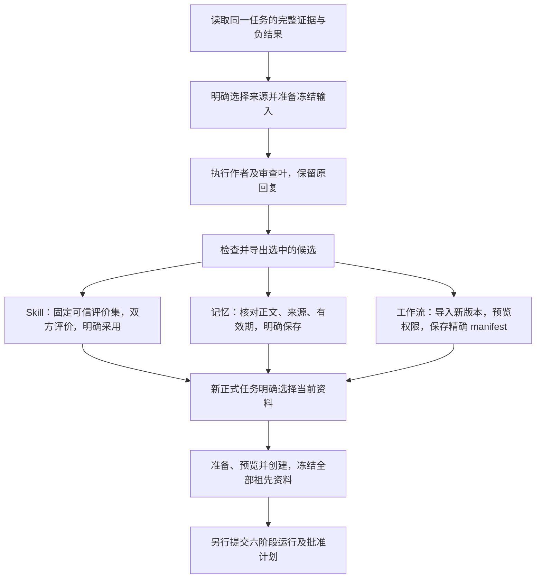

# 从一次复盘到下一次任务

Ergora 把复盘产物分成三个独立的候选：项目记忆、标准 Skill 和工作流版本。你可以只采用其中一种。候选生成、模型审查和导出都不会自动采用；每种产物沿自己的原记录保存，正式任务再明确选择并冻结它们。

开始前按[安装与配置](USAGE.md#选择安装组合)准备环境，登记自己的项目，并配置实际使用的后端。命令中的 `my-project` 是项目 ID；相对文件路径相对于运行 CLI 的目录。网页路径指控制台所在机器可读的目录。



## 准备与检查候选

先[收集和完整读取证据](USAGE.md#完整选择离线证据用于复盘)，保留原任务、run、回执、文件摘要、失败和成本未知项。作者和审查者可选不同后端；有依赖边的静态图仍需按该模板的[单叶调用步骤](USAGE.md#生成来源绑定的skill复盘候选)交接完整前驱，图本身不代表这些叶已经执行。

在控制台的“复盘改进”中选择项目与候选方向，准备完整输入、明确调用所选叶，然后检查原结果并导出。CLI 分别使用 `retrospective prepare`／`prepare-memory`／`prepare-workflow`，检查与导出使用同方向的命令。完整字段和示例见下表。保存每次返回的 input digest、原结果 SHA256、candidate digest 与导出目录；它们标识本次选择，不是质量认证。

|候选|操作说明|明确采用的原接口|
|---|---|---|
|Skill|[完整 Skill 候选](USAGE.md#生成来源绑定的skill复盘候选)|导入目录；固定同一可信 suite；双方评价及 compare；`skill adopt`|
|项目记忆|[记忆候选](USAGE.md#生成来源绑定的记忆复盘候选)|以完整 `memory.txt`、原来源及原 revision 执行 `memory save`|
|工作流|[完整根候选](USAGE.md#生成来源绑定的工作流复盘候选)|`composition import` 新版本；原权限 preview；明确 freeze-manifest|

## 分别采用

**Skill：**导入后续版本只增加候选，活动 head 保持。维护者预先登记可信 suite，固定 evaluator 文件和 train／validation／holdout 案例；生成器不能改评价器或访问被隐藏的 holdout。分别评价原基线和候选，检查完整比较，再说明理由采用。控制台在“Skill 演进”完成这些操作。CLI 的核心步骤如下；摘要和 run ID 使用各命令实际返回值。

```bash
ergora skill import my-project ./candidates/my-skill
ergora evaluation register my-project ./trusted-suite.json
ergora evaluation run my-project BASELINE_DIGEST --suite SUITE_DIGEST
ergora evaluation run my-project CANDIDATE_DIGEST --suite SUITE_DIGEST
ergora evaluation compare my-project BASELINE_RUN CANDIDATE_RUN
ergora skill adopt my-project --baseline-run BASELINE_RUN --candidate-run CANDIDATE_RUN --revision CURRENT_HEAD_REVISION --reason '已审阅完整评价与适用范围'
```

**记忆：**在“长期记忆”明确新增或更正，选择导出的 UTF-8 文件，核对 `receipt.json` 的 source、ID、expected revision 与有效期后保存。导出回执中的 `save.memory_id`／`save.expected_revision` 对应 CLI 的 `--id`／`--revision`，HTTP 的 `id`／`revision`；不是可直接原样提交的 HTTP 请求。新建省略原 ID；更正沿原修订追加，不覆盖历史。更正省略 expiry 参数会保留原期限，恢复过期资料也不会自动续期。

**工作流：**在“Agent 与组合库”明确导入完整目录，关闭回执窗口后点“刷新定义库”，选回执中的精确 ID／版本，再预览并保存完整 manifest。导入会核依赖，缺少子定义直接拒绝；分享单个根目录时需另外提供并导入其精确依赖。导入新版本不修改旧 manifest，也不自动选中或运行。

## 新任务冻结与后续恢复

在 Linux／WSL2 使用[正式任务资料选择](USAGE.md#为正式任务选择项目记忆与活动-skill)：任务定义 v7 在原原生六阶段组合配置之外，显式增加 `context`。下面仅为该字段示例，必须合入自己已配置的完整任务定义。

```json
{
  "context": {
    "root_version": "1.0.2",
    "memories": [{"id": "MEMORY_ID", "revision": 2}],
    "skills": [{"name": "my-skill", "digest": "CURRENT_ADOPTED_DIGEST", "revision": 2}]
  }
}
```

`composition.manifest` 和 `manifest_digest` 指向明确选定的完整工作流；`root_version` 是为本次资料派生的新根版本，须不同于其基线根版本。记忆 revision 和 Skill digest／head revision 必须是当前有效、活动的精确选择；初次导入的 Skill 基线也可选，不代表已测得改善。相关实例须使用 `task-mcp`／`workspace-task-mcp` 交付 Skill 附件。所有父模板资料累加到子实例；资料选择不会扩大父级权限，容量不足时拒绝完整准备。

```bash
ergora task prepare my-project --definition ./task.json --revision PROJECT_REVISION
ergora task preview my-project --definition ./task.json --revision PROJECT_REVISION
ergora task create my-project --definition ./task.json --revision PROJECT_REVISION --prepare-sha256 PREPARE_SHA --preview-sha256 PREVIEW_SHA
ergora task show my-project TASK_ID
```

在“正式任务”选择已创建记录，展开“冻结项目资料与派生根来源”查看原记忆正文、来源、期限和 Skill 精确身份；该区读取任务存档，不读取当前活动资料。

这些步骤创建冻结合同；[提交运行与批准计划](USAGE.md#提交正式任务与恢复未知结果)另行进行。已创建任务携带原完整资料；后续更正、到期、删除、Skill 回退或新工作流版本不会热换它。Skill 附件随冻结包保存，记忆正文在上下文 JSON 中按 JSON 转义保留原 Unicode 和换行。

准备后、首次创建前若来源变化，旧选择被拒绝。先读原创建记录；尚未保存意图时，明确选择当前资料并以新任务 ID 重新准备。已有 pending 意图时按原 ID／intent SHA 恢复，不能用当前资料重编译原任务或重置预算。回复未知也先读原记录，分别使用[创建／提交恢复](USAGE.md#正式任务的操作顺序与恢复)，不靠页面通知推断是否执行。

需要撤回改进时，Skill 对曾活动版本执行有理由的 `skill rollback`；记忆 `restore` 追加历史正文为新 revision；工作流为新任务选择旧精确 manifest。它们的修订规则独立，操作后重新读取当前选择。不要把合成 scorer、模型 approve 或导入成功解释为真实质量、训练性能或外部资源可用性的证明。
