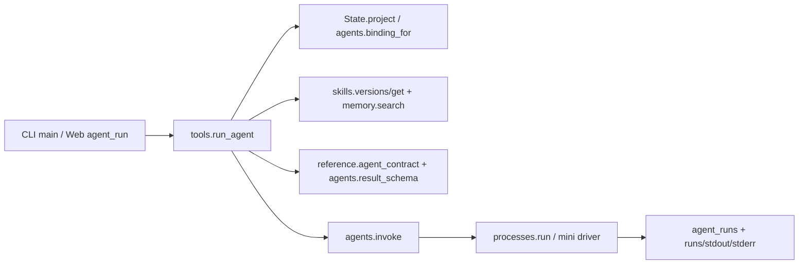
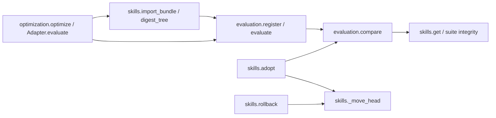
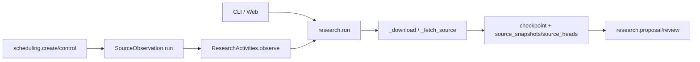
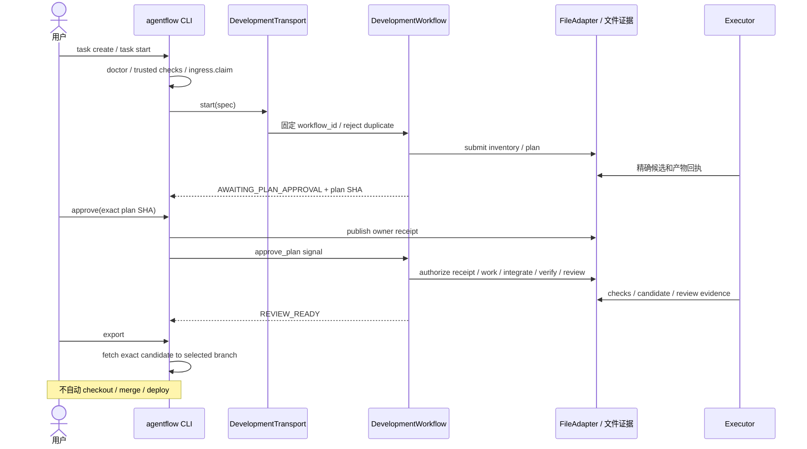
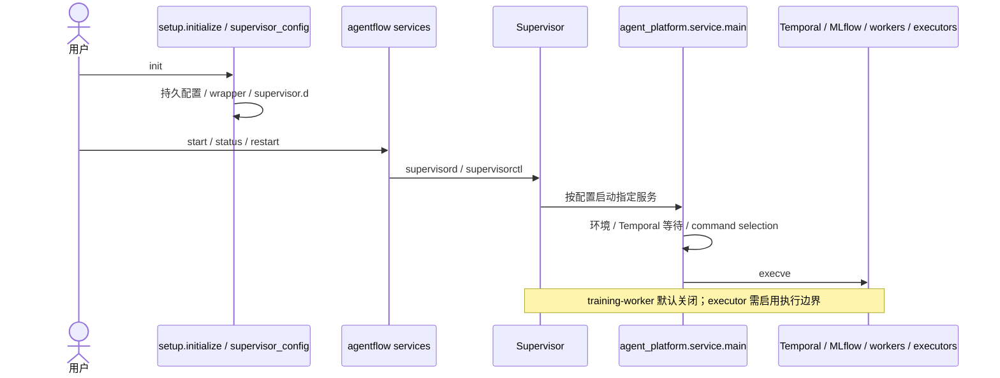
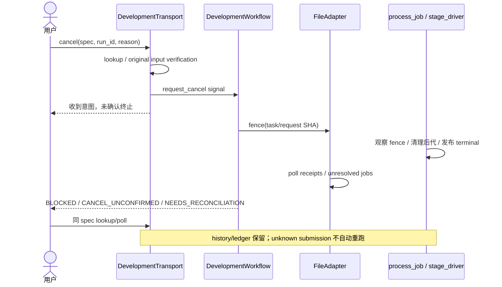

# A1：调用、状态与重构影响审计

日期：2026-11-01。审计基线 `0027f3f9bf9f03a62afe8710970587b66103f7fe`，生产内容与 Windows 交接一致。[计划](../plans/2026-11-01-all-in-one.md) · [原架构快照](2026-11-01-baseline.md) · [源码索引](2026-11-01-source-index.json) · [检查与审查状态](../delivery/2026-11-01-audit.md)。本节点只增补文档，没有迁移或改写运行代码。

## 1. 范围与结论

需要先收拢工具描述、存储初始化和完整用例的所有权，再连接现有正式执行链。没有证据支持重写全部框架、为每个领域增加基类，或同时替换前端技术栈。CLI 与 Web 已共用业务函数；当前主要缺口是同一用户任务跨越两套项目配置和多个操作入口。

一次性 `ast.parse` 快照覆盖 `src/ergora/**/*.py`，排除 `tests/`、`test_*` 和字节码目录。索引保留每文件 SHA、全部函数/方法（含嵌套）的行号、作用域 import、调用表达式及 HTTP 路由，不解析运行时分派。它是日期快照，不是新增运行组件，也不要求日常开发同步重生成。

|源码组|文件|函数（含嵌套）|行数|运行归属|
|---|---:|---:|---:|---|
|自有应用|21|158|3,189|控制面、入口、执行桥接|
|SDK drivers|2|3|130|独立 Python 环境中的 mini / Forge SDK|
|reference local|21|93|2,142|正式执行和安装后的 agentflow|
|reference upstream|45|330|5,014|合同、Temporal、通信、训练等参考模块|
|reference bootstrap|24|117|2,829|安装/报告生成和源码分发镜像|
|合计|113|701|13,304|不是全部处于同一次任务的运行链|

索引中 9,267 个调用是语法位置，不能当作已执行边。Web 显式注册 30 路由（含 `/`，不含框架生成的 OpenAPI）；middleware 和异常处理器单列，不计 API。前端、Shell/PowerShell、包配置、子进程与 Temporal 分派另以源码人工核对，不能从 Python import 图推断不存在。

## 2. 入口、消费者和责任

以下列出全部自有模块的入口组；逐函数行号和调用位置见索引的 `files[].functions/imports/calls`。消费者是生产文件，不把测试、同文件重复调用或未来设想计为复用。

|所有者|实际入口与消费者|主要读写/应保持的边界|
|---|---|---|
|`__main__` / `__init__`|`python -m ergora`、console script → `cli.main`；版本给 CLI/Web|入口及版本，不拥有业务状态|
|`cli`|`parser/main`；pyproject 的 `ergora` 入口|解析参数、读 UTF-8/BOM 输入、业务结果和退出码；Web/Temporal 延迟导入|
|`web`|`create_app`；CLI serve、Uvicorn；页面 `api()` 调用路由|DTO、同源/Host、错误映射、静态资源和聚合；复用业务函数|
|`projects`|`create/list_projects/bind`；CLI/Web|Git 根、默认 bindings、项目 revision；校验调用 tools|
|`tools`|`catalog/doctor/validate_binding`；CLI/Web/projects；`run_agent/runs/output` 给 CLI/Web|同时承担工具目录和独立 Agent 用例，需拆责任；不驱动正式任务|
|`agents`|`binding_for/validate_binding/available/invoke/result_schema/validate_result`；tools、reference_executor、stage_driver|角色能力、命令协议、结果形状和原生调用；不决定可信通过|
|`state`|`State.__init__/connect/project`、`file_lock/now`；多个业务模块及 Web/CLI|目录/连接/锁、projects/agent_runs 初始化；不统领领域状态机|
|`memory`|`records/history/save/delete/restore/search/sync`；CLI/Web，tools recall|项目主数据/修订/删除；ReMe 是检索投影；凭据仅 env 引用|
|`skills`|`metadata/digest_tree/import_bundle/get/versions/export/adopt/rollback`；CLI/Web、tools、evaluation、optimization|不可变文件树、版本头和事件；adopt 当前跨入评分领域|
|`evaluation`|`register/suite/listing/evaluate/get/compare`；CLI/Web、skills.adopt、optimization|冻结 evaluator/数据集、可信评分与比较，不负责改活动头|
|`optimization`|`optimize/listing`，内含 GEPA adapter 和预算回调；CLI/Web|有界候选生成、导入、评价和成本记录；不自动采用|
|`research`|`run/get/listing/cancel/proposal/review`，私有抓取/解码/checkpoint；CLI/Web、scheduling activity|来源策略、下载子进程、快照、预算、去重、恢复与提案修订|
|`scheduling`|`create/control/serve`；CLI 延迟导入；Temporal 调用 `SourceObservation.run` / `ResearchActivities.observe`|调度身份、固定 request、activity → research.run；不另造后台轮询器|
|`drafts`|`listing/save`；Web|编辑输入和 revision；调用 reference 校验；不是正式任务|
|`kernel`|`validate_binding/available/create/operate/listing/get`；tools/CLI/Web|Forge 原生 campaign、绑定快照、全局配置身份和对账；不是可信 benchmark|
|`processes`|`resolve_program/run/cancel_supervised`；agents/evaluation/optimization/kernel/stage_driver|进程/后代生命周期、UTF-8、超时；独立和受监控模式不同|
|`windows_job`|`Job.assign/__enter__/__exit__`；processes、research|Windows 后代清理；不提供文件/网络访问隔离|
|`reference`|`verify/info/copy_template/agent_contract/validate_input/workflow/executor`；CLI/Web/drafts/tools|冻结内容与编译器子进程；正式执行仅 Linux，加载前核对安装身份|
|`reference_executor`|`Executor.__init__/model/receipt`、`process/main`；reference.executor 动态加载|继承原 Executor；新任务冻结绑定、生成阶段替换；原提交/检查/回执保留|
|`stage_driver`|`main/_cancel`；monitor 启动 `python -m ergora.stage_driver`|在专用子进程读凭据、调用 agents、处理取消；不在共享 Web 进程设 subreaper|
|SDK drivers|mini 的 `main`/environment hook；Forge 的 `main`；agents/kernel 经进程调用|独立依赖与真实 SDK 操作；不导入模板定义|

`web.create_app` 的业务路由直接调用上表函数。例外是 bootstrap/dashboard 读取聚合、Skill diff 的文件比较、模板和草稿校验的视图构建；这些没有另一套评分/采用实现。前端 `api()` → bootstrap/dashboard、项目注册/绑定、Agent 运行/输出、记忆、Skill/评价/优化、研究、模板/草稿、kernel；本基线没有正式 `task create/start/approve/export` API。

页面 `app.js` 中 `api` 负责请求，refresh/navigation 管状态，`bindingDialog` 按工具手写字段，各功能 render/dialog 构建 DOM，DAG 使用 Cytoscape。`index.html` 已按 module 加载入口；可逐功能拆 ES modules。无需为拆文件引入 React、构建器或第二个图引擎。

## 3. 五条基线流程对应到函数

独立 Agent 调用会冻结 project_revision、binding、Skill digest、记忆召回和 prompt SHA；是同步用例。它的 `succeeded` 只表示进程/结构化输出成功。工具目录和此上下文/运行记录编排分开后，实际消费者仍为 CLI/Web，两者共用完整用例，不增加只转发一层的服务对象。

```mermaid
flowchart LR
  Create[agentflow projects.create_task] --> Compile[contracts.make_spec / portable compile]
  Compile --> Start[cli.task_action / DevelopmentTransport.start]
  Start --> WF[DevelopmentWorkflow.run]
  WF --> Stage[stage / units / approval]
  Stage --> Activities[Activities.submit/poll/authorize/fence]
  Activities --> Adapter[FileAdapter]
  Adapter --> Exec[Executor.execute]
  Exec --> Model[reference_executor.Executor.model]
  Model --> Monitor[Sandbox.run / process_job.run]
  Monitor --> Driver[stage_driver.main / agents.invoke]
```

`inventory → plan → approval → work DAG → integrate → verify → review` 的顺序和可信边界归 workflow / Activities / Executor。选择性执行器只覆盖 model/actor receipt：首次冻结四角色绑定，已有 receipts 的旧任务拒绝切换；恢复读取冻结值。`integrate/verify` 不委托给 Agent 自报通过。

`skills.adopt → evaluation.compare → skills.get` 是真实职责环。应上移“比较后采用”的用例，而资产模块保留原子 revision / expected digest 检查；不删除比较、holdout 或 correctness 门禁。回退仍须目标曾为活动版本和操作者理由。

Temporal `activity` 和本地网络抓取进程是两级生命周期。`cancel` 写持久意图，run 的 check/progress 观察后才确认；取消请求不等于已停。`reviewed` 资料提案不会自动修改 Skill/代码/评分规则。

```mermaid
flowchart LR
  Campaign[kernel.create/operate / _call] --> Driver[Forge driver main]
  Driver --> Native[原生 campaign / native 状态]
  Native -. 当前人工转交 .-> Prepare[training.prepare]
  Prepare --> Start[操作者 training start / worker-start]
  Start --> Workflow[ExperimentWorkflow.run]
  Workflow --> Adapter[LocalTrainingAdapter]
  Adapter --> Request[create_job_if_absent 写 request.json]
  Operator[操作者 run-local + exact manifest SHA] --> Runner[training_executor.process / Sandbox.run]
  Request --> Runner
  Runner --> Archive[perfctl / comparator / evidence archive]
  Archive --> Result[result.json + gate-report.json]
  Result --> Gate[Adapter.poll_job / collect_and_gate]
  Gate --> Owner[authorize_release_and_create_task]
```

训练规划/性能分析/kernel 角色经通用 agents 生成建议；实际训练有独立 Binding/runner/manifest/evidence 合同。`prepare` 返回 `started=False`，还需 `training start`；控制 worker 的 `create_job_if_absent` 只写 request.json。操作者等任务排队后执行 `training run-local <id> --confirm-manifest-sha <sha>`，才会调用 training_executor.process 并发布 result/gate 文件；worker-start 明确返回 `automatic_training_execution=False`，Supervisor 没有自动训练 executor。F9 要保留或显式设计这条人工执行边界，不能把现有训练控制接线当成自动 runner。

`native_finished` 只代表 Forge 原生调用完成；`outcome_unknown` 必须对账，禁止据此重提。训练 release 核对归档 gate 和 owner 指定 evidence SHA。没有证据支持把训练压入开发六阶段，或把 MLflow 指标当可信通过。

## 4. 正式入口、部署与取消恢复

`DevelopmentTransport.start` 捕获 already-started 后调用 `lookup`，读取原 history 的第一个 input 比较完整 spec；不是“同 ID 就复用”。Transport 的 `poll`、FileAdapter 的 `poll` 与 Forge status 分别拥有不同事实，不应合为一个无语义的 polling helper。

Ergora `serve` 只启动控制台；reference Supervisor 管正式执行依赖。安装器不是状态机：Python wheel 自带冻结资料；Linux/PowerShell 安装器装应用和选用 extras；`install-agent.sh` 单独安装固定版本 SDK；完整 reference 安装器还负责其工具链/配置。当前不能把控制台可启动视为正式运行已就绪。

恢复使用 Temporal history、任务文件、作业 ledger 和 process submission/terminal 文件共同对账。原 `process_job.run` 检出旧 submitted/无 terminal 会拒绝自动重执行；不是通过清掉 running 行恢复。只有 worker/服务重启不要求创建新任务；外部作业终止未确认时也不能释放为成功。此图为源码控制路径，不是本轮新跑的分布式故障注入结果。

## 5. 数据、配置与摘要的归属

|所有者|表/资产|更改影响|
|---|---|---|
|State/projects/tools|`projects`, `agent_runs`；运行目录|项目 revision、binding 快照、独立调用结果|
|drafts|`drafts`|只影响输入编辑，不写正式 history|
|memory|`memories`, `memory_mirrors`|canonical 修订与删除；镜像要传播，不改已冻结任务输入|
|skills|`skill_versions`, `skill_heads`, `skill_events`；Skill 文件树|身份、活动头、采用/回退历史|
|evaluation|`evaluation_suites`, `evaluations`；evaluator/case 文件|评分输入和可信身份，非生成器可改写的策略|
|optimization|`optimizations`；候选/proposal 文件|预算/父候选/评价关联|
|research|`research_runs`, `research_proposals`, `source_heads`, `source_snapshots`；来源快照|取消、预算、dedup 和提案归属|
|kernel|`kernel_runs`；Forge SDK 原生产物|冻结绑定、未知状态与对账证据|
|reference|独立 CONFIG/STATE、`jobs` ledger、共享 ingress leases、任务/回执/产物/批准|正式事实不能偷偷迁入控制面 SQLite；在途任务固定引擎|
|Temporal / MLflow|history/schedules；实验 metrics/artifacts|前者拥有编排，后者用于观测，均不由页面自造状态替代|

基础 State 两表、各域 `_schema`、drafts/kernel 内联 DDL 是真实分散点；目前没有 DB version/ordered migration。应集中 DDL/升级边界，保留各域事务和查询，不加万能 JSON repository。Sqlite 和文件资产要一起备份核对。

摘要须按原规范保护：

- `dev_platform.contracts.canonical_sha` / adapter canonical 使用排序、UTF-8、紧凑分隔符、拒绝 NaN；批准绑定不得重算为其他 JSON 编码。
- `evaluation._sha` 使用排序、`ensure_ascii=False`、默认分隔符、拒绝 NaN；并冻结 evaluator 文件及路径目标。
- `skills.digest_tree` 对路径 → 文件 SHA + executable_bits 的映射使用原 JSON 规范；目录 digest 与文本 SHA 不是同一种身份。
- `reference.validate_input` 的输入 SHA 和 prompt/raw-file/source SHA 各有原编码；同为 SHA256 不构成可互换依据。优化内部文本 SHA 用于父候选映射，不能代替完整 Skill digest。

配置来源现为：控制面 SQLite 项目/bindings；reference CONFIG 项目/策略/adapter；CLI flag/env 的 home 路径；模板 JSON；SDK 原生配置。F1 应提供单一项目入口并单向投影到 reference，新默认只影响新修订。凭据保留运行时读取，不进入可分享项目定义。Web DTO 是可选 Web 依赖，不意味着核心 CLI 已有 Pydantic。

## 6. 可执行的保留、合并与删除清单

|候选及已确认触发|结论与最小变更|后续节点/验证|
|---|---|---|
|agents 能力/CHOICES、tools catalog/doctor、projects 默认、JS bindingDialog、安装配方需同步|集中静态组件描述和默认值；probe/validate/执行保留原所有者；JS 消费字段描述|R1；全部绑定接受/拒绝、默认与真实安装状态兼容|
|tools.validate_binding 的 Agent 提前 return；非 Agent CATALOG 无 codex/claude/command|`allowed` 内三项、model 检查及 tool==command 块对当前目录不可达，可删除；不能删 GEPA 调用 Agent 校验的递归分支|R1；遍历 CATALOG 和所有调用者，保留未知字段拒绝|
|skills.adopt → evaluation.compare → skills.get|采用编排上移用例，资产保留原子移动；tools.run_agent 的 context/run 也属于用例|R4；CLI/Web 都切同一所有者，旧入口退出办法单列|
|多域 `_schema` 与内联 DDL|初始化/版本迁移下沉存储边界；领域查询不迁为万能仓库|R3；旧库升级/重开/冲突/回滚/新版本拒绝|
|多种 digest、JSON 读写和 schema|摘要按语义命名、同规范才合并；公共结构验证集中，业务修订/证据仍各域拥有|A2/R2；golden identity 与 CLI/Web 输入矩阵|
|app.js 混合 API/state/工具表单/图和功能页面|按现有消费者拆原生 ES modules；共享描述驱动表单|R7；页面操作、延迟响应、窄屏、相同业务调用|
|local 与 bootstrap/local 的 21 组逐字节一致文件|保留冻结分发镜像；安装器从 bootstrap/local 复制，报告生成维护两前缀；不是删除清单|R6；283 文件身份，另版本迁入，不原地改冻结包|
|processes.run / research._download 都创建子进程|保留差异：命令 IO 与受控网络抓取的通信/预算/父进程死亡处理不同；共享 Job 已存在|R5；无必要不抽新层；后代存活/控制器退出反例|
|POSIX 独立 process group、专用 stage_driver subreaper、Windows Job|同操作契约下保留平台/模式实现，不能互相替换；Job 不升级为 sandbox|R5；真实两 OS 与 Linux 专用受监控验收|
|reference_executor.Executor 与 mini environment 的继承|保留外部框架的实际 hook；模板与 Agent 不建继承树|R6；新任务冻结绑定、receipt/检查一致|
|DevelopmentRuntime / DevelopmentAdapter / ClusterAdapter Protocol|复用现有契约，保持开发与训练差异；不新造覆盖全部功能的 Agent/Backend 基类|R5/R6/F3/F9；固定原状态/取消/批准语义|
|Web/CLI 都调用项目、资产、评价等函数|已复用，不再抽第二个代理服务层；只移完整跨域用例|R4/R7；两个入口对相同业务结论一致|
|各种 status/list/poll 和 revision SQL 相似|保留领域差异；统一摘要是读取投影，不合并事实状态机；revision 在事务内|R3/F4/F5；unknown/取消/过期 revision 不变|

本审计没有提出彻底重写任何算法。删除名单仅限已证明的 tools 遗留分支；后续若发现不满足合同的反例，先记录，再在对应节点修正。

## 7. 修改范围与接入成本

|变更|当前真实同步位置|目标范围与依赖保护|
|---|---|---|
|兼容 Agent|agents 的能力/选项/调用、tools 的展示/probe、JS、安装文档/脚本|组件描述 + 自身 adapter/recipe + 合同测试；不动模板/可信检查；新执行能力仍需代码|
|模板或 work DAG|模板/profile/schema、reference.agent_contract 与模板映射|兼容模板只改声明；阶段语义变化必须版本化；不允许画布删除可信阶段|
|OS 支持|processes、Job/文件读取/锁、安装器、doctor 与真实 OS CI|保留平台差异；不迫使评分/业务层加入 OS 分支|
|新存储/检索|对应域及配置，ReMe 同步已有独立边界|canonical 仍原域；不让搜索返回改变采用或批准身份|
|工单/通信|reference Symphony/A2A、IngressLeases、DevelopmentTransport|逐项目入口复用原任务合同；不要求本地项目设置远端工单|
|正式任务页面|当前缺业务用例/API，不能只增加前端按钮|F3 连接已有 runtime、F4 展示；页面不导入 Temporal/Executor|

后续依赖的选择：继续用 Temporal 的持久化、sqlite3/Git 的本地事实、MLflow 观测、Cytoscape 图、SDK 和现有 Protocol；字段 schema 可复用 JSON Schema，A2 比较校验库后决定。项目/任务的精确身份、受信任检查授权、采用/回退和多层工具组合属于本项目规则，需要自己维护。先不接插件发现框架、通用迁移 ORM、第二个调度器或流程 DSL。

下一步 A2 固定旧数据/摘要与边界夹具、可复跑命令、实际操作成本，记录 schema/注册/reference/状态权威 ADR。R1–R8 按上述证据收缩范围；每节点更新计划与交付并独立审查，不能仅以文件移动或抽象数量验收。
