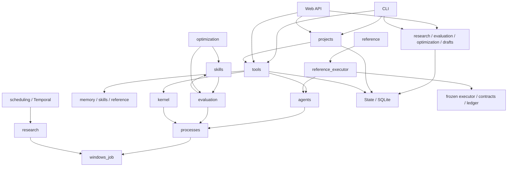
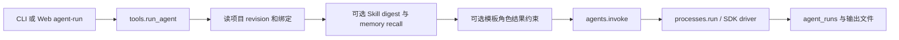
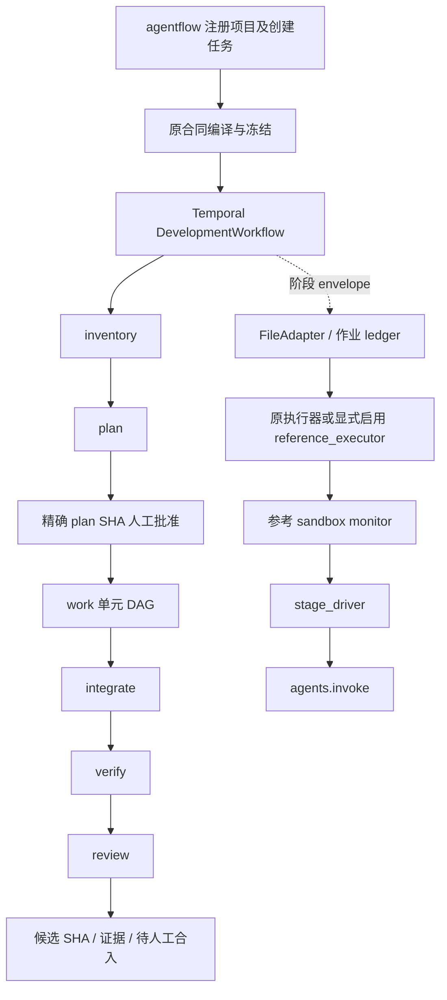
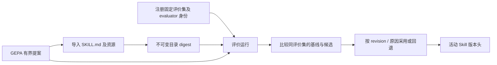
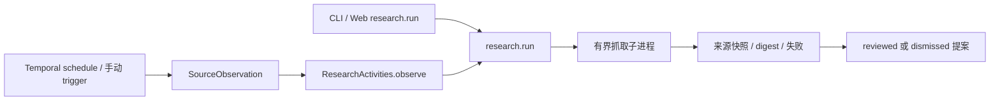
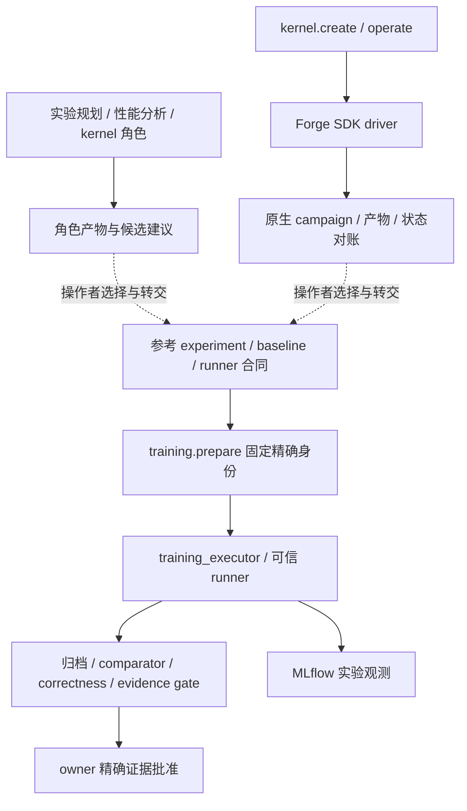

# Ergora 架构基线与重构依据

日期：2026-11-01。源码基线：`44c1c94d8c34ac3d6179eba91dfcd194ea9b005a`（`feat/windows-support`）。这是源码盘点与设计依据，不代表本轮重新执行了运行验收。执行顺序与进度以 [总计划](../PLAN.md) 和 [下一阶段详细计划](../plans/2026-11-01-all-in-one.md) 为准。

## 1. 结论与证据边界

目前有可用的协作合同、执行参考、演进资产和原生控制台。距离 all-in-one 的主要差距是：项目配置尚需在两个体系注册，控制台没有正式任务的完整操作闭环，长任务操作、证据关联、安装运维和扩展描述尚未统一。不能从“递进开发”直接推断代码已经极其混乱。

本轮 AST 盘点：自有顶层 Python 21 文件，加两个 SDK driver，共 23 文件、3,319 行；控制台 `app.js` 为 2,108 行。另有 283 个冻结参考文件；上述行数不包含它们、测试、安装脚本或第三方前端库。较小的自有代码量支持逐项调整，不支持无证据地整体重写。

|证据|已确认事实|不能推导的结论|
|---|---|---|
|顶层模块 AST、关键函数及调用者|CLI/Web 大量共用应用函数；工具描述分散；Skill/evaluation 有延迟依赖环|静态 import 图不能证明全部动态调用与运行行为|
|[Windows 交付记录](../delivery/2026-11-01-windows.md)|既有 Linux 回归及 Windows/Ubuntu CI 已交付，运行代码身份 `9c196a9`|本轮文档编辑不等于重新验收模型、GPU、ReMe 或空白系统|
|`git ls-remote --symref`|远端没有 `main/master`，HEAD 指向 `research/multi-agent-evolution-20261028` 的 `3b52365`|创建 `main` 不等于修改 GitHub 默认分支|
|`git merge-base --is-ancestor`|`3b52365`、`4c7426a` 都是 `44c1c94` 的祖先|实施时远端可能变化，仍需重新核对|
|[代表性工具调研](../research/2026-10-28-multi-agent-landscape.md)、[持续演进调研](../research/2026-10-28-continuous-evolution.md)|已有多种可复用框架、协议与产品能力|没有穷尽市场，也未证明 Ergora 的模型效果优于其他产品|

本轮只核查公开资料、源码和 Git，不改生产实现、数据格式、冻结文件或默认分支。

## 2. 当前模块与直接依赖

以下为自有实现。表内是主要责任与生产依赖；函数内延迟 import 也计入。冻结包内部的细粒度调用留在其原架构文档，后续 A1 要为真正迁移的部分继续下钻。

|模块（行数）|当前责任|主要依赖与调用者|
|---|---|---|
|[cli.py](../../src/ergora/cli.py)（325）、`__main__`（4）、`__init__`（3）|命令解析、输出与入口|调用项目、工具、记忆、Skill/评价/优化、研究/调度、kernel、reference；Web/Temporal 延迟加载|
|[web.py](../../src/ergora/web.py)（288）|FastAPI、请求 DTO、同源/Host 边界、静态资源、dashboard 聚合|调用相同应用函数及 drafts；不是第二套独立业务实现|
|[projects.py](../../src/ergora/projects.py)（54）|Git 根注册、默认绑定、带 revision 的变更|State；向 tools 借用绑定校验；CLI/Web 调用|
|[tools.py](../../src/ergora/tools.py)（200）|层目录、doctor、独立 Agent 调用编排、运行查询与日志|agents、kernel、processes、State；运行时载入 memory/skills/reference；CLI/Web/projects 调用|
|[agents.py](../../src/ergora/agents.py)（184）|角色能力、绑定校验、可用性、结构化结果、工具命令分派|processes；tools、reference_executor、stage_driver 调用|
|[state.py](../../src/ergora/state.py)（74）|目录解析、SQLite 连接、两张基础表、跨进程锁、时间|各业务模块共用；不拥有所有业务状态机|
|[memory.py](../../src/ergora/memory.py)（185）|项目记忆、修订/删除/恢复、SQLite 检索、ReMe 投影同步|State/file_lock；CLI/Web、独立 Agent 的 recall 调用|
|[skills.py](../../src/ergora/skills.py)（169）|Skill 目录身份、导入/导出、版本头、采用/回退|State；adopt 延迟调用 evaluation.compare；CLI/Web、tools、evaluation、optimization 调用|
|[evaluation.py](../../src/ergora/evaluation.py)（226）|评价集及 evaluator 身份冻结、执行、比较|skills、processes、State；CLI/Web、skills.adopt、optimization 调用|
|[optimization.py](../../src/ergora/optimization.py)（192）|有界 GEPA、提案命令、评价回调、候选记录|evaluation、skills、processes、State；CLI/Web 调用|
|[research.py](../../src/ergora/research.py)（358）|来源校验、子进程抓取、预算/取消/恢复、快照及提案审阅|State/file_lock、Windows Job；CLI/Web/Temporal activity 调用|
|[scheduling.py](../../src/ergora/scheduling.py)（107）|研究任务 Temporal workflow/activity、schedule、worker|research、State、Temporal SDK；CLI 调用|
|[drafts.py](../../src/ergora/drafts.py)（32）|保存和修订可编辑输入|State、reference.validate_input；Web 调用；草稿不等于正式任务|
|[kernel.py](../../src/ergora/kernel.py)（158）|Forge 绑定、campaign 操作、原生状态和不确定结果对账|processes、State/file_lock、Forge driver；tools/CLI/Web 调用|
|[processes.py](../../src/ergora/processes.py)（163）|程序解析、UTF-8 IO、进程与后代生命周期、超时、取消|Windows Job；agents/evaluation/optimization/kernel/stage_driver 调用|
|[windows_job.py](../../src/ergora/windows_job.py)（91）|Win32 Job Object 生命周期|processes/research 共用；不是安全沙箱|
|[reference.py](../../src/ergora/reference.py)（163）|冻结内容校验、模板补充合同、编译入口、执行入口适配|隔离编译子进程；Linux 执行时载入 reference_executor；CLI/Web/drafts/tools 调用|
|[reference_executor.py](../../src/ergora/reference_executor.py)（165）|选用新角色绑定，继承原执行器的提交、验证和回执|agent_platform、dev_platform、agents、State；依赖原 CONFIG/STATE 与 ledger|
|[stage_driver.py](../../src/ergora/stage_driver.py)（48）|监控器内 Agent 子进程入口、凭据读取及取消请求|agents、processes；reference_executor 的 sandbox monitor 启动|
|[mini.py](../../src/ergora/data/drivers/mini.py)（67）、[forge.py](../../src/ergora/data/drivers/forge.py)（63）|真实上游 SDK 的独立环境入口|mini-swe-agent / ForgeKernel；不是模板自身的 Agent 实现|
|[app.js](../../src/ergora/data/console/app.js)（2,108）及 HTML/CSS|页面状态、请求、绑定表单、图、资产操作|Web API、Cytoscape；绑定字段仍按工具分支手写|
|[安装脚本](../../scripts/install.sh)、[PowerShell 安装器](../../scripts/install.ps1)、[Agent 安装器](../../scripts/install-agent.sh)|用户目录安装与可选 SDK 环境|pyproject extras、源码资产；参考运行时还有独立冻结安装器|

这是主要依赖的概览，省略了部分 State 边和入口分派边。`skills → evaluation → skills` 是函数层真实依赖，不是顶层 import 时立即报错的循环。

## 3. 五条真实调用流程

### 3.1 独立 Agent

这个调用可写代码或生成角色产物，但不代表经过正式六阶段和可信验收。当前 Web 调用是请求内同步执行，日志读取有大小上限；没有统一的持久后台派发、跨操作取消和全局事件流。进程返回的成功也不是证据通过。

### 3.2 正式开发任务

选用 Ergora executor 的新任务，在首次接入时从同名、同 Git 根的 Ergora 项目冻结四个角色绑定。恢复使用冻结值，不切换 Agent。`integrate/verify` 继续归可信执行器，角色生成器没有权力自报通过。当前控制台的草稿/DAG 页面只校验输入，没有创建、批准并驱动这条正式链；双注册与服务接线是实际缺口。

### 3.3 Skill、评价与 GEPA

已有完整的候选、评价、采用/回退能力；GEPA 不自动采用。应把跨资产与评分的采用编排放到恰当所有者，不能通过删除评价依赖来绕开门禁。

### 3.4 来源观察与调度

研究提案经人审阅后仍是资料资产，不自动改代码、Skill 或审批策略。Temporal 持久调度与本地网络子进程取消是不同层次，重构不能把取消请求等同于远端停止确认。

### 3.5 kernel 候选与正式训练

虚线是当前人工转交，尚无统一自动桥接。Forge 的 `native_finished` 不是项目验收通过；`outcome_unknown` 需要对账，不能无条件重跑。训练有自己的 workload/实验/runner/证据合同，不强塞进开发六阶段。GPU 性能收益须实测。

## 4. 配置、代码与数据的权威归属

|对象|当前格式与所有者|版本、修改与迁移要求|
|---|---|---|
|应用及可选依赖|`pyproject.toml`；Python >=3.11；基础 PyYAML；Web/GEPA/Temporal extras|版本锁与支持矩阵单独维护；不把所有 SDK 塞进默认环境|
|控制面项目|SQLite `projects.document` JSON；`schema_version=1`、`revision`、repo、bindings|`BEGIN IMMEDIATE` + expected revision；现在没有正式的 DB schema 迁移序列|
|默认值与工具能力|agents 常量、tools.CATALOG/doctor、projects.create、JS 表单、安装器|同一新增工具可能需要多处同步；应由一个描述所有者生成消费者所需视图|
|边界校验|核心 Python dict/显式校验；Web 额外 Pydantic DTO（禁止额外字段）|Web 依赖是可选；不能默认所有 CLI 用户已有 Pydantic|
|模板与关系|JSON profile/roles/input/output schema；模板目录；复制时附加 agent-contract.json|模板只声明角色与验收；六阶段固定，工作单元依赖 DAG 可调整；布局不是执行合同|
|可移植开发合同|Task / Package / Policy / Binding、compiled JSON 与 canonical SHA|冻结内容与批准身份要保留；转换或新版本不可静默重算旧批准|
|Agent 命令协议|普通 stdin 文本；`stage-json-v1` 的 stdin JSON / stdout JSON 结果|结构化命令须声明能力；未知协议必须拒绝；成功进程不等于可信验收|
|Skill|标准 `SKILL.md` YAML frontmatter + 资源目录；digest/版本头/evidence 在控制面|目录摘要含资源及可执行位；不要改成私有 Skill DSL|
|评价及优化|SQLite 文档、固定 evaluator 文件与输入、文件产物|评价 manifest 有版本，其他文档并非都显式带 schema version；须有按域的升级策略|
|记忆|SQLite 主数据、修订和删除记录；ReMe 是远端检索投影|ReMe 不拥有正式主数据；删除/纠错传播到投影；已冻结证据身份按保留策略处理|
|资料/提案/Forge|SQLite 文档及快照/SDK原生产物；Forge 保留 native 状态|本地视图不得覆盖原生不确定状态；重复提交和恢复按各域语义处理|
|参考配置与执行|JSON platform/projects/policies/adapter、Codex TOML、credentials 文件、环境变量|参考 CONFIG/STATE 与 Ergora home 分离；仍依赖安装目录和导入路径|
|正式任务/作业状态|Temporal history + 参考任务文件、receipts/artifacts + SQLite jobs ledger|分别拥有编排历史、证据、作业提交事实；统一视图不能创造第二套正式状态机|
|实验观测|MLflow run/metrics/artifacts|只作为观测关联，不能替代 comparator/可信证据|
|生成文件与发布资产|build/wheel、日志、运行目录；冻结 HTML/ZIP 与 manifest|生成物不作为编辑源；283 冻结文件和旧 HTML 保持身份；以后新发行另行版本化|
|用户路径与凭据|Linux XDG / Windows LocalAppData；`--home`、`ERGORA_HOME` 优先|长期数据在用户持久目录。新声明只保存凭据引用，不把密钥值导入项目/日志/导出包|

统一配置入口不意味着把以上所有状态强行合为一个数据库。应统一身份和读取/操作边界，各域继续拥有自己的事实。

## 5. 重复、必要差异与处理建议

|观察|分类|最小处理与保护|
|---|---|---|
|工具字段、平台/能力/操作说明散落 Python、JS、安装脚本|已确认的同步维护点|集中组件描述；运行时 probe 与安装配方分离；CLI/Web 消费同一 schema|
|tools.validate_binding 提前委派 Agent 后仍保留 command/model 分支|疑似不可达遗留|先按 CATALOG 和所有调用者验证可达性，随后删除；不凭代码相似直接删|
|skills.adopt → evaluation.compare → skills|真实职责环|把“比较证据后移动版本头”的编排上移应用层，保留资产与可信评价各自职责|
|多个 `_schema`、SQLite 文档和连接操作|部分重复、部分领域所有权|DDL/迁移归存储层；不同事务不机械统一成万能 repository；必要时增加特定查询接口|
|不同 `_sha`、canonical JSON、Skill digest|相似但不是同一规范|明确命名/规范和 golden fixtures；只有输入域、规范、调用合同都相同才合并|
|Agent/research/evaluation/Forge 都有 status/run|共同展示需求，不是同一状态机|统一运行摘要及错误/产物引用，保留各自 native state、未知/对账和预算语义|
|processes 与 research 都启动并清理子进程|已有共用 Windows Job；POSIX监控模型不同|只下沉验证过的生命周期原语；不拿通用 subprocess 包替掉现有取消与后代清理保证|
|Linux process group/subreaper 与 Windows Job|必要的平台差异|共同操作契约、平台差异化实现；不能共享未经验证的清理路径|
|reference_executor 继承原 Executor，mini driver 继承上游 environment|现有框架钩子，有具体用途|先隔离依赖；外部框架要求的继承可保留。模板/角色/工具不应形成继承树|
|Web DTO 与核心校验|传输结构与业务不变量有不同责任|字段 schema 统一来源，传输和领域错误映射分开；修订/权限/证据等判断只由业务所有者决定|
|app.js 同时负责请求/状态/表单/页面/图|已确认的集中度与工具耦合|按真实功能拆 ES modules，保留现有 DOM/Cytoscape；先不引入全新前端栈|
|新控制面与冻结 reference 双项目/配置入口|最主要的产品缺口与迁移边界|统一 project/application 入口，reference 保留为版本化 adapter；新任务写同一有效快照，在途任务不换引擎|

这些是基线建议。函数级删除名单、接口签名和最终迁移目录由 A1/A2 审计后定案；“彻底重新实现”只在现有实现无法满足已确认合同且有反例时采用。
