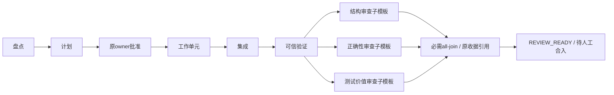
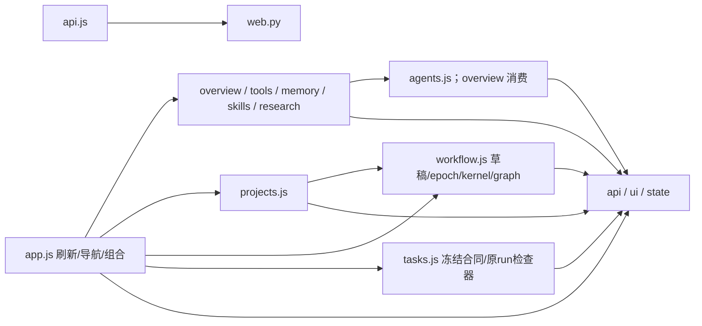
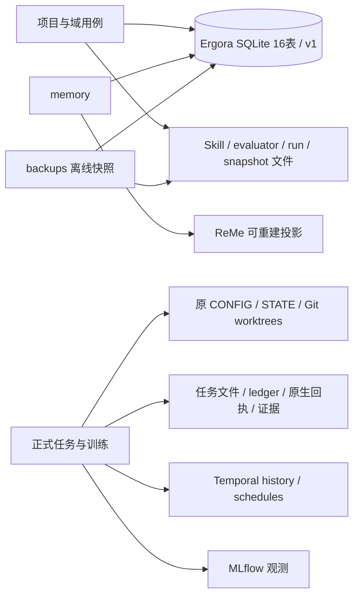

# 当前架构与扩展边界

AC4.2a 新增 WorkflowDefinition v2 的实例级 `review_requirement`，由原完整包检查选择严格版本，原编译器投影到各 reviewer 叶子；任何递归 v2 定义使静态预览版本为 2，固定包及备份保留原内容。全 v1 定义/预览保持，AgentDefinition 与库索引不换格式。正式信封 v2 的运行仍只接受预览 v1，新图在任务准入及运行形状检查明确拒绝；可信建议审查接线属于 AC4.2b。[职责格式](../WORKFLOW_DEFINITIONS.md#必需与建议审查的静态声明)与[分片记录](../delivery/2026-11-09-review-requirements.md)区分静态声明和已执行的审查。

2026-11-09补充：原v1六阶段继续使用单角色绑定；v2在同一六阶段的review内支持单叶或多个嵌套只读审查分支，经显式必需all-join汇合。AC2的局部后端适配器与AC3a/d的[专家库](../AGENT_DEFINITIONS.md)、[嵌套图/继承编译](../WORKFLOW_DEFINITIONS.md)保持职责分离。完整叶子输入、只读任务MCP与共同能力准入由AC3b拥有；完整静态manifest、正式信封及原运行身份由AC3c拥有。AC4.1复用同一Temporal与执行账本：稳定实例路径映射各自stage/job，祖先共享配额控制并发，汇合只引用原收据，不新增模型批准或调度器。通用串行依赖、建议性审查、写执行者分配与页面仍按[AC计划](../plans/2026-11-08-agent-composition.md)推进，实际验收状态见[本片记录](../delivery/2026-11-09-parallel-reviews.md)。

2026-11-05，R8后的当前导航，覆盖F1项目定义、F2安装/运维、F3正式任务CLI/API生命周期与F4网页消费者。F3已通过[阶段验收](../delivery/2026-11-03-f3-completion.md)，F4的创建/原ID恢复、原运行/计划/批准/取消/对账/导出及有界事件/job文本均已实现，[完整页面收口](../delivery/2026-11-05-f4-completion.md)的恢复与服务退出验收单独登记。F5.1只读证据索引与F5.2预算/用量事实CLI/API均已交付；F5.3a原生交接包及离线校验已实现，验收单独登记，F5.3b显式HTTP下载已实现，发行与真实下载验收单独登记，F5.4页面的发行/浏览器及独立审查、精确提交/双OS CI和同片终结通过；F5.5实际服务恢复组合、新综合独立审查与纯文档精确交付/远端终结通过，完整F5完成；G0全新用户旅程独立进行。历史[A1审计](2026-11-01-audit.md)及[R8记录](../delivery/2026-11-02-refactoring-exit.md)保留原身份与范围。设计约束见[ADR0001](decisions/0001-refactoring-foundations.md)/[0002](decisions/0002-static-boundaries.md)。

AC3c.2的`task_envelopes`保存版本化正式信封，完整静态包、成员选择与原`legacy_spec`共同参与身份；历史读取不依赖当前后端目录。AC3c.3/CR1新增可选SDK边界`reference_workflows`，通过局部`WorkflowInput`接口选择原入口或`ErgoraCompositionWorkflowV2`；新版继承原六阶段，只在stage context附完整信封，并使用专用`ergora_composition_submit`活动，避免旧worker派成单Agent请求。`VerifiedSpecClient`先核原始单payload的完整JSON身份，再向原Transport交付兼容投影。CR2/3接通双版本worker、原owner批准和受监控executor。公开start/status支持单个纯只读review叶，AC4.1扩展为显式all-join的多个嵌套只读成员；每叶和全部结构祖先输入须直接映射至根task且没有依赖。运行态父输出仍拒绝。常驻executor从局部版本合同扫描两请求根，复用原并发预算/receipt/rejection，不另建调度器。真实安装包公开CLI/Temporal旅程两v2加v1各6原receipt及历史重放已通过；Agent为合成协议、实际模型自审单列。最终独立交付及Supervisor/故障恢复边界见[运行桥](../delivery/2026-11-09-composition-runtime.md)和[本片原件](../delivery/2026-11-09-composition-public-runtime.md)。

CR2a在同一版本所有者增加双队列/请求根与活动构造；`reference_worker`通过原生SDK同时管理两个Worker，Supervisor消费`reference.worker_command`。v2使用`.composition-v2`队列与`requests-composition-v2`目录，原poll/authorize/fence依队列绑定各自FileAdapter，避免旧worker漏查新版请求；submit沿CR1名称，旧history不换协议。实际接线/包与独立出口见[worker记录](../delivery/2026-11-09-composition-workers.md)，原生bootstrap只解析选中的Ergora包供SDK沙箱重新导入，其余依赖保持所选原生环境；停止信号覆盖连接和完整Worker清理。这条CR2a历史验证没有覆盖Supervisor完整栈；后续有限v2入口及其实际旅程见上一段，Supervisor完整生命周期仍归CR4。

正式开发的并行审查仍发生在同一个六阶段工作流内：



每条审查分支沿自己的结构父链完整加载Skill与上下文，独立会话检查同一候选。任一必需分支失败、取消或缺失都不能到达Ready；仍交原stop/fence与外部对账处理。

## 模块与依赖

自有Python仍为单包`ergora`；F1.2增加完整注册用例`registrations`，F2.3增加显式服务用例`services`，F3.1增加项目范围的正式任务查询`tasks`，F3.2在同一用例接入预览/创建/恢复，专用`reference_task_creation`拥有原生编译/发布生命周期，F4.4的`reference_task_events`与`reference_task_evidence`分别拥有有界原事件、原job回执及文本窗口查询。F5.3的`handoff`依赖合同基础库，AC4.1与线上证据索引共同消费`task_envelopes.outcome_reference_state`核原作业完整引用；它拥有受限ZIP格式及离线内部身份校验；原生收集和CLI验证分别消费它。AC2为四种既有后端增加局部`AgentBackend` ABC及工厂；没有为每种专长创建Python类、空子包或通用插件容器。下图表示当前调用方向，组合节点内的模块并非互相依赖；精确导入由静态检查和源码确定。

```mermaid
flowchart TB
  CLI[cli.main] --> Query[projects / tools / memory / drafts / research / kernel]
  Web[web.create_app] --> Query
  CLI --> Registration[registrations]
  Web --> Registration
  Registration --> Query
  CLI --> Services[services]
  Web --> Services
  CLI --> Tasks[tasks]
  Web --> Tasks
  Tasks --> Bindings
  Tasks --> Ref
  Services --> Registration
  Services --> Ref
  Services --> Supervisor[Supervisor Unix RPC / native launcher]
  Registration --> Ref
  CLI --> Uses[agent_runs / skills / optimization]
  CLI --> Definitions[agent_definitions 静态专家库]
  Definitions --> Native
  CLI --> Composition[workflow_definitions 静态图/继承编译]
  Composition --> Definitions
  Definitions --> Bundles[definition_bundles 完整资源/原子版本库]
  Composition --> Bundles
  Bundles --> Tree[asset_trees 完整树身份]
  Bundles --> Assets
  Web --> Uses
  Uses --> Assets[skill_assets / evaluation]
  Query --> Bindings[bindings]
  Uses --> Bindings
  Uses --> Composition
  Uses --> TaskMCP[task_mcp 官方SDK及固定资源URI]
  Bindings --> Native[agents / kernel]
  Uses --> Native
  Native --> Backends[agent_backends / 四种原生后端]
  Query --> Backends
  Backends --> Processes[processes → windows_job]
  Native --> Processes
  CLI --> Optional[scheduling / backups]
  Optional --> Research[research / skill_assets]
  Optional --> Definitions
  Optional --> Composition
  Assets --> Tree
  Query --> Ref[reference]
  Uses --> Ref
  CLI --> Ref
  Web --> Ref
  Ref --> Creation[reference_task_creation 专用子进程]
  Creation --> Foundations
  Ref --> RuntimeQuery[reference_task_runtime 专用查询进程]
  RuntimeQuery --> Temporal[原 DevelopmentTransport / Temporal]
  RuntimeQuery --> WorkflowInputs[reference_workflows 版本入口与完整原始输入]
  WorkflowInputs --> Envelopes[task_envelopes 标准库历史合同]
  WorkflowInputs --> Temporal
  Ref --> Events[reference_task_events 专用事件查询进程]
  Events --> Submission
  Events --> Temporal
  Ref --> JobEvidence[reference_task_evidence 原job回执/文本]
  JobEvidence --> Submission
  JobEvidence --> Temporal
  JobEvidence --> Adapter
  Ref --> Submission[reference_task_submission 专用提交进程]
  Submission --> Temporal
  Ref --> Approval[reference_task_approval 专用审批进程]
  Approval --> Submission
  Approval --> Temporal
  Ref --> Cancellation[reference_task_cancellation 专用取消进程]
  Cancellation --> Submission
  Cancellation --> Temporal
  Ref --> Export[reference_task_export 专用导出进程]
  Ref --> ExternalStatus[reference_task_reconciliation 证据查询与显式对账]
  ExternalStatus --> Submission
  ExternalStatus --> Temporal
  ExternalStatus --> Adapter[原FileAdapter 请求/回执/产物/fence]
  ExternalStatus --> Handoff[handoff 受限ZIP/JSON/SHA]
  CLI --> Handoff
  Web --> Handoff
  Handoff --> Contracts[contracts.StrictValidator / versioned schema]
  ExternalStatus --> Ingress[原IngressLeases 精确claim释放]
  Export --> Submission
  Export --> Temporal
  Export --> Git[Git ref事务 / 原ingress.release]
  Ref --> Bridge[reference_executor → stage_driver subprocess]
  Bridge --> Native
  Query --> Foundations[components / contracts / state]
  Uses --> Foundations
  Assets --> Foundations
  Native --> Foundations
```



`state`、`components`、`contracts`、`asset_trees` 和 `windows_job` 不导入其他自有模块；`processes` 只依赖 `windows_job`。这些底层模块不读具体项目用例。`backups` 依赖 `contracts / skill_assets / agent_definitions / workflow_definitions / asset_trees / state`，`scheduling` 依赖 `research / state`，不互相依赖。图中`Definitions → Native`只消费职能/后端校验，不启动后端；两类定义库通过`definition_bundles`复用Skill metadata与原子版本发布；Skill和定义树复用同一摘要实现。工作流编译只消费定义与显式grant，不调用Agent或调度器。完整图和叶子输入在同一所有者共用快照核验/原子发布；agent_runs的独立调用消费已核叶子，后端各自拥有真实能力描述和原生MCP配置，task_mcp只向专用子进程提供已冻结的声明资源。`research` 为抓取监控直接消费 Windows Job，普通命令走 `processes`；二者生命周期不同。

AC3b.1将历史完整性与当前后端准入分开：`DefinitionLibrary`的历史读取/导出只用静态inspector，新的导入在源包和暂存副本使用import inspector；Agent拥有当前角色/binding校验，Workflow在新导入/preview的递归解析中消费它。完整备份仍核图、资源、权限/预算及全部精确引用，但不要求旧后端仍可准入。不新增可跳过验证的CLI或历史重写，真实执行装载与批准仍待后续切片。

|责任|当前所有者与实际入口|保留的边界|
|---|---|---|
|组件、默认值、平台、字段和安装配方身份|`data/components.json` → `components`；agents/bindings/projects/tools、Web bootstrap、SDK 安装器|描述不制造执行能力；probe/认证/连通/任务验收分开|
|结构与身份|`contracts` + `data/schemas`；agents/bindings/evaluation/backups 和页面元数据|JSON Schema 校验不注入默认值；业务 revision/授权保留原所有者；[不同摘要规范](contracts-and-identities.md)不互换|
|项目与绑定事务|`projects.create / bind / effective_configuration`、`components.resolve_binding`、`bindings.validate_binding`；CLI/Web/调用与执行桥|Git根、项目revision与能力拒绝；轻量项目保持兼容，统一项目附定义/发布状态|
|完整注册、旧注册采用与跨资源恢复|`registrations.register / preview_import / apply_import / resume / status`；CLI/Web|复用基础项目与绑定校验，保存before/after意图及pending状态；显式采用绑定预览/源字节身份并保持旧文件；reference仅拥有投影布局、原校验和不覆盖发布，不反向写控制项目|
|正式任务本地合同查询|`tasks.listing / show` → `reference.task_files`；CLI/API|固定子进程复用原合同与有界文件读取、项目/目录/基线/tracker归属、不透明分页游标；不查询Temporal或推断运行成功，不新增索引/调度器|
|正式任务预览、创建与恢复|`tasks.preview / create / creation / resume_create` → `reference.task_creation` → 专用`reference_task_creation`；CLI/API|复用原create_task/portable及write，预览绑定项目修订和完整快照；先持久意图再发布原文件；按原意图恢复，不启动workflow，不接管legacy或复制调度器|
|正式任务原生运行状态|`tasks.status` → `reference.task_runtime_status` → 专用`reference_task_runtime`；CLI/API|可选SDK只在专用进程导入；使用登记安装原Transport及共享VerifiedSpecClient严格核原始spec JSON/固定run ID，保留not-found/RPC错误/未知结果，不写本地状态或释放租约|
|原运行的有界事件片段|`tasks.events` → `reference.task_events` → 专用`reference_task_events`；CLI/GET API|复用原提交/spec/memo固定run；单SDK物理页及页内游标，1–100事件/1 MiB响应/显式继续，事件投影不解码payload或持久化执行账本；查询模块依赖submission，避免runtime验证所有者反向导入submission|
|原job发布回执与文本窗口|`tasks.job` → `reference.task_job` → 专用`reference_task_evidence`；CLI/GET API|只选原dev_submit调度事件，核连续history/context/envelope；原FileAdapter核回执及全部产物，配置/注册根验证由Creation共享给本入口与外部对账。材料按原回执名及首次receipt SHA读取；先核完整摘要/严格UTF-8，再返回字符窗口；响应上限不等于完整IO/内存上限|
|本地服务运维|`services.status / control / logs`；CLI/API|复制原 Supervisor 定义并关闭自动启动；所选服务、当前修订及停止确认；共享执行目录/控制库归属；有界日志与原生游标，未确认不报告成功|
|独立 Agent 调用|`agent_runs.run_agent / runs / output`；CLI/Web|冻结有效绑定视图、所选 Skill/记忆上下文及归档；普通调用成功不产生正式任务通过|
|静态专长Agent定义库|`agent_definitions.inspect_bundle / import_bundle / get / definitions / export`；CLI，`backups`另调用`verify_store`|完整资源与不可变精确版本，导入不执行；无活动头、DB新表或运行准入，后续成员/继承通过新合同接入|
|原生 Agent后端|`agents.invoke` → `agent_backends.for_binding`及`AgentBackend`；`tools`复用同一诊断/探测|公开配置仍归components，后端拥有本实现命令、配置及结果提取；通用schema/摘要归agents，进程/取消归processes；成功不等于可信验收|
|Forge候选|`kernel.create / operate`；独立调用、参考阶段/页面|既有SDK协议；campaign完成不等于可信训练采用，未知结果先对账|
|Skill 资产、评价、采用和搜索|`skill_assets`、`evaluation`、`skills.adopt`、`optimization.optimize`；CLI/Web|资产与评价不反向导入采用；GEPA 搜索复用评价，不拥有评分/采用权限|
|记忆与资料|`memory`、`research`；CLI/Web，`scheduling` 调用 research|SQLite canonical / ReMe 投影；来源快照、预算、取消及人工审阅，资料不自动成为有效记忆|
|存储升级与离线恢复|`State`、`backups.create / verify / restore`；所有域及 CLI|集中 16 表、schema v1、有序迁移和旧 writer fence；领域保留查询/事务，恢复核对库和文件|
|正式任务提交及原身份恢复|`tasks.start / submission / resume_start` → `reference.task_submission` → 专用`reference_task_submission`；CLI/API|复用创建所有者及原doctor/策略/claim/Transport；短revision保留下非阻塞保存意图，释放控制库后才原准入/RPC；意图先于副作用、attempt先于原start，阶段间中断可恢复；未知只查询原始spec并核SDK memo归属后补原run回执，拒绝接管旧运行；完整参考运行时负责依赖|
|精确计划批准和原history投递恢复|`tasks.approve / approval / resume_approve` → `reference.task_approval` → 专用`reference_task_approval`；CLI/API|准备意图时保留revision且非阻塞任务锁；释放控制库后核原run/spec/memo/plan，复用原owner回执与signal；未知只读分页history，requested不代表授权采纳|
|待批计划材料只读审阅|`tasks.plan` → `reference.task_plan` → 同一`reference_task_approval`的inspect-plan操作；CLI/GET API|复用原提交与安全文件读取；流式原history前缀定位plan上下文，以原请求和整个receipt摘要绑定材料；每文本256 KiB、总响应1 MiB，不写决策或发信号，不持控制库写锁；页面批准另片接入|
|取消请求和原history投递恢复|`tasks.cancel / cancellation / resume_cancel` → `reference.task_cancellation` → 专用`reference_task_cancellation`；CLI/API|复用原Transport.cancel的RUNNING守卫及协作signal；稳定request ID/原因/actor，写前attempt和操作SHA关联；闭合明确不发新信号，unknown不重发且不声称外部已停|
|精确候选本地导出与回执恢复|`tasks.export / export_status / resume_export` → `reference.task_export` → 专用`reference_task_export`；CLI/API|复用原提交/spec/memo/run及REVIEW_READY结果；短revision准备后仅task锁，写前attempt固定outcome，Git事务保护已有分支/符号引用；unknown只核ref不重复写入；原租约/原生export回执沿原所有者|
|原run外部作业证据|`tasks.external_status` → `reference.task_external_status` → 专用`reference_task_reconciliation`；CLI/API|复用原提交/spec/memo/SDK converter，完整连续闭合history逐项核请求和原FileAdapter可信终态回执/产物；已有fence与未决项另报；不写本工具记录、不发布fence或释放租约|
|原run只读证据引用索引|`tasks.evidence` → `reference.task_evidence` → 同一专用进程的`inspect-index`；CLI/GET API|复用一次闭合history及FileAdapter核验；返回原创建/spec/Agent绑定摘要、调度event引用及已核回执，不复制正文。原outcome显式回执引用与材料字节验证分别陈述，未记录上下文不补造；1 MiB响应不等于总IO上限，旧external-status/对账输出保持|
|原run离线材料交接|`tasks.handoff` → `reference.task_handoff` → 同一原生索引所有者的`export-handoff` → `handoff.create`；CLI另直接消费`handoff.verify`|FileAdapter受限读取回调只提供原回执材料；ZIP仅manifest及去重blob，同目录仅创建发布。离线验证不导入State/SDK或执行材料，核字节及声明的内部身份，不认证来源或历史计数|
|显式HTTP交接下载|POST任务`/handoff` → 同一`tasks.handoff`|严格正文只有原run/timeout，无服务器路径；Web在每请求私有临时目录选择输出、受限读回并核响应SHA，清理后以固定attachment返回ZIP。格式/材料校验不复制到Web，缓冲内存与发送生命周期由传输端负责；不改变执行或ownership，不新增持久下载记录|
|证据/预算/交接网页|现有`tasks.js`详情 → 同一GET索引/POST包；`api.js`共用错误处理、可选成功解码，`ui.download`接收可选MIME|打开不收集；busy串行、原view/detail/run及弹窗连接隔离迟到响应。job目录每页20项，正文复用原job窗口；包响应SHA核后才交给浏览器。无新控制器/状态库/下载账本，材料和结果语义仍在后端所有者|
|原预算与有来源的用量事实|同一`inspect-index`的`budget/usage`；CLI/GET API|冻结profile给工作流准入/等待策略，不冒充外部进程硬限；原history单次扫描累计事件/调度及首终Timestamp跨度，不另建账本或额外RPC。记录的activity-start不等于全部尝试或模型调用；模型次数/token/费用无结构化来源保持null，旧操作输出不增加字段|
|原run显式清理对账/本地记录/恢复|`tasks.reconcile / reconciliation / resume_reconcile` → `reference.task_reconciliation` → 同一专用进程；CLI/API|组合原只读检查所有者，短revision准备后仅task锁；原outcome/history检查点先于原fence，发布后完整重验；清理evidence先于原IngressLeases精确释放，SQLite提交后result；不改原outcome/复用task ID，GET只读本地记录|
|参考资源、编译与执行桥|`reference`、`reference_task_creation`、`reference_task_runtime`、`reference_task_events`、`reference_task_evidence`、`reference_task_submission`、`reference_task_approval`、`reference_task_cancellation`、`reference_task_export`、`reference_task_reconciliation`、`reference_executor`、`stage_driver`；CLI/Web/drafts/agent_runs|资源查询与正式执行分开；执行器限专用 Linux 进程，不把原导入全局当 Web request-local；模型阶段核任务compiled/spec并加载固定模板正文，摘要随agent-selection记录|
|交互与传输|`cli`、`web`、`data/console`|调用现有用例；可选 Web/Temporal 延迟导入；UI 不拥有正式任务状态|

Python 导入图包含函数内延迟导入，当前无环。`reference.executor` 动态加载执行桥，`stage_driver` 通过子进程运行，`data/drivers` 在独立 SDK 环境调用；这些运行边不能仅由顶层 import 推断。完整参考边界及退出条件见 [reference 文档](reference-boundary.md)，进程结果/产物/平台矩阵见 [运行契约](2026-11-02-runtime-contracts.md)。

前端保持原生 ES modules 与随包 Cytoscape，不需要 Node 构建：



视图通过明确的 `refresh/render` 回调组合，不反向导入入口。`state.js` 只有 UI 选择、后台快照和显示元数据；草稿编辑身份、revision、图和 kernel 请求身份同属 `workflow.js`。`tasks.js`拥有正式任务分页、冻结详情、固定原run查询，以及F4.2a的局部预览/创建/原ID查询恢复及提交检查对话框；F4.3b沿同一详情所有者新增完整计划审阅、按稳定decision检查/显式批准/原意图恢复，复用原plan/approval API，写前保存选择、锁定输入，完整材料或原记录缺失时不提供确认。已有decision单独查看，requested不当批准采纳。F4.3c1沿同一所有者接取消记录读取/明确请求/原意图恢复，固定原run与request ID，requested/already_closed不提供再投递，也不当运行或外部清理完成；F4.3c2在同一详情中独立读取外部证据和原对账记录，沿原intent明确对账/恢复；写开始使旧观察失效，仅reconciled表示原租约释放回执保存，原outcome保持。共13个前端模块，复用原tasks API。对话框结果检查页面/详情归属、内容连接、open状态和请求代际，编辑废弃预览，创建发出前保存原ID选择，未知回复不自动重发。浏览器会话只存项目/页面/任务/run/decision/cancel-request选择，服务端继续拥有创建和执行事实；项目切换同步移除旧快照/视图，刷新代际和查询序号使旧响应失效。同项目刷新保留快照，工作流保存回包也检查实际快照项目。F4.3d沿同一任务详情接入精确REVIEW_READY候选导出、本地记录读取和原intent恢复，exported保持历史事实并禁止再次写入；F4.4a/b沿同一局部所有者提供手动事件分页和原job回执/材料窗口：事件DOM保留最近200条，文本DOM只留当前8192字符，所有读取固定原run及回执身份，关闭/选择切换与迟到回复受现有作用域约束。任意角色关系编辑和原生交互会话恢复尚待后续切片。

## 调用与数据归属

独立调用的当前路径：`CLI/HTTP → agent_runs.run_agent → 项目/绑定 + 活动 Skill/记忆快照 → agents.invoke → processes.run → 归档与 agent_runs`。Skill 采用的路径：`CLI/HTTP → skills.adopt → evaluation.compare → skill_assets.get/move_head`，采用事务同时检查旧 revision 和精确基线 digest；没有另一条可绕过评价的“采用”用例。

两个开发模板的创建、提交、批准、取消、终态对账与候选导出均使用主入口；正式阶段及结果继续由原工作流拥有：

```mermaid
sequenceDiagram
  actor User as 操作者
  participant Create as Ergora task preview/create
  participant Entry as Ergora task start/approve
  participant Export as Ergora task export/reconcile
  participant Runtime as DevelopmentTransport / Temporal
  participant Files as FileAdapter / ledger / receipts
  participant Executor as 原 Executor + 可选 Ergora 角色桥
  User->>Create: 审阅预览后创建（精确摘要/修订）
  Create->>Files: 保存意图、原生合同及冻结角色
  User->>Entry: start（原任务 ID / 创建摘要 / 修订）
  Entry->>Runtime: start（原 spec）
  Runtime->>Files: inspect / plan
  Files->>Executor: 阶段请求
  Executor-->>Files: 精确候选、检查与阶段产物
  Runtime-->>User: AWAITING_PLAN_APPROVAL + plan SHA
  User->>Entry: approve（原run / 精确plan / decision ID / 确认）
  Entry->>Runtime: owner receipt / signal
  Runtime->>Files: work → integrate → verify → review
  Files->>Executor: 可信检查、独立审查
  Runtime-->>User: REVIEW_READY / 阻塞或未知事实
  User->>Entry: 明确GET原事件/选定调度事件的job材料
  Entry->>Runtime: 核原run/history/spec/memo，保留游标
  Entry->>Files: 原回执/产物完整摘要，固定receipt文本窗口
  Entry-->>User: 有界只读观察，未知不当成功
  alt 原outcome为REVIEW_READY且选择导出
    User->>Export: 精确run/candidate/分支/修订/确认
    Export->>Runtime: 核原run/outcome
    Export->>Files: Git条件ref事务、原claim释放及导出回执
    Export-->>User: exported，维护者另行复验/合入
  else 选择对账关闭原run（含暂不导出的正常任务）
    User->>Export: 明确reconcile原run
    Export->>Runtime: 原完整history/spec/memo
    Export->>Files: 原fence、逐job可信证据、独立清理记录/精确释放
    Export-->>User: reconciled或未知，原outcome保持
  end
```

执行桥只替换生成阶段的Agent，原执行器仍拥有候选SHA、只读检查、提交和回执。默认值或项目绑定变化不修改在途任务的`agent-bindings.json`。取消是意图，`CANCEL_UNCONFIRMED / NEEDS_RECONCILIATION`保持可见，不能删ledger后重跑。F1已统一项目配置与投影；F3.1/F3.2提供本地合同读写API，F3.3a提供原生状态查询；F3.3b提供单次提交和原ID恢复；F3.3c1提供精确批准和投递恢复，F3.3c2提供原运行取消请求/投递对账，F3.4提供精确候选导出与只读外部证据/显式清理对账。F4.1页面接入只读合同/提交回执及原run查询，F4.2a接入预览/明确创建/原ID恢复；F4.2b在任务详情重新读取原创建/提交记录后，明确start或resume原意图；F4.3b/c页面沿既有用例提供计划审阅/明确批准、取消与闭合原run外部证据/显式对账，原记录及意图恢复仍由后端拥有；F4.3d页面沿原export/原intent恢复用例提供本地分支导出，不承担Git规则、执行结果或租约释放所有权。F4.4a/b通过同源GET查询原事件及job材料，事件与文本消费者不保存另一份权威历史；只有明确读取才查询，published/SUCCEEDED不推出workflow已采用。

训练保持独立的 workload/baseline/manifest/runner/evidence：`prepare → start（控制排队）→ 操作者 run-local + manifest SHA → 可信统计门禁 → owner evidence SHA → 集成/复验任务`。control worker 不自动启动训练；Forge 只生成原生候选。R8 的 fixture 只检验协议，真实模型/GPU效果以各次实测记录为准。



|事实所有者|表或资产|修改责任|
|---|---|---|
|projects / agent_runs|`projects`、`agent_runs`；`runs/`|项目/binding 修订、独立调用上下文与结果；F1.1新调用附加版本化有效绑定视图，旧文档不回写|
|memory|`memories`、`memory_mirrors`|来源、修订、删除；投影同步不改变 canonical|
|skill_assets|`skill_versions`、`skill_heads`、`skill_events`；`skills/`|完整树在同父目录暂存/核身份，同digest文件锁与原子发布先于事务登记；未登记残树可恢复，已登记损坏拒绝覆盖；活动头及采用/回退历史不变|
|evaluation / optimization|`evaluation_suites`、`evaluations`、`optimizations`；suite/run/proposal 文件|固定评分输入与成本、候选关系；生成器不改可信评分|
|research / drafts / kernel|`research_runs`、`source_snapshots`、`source_heads`、`research_proposals`、`drafts`、`kernel_runs`；来源与原生产物|预算/取消、资料/草稿 revision、Forge 原生 ID 与未知状态|
|State / backups|schema 版本、迁移前 DB 快照、完整离线备份清单|DDL/锁/版本拒绝；DB 快照不等于完整文件备份|
|正式任务创建意图/回执|登记执行状态目录的`ergora/task-creations/`；原`tasks/`七份合同|意图先于原生发布，同ID跨进程锁；恢复固定内容及旧绑定；不从发布回执推导运行状态|
|正式任务操作意图/检查点/回执|执行状态目录`ergora/task-submissions / task-approvals / task-cancellations / task-exports`；原owner与export文件|固定创建/原提交/run，attempt先于外部变更；未知只核原history/实际分支，不能将请求回执作为六阶段成功；随执行目录备份|
|显式终态外部清理证据|执行状态目录`ergora/task-reconciliations/`四份不可变JSON；原`cli-ingress.json`与租约库|保存原outcome和独立清理事实；缺历史job/可信回执/产物不释放，原native适用时保持原outcome释放摘要，其他闭合清理使用evidence摘要；与执行目录及ledger联合备份|
|离线任务交接包|操作者明确选择的新文件；`task-handoff-v1` manifest+内容寻址blob|保存本次完整材料观察，不作为新执行账本或完整备份；原创建/提交/context/history SHA仍为引用，来源认证和候选执行复验另行负责|
|原 runtime / executor / runner|原配置、任务文件、ingress leases、jobs ledger、Git/产物；Temporal history|正式阶段、批准、候选与取消事实；不搬迁在途 history|

F1统一注册将控制项目定义和bindings作为权威来源，reference正式注册/策略是不可变单向投影；旧注册经只读预览、差异与显式采用接入，轻量项目和旧参考入口保持兼容。CLI/env路径、模板输入和SDK原生设置仍按域归属，没有新增双向同步器。pending项目与before/after意图协调跨资源恢复，published状态和实际文件一致性分别查询。凭据值继续由运行环境/工具认证提供，不进入分享定义。详见[项目手册](../PROJECTS.md)、[状态迁移](state-migrations.md)与[参考配置范围](reference-boundary.md#配置与进程范围)。

## A1 清单结案

下表对应 [A1 第6节](2026-11-01-audit.md#6-可执行的保留合并与删除清单)全部 13 项。完成重构不等于对应的未来产品节点完成。

|原候选|R8 核对结论|证据/后续责任|
|---|---|---|
|多份工具/角色/默认/表单/安装字段|已集中到 components 描述；执行与 probe 各归原所有者|[R1](../delivery/2026-11-02-components.md)，组件遍历与表单/配方测试|
|tools 中不可达的 codex/claude/command 校验块|已删除；GEPA proposer 参数的原校验语义由 bindings 调用组件 schema 保留|R1/R2、`tests/test_components.py` 所有接受/拒绝路径；没有遗留递归分支|
|Skill/evaluation 环与 tools 独立调用编排|已分为 skill_assets / skills / agent_runs / bindings，无导入环|[R4](../delivery/2026-11-02-application-use-cases.md)，旧 API 为别名，见下表|
|lazy DDL / 内联建表|已集中 State 的 16 表和有序迁移；域保留事务查询|[R3](../delivery/2026-11-02-storage.md)，旧库/fence/恢复回归|
|多种摘要、schema 与 JSON 处理|结构校验集中 contracts；摘要按原规范命名并保留差异|[R2](../delivery/2026-11-02-schemas.md)，固定 golden digest，不统一编码|
|app.js 混合责任|已拆 12 模块；Skill diff 归资产；入口149行|[R7](../delivery/2026-11-02-console-modules.md)，浏览器/CLI/API/窄屏与异步验收|
|local/bootstrap 的21对镜像|保留为生产分发；安装器、HTML 报告仍消费|[R6](reference-boundary.md#身份恢复及迁出条件)，F2/F7等有替代后才退出|
|processes.run 与 research 抓取子进程|保留通信、网络预算、父进程死亡处理差异；已共享 Job|[R5](2026-11-02-runtime-contracts.md)，没有新的抽取依据|
|POSIX group / stage subreaper / Windows Job|保留平台与专用执行模式；均不宣称访问沙箱|R5、原生两OS及受监控进程反例|
|Executor 与 mini environment 继承|保留外部框架实际 hook；不建模板/Agent 继承树|R5/R6，阶段/receipt 与固定 SDK 适配检查|
|DevelopmentRuntime / Adapter / ClusterAdapter Protocol|保留既有合同及开发/训练差异|R6；F3/F9按真实消费者接入，不新增巨型 Backend|
|Web/CLI 共用业务|保持直接用例调用，不再抽代理服务层；只归位跨域编排/diff|R4/R7，CLI/API对照与同一拒绝语义|
|status/list/poll 与 revision SQL 相似|保留不同事实和事务；未来汇总只读投影|R3/R5，F4只读消费者已接入，F5汇总待实现，不合并状态机|

### 兼容入口及退出条件

|保留项|当前可核对的消费者|退出条件|
|---|---|---|
|`skills` 的7个资产入口|既有 Python API、兼容/Skill/Agent/备份等测试；生产 CLI/Web 用 skill_assets（采用仍用 skills.adopt）|无独立实现或双写；若删除，需明确公共 API 破坏版本/公告并迁移仓内消费者、更新身份保护；仓外使用未知，不能据仓内无生产引用直接删除|
|`tools.run_agent/runs/output/validate_binding`|既有 Python API、组件/项目/Agent/Windows/兼容等测试；生产已用 agent_runs/bindings|同上；保留直接别名，不加弃用包装或转发状态|
|`reference.ROOT / DATA` 和公开组件常量|reference 内部资源定位；ROOT 被兼容/reference/SDK/执行器测试消费，组件常量被 agents/tools 消费|公开常量保留；未来改变布局需先迁移明确消费者和包资源验收，不为内部整理单独破坏 API|
|reference 动态执行桥、Windows reader patch|CLI 专用执行器、编译子进程及原生 Windows 编译测试|依 [R6退出条件](reference-boundary.md#身份恢复及迁出条件)逐项替代；不能在 Web 中直接复用原进程全局|
|冻结283文件、旧HTML、21对镜像|完整参考安装/报告、正式执行/训练和兼容身份验证|对应安装/任务/训练/工单路径有等价替代和升级/在途恢复证据后，才能降为归档或另版本移除|

旧入口没有自身存储/算法，故本轮不设假定日期强删；每次有 API 破坏需求时按上表重新核对实际消费者。不存在为“代码更整齐”新增的临时兼容层。

## 修改影响与接入方式

|变更|实际需要改的所有者|可保持的边界|
|---|---|---|
|兼容 Agent/工具|组件字段/配方、agents 或 kernel 的真实适配、协议与生命周期测试、手册|现有模板、评分、进程平台不因厂商变化而改；已有 command 协议可接遵约命令，但不会凭配置新增恢复能力|
|兼容绑定/默认值|components 描述、bindings 的业务约束及相应检查|CLI/Web 通用字段消费描述；新默认只影响新项目/新修订，任务冻结不变|
|新页面或 CLI 操作|相应传输/视图，调用已存在用例；新增跨域行为才增加用例|不在页面复制评分、批准或状态机|
|新持久业务|自身域、State 有序迁移、文件资产/备份核对及合同|不迫使 Agent/模板修改；主数据所有权不能暗换|
|新 OS 或执行服务|平台生命周期/锁/安装探测、实际 runner 和对应 CI|保留六阶段与可信门禁；执行边界按读写反例验收|
|新模板、阶段或通用低代码|目前只有3个固定模板及受约束输入草稿；新模板/合同需显式实现和验收|F6才扩展描述/编辑；不能承诺现有任意配置可增删可信阶段|
|新 tracker/通信/会话|对应 F7/F8/D1/D2 的真实 adapter、native ID/去重/取消和授权合同|本地无工单流程继续可用；上下文消息不扩大权限|

复用SQLite、Git、jsonschema、Temporal、MLflow、Cytoscape、GEPA/ReMe和各工具真实SDK。项目revision、精确候选授权、证据关联与显式采用属于Ergora规则。继续保持函数和既有Protocol，只有外部框架hook使用继承。静态边界检查运行方式及局限见[ADR 0002](decisions/0002-static-boundaries.md)。F1/F2/F3已完成；F4页面消费者已接入并逐片验收，综合收口见当前交付记录。完整F5及G0新用户闭环已按各自记录交付，后续真实工具与低代码节点沿既有计划实施。

## F2安装增量

F2.1已交付（运行/测试`8201c5d`，本地/精确两OS CI及独立最终复核通过）：安装组合与工具描述共享`components.json`，`tools.installation_profiles`供CLI与只读API消费。Bash/PowerShell启动前直接读同一配方，不依赖已安装的Ergora或Web；组合仅选择现有SDK extras，默认和旧参数保持兼容。它不改项目定义、原服务或已冻结运行快照；诊断状态和服务管理分别留F2.2/F2.3验收。进度见[F2.1记录](../delivery/2026-11-03-installation-profiles.md)。

F2.2诊断增量复用 `tools.doctor` → CLI/dashboard/主动POST：本地探测和主动版本/凭据/TCP检查分开；单次请求按有效绑定复用结果，不跨请求缓存。主动探测共用预算，使用现有进程树清理，原始输出不保留；配置摘要绑定诊断，页面仅保存当前服务器快照，刷新/切项目后迟到结果不回写。诊断不产生正式任务验收；状态/修复说明见[使用手册](../USAGE.md#诊断与修复)。

F6.1以独立[开发者原型](../../examples/editor-comparison/README.md)实际比较三种图/表单栈，默认生产模块及包资源未替换；[ADR0003](decisions/0003-workflow-editor-stack.md)保留Cytoscape/原生模块，下一F6.2在原workflow所有者补统一编辑状态、有限命令、撤销重做与修订处理。schema渲染和布局不拥有领域校验或执行授权；JSON Forms默认Ajv/CSP失败及官方NoValidation试验分别记账。

用户进一步要求可嵌套的工作流模板：执行子图与并行结构/正确性/冗余检查子图可串接，各实例完整继承当前路径全部祖先Skill指令和上下文，资源累加而权限不越父级，父/子权限可共同存为新修订。[ADR0005](decisions/0005-composable-workflows.md)的静态定义与继承编译已由AC3d实现，真实执行仍属AC3b/c/4d，当前`drafts`和固定六阶段运行器没有嵌套执行语义；现有工作单元DAG、Agent单binding及AC1.2固定正文加载分别保留原范围。

## Agent后端接入

现有`agent_backends.py`提供`AgentBackend` ABC和四种实现；`Invocation`只传递本次调用的职能、正文、工作目录、协议目录、时限与结果schema，不承载领域成员或运行状态。`agents.invoke`保留旧参数并将Codex专用覆盖项交给该实现，正式`stage_driver`仅转交冻结配置、凭据环境和取消信号。`tools`调用同一实现的诊断/固定探测命令，仍统一管理请求预算、去重和输出脱敏。

新增后端时，实现执行文件选择和原生命令；按实际差异实现结果提取、平台拒绝、可用性、正式配置核验及不调用模型的诊断。将实现登记到本模块`_BACKENDS`，再在`components.json`声明公开配置schema、能力、平台和安装配方；上层无需新增厂商分支。运行所需的静态资源和权限装载仍属AC3，不能仅登记一个字段就宣称支持。用原入口验证结构化结果、错误退出、取消和真实支持范围；不能把执行文件存在当认证或任务通过。

## 组合任务信封

显式task-definition-v2由tasks应用所有者核完整manifest和当前准入、选择review子图与每成员后端；标准库task_envelopes只拥有新信封摘要、完整文件字节身份和只读投影。reference_task_creation在原-S桥中发布同七文件/完整意图，task.spec.json改为新信封，compiled.json保留原六阶段投影；原只读reader核信封后展示投影及组合身份。旧运行器和未接新桥的正式提交拒绝新格式。新能力没有更改旧spec、283冻结文件、存储schema或Temporal历史，实际运行支持留AC3c.3/4。
