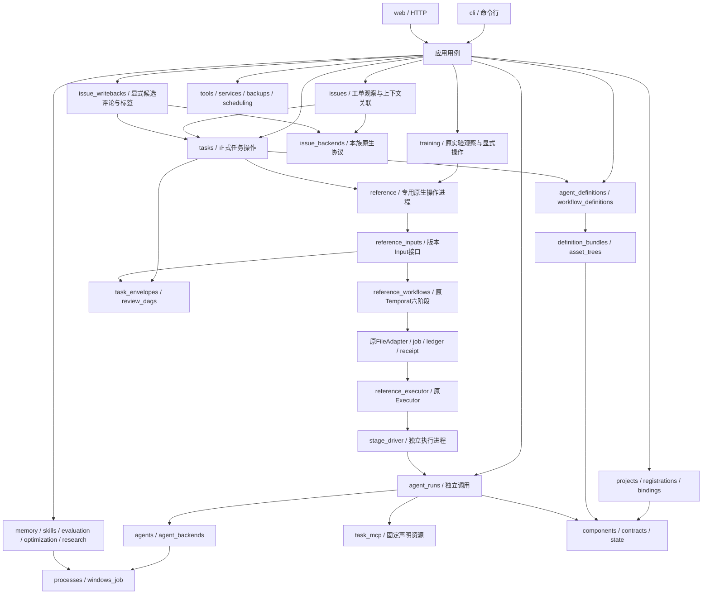
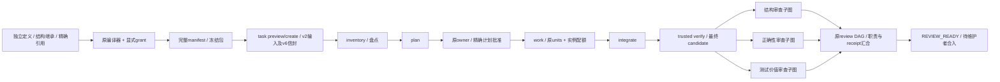
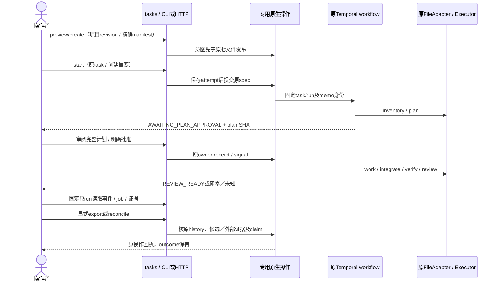
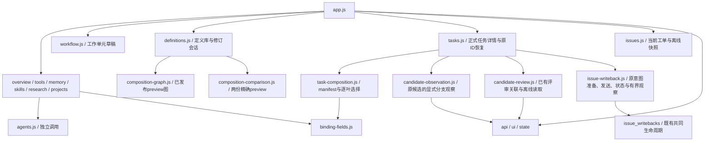
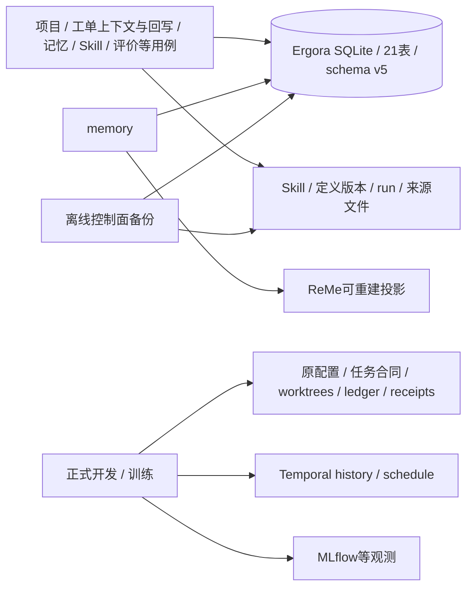
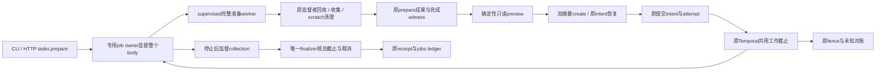
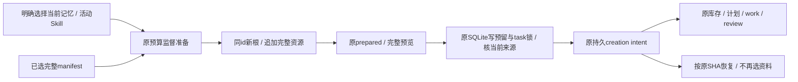

# 当前架构与扩展边界

Ergora 把项目合同、可组合的专长 Agent、正式执行和可核对证据接在一起。CLI 与网页共用应用用例；Agent 后端、工单来源和外部通信各有自己的接入位置。当前实现仍复用冻结参考发行的六阶段与 Temporal，不要求每个项目使用工单，也没有第二套正式调度器。

主体对应 `c1f31fc` 的生产源码，F7a读取、F7b快照／来源任务v7与F7c显式候选评论／GitHub原生ID标签及只读远端候选核对在对应所有者处增补；当前进度以[PLAN](../PLAN.md)与各片交付记录为准。逐次实施说明已[逐字归档](current-history-2026-11-11.md)，当中的“当前”“待实现”和默认版本只代表原记录。[C6d源码清单](../delivery/evidence/2026-11-11-architecture-source-inventory.json)是该基线的53个第一方Python模块、203条静态本地导入边和18个第一方console JS，不包含后增的`issues / issue_backends / issue_sources / issue_snapshots / issue_writebacks`。原静态导入包含函数内导入、拓扑无环；动态装载、子进程和运行语义另按下文调用关系核对。

## 模块与依赖

自有Python保持一个 `ergora` 包。下图是主要调用方向；组合框表示职责集合，不表示框内模块互相依赖，也不是完整的导入图。

|Module与实际入口|拥有的行为|调用者必须知道的Interface|
|---|---|---|
|`components`、`contracts`|随包工具目录／配置schema、严格结构校验|声明不代表安装或认证；schema不注入默认值，摘要算法不混用|
|`state`、`asset_trees`|SQLite版本与锁、完整文件树身份|领域拥有自己的事务；文件字节与执行位影响身份|
|`projects`、`bindings`、`registrations`|项目修订、有效工具选择、完整登记及旧登记采用|控制项目为权威；参考配置是单向投影，跨资源发布按原意图恢复|
|`issues`、`issue_backends`、`issue_sources`、`issue_snapshots`|固定项目配置的工单观察、不可变快照／显式creation关联；GitHub／GitLab本族协议与局部选择、标准库来源合同。issue_snapshots共享读取／row核验，由tasks与issues共享读取，tasks不反向导入issues|完整API base／namespace／number或iid及native ID分别保留；新link复用原tasks.creation，只有上下文关联，无任务启动／输入或批准改写／远端写入|
|`issue_writebacks`|CLI与HTTP共享原v7已导出精确候选的评论／单标签prepare及共同send／status／observe；本域action Interface／registry拥有两种真实动作，消费原tasks与快照|原C1记录保持；同一生命周期先提交attempt再至多一次写，只有严格原201评论或原200标签收据持久化才确认。GitHub按原生ID追加，GitLab标签明确unsupported；IssueBackend拥有原生协议，State／backup复用原本域记录，观察不确认unknown，无第二调度或通用副作用框架|
|`agent_definitions`、`workflow_definitions`|独立专家、精确嵌套引用、继承／DAG编译、preset与manifest|定义可静态检查；preview不授执行权，freeze不启动任务|
|`definition_bundles`|两类定义共用的完整资源树、检查／修订／不可变版本发布|修订派生新包；逐定义发布，根最后发布，不是跨库事务|
|`agent_runs`|独立叶子／角色的输入冻结、准入、调用和归档|原项目／定义／后端绑定保持；普通调用成功不生成正式任务通过|
|`agents`、`agent_backends`|角色输出合同与可替换后端Adapter|调用者走同一Interface；实现拥有原生命令、配置、结果提取及支持模式|
|`task_mcp`|单次调用的完整声明资源投影与连接回执|只有固定 `list/read`，没有任意路径／shell工具；当前要求Linux和可选SDK|
|`tasks`|正式任务本地查询、预览／创建，以及运行／批准／取消／导出／对账用例；共有exported_source_candidate绑定原来源与精确候选，inspect_export委托原Git owner读当前对象|项目revision、原task/run、精确意图与摘要；未知结果沿原ID恢复|
|`training`|CLI／HTTP共用离线观察、显式实时查询、原准备实验提交／取消及意图对账；reference子进程装载所选原配置|标准库reader共用于观察与预检；原client拥有start／cancel，操作intent／attempt／memo／回执不替代实验账本。attempt后只读固定原history恢复；停止观察分别呈现原control、adapter与fence，不复制调度／批准|
|`reference_training_submission`、`reference_training_cancellation`、`reference_training_runtime`|原训练start身份、固定run取消意图与投递恢复、共享原Status／Outcome观察|取消引用原start意图与receipt，不复制大manifest；原client核binding并发送，原ClusterAdapter核job／executor；原负结果保持|
|`reference_training_context`、`reference_training_setup`|setup与原submission共用注册身份／路径；完整baseline与runner预览及确认登记|baseline发布交原perfctl锁／原子init；runner在隔离临时CONFIG调用原register_runner预览，确认后交同一不可变writer。同内容可重试、不同内容不覆盖，不新建实验账本|
|`reference_training_preparation`|原prepare的完整暂存预览、确认意图及三件发布／显式恢复|共用context／有界serializer，直接原prepare生成字段／Binding并发布。原state保存恢复checkpoint，status SDK-free逐件读事实；不接管不明旧文件、执行或实验状态权威|
|`reference_training_release`|固定原start／run／evidence的owner批准、原receipt／attempt与投递恢复|桥接原approve CLI和release客户端；原receipt不续期，attempt后只按完整receipt身份查原history，源漂移不重发；原adapter仍唯一授权／票据owner|
|`reference_history`|Task批准／取消和训练批准／取消共用的完整signal payload分页匹配|只读固定run的原history；同原因或错误操作SHA不能补回执|
|`reference`、`reference_creation_process`|随包参考资源和专用进程装载|编译／读取与执行分开；不在Web请求中直接改原生进程全局|
|`reference_task_creation`、`reference_task_submission`、`reference_task_runtime`|原合同发布、attempt-before-send及原运行查询|操作先持久化意图，后做外部变更；原spec/memo/run必须匹配|
|`reference_task_approval`、`reference_task_cancellation`|完整计划读取、精确批准、取消请求和投递恢复|requested是投递事实；授权采纳／外部停止需另核|
|`reference_task_export`、`reference_task_reconciliation`|精确候选Git条件ref发布、外部证据核验与显式清理|导出不合入／推送；证据充分才释放原claim，不改原outcome|
|`reference_task_events`、`reference_task_evidence`|原history有界观察、原job回执与固定文本窗口|固定原run与游标／receipt摘要；响应上限不是总IO或内存上限|
|`task_envelopes`、`review_dags`|版本化正式身份、历史校验；冻结图的StageDAG／WorkDelivery投影|标准库数据规则不启动SDK；工作与审查各消费同一图的阶段投影|
|`reference_review_opinions`|SDK无关的可信审查意见读取|原workflow活动与Executor共用候选／job／调用绑定规则，不各解释一套建议意见|
|`reference_inputs`、`reference_workflows`、`reference_worker`|按版本构造队列／请求根／活动与workflow、共同worker生命周期|保留旧版本路由与history；扩展原六阶段，不新建调度／账本|
|`reference_executor`、`reference_job_lifecycle`、`stage_driver`|原checkout／检查／可信commit／receipt，以及Agent桥接；v9专用job owner和停止后唯一finalizer|原Executor拥有可信候选；pending不是终态；原jobs ledger保留未知资源占用|
|`handoff`|受限ZIP格式、内部字节与引用校验；仅依赖纯envelope／来源合同，不依赖运行Input|离线核包不执行材料、不认证来源，也不重放完整history|
|`skill_assets`、`evaluation`、`skills`、`optimization`|Skill版本、固定评价、评价后采用／回退、可选GEPA搜索|生成器不改评分；采用核精确baseline和revision，没有绕过评价的另一入口|
|`memory`、`research`|带来源的记忆、可选ReMe投影、有界资料快照／提案|SQLite是记忆权威；新资料须审阅，不自动写成有效记忆|
|`kernel`、`data/drivers`|ForgeKernel原生campaign与独立SDK进程|原生ID／未知状态保留；候选生成不等于可信实验采用|
|`tools`、`services`、`scheduling`|诊断、显式Supervisor运维、可选Temporal研究调度|本地存在／认证／连通／任务验收分开；安装不自动启动服务|
|`backups`、`drafts`|离线完整控制面备份；任务输入草稿|备份需停止写入；草稿不是正式合同，业务仓库／执行状态另行备份|
|`processes`、`windows_job`|POSIX进程组或Windows Job的时限／取消／后代清理|生命周期管理不提供文件或网络沙箱；远程计算另行对账|
|`cli`、`web`、`__main__`、`__init__`|入口、传输DTO与版本|直接调用现有用例，不另持评分、批准或运行状态|

`issues.remote_candidate`供CLI／HTTP共用，只拼接原`tasks.exported_source_candidate`、`tasks.inspect_export`和`IssueBackend.repository_refs`的事实。GH／GL本族拥有仓库与两条精确分支读取；GitLab后续按本次项目native ID访问，GitHub仍按原namespace路由。repo／ref逐点读取不是共同snapshot或CAS，原快照没有创建时repo native ID，404是不存在或不可见；结果不授执行权、不证明原attempt或自动发布，无新表或账本。原C1／C2持久task/source投影字节保持，当前本地ref不能改写历史export状态。

`components / contracts / state / asset_trees / windows_job` 不导入其他自有模块；`processes`只依赖`windows_job`。定义编译不导入Temporal；SDK相关装载留在实际原生操作和worker。原执行器动态装载、驱动子进程及外部SDK环境是静态导入图之外的调用边，详见[reference边界](reference-boundary.md)。

## 结构继承、控制依赖与具名数据

模板的“父／子”是版本化数据关系，专长Agent是独立完整定义包；无需为每位专家创建Python子类。同一精确定义可实例化多次，完整实例路径区分权限、材料来源、并发计数、后端选择及会话。

|关系|含义|现有规则|
|---|---|---|
|结构父子|Workflow嵌套Workflow或Agent实例|每个叶子累加全部结构祖先的声明Skill／指令／上下文，再加自身资料；不读取兄弟或控制前驱的私有资料|
|控制依赖|`depends_on`决定可运行先后；显式all-join等待列出的分支|静态有界DAG拒绝环；正式阶段只执行其支持的投影，不由画布另排一次|
|具名数据|输入绑定至父输入或已声明依赖的输出|端口不创建继承／权限；实际值由原producer receipt与声明产物验证后交付|

每个Workflow权限受结构父级和操作者显式grant约束，每个Agent节点权限再受所在Workflow约束；写入只允许声明workspace范围。继承资料若因缩小read范围而不可读，编译拒绝，不能丢掉祖先资料继续。相同资料可去重字节，但保留全部逻辑ID与来源；同ID异内容或同Skill加载名异树拒绝。

增加资源仍需其完整父链允许访问；提升权限须发布所需父、子的新精确版本并更新引用，根最后发布，不能越过父级。包内普通附件不会仅因被打包就进入scope。限额包含各祖先实例／材料预算和并发配额，超限明确拒绝，不截断后宣称完整继承。完整定义／准入和模型实际逐页读取是两种证据，后者须核原 `list/read` 回复。

## 调用与数据归属

控制台的 `issues.js` 只消费已有 `issues.show / capture / snapshots / snapshot` 用例。导航进入只读取本地列表；外部读取和保存由操作者点击。局部序号、DOM存活和项目身份负责页面迟到响应，完整来源和权限仍由原后端所有者负责。历史快照保留原绑定，manual仍可离线读。已保存快照通过app渲染参数把本项目SHA临时承接到原tasks创建表单；完整来源只经原本地snapshot读取，definition3仍由原tasks准入。没有新增持久业务状态、provider分派或调度。

### 正式开发路径

默认两开发preset采用 `work-units-v2`／正式信封v6；用户task-definition仍为v2，二者版本号含义不同。显式work-units-v1／v5与更早版本保留自己的身份，不自动迁移。在正式v5/v6中，每个原work unit一对一分配implementer实例，工作依赖必须匹配原units的传递依赖，全部Agent叶由work/review覆盖。静态图可表示的结构不保证正式运行器支持任意角色或拓扑。工单来源任务显式用definition3／creation3／信封v7选择完整snapshot，限work-units-v2；默认v2/v6不变。v7的纯来源合同核完整API来源与本项目冻结绑定，正文是任务数据，不授执行权；start的Input准入报告检查实际所选依赖，原策略／checks／claim保持。

图示使用内置三类审查，模板可在支持的合同内选择成员和串并行端口。每条分支固定同一候选、完整结构祖先输入和独立会话。至少一个必需reviewer；必需拒绝、运行失败、取消或证据缺失会阻止Ready。建议请求修改仅在可信意见合同通过后保留原FAILED回执进入汇合，其他失败仍走原stop/fence。汇合不凭模型文本制造额外批准。

创建不等于提交，requested不等于授权采纳或停止，exported不等于已合入或远端已更新。提交／批准／取消／导出／对账保留各自意图、attempt及回执；未知结果查询原task/run和实际外部事实，不自动另建任务或重发。默认绑定改动只影响新快照，不能改在途 `agent-bindings.json`。操作顺序和恢复命令见[日常手册](../USAGE.md#正式任务的操作顺序与恢复)。

### 执行材料与恢复

`WorkflowInput`选出版本专用queue／request根；`reference_workflows`继承原六阶段，`StageDAG / WorkDelivery`只是同一冻结图的阶段数据投影。原units、job/context、monitor、ledger和FileAdapter继续拥有执行事实。Executor拥有checkout、依赖commit合并、路径门禁、确定性检查和可信commit；桥接调用沿`agent_runs`冻结输入、固定任务MCP、后端Interface及进程记录。

v6使用 `StageResultsInput → WorkDeliveryInput` 和 `StageResultsWorkflow → WorkDeliveryWorkflow`，复用原调度及活动；输入材料另标 `schema_version: 2 / artifact_protocol: stage-artifacts-v1`。完整声明阶段产物、可信检查与意见内联；审计原件仍逐件核验，不递归复制旧prompt/materials。work的具名来源与直接控制前驱合并交付，另保留unit→instance映射；祖先资源和原1,000,000B预算保持。v7继承v6并通过Input.stage_material提供完整issue_source；stage-artifacts协议由Input拥有，不在执行器继续枚举新版本号。v5旧材料和history不改写。[版本表](contracts-and-identities.md#当前格式和责任)区分这些合同。

Input还拥有准入报告的版本差异：v1–v6调用原doctor，v7从冻结creation角色与composition成员检查实际选中的后端配置／程序／模式和必要本地执行条件，所选MCP才检查SDK。Codex可用性与执行命令读取同一executable配置。`_Submission.dispatch`只在原专用进程作用域替换报告并finally恢复；策略、可信检查、Temporal连接、同一共享claim与attempt-before-send仍由原task_action／transport拥有。availability不表示认证、worker可用或模型消费，unknown仍只查询原workflow／memo，不重新准入或重发。

崩溃恢复复用原job/context/monitor。HEAD偏离首次调用起点时，核Executor在首次HEAD门禁后发布的完整agent-selection和结果字节摘要，用已有证据区分可信commit与Agent自提交窗口；证据不足要求对账，不新增“成功”标记绕过原门禁。

### 独立调用、改进与训练

普通角色路径是 `CLI/HTTP → agent_runs → 项目/Skill/记忆快照 → agents.invoke → 后端Adapter → processes → 归档`。组合单叶另冻结完整manifest／输入／祖先scope，但不替操作者执行图前驱。原生工具调用、完整资源可用、模型实际读取和可信业务验收分别记录。

Skill采用沿 `skills.adopt → evaluation.compare → skill_assets.move_head`，同事务核旧revision与精确baseline。GEPA只提出候选；资料观察／研究调度只提出带来源材料；ReMe只是可重建的记忆投影。记忆有效期由原memory模块按服务端时刻判定；catalog可审阅所有状态，新检索只取有效当前修订，并在远端请求后重新核本地版本。schema v5沿原State迁移更新writer fence，升级停止旧进程，旧归档不重写。

训练领域组合提供实验设计／kernel／性能／测量审查的只读提案叶。实际实验仍走 `prepare → start（控制排队）→ 操作者run-local + manifest SHA → 可信统计门禁 → owner evidence SHA → 集成复验`。控制worker不自动启动训练，Forge内部judge不替代可信门禁；GPU结果和完整实验图须有独立实测，见[训练手册](../TRAINING.md)。

新项目的baseline与runner由同一training应用入口从CLI／HTTP／页面预览，再确认当前项目revision及完整canonical内容SHA登记，原文件字节SHA单列。baseline仍交原perfctl锁／原子init，仅Linux／WSL2初始化，预览与初始化无需SDK或服务。runner沿原register_runner在隔离临时CONFIG预览，确认后用规范化文档向真实config不可变发布，仅Linux／WSL2且需可选SDK，无需服务。两者共用短本地DB预留与页面表单生命周期；失联先读原文件，同内容显式重试，不同内容不覆盖；共享config的外项目runner ID拒绝且不展示命令。实验准备的CLI／HTTP复用原多件publisher，确认精确计划后保存原意图，部分发布只能以原intent显式恢复；训练页的局部preparation面板只拥有编辑／请求序列与显式确认，发布算法仍在原owner。见[分片计划](../plans/2026-11-14-training-preparation.md)。

训练证据读取由`training.evidence → reference.training_evidence → reference_training_evidence`进入隔离有界子进程，复用原注册与训练记录reader。归档gate按原JSON内容、evidence／元数据按绑定字节SHA核对；artifact只在明确选择后完整核摘要并返回Unicode窗口，原索引不冒称全部内容已验。读取原本地integration ticket不生成Task或批准，Temporal、原archive／gate与owner receipt继续拥有原职责。见[证据计划](../plans/2026-11-14-training-evidence.md)。

## Agent后端接入

`agent_backends.AgentBackend`是已有共享ABC，`_BACKENDS`只登记本族Codex、Claude Code、mini-swe-agent、DeepSeek Harness、command五种Adapter。`Invocation`传角色、正文、cwd、协议目录、时限和结果schema，不拥有模板成员或正式状态。`agents.invoke`沿共同Interface调用；Adapter拥有命令、原生配置、模式能力、结果提取、诊断及固定探测。通用结果校验归agents，进程生命周期归processes，doctor沿同一Adapter读取实际支持范围。

DeepSeek只准入只读composition模式，其独立SDK驱动位于`data/drivers/deepseek.py`；基础安装不导入或依赖SDK。默认调用使用原`.protocol`目录保存新原生home／ID、固定patch、完整模型输入、事件和终值；原Adapter拒绝不完整turn与工具错误，原agents校验结构，原agent_runs核MCP readiness。显式opt-in的新standalone task-MCP源可沿原Invocation续接一次；`agent_runs`拥有原项目／资料／权限准入、唯一intent与DB记录，Adapter／driver拥有原生冻结、resume／receipt和归档，`processes`仍拥有停止。新调用复用原home／ID／cwd，独立MCP与结果；原锁覆盖操作及子进程，unknown不重发。不增调度或状态账本，native／workspace和正式任务恢复仍unsupported；实际验收分别见[H1](../delivery/2026-11-12-harness-probes.md)与[H3b](../delivery/2026-11-14-harness-session-continuation.md)。

新增后端需实现这一Interface、登记本地映射，并在 `components.json` 声明配置schema／角色能力／平台／安装配方。仅能遵守命令协议时可选现有command；它不会凭一条argv获得恢复、隔离或MCP能力。正式模式还要给出真实准入与资源／权限合同，不能只登记模式名。上层任务／模板无需新增厂商分支；验证应覆盖结构化输出、错误退出、取消与真实平台限制。[接入手册](../AGENT_BACKENDS.md)列出公开协议。

专长、Skill、提示词和默认后端请求属于AgentDefinition包；权限属于Workflow实例与父链。逐叶override保存实际binding及理由，不改定义默认请求。`require-distinct`拒绝与任一实际work后端相同的reviewer，`prefer-distinct`同后端时要求显式理由；工具名不同不证明模型错误统计独立，认证成功也不证明推理可用。不可用的后端须保留原失败和明确回退，不能静默换成别的实现。

## 图形页面与低代码

前端为第一方原生ES modules，加随包Cytoscape，无Node构建或运行时CDN。`app.js`拥有导航、刷新及图mount/dispose；`api / ui / state`提供传输、DOM和界面选择，均不保存正式执行真相。

- **工作单元草稿**：`workflow.js`拥有语义、完整JSON／单元原文、目标ID／已观察修订、有限命令／撤销重做与布局。缓冲按控制目录／项目隔离；保存仍调用drafts/reference，不直接变成正式任务。
- **独立定义修订**：`definitions.js`调用两类原用例，JSON/YAML只是同一结构的输入语法。完整资源变更从新暂存树派生，预览返回candidate digest和directories，check/publish重新核已接受候选。CLI/HTTP不各实现一套文件身份算法。
- **已发布图与比较**：`composition-graph.js`展示原编译器的完整路径、结构／控制／数据关系与全文inspector，支持折叠／查找／键盘选择；图位置不进入摘要。比较模块只投影同grant下两份已发布preview，不在浏览器推断权限或编译未发布候选。
- **正式任务选择**：`tasks.js`沿原创建／原ID恢复用例，收集可选来源快照并在有完整执行组合时提交既有definition3；`task-composition.js`只持有完整manifest选择、unit分配和逐叶binding；共用schema字段展示由`binding-fields.js`负责。正式准入仍在后端。原v7已导出记录可打开`candidate-observation.js`的内聚观察对话框，调用既有`issues.remote_candidate`；任务owner传固定原记录与独立于旧modal内容的存活条件，观察owner只管理临时base选择、异步代际与安全结果展示，不持久化或实现provider分派。`candidate-review.js`内聚已有PR／MR的明确保存／原字段恢复和独立SHA读取，复用原`issues.link_review / review_link`；恢复同一幂等POST可能首次保存，页面不冒称只读status，也不建浏览器恢复账本。`issue-writeback.js`内聚评论／标签的准备和原字段恢复、独立SHA状态、明确发送与有界观察，直接消费原`issue_writebacks`共同生命周期；页面只管理临时选择／忙状态，不建立provider分派或第二账本，unknown不提供发送入口。

视图／home／项目／原run／编辑代际约束迟到回复；已替换会话不能保存到新会话。草稿与资源缓冲使用有限内存历史／sessionStorage，损坏或配额失败可明确下载／清除。布局、折叠和浏览器缓存不是合同、执行账本或协同编辑存储。

当前低代码可以调整已支持的工具／模型、预算、资源、专家组合、受约束DAG和逐实例后端。新增可信阶段、任意角色调度、运行器或通信协议仍需代码和版本化验收；画一条边不会自动实现它们。

## 配置、数据与证据所有权

|事实|权威与存放|修改与备份责任|
|---|---|---|
|工具字段、默认值、平台、安装SDK组合|随包 `data/components.json`|声明由catalog拥有；动态诊断不写成静态可用|
|项目与有效绑定|`projects`表及登记意图／回执|revision与能力校验；参考注册／策略是单向不可变投影|
|工单来源与上下文关联|show不写库；capture保存issue_snapshots，link保存issue_task_links；原生响应SHA与稳定payload SHA各自独立|列表有界、完整快照显式离线读；原State v2迁移／writer fence及完整备份复用。旧正式注册无API host，operator_asserted_context不证明归属、不派工或改写原任务／批准|
|候选评论／标签与当前观察|issue_writebacks保存原intent／attempt／result，issue_writeback_observations追加当前原生观察|schema v3沿原迁移／backup与旧writer fence；完整来源重新绑定原snapshot。status与备份离线核已存身份，send再消费原任务与导出所有者，不据观察补发|
|候选与已有PR／MR上下文|`issues.link_review / review_link`保存及离线读取candidate_review_links；原生review读取留在IssueBackend本族|State v4迁移／旧writer fence；单候选scope不可变，save／load／backup同一身份校验。网络不持写锁，短事务核revision；不确认原发送、不创建资源或改变正式run|
|静态专家与组合|独立完整包、版本索引、`composition-manifests/`|DefinitionLibrary逐包原子发布；历史读取不要求今天的后端仍可准入|
|记忆与资料|`memories / memory_mirrors`；research四表与来源文件|来源、修订、审阅由所属域拥有；镜像不取代SQLite|
|Skill／评价／搜索|`skill_versions / skill_heads / skill_events / evaluation_suites / evaluations / optimizations`及完整资产|采用／回退只改经过核验的精确头；生成与评分分权|
|独立调用／草稿／Forge|`agent_runs / drafts / kernel_runs`及原生产物|保留各自状态和native ID，不合并成另一套通用状态机|
|正式创建与操作|登记执行状态中的 `ergora/task-creations / task-submissions / task-approvals / task-cancellations / task-exports / task-reconciliations`|固定原身份与意图／attempt／回执；与原合同、执行目录和ledger联合备份|
|训练提交／取消操作|原执行状态中的 `ergora/training-submissions / training-cancellations`|取消引用原start意图及run，保存操作人／原因／稳定request ID；操作checkpoint不替代原实验账本，与job／fence／history共同保存|
|正式运行与训练结果|原task/spec／ingress leases／job ledger／Git／receipt／Temporal history；runner证据|原runtime／executor／runner拥有，不搬迁在途history|
|只读索引与交接包|原材料引用索引；操作者明确导出的 `task-handoff-v1` ZIP|有来源的快照和内部身份校验，不是完整备份、来源认证或重新执行|

公开JSON Schema Draft2020-12由`contracts`统一校验；需纯标准库读取的工单快照／版本化envelope由`issue_sources / task_envelopes`拥有严格运行合同，已核来源的完整首inventory context也由task_envelopes组装、creation与v7／v8 workflow直接复用，两个运行Module不反向导入，普通Python JSON值与现有canonical身份保持；Web DTO只负责传输。格式、schema版本、摘要编码和迁移责任见[合同与身份表](contracts-and-identities.md)。CLI/env路径、项目定义、冻结任务、数据库版本与原生SDK配置分别归属，不能用一次JSON重编码合并旧身份。凭据只从外部环境或工具认证读取，分享定义保留变量名引用。

## 修改影响与接入方式

|需要调整的内容|最小入口|必须重新核验的实际影响|
|---|---|---|
|增加／替换专长Agent|新的AgentDefinition完整包、Skill／上下文／提示和默认backend请求|原包身份、角色支持；引用它的Workflow发布新版本，旧任务保持|
|增加／删减／嵌套成员或串并行|WorkflowDefinition节点／端口／精确ref与grant，页面或CLI修订|完整祖先权限／资料／限额、DAG与正式阶段投影；受影响manifest重新冻结|
|换已支持的后端／模型|项目binding或逐叶override与理由|当前模式／认证／平台准入；既有冻结绑定不随默认改变|
|新Agent实现|AgentBackend Adapter、本族映射、components配置及安装说明|输出／取消／资源能力／平台；具体模板和评分规则保持|
|新页面或命令|相应传输／视图直接调用现有用例|输入、scope、并发修订和未知恢复；不复制审批或运行状态机|
|新持久业务|自身领域、State有序迁移、文件资产及备份核验|旧writer fence／同平台恢复；不暗换主数据权威|
|新tracker／通信／会话|对应实际Adapter及配置、native ID／去重／授权／取消语义|无工单本地流程保持；消息不扩权限，按F7/F8及实际需求接入|
|新OS／执行器／可信阶段|平台生命周期／锁／安装，或显式协议版本与原生执行实现|旧history／批准／候选证据与在途恢复；需要专片，不能配置冒充|

使用SQLite、Git、jsonschema、Temporal、官方MCP SDK、Cytoscape、GEPA/ReMe及工具原生协议处理其擅长的部分。Ergora保留项目revision、精确候选批准、继承／权限准入、原证据关联和明确采用规则。多个真实Adapter使用既有ABC／Protocol或局部工厂；单消费者的内聚投影保留在原所有者，不为看起来相似的代码创建万能插件层。

## 兼容入口及退出条件

|有意保留的实现|保留原因与退出条件|
|---|---|
|`skills`资产入口与`tools.run_agent/runs/output/validate_binding`|直接指向同一实现，既有Python API及测试仍消费；删除需明确破坏版本／公告及消费者迁移，不按仓内引用数自动删|
|POSIX group／stage subreaper／Windows Job、research专用抓取进程|平台和通信／网络预算／父进程死亡语义不同，共享能共用的Job；不因都叫取消就合并|
|Input／Workflow版本继承|不同已发布history、queue和材料合同有真实兼容责任；局部映射构造，不把版本分支散到调用者|
|原Executor与mini environment继承、原SDK Protocol|实际外部hook和开发／训练合同；替代实现须证明等价恢复与证据语义|
|冻结283文件、21对镜像、旧HTML与reference动态桥|仍为安装、报告、正式执行／训练的生产分发；替代入口及升级／在途恢复验收后才逐项退出，见[reference迁出条件](reference-boundary.md#身份恢复及迁出条件)|
|status／list／poll与各域revision事务|分别陈述本地合同、原运行和外部事实；只读投影可组合，不能机械合并状态机|

原A1的13项保留／删除判断及R1–R8证据在[历史清单](current-history-2026-11-11.md#a1-清单结案)，本次文档整理不重新授予旧验收或删除API。当前没有根据这份静态盘点新增重构层或性能优化；有实际反例／测量再改对应所有者。

## 手册、平台与验收范围

- [三模板入门旅程](../TEMPLATE_WALKTHROUGHS.md)：完整组合、逐实例后端、当前页面v6创建与训练提案。
- [安装与日常手册](../USAGE.md)、[训练与持续改进手册](../TRAINING.md)：统一CLI／页面和原ID恢复。
- [完整Linux部署／日常参考手册](../../src/ergora/data/reference/platform/README.zh-CN.md)、[完整训练参考手册](../../src/ergora/data/reference/platform/docs/TRAINING.md)：随包保留完整冻结发行，不改原命令身份。
- [Windows手册](../WINDOWS.md)：原生控制面／静态定义与Linux task-MCP／完整执行的区分；WSL2是部署路径，不能由Windows CI推导其实际运行通过。

当前两域v6完整六阶段证据来自真实服务加确定性原生命令协议夹具，[C5c记录](../delivery/2026-11-11-composition-runtime.md)明确其范围；真实模型自身审查与训练单叶另记。C6b页面只验创建／原ID读回，C6a画布容量不代表同数量Agent已执行；不同输入、后端或环境不能继承这些结果。成功双后端、模型质量、真实GPU收益与生产隔离均须各自实测，不能由定义、认证、CI或文档静态检查推出。后续F7–F10及G1仍见[总计划](../plans/2026-11-01-all-in-one.md)。

## 完整材料输入 v8

[B1材料合同](../WORKFLOW_DEFINITIONS.md#盘点与规划的完整材料)新增definition4／input8，沿原tasks、creation、WorkflowInput和Temporal六阶段消费。`review_dags`在原unit映射旁投影两个只读准备叶并核全部Agent覆盖；`task_envelopes`保留纯标准库冻结读取，`reference_inputs`局部注册v8自己的queue／request根和所选依赖准入。准备叶没有独立调度器。

原Executor统一选择实际member；inventory／plan复用原stage_driver与run_input，在新空cwd执行，完整资料由原快照和固定MCP提供。精确Git对象批量读取由原Executor内聚共享算法承担，review保留base／candidate，准备阶段提供starting及所需AGENTS。plan先核原inventory请求／收据／claim／调用与产物身份；完整输入超过限额直接失败。`task_mcp`记录成功read返回范围，v8阶段接受前核未内联附件连续覆盖；旧版本仍按原握手准入，不重写旧输入。

## 全程共用预算 input9

`tasks.prepare`和CLI／HTTP共用原creation所有者：先在task-creations持久授权及唯一attempt，再由独立supervised worker遍历安装、读取完整manifest／材料及编译。原subreaper等待拥有进程树退出，原owner清理编译scratch后才发布准备成果与完成witness。`reference_budget`只拥有实例、时钟和已知slot的stdlib合同；时间状态另投影，不改变完整preview身份。create确认prepare／preview两个SHA并在同一工作截止内逐文件发布，resume不重编或重新授权。

单次准备观察结束不终止仍在安全清理的owner；未知attempt不重跑。跨boot／主机及明显时钟跳变不授权新工作。v9沿原WorkflowInput共同构造Interface注册专属queue／请求根；原workflow监督排队、owner批准、stage、semaphore、poll／重试及fence。固定UTC截止用于Temporal；Linux消费者同时核原same-boot单调起点，重试／重启不重新计时。

`WorkflowInput.job`选择DirectJob或BudgetedJob，Executor不按后端分派生命周期。旧输入沿原线程内执行／发布；v9独立owner在启动前沿原jobs表持久化OWNED，由原processes的subreaper监督构造／Git／模型／可信命令和后代。child只产pending；确认整个树停止后独立监督collection。唯一finalizer先持久化候选，再重核同实例截止／取消，最后链接原字节为正式receipt并更新原账本，三种终态均受停止门禁。慢fsync不能发布旧success，未知停止不会先发FAILED来误确认fence。

Executor安装级并发取持久OWNED与本进程active的并集；重启只观察原attempt，unknown／rejected不退款。已链接receipt但账本未更新的原job仍进入对账，不能因receipt存在永久跳过。单次request入口沿同一容量门禁；没有另建调度器或表。现有版本的调度、终态与冻结参考保持；可信当前容器仍不是本工具提供的OS隔离。

统一预算只覆盖单机／同boot的原六阶段输入，原生嵌套六阶段调用另片；trusted writer的advisory能力保持。当前图形向导仍生成v6；新合同从CLI／共用API使用。材料传递和原生夹具的实际验收见[B1交付](../delivery/2026-11-12-six-stage-materials.md)，不得借旧候选结果推导新版本成功。

## 单实例原生六阶段 input10

`tasks`与`task_envelopes`共用纯stdlib `native_six_stage.invocation`，从既有WorkflowDefinition的完整图核单次调用形状及精确祖先链；definition6/input10不引入新图格式。父链只能直接转发task和结果，全部阶段属于同一所选实例，原WorkDelivery继续拥有叶覆盖、角色和依赖核验。原creation保存完整定义、项目revision、baseline、能力和同一预算；新WorkflowInput实现注册独立版本的queue、请求根、adapter和workflow。

`NativeSixStageWorkflow`继承BudgetedWorkflow，只为原status/outcome追加`native_invocation`；没有新的父执行状态、调度或批准。单实例内部的准备/工作/审查仍沿原阶段消费者；多次native、额外父分支和未执行外部输入在原prepare内失败。完整用法见[单实例说明](../USAGE.md#将六阶段作为一个子模板调用)。

## 显式项目来源 input11

definition7在definition6上要求项目内当前记忆revision与活动Skill head的显式选择。`task_context`复用memory catalog、Skill版本／head和原定义库，在监督准备目录内复制原manifest，通过`DefinitionLibrary.revise`为同id新根追加来源context与完整Skill目录，再由原manifest／逐叶输入准入。根其余字段、节点引用、成员路径、grant与limits保持；祖先read、同名Skill和附件连续读取不能绕过。临时树沿原prepare scratch清理，完整成果进入原prepared／intent，不产生第二资源或记忆库。

`task_envelopes`以标准库核来源资源SHA、精确选择、原根与派生根差异、完整Skill目录身份；`SelectedContextInput`通过原stage_material接口交付来源指针，正文和SKILL.md沿原祖先资源内联，附件沿原MCP list/read。input11继承input10的预算、job、准入和证据接口，仅注册自己的版本队列／请求根与原workflow子类。

首次intent保存前核canonical有效性和完整来源，预览后变更拒绝；已经持久化intent的恢复不重新读活动资料，不热换或撤销归档。schema v5没有新增表或迁移。用法见[显式选择](../USAGE.md#为正式任务选择项目记忆与活动-skill)，实际验收与未验范围见[F10b交付](../delivery/2026-11-14-task-context-selection.md)。
