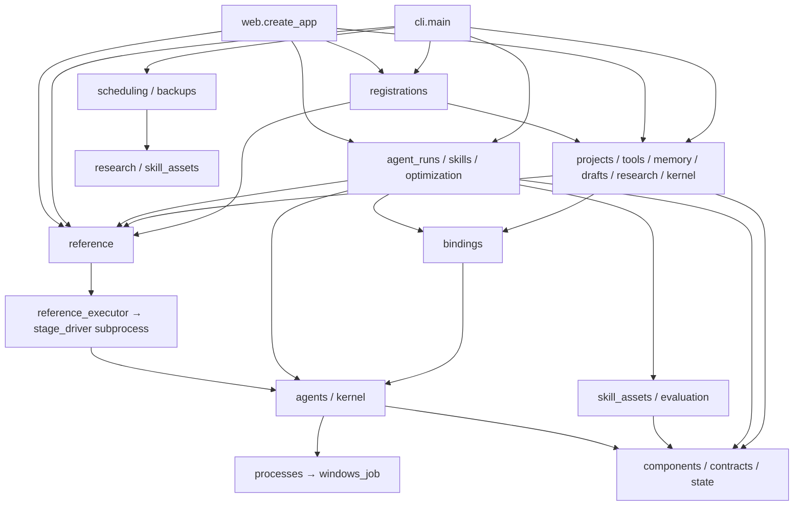
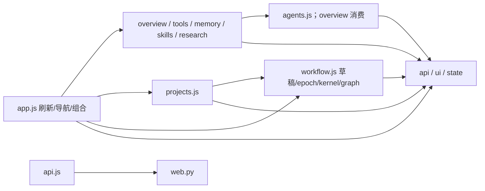
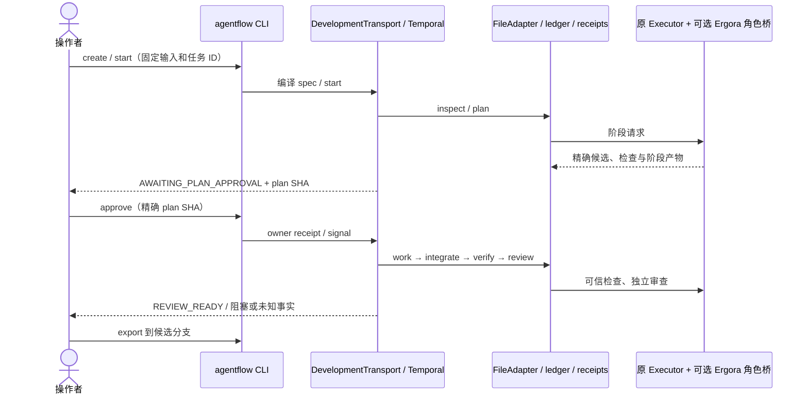
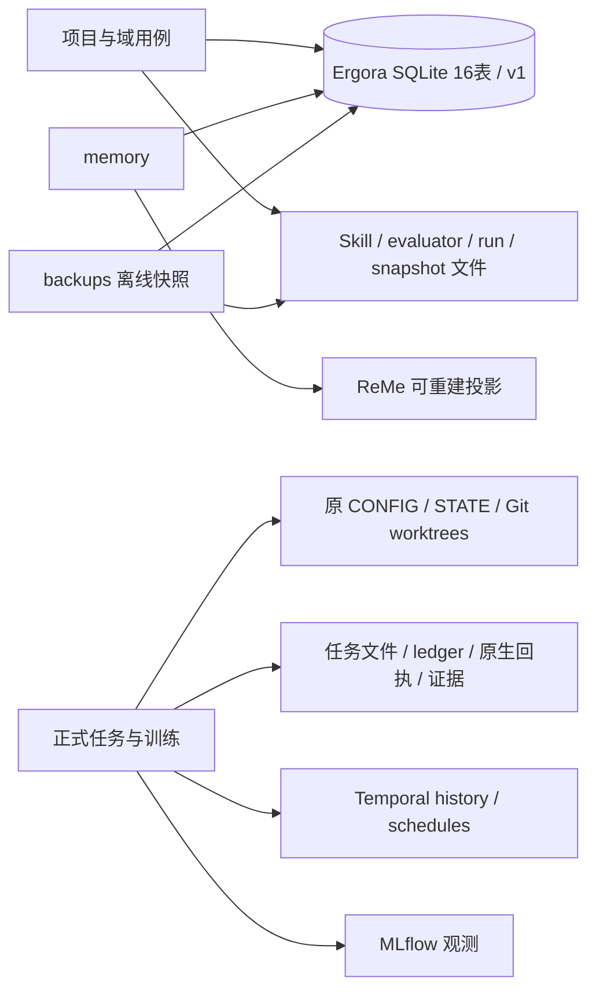

# 当前架构与扩展边界

2026-11-02，R8后的当前导航，加入F1.1有效绑定与快照增量（已交付；本地验收、独立复审与精确两OS CI通过）。历史 [A1 审计](2026-11-01-audit.md)及[R8记录](../delivery/2026-11-02-refactoring-exit.md)保留原身份与范围；新行为验收见[F1记录](../delivery/2026-11-02-project-configuration.md)。设计约束见 [ADR 0001](decisions/0001-refactoring-foundations.md) / [0002](decisions/0002-static-boundaries.md)。

## 模块与依赖

自有Python仍为单包`ergora`，28个顶层文件（含两个包入口）；F1.2增加完整注册用例`registrations`。没有为层级增加空子包、通用Agent基类或插件容器。下图表示当前调用方向，组合节点内的模块并非互相依赖；精确导入由静态检查和源码确定。

`state`、`components`、`contracts` 和 `windows_job` 不导入其他自有模块；`processes` 只依赖 `windows_job`。这些底层模块不读具体项目用例。`backups` 自身依赖 `contracts / skill_assets / state`，`scheduling` 依赖 `research / state`，不互相依赖。`research` 为抓取监控直接消费 Windows Job，普通命令走 `processes`；二者生命周期不同。

|责任|当前所有者与实际入口|保留的边界|
|---|---|---|
|组件、默认值、平台、字段和安装配方身份|`data/components.json` → `components`；agents/bindings/projects/tools、Web bootstrap、SDK 安装器|描述不制造执行能力；probe/认证/连通/任务验收分开|
|结构与身份|`contracts` + `data/schemas`；agents/bindings/evaluation/backups 和页面元数据|JSON Schema 校验不注入默认值；业务 revision/授权保留原所有者；[不同摘要规范](contracts-and-identities.md)不互换|
|项目与绑定事务|`projects.create / bind / effective_configuration`、`components.resolve_binding`、`bindings.validate_binding`；CLI/Web/调用与执行桥|Git根、项目revision与能力拒绝；轻量项目保持兼容，统一项目附定义/发布状态|
|完整注册与跨资源恢复|`registrations.register / resume / status`；CLI/Web|复用基础项目与绑定校验，保存before/after意图及pending状态；reference仅拥有投影布局、原校验和不覆盖发布，不反向写控制项目|
|独立 Agent 调用|`agent_runs.run_agent / runs / output`；CLI/Web|冻结有效绑定视图、所选 Skill/记忆上下文及归档；普通调用成功不产生正式任务通过|
|原生 Agent/Forge|`agents.invoke`、`kernel.create / operate`；独立调用、参考阶段/页面|既有 CLI/SDK 协议；Forge campaign 完成不等于可信训练采用，未知结果先对账|
|Skill 资产、评价、采用和搜索|`skill_assets`、`evaluation`、`skills.adopt`、`optimization.optimize`；CLI/Web|资产与评价不反向导入采用；GEPA 搜索复用评价，不拥有评分/采用权限|
|记忆与资料|`memory`、`research`；CLI/Web，`scheduling` 调用 research|SQLite canonical / ReMe 投影；来源快照、预算、取消及人工审阅，资料不自动成为有效记忆|
|存储升级与离线恢复|`State`、`backups.create / verify / restore`；所有域及 CLI|集中 16 表、schema v1、有序迁移和旧 writer fence；领域保留查询/事务，恢复核对库和文件|
|参考资源、编译与执行桥|`reference`、`reference_executor`、`stage_driver`；CLI/Web/drafts/agent_runs|资源查询与正式执行分开；执行器限专用 Linux 进程，不把原导入全局当 Web request-local|
|交互与传输|`cli`、`web`、`data/console`|调用现有用例；可选 Web/Temporal 延迟导入；UI 不拥有正式任务状态|

Python 导入图包含函数内延迟导入，当前无环。`reference.executor` 动态加载执行桥，`stage_driver` 通过子进程运行，`data/drivers` 在独立 SDK 环境调用；这些运行边不能仅由顶层 import 推断。完整参考边界及退出条件见 [reference 文档](reference-boundary.md)，进程结果/产物/平台矩阵见 [运行契约](2026-11-02-runtime-contracts.md)。

前端保持原生 ES modules 与随包 Cytoscape，不需要 Node 构建：

视图通过明确的 `refresh/render` 回调组合，不反向导入入口。`state.js` 只有 UI 选择、后台快照和显示元数据；草稿编辑身份、revision、图和 kernel 请求身份同属 `workflow.js`。正式任务页面、任意角色关系编辑、会话恢复仍未实现。

## 调用与数据归属

独立调用的当前路径：`CLI/HTTP → agent_runs.run_agent → 项目/绑定 + 活动 Skill/记忆快照 → agents.invoke → processes.run → 归档与 agent_runs`。Skill 采用的路径：`CLI/HTTP → skills.adopt → evaluation.compare → skill_assets.get/move_head`，采用事务同时检查旧 revision 和精确基线 digest；没有另一条可绕过评价的“采用”用例。

两个开发模板的正式任务仍通过原 `agentflow`：

执行桥只替换生成阶段的 Agent，原执行器仍拥有候选 SHA、只读检查、提交和回执。默认值或项目绑定变化不修改在途任务的 `agent-bindings.json`。取消是意图，`CANCEL_UNCONFIRMED / NEEDS_RECONCILIATION` 保持可见，不能删 ledger 后重跑。当前控制台没有这套任务 API；F1/F3/F4 才连接统一入口。

训练保持独立的 workload/baseline/manifest/runner/evidence：`prepare → start（控制排队）→ 操作者 run-local + manifest SHA → 可信统计门禁 → owner evidence SHA → 集成/复验任务`。control worker 不自动启动训练；Forge 只生成原生候选。R8 的 fixture 只检验协议，真实模型/GPU效果以各次实测记录为准。

|事实所有者|表或资产|修改责任|
|---|---|---|
|projects / agent_runs|`projects`、`agent_runs`；`runs/`|项目/binding 修订、独立调用上下文与结果；F1.1新调用附加版本化有效绑定视图，旧文档不回写|
|memory|`memories`、`memory_mirrors`|来源、修订、删除；投影同步不改变 canonical|
|skill_assets|`skill_versions`、`skill_heads`、`skill_events`；`skills/`|不可变树身份、活动头及采用/回退历史|
|evaluation / optimization|`evaluation_suites`、`evaluations`、`optimizations`；suite/run/proposal 文件|固定评分输入与成本、候选关系；生成器不改可信评分|
|research / drafts / kernel|`research_runs`、`source_snapshots`、`source_heads`、`research_proposals`、`drafts`、`kernel_runs`；来源与原生产物|预算/取消、资料/草稿 revision、Forge 原生 ID 与未知状态|
|State / backups|schema 版本、迁移前 DB 快照、完整离线备份清单|DDL/锁/版本拒绝；DB 快照不等于完整文件备份|
|原 runtime / executor / runner|原配置、任务文件、ingress leases、jobs ledger、Git/产物；Temporal history|正式阶段、批准、候选与取消事实；不搬迁在途 history|

当前仍有控制面项目绑定与 reference 正式注册两种配置，另有 CLI/env 路径、模板和 SDK 原生设置；R8 未将其伪装为单一项目。它们有显式入口，没有本轮新增或遗留已弃用的同步双写器。F1 将检测差异、显式导入并单向投影；凭据值继续由运行环境/工具认证提供，不进入分享定义。详见 [状态迁移](state-migrations.md) 与 [参考配置范围](reference-boundary.md#配置与进程范围)。

## A1 清单结案

下表对应 [A1 第6节](2026-11-01-audit.md#6-可执行的保留合并与删除清单)全部 13 项。完成重构不等于对应的未来产品节点完成。

|原候选|R8 核对结论|证据/后续责任|
|---|---|---|
|多份工具/角色/默认/表单/安装字段|已集中到 components 描述；执行与 probe 各归原所有者|[R1](../delivery/2026-11-02-components.md)，组件遍历与表单/配方测试|
|tools 中不可达的 codex/claude/command 校验块|已删除；GEPA proposer 参数的原校验语义由 bindings 调用组件 schema 保留|R1/R2、`tests/test_components.py` 所有接受/拒绝路径；没有遗留递归分支|
|Skill/evaluation 环与 tools 独立调用编排|已分为 skill_assets / skills / agent_runs / bindings，无导入环|[R4](../delivery/2026-11-02-application-use-cases.md)，旧 API 为别名，见下表|
|lazy DDL / 内联建表|已集中 State 的 16 表和有序迁移；域保留事务查询|[R3](../delivery/2026-11-02-storage.md)，旧库/fence/恢复回归|
|多种摘要、schema 与 JSON 处理|结构校验集中 contracts；摘要按原规范命名并保留差异|[R2](../delivery/2026-11-02-schemas.md)，固定 golden digest，不统一编码|
|app.js 混合责任|已拆 12 模块；Skill diff 归资产；入口149行|[R7](../delivery/2026-11-02-console-modules.md)，浏览器/CLI/API/窄屏与异步验收|
|local/bootstrap 的21对镜像|保留为生产分发；安装器、HTML 报告仍消费|[R6](reference-boundary.md#身份恢复及迁出条件)，F2/F7等有替代后才退出|
|processes.run 与 research 抓取子进程|保留通信、网络预算、父进程死亡处理差异；已共享 Job|[R5](2026-11-02-runtime-contracts.md)，没有新的抽取依据|
|POSIX group / stage subreaper / Windows Job|保留平台与专用执行模式；均不宣称访问沙箱|R5、原生两OS及受监控进程反例|
|Executor 与 mini environment 继承|保留外部框架实际 hook；不建模板/Agent 继承树|R5/R6，阶段/receipt 与固定 SDK 适配检查|
|DevelopmentRuntime / Adapter / ClusterAdapter Protocol|保留既有合同及开发/训练差异|R6；F3/F9按真实消费者接入，不新增巨型 Backend|
|Web/CLI 共用业务|保持直接用例调用，不再抽代理服务层；只归位跨域编排/diff|R4/R7，CLI/API对照与同一拒绝语义|
|status/list/poll 与 revision SQL 相似|保留不同事实和事务；未来汇总只读投影|R3/R5，F4/F5仍待实现，不合并状态机|

### 兼容入口及退出条件

|保留项|当前可核对的消费者|退出条件|
|---|---|---|
|`skills` 的7个资产入口|既有 Python API、兼容/Skill/Agent/备份等测试；生产 CLI/Web 用 skill_assets（采用仍用 skills.adopt）|无独立实现或双写；若删除，需明确公共 API 破坏版本/公告并迁移仓内消费者、更新身份保护；仓外使用未知，不能据仓内无生产引用直接删除|
|`tools.run_agent/runs/output/validate_binding`|既有 Python API、组件/项目/Agent/Windows/兼容等测试；生产已用 agent_runs/bindings|同上；保留直接别名，不加弃用包装或转发状态|
|`reference.ROOT / DATA` 和公开组件常量|reference 内部资源定位；ROOT 被兼容/reference/SDK/执行器测试消费，组件常量被 agents/tools 消费|公开常量保留；未来改变布局需先迁移明确消费者和包资源验收，不为内部整理单独破坏 API|
|reference 动态执行桥、Windows reader patch|CLI 专用执行器、编译子进程及原生 Windows 编译测试|依 [R6退出条件](reference-boundary.md#身份恢复及迁出条件)逐项替代；不能在 Web 中直接复用原进程全局|
|冻结283文件、旧HTML、21对镜像|完整参考安装/报告、正式执行/训练和兼容身份验证|对应安装/任务/训练/工单路径有等价替代和升级/在途恢复证据后，才能降为归档或另版本移除|

旧入口没有自身存储/算法，故本轮不设假定日期强删；每次有 API 破坏需求时按上表重新核对实际消费者。不存在为“代码更整齐”新增的临时兼容层。

## 修改影响与接入方式

|变更|实际需要改的所有者|可保持的边界|
|---|---|---|
|兼容 Agent/工具|组件字段/配方、agents 或 kernel 的真实适配、协议与生命周期测试、手册|现有模板、评分、进程平台不因厂商变化而改；已有 command 协议可接遵约命令，但不会凭配置新增恢复能力|
|兼容绑定/默认值|components 描述、bindings 的业务约束及相应检查|CLI/Web 通用字段消费描述；新默认只影响新项目/新修订，任务冻结不变|
|新页面或 CLI 操作|相应传输/视图，调用已存在用例；新增跨域行为才增加用例|不在页面复制评分、批准或状态机|
|新持久业务|自身域、State 有序迁移、文件资产/备份核对及合同|不迫使 Agent/模板修改；主数据所有权不能暗换|
|新 OS 或执行服务|平台生命周期/锁/安装探测、实际 runner 和对应 CI|保留六阶段与可信门禁；执行边界按读写反例验收|
|新模板、阶段或通用低代码|目前只有3个固定模板及受约束输入草稿；新模板/合同需显式实现和验收|F6才扩展描述/编辑；不能承诺现有任意配置可增删可信阶段|
|新 tracker/通信/会话|对应 F7/F8/D1/D2 的真实 adapter、native ID/去重/取消和授权合同|本地无工单流程继续可用；上下文消息不扩大权限|

复用 SQLite、Git、jsonschema、Temporal、MLflow、Cytoscape、GEPA/ReMe 和各工具真实 SDK。项目 revision、精确候选授权、证据关联与显式采用属于 Ergora 规则；没有理由用通用库替换这些规则。继续保持函数和既有 Protocol，只有外部框架 hook 使用继承。静态边界检查运行方式及局限见 [ADR 0002](decisions/0002-static-boundaries.md)。下一功能节点为 F1.2 单一注册与单向投影，尚不能宣称 all-in-one 用户旅程已经打通。
