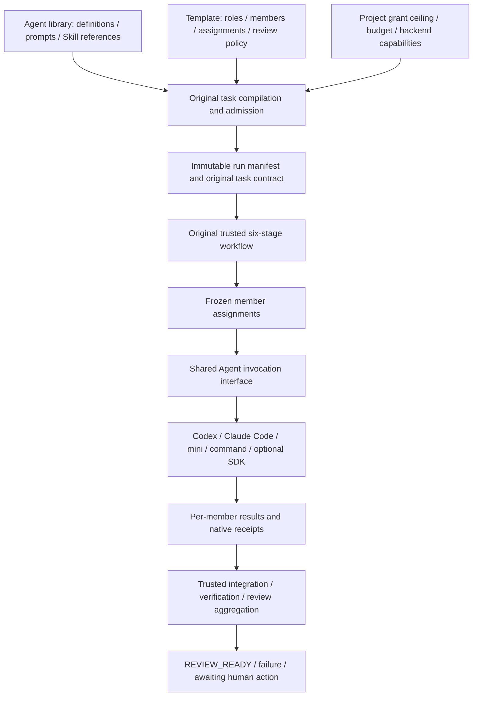

# ADR0004: Separate roles, specialized Agent definitions, template members, and backends

English · [Documentation](../../README.md)

Date: 2026-11-08. This ADR records member composition design; [ADR0005](0005-composable-workflows.md) supplements nesting, inheritance, and parent/child permissions. See [Agent definitions](../../definitions/agents.md) and the [workflow guide](../../definitions/workflows/compose.md) for currently implemented configuration.

## Problem

Current role bindings answer “which tool runs a responsibility,” but cannot adequately express multiple members with different specialties, independent resources/permissions, and complementary review coverage within one template. Expanding directly into an arbitrary Agent connection graph would mix task dependencies, material flow, model calls, and authorization, affecting existing exact approval and recovery.

The user also requires backend selection for every role, preferring different backends for executors and reviewers and allowing slower backends for suitable roles. Class names, backstories, and self-reported labels cannot guarantee expertise or quality.

## Decision

First express configuration using existing versioned JSON, JSON Schema, and equivalent YAML; Skills retain Agent Skills directories, and MCP retains the original protocol and native clients. Define only Ergora's required domain objects, without inventing a general cross-vendor DSL or using one vendor runtime as the base class for every object.

|Object|Owns|Must not own|
|---|---|---|
|RoleSpec, role contract|Role ID, allowed stages, required inputs/artifacts, actor kind, minimum responsibilities, and independence constraints|Vendor implementation, credentials, or individual ability; being a “supervisor” grants no trusted approval authority.|
|AgentDefinition, specialized definition|Stable ID/version, supported roles, specialties, prompts/references, Skill/MCP requests, backend binding, and budget defaults|Shared sessions or current task state; specialties support discovery/matching, not permission or capability proof.|
|WorkflowDefinition, composable workflow definition|Reusable static bounded subgraph, named inputs/outputs, Agent/child workflow references, and template resources/permissions; ancestor inheritance and joins follow ADR0005|A template reference is not a shared running instance; it cannot bypass trusted stages or treat accumulating resources as expanded permissions.|
|MemberAssignment, template member assignment|Stable member ID within the template, role, AgentDefinition reference, responsibilities/coverage criteria, work scope, explicit collaboration mode, and allowed bounded overrides|Duplicated tool implementations, arbitrary embedded executable configuration, or arbitrary member changes after approval.|
|AgentRun, actual run|Current member/attempt ID, definition and effective configuration digests, backend/version, native session/process IDs, participation/delegation provenance, results/usage/evidence|Deriving author identity from display names or treating process exit0 as review approval.|
|BackendAdapter, backend implementation|Shared construction/invocation contract encapsulating native tool configuration, actual capabilities, loading, result parsing, and cancellation/recovery differences|Choosing domain roles, approving plans, producing trusted acceptance results, or leaking vendor branches into upper layers.|
|Run manifest|Freezes the resolved values above, actual prompt/Skill/material content identities, effective grants, selection policies, and budgets|Plaintext credentials, unresolved active-version pointers, UI layout, or mutable session state.|

AgentDefinition is a reusable recipe; every assignment/execution has independent identity and state. “Kernel executor” and “architecture reviewer” do not each require Python classes. Backends have multiple actual implementations, so a Protocol/ABC and implementation factory at the original `agents` invocation seam are appropriate; each backend's configuration and initialization belong to its adapter, and configuration name mappings register only within the Agent backend family. CLI/Web, formal stages, and doctor reuse this owner; the component manifest continues to own public field descriptions, avoiding a second unsynchronized registry.

This diagram shows target invocation relationships; actual current relationships remain in the [current architecture](../current.md). Do not add a second persistent scheduler; models may suggest work assignments within authorized scope, but cannot change the trusted six stages or merge directly.

## Complementary specialties and backend selection

One role can have multiple members, and multiple templates can reference one definition. A template should declare “what this member owns, what it delivers, and when it is needed,” separating mandatory coverage from optional advice. Examples:

|Template|Example composable members|Complementary results|
|---|---|---|
|Repository governance|Repository inventory executor, documentation/test executor, overall structure reviewer, requirements coverage reviewer|Inventory/migration materials, module design, and old behavior coverage each have an owner; governance tasks do not run GPU specialists by default.|
|Large changes|Executors assigned by work unit, API compatibility reviewer, architecture reviewer, optional progress supervisor|Work is assigned by approved scope and DAG, collecting compatibility/structural findings; the supervisor advises rather than replacing trusted integration.|
|Training optimization|Experiment designer, kernel/CUDA/Triton specialist, measurement analyst, correctness/reproducibility reviewer|Specialist configuration may select source-checked Skills such as KDA/KernelWiki; Forge native candidate generation and trusted runner/compare/gate still execute separately.|

These are target compositions, not a released Agent library. First deliver a few definitions with actual consumers, then evaluate through task comparisons; do not give every Agent all installed Skills. Skills and context explicitly declared in parent templates are fully inherited by descendant calls under ADR0005; on-demand retrieval cannot replace the user's required full loading.

Relations are explicitly separated into work dependencies `depends_on`, named artifact handoffs, bounded delegation, review/independence requirements, and authorization/resource requests. UI may project them separately; one graph line cannot simultaneously represent permissions and data flow.

Multiple executors first receive disjoint work units, each worktree retaining one writer owner; the same unit may have read-only specialist advisers, with adoption owned by the designated executor. Multiple writers must not concurrently write one checkout. Role/specialty label changes do not automatically expand writable paths.

The default backend policy is `prefer-distinct`: at admission, reviewers prefer eligible backends outside the actual writers' backend set; configuration bindings, role capabilities, resource permissions, and budgets must all be satisfied. Compare resolved implementation families, such as codex and claude-code, rather than different profile/member names. Record model IDs, providers, versions, and unknowns separately; different harnesses do not prove underlying model independence.

If no eligible different backend exists, preview explicitly shows the same backend and the reason, freezing the choice through the original preview/create flow; optional `require-distinct` rejects that configuration. Priorities and failure behavior are explicit; silent backend switching after timeout or downgrading failure to advice is forbidden. Slower backends may have longer member limits, subject to the task's total time, concurrency, and resource ceilings; numerical values require actual measurements. Retain current project bindings rather than automatically changing user configuration or old runs for a new default preference.

## Review policy

Every mandatory reviewer checks the same exact candidate, original requirements, and trusted validation evidence, returning structured findings, coverage, and an explicit conclusion from an independent session. The first version uses a deterministic policy requiring every mandatory review to pass: any request-changes, failure, absence, or timeout prevents passing; advisory results are separate. Two review axes may cover requirements conformity and structure/maintainability respectively; optional performance specialists must bind judgments to measurement conditions.

Trusted code aggregates results and retains every original receipt and identity; no separate LLM voter overrides failed findings. Returned stage results must remain compatible with the original review contract. When fixes change the candidate, old reviews retain their original SHA and are not automatically reused; the new candidate undergoes acceptance again. Majority voting, dynamic reviewer counts, and bounded repair loops require independent specifications and evaluation before extension.

Independence checks actual author participation, session/delegation provenance, and input scope together; renaming, changing roles, or reusing one session cannot bypass it. Fresh sessions and different backends each have value, but neither establishes statistical error independence or identity isolation in malicious environments. Retain trusted checks and checkout immutability constraints, showing the actual execution boundary used.

## Actual enforcement of permissions, MCP, and Skills

Definitions request resources and permissions, project/operator policy sets grant ceilings, and adapters declare and measure enforceable capabilities. Admission resolves effective grants: explicitly reject requests exceeding ceilings, required capabilities the selected backend cannot enforce, or unsupported MCP/Skill loading. Do not silently discard permissions or accept an unsatisfactory configuration through set intersection. Path, network, and tool permissions have different semantics and cannot be reduced to ineffective strings.

Implementations separately label `enforced`, `advisory`, and `unsupported` with their basis; formal composition is allowed only when required guarantees can actually be enforced. In trusted container mode, operators may explicitly accept broader boundaries, but pages and receipts must show actual scope; do not claim that requesting read-only prevents an Agent from reading user files.

MCP configuration uses credential references and allowed tools; connection/discovery/health are separate from runtime authorization. An MCP interface does not mean the service is logged in or tools are permitted. Skills freeze complete directory digests, executable bits, and provenance, labeling native loading separately from textual references; concatenating SKILL.md into a prompt does not execute its resources/scripts. `stage_driver` currently ignores user rules/config and restricts apps/plugins; future work must explicitly construct dedicated runtime configuration rather than assuming ambient installation takes effect automatically.

Context ordering consists of trusted stage constraints, fixed template instructions, selected Agent prompts, approved resources, and task/evidence materials; external issues or repository text cannot elevate authorization. Every material retains complete content identity and provenance; insufficient budgets require explicit spill/continuation or rejection, not silent truncation of required instructions. Session state and long-term memory are stored separately; deleting/updating materials does not rewrite old run evidence.

## Format and migration

New Agent packages and composition files use their own versioned schemas; definitions contain prompt/resource relative paths and content digests, and saving must not execute them automatically. Independent Agent packages may be shared through Git, resolving into content-addressed versions at installation/import. MCP credentials reference only environment variable names or secret references.

Proposed AgentDefinition field groups are `id/version/roles/specialties`, `backend`, `instructions/resources`, `skills/mcp`, `permission_requests`, and `limits`; proposed compositions contain `members`, work assignments, review policy, and backend diversity policy. Final field spelling is governed by AC3 schemas and consumers; this ADR provides no fake example supposedly importable by the current CLI.

Compilation must freeze all resolved values affecting behavior and include the manifest digest in the identity chain checked by new creation/approval. An extra sidecar outside admission checks is insufficient, and fields must not be added in place to frozen legacy specs or published reference files. AC3 first provides an explicit design for the new version/admission envelope and bridge to the old six stages; incompatible capabilities enter explicitly through new versions, while old runs read and recover under old contracts. Layout belongs only to editor data and does not change execution digests.

Reading old single-binding projects remains unchanged; the new model may provide a one-member compatibility projection, with explicit revisions/migration for new writes. Active Agent or Skill versions affect only new previews; started stages cannot hot-swap. Cancellation/recovery follows original run/member/attempt and native identities; unknown state must not trigger blind resending of model calls or external writes.

## Consequences and rejected alternatives

Adding a specialized Agent usually requires only a resource package and definition; adding a template usually requires only responsibilities/member mappings, artifacts, and acceptance; adding a backend requires a local adapter, registration, component capability/installation descriptions, and actual contract validation. New trusted stages, permission capabilities, or cross-service semantics still require code and specifications; do not promise full-featured low code.

Retain existing process/Windows Job behavior, transitional reference inheritance, and actual differences; do not copy upstream trusted logic to unify surface interfaces. Do not currently adopt a separate inheritance chain per role/specialty, a universal global registry, arbitrary executable YAML, automatic discovery/execution of third-party plugins, unrestricted Agent interconnection, or runtime hot replacement. Prefer native SDK libraries for protocols, MCP, processes, and scoring search where they suffice; template composition, authorization admission, candidate evidence, and multiple-review aggregation are domain code Ergora should own.
