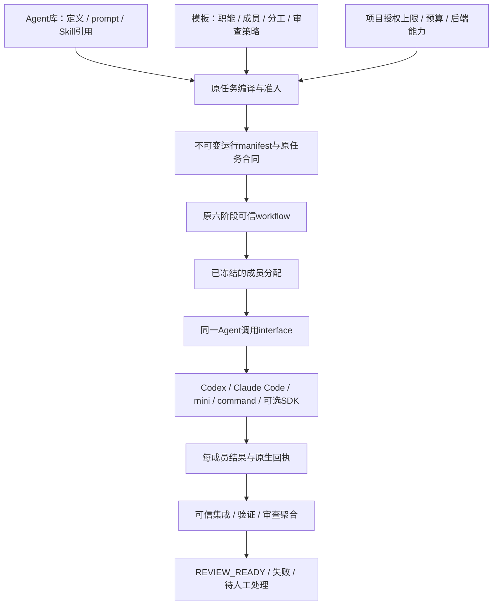

# ADR0004：职能、专长化Agent定义、模板成员与后端分开

日期：2026-11-08。状态：设计提案，按[AC计划](../../plans/2026-11-08-agent-composition.md)分片实施；不是当前发行已支持的配置格式。依据：[实现与论文对照](../../research/2026-11-08-agent-composition.md)和[完整快照独立评审](../../delivery/2026-11-08-agent-composition-review.md)。保留[ADR0001](0001-refactoring-foundations.md)的兼容与可信执行约束、[ADR0003](0003-workflow-editor-stack.md)的前端选型。

## 问题

当前role binding解决“用哪个工具运行一个职责”，不足以表达多个拥有不同专长的成员、独立资源/权限和同模板内互补的审查覆盖。直接扩展成任意Agent连接图，会把任务依赖、资料流、模型调用和授权混在一起，并影响现有精确批准与恢复。

用户另要求各职能均可选择后端，执行者与审查者优先不同后端，允许速度较慢的后端用于适合的职能。专长和质量不能通过类名、背景故事或自报标签保证。

## 决策

先用已有版本化JSON、JSON Schema和等价YAML表达配置；Skill沿用Agent Skills目录，MCP沿用原协议及原生客户端。只定义Ergora所需的领域对象，不创造通用跨厂商DSL或复用一套厂商运行时作为所有对象的基类。

|对象|负责什么|不能承担什么|
|---|---|---|
|RoleSpec，职能合同|角色ID、允许的stage、必需输入/产物、actor kind、职责下限和独立性约束|厂商实现、凭据、具体个人能力；“监管者”不因此获得可信批准权。|
|AgentDefinition，专长化定义|稳定ID/版本、可承担职能、specialties、提示与参考资料、Skill/MCP请求、后端binding和预算默认值|共享会话、当前任务状态；specialties只供发现/匹配，不当权限或能力证明。|
|MemberAssignment，模板成员分配|模板内稳定member ID、role、AgentDefinition引用、职责/覆盖标准、工作范围、显式协作模式及允许的有限覆盖|重复保存工具实现、任意嵌入可执行配置、批准后任意改成员。|
|AgentRun，实际运行|本次member/attempt ID、定义和有效配置摘要、backend/version、原生session/进程ID、参与/委派来源、结果/usage/证据|从显示名称推导作者身份、用进程exit0冒充审查通过。|
|BackendAdapter，后端实现|同一构造/调用合同，封装原生工具配置、真实能力、装载、结果解析和取消/恢复差异|决定领域角色、批准计划、生成可信验收结果或泄漏厂商分支到上层。|
|运行manifest|冻结上述解析结果、实际提示/Skill/资料内容身份、有效授权、选择策略和预算|凭据明文、未解析的活动版本指针、UI布局或可变会话状态。|

AgentDefinition是可复用配方；每次分配/执行都有独立身份与状态。无需为“kernel执行者”“架构审查者”分别创建Python类。后端有多种真实实现，因此在原`agents`调用seam定义Protocol/ABC与本实现工厂是合理的；各后端的配置和初始化归其adapter，配置名映射只在Agent后端家族中登记。CLI/Web、正式stage和doctor复用该所有者，组件manifest继续拥有公开字段描述，避免第二套不同步的注册表。

这张图是目标调用关系，当前真实调用关系仍在[当前架构](../current.md)。不新增第二套持久调度器；模型可在已授权范围内建议分工，但不改可信六阶段或直接合并。

## 专长互补和后端选择

同一职能可有多个成员，同一份定义可供多个模板引用。模板应声明该成员“负责什么、交付什么、何时需要”，并将mandatory coverage与可选建议分开。例：

|模板|可组合成员示例|互补结果|
|---|---|---|
|仓库治理|仓库盘点执行者、文档/测试执行者、整体结构审查者、需求覆盖审查者|盘点/迁移材料与模块设计、旧行为覆盖各有责任；不因治理任务默认运行GPU专家。|
|大型变更|分工作单元执行者、API兼容审查者、架构审查者、可选进展监管者|以已批准scope和DAG分工，汇总兼容与结构finding；监管者给建议，不替代可信集成。|
|训练优化|实验设计者、kernel/CUDA/Triton专家、测量分析者、正确性/复现审查者|专家配置可以选择KDA/KernelWiki等已核来源Skill；Forge原生候选生成与可信runner/compare/gate仍分别执行。|

以上是目标组合，不是已发版的Agent库。首先交付少量有实际消费者的定义，再用任务对照评价；不把所有已安装Skill全部塞给每个Agent。

关系明确分为：工作依赖`depends_on`、具名产物交接、受限委派、审查/独立性要求、授权/资源请求。UI可以分别投影这些关系；图的一条线不能同时表示权限和数据流。

多执行者先按不相交工作单元分配，每个worktree保留单写所有者；同一单元可配只读专家建议者，采纳由指定执行者负责。多个写者不并发写同一checkout。角色/专长标签变化不自动增加可写路径。

默认后端策略为`prefer-distinct`：在准入时，审查者优先选择不属于实际写作者后端集合的合格后端；配置绑定、角色能力、资源权限与预算均需满足。比较的是解析后的实现家族，例如codex与claude-code，而不是profile/member的不同名称。模型ID、提供方、版本与未知项分别记录；不同harness不证明底层模型独立。

若没有合格的不同后端，预览明确展示相同后端及原因，由原预览/创建流程冻结选择；可选`require-distinct`拒绝该配置。优先级与失败行为显式，禁止超时后静默换后端或将失败降为建议。慢后端可有更长成员时限，但受任务总时限、并发和资源上限约束；数值需要真实测量后确定。保留当前项目已配置的绑定，不因新默认偏好自动改用户配置或旧运行。

## 审查策略

每名mandatory reviewer检查同一个精确候选、原始需求及可信验证证据，以独立会话输出结构化finding、覆盖和明确结论。第一版采用所有必需审查通过的确定策略：任何request-changes、失败、缺失或超时都不能产生通过；advisory结果另列。两轴审查可分别覆盖需求符合性与结构/维护性，可选性能专家须把判断绑定测量条件。

聚合由可信代码完成，并保留每份原始回执与身份；不另设LLM投票者覆盖失败finding。返回的阶段结果须兼容原review合同。修复后候选改变，旧审查保留其原SHA，不自动沿用；新的候选重新验收。多数票、动态reviewer数与有界修复循环只有在独立规格与评价支持后才扩展。

独立性同时检查实际作者参与记录、session/委派来源和输入范围；改名、换role或复用同一会话不能绕过。fresh session与不同后端各自有价值，均不等同错误统计独立或恶意环境下的身份隔离。保留可信检查和checkout不变约束，显示实际采用的执行边界。

## 权限、MCP与Skill的真实执行

定义提出资源和权限请求，项目/操作者策略规定授权上限，adapter声明并实测可执行的能力。准入解析有效授权：请求超出上限、必需能力不被选定后端强制执行、MCP/Skill装载不受支持时明确拒绝；不把权限静默丢弃，也不按集合交集悄悄接受一个不满足必需能力的配置。路径、网络和工具权限有不同语义，不简化成一组无作用的字符串。

实现分别标明`enforced`、`advisory`、`unsupported`及其依据；只有被要求的保证可实际执行，才允许该正式组合。可信容器模式可以由操作者明确接受较宽边界，但页面和回执须显示实际范围，不能声称Agent请求了read-only就读不到用户文件。

MCP配置使用凭据引用及允许工具，连接/发现/健康和运行授权分开；MCP接口存在不代表服务已登录或工具被许可。Skill冻结完整目录摘要、可执行位及来源，分别标明原生加载和文本参考；将SKILL.md拼进prompt不算运行了其资源/脚本。`stage_driver`目前忽略用户rules/config并限制apps/plugins，未来必须明确构造专用运行配置，不能假设ambient安装会自动生效。

上下文顺序由可信阶段约束、已固定模板说明、已选Agent提示、获准资源、任务/证据材料组成；外部工单或仓库文本不能提升授权。每份资料保留完整内容身份和来源，预算不足须显式spill/提供续读或拒绝，不默默截掉必需指令。会话状态与长期记忆分别保存，删除/更新资料不回写旧运行证据。

## 格式和迁移

新增Agent包和组合文件采用各自版本化schema；定义包含prompt/资源相对路径和内容摘要，保存时不得自动执行。独立Agent包可以随Git分享，安装/导入时解析成内容定址版本。MCP凭据只引用环境变量名或secret引用。

AgentDefinition建议字段组为`id/version/roles/specialties`、`backend`、`instructions/resources`、`skills/mcp`、`permission_requests`和`limits`；组合建议含`members`、工作分配、审查策略、后端多样性策略。字段最终拼写以AC3的schema与消费者为准，本ADR不提供可直接导入当前CLI的假示例。

编译时必须冻结所有影响行为的解析值，并把manifest摘要纳入新创建/批准所核对的身份链。不能只额外写一个不参与准入核对的sidecar，也不能原地添加字段到冻结的legacy spec或改已发布参考文件。AC3先给出新增版本/admission envelope与旧六阶段桥接的明确设计；不兼容能力以新版本显式准入，旧run沿旧合同读取和恢复。布局只属于编辑器数据，不改变执行摘要。

旧单binding项目读取不变，新模型可提供一成员的兼容投影；新写入采用显式修订/迁移。活动Agent或Skill版本仅影响新预览，已开始阶段不能热换。取消/恢复沿原run/member/attempt及原生身份，未知状态不得盲重发模型或外部写入。

## 后果及未采用方案

新增一个专长化Agent通常只需资源包和定义；新增模板通常只需职责/成员映射、产物和验收；新增后端需实现局部adapter、注册、组件能力/安装说明及真实合同验证。新增可信阶段、权限能力或跨服务语义仍需代码和规格，不能承诺全功能低代码。

保留现有进程/Windows Job、reference过渡继承及实际差异，不为统一表面接口复制上游可信逻辑。暂不采用每个role/专长一条继承链、一个全局万能注册表、任意可执行YAML、自动发现并执行第三方插件、所有Agent全互通或运行中热替换。使用原生SDK能解决的协议、MCP、进程和评分搜索优先调库；模板组合、授权准入、候选证据与多审查聚合是Ergora应拥有的领域代码。
