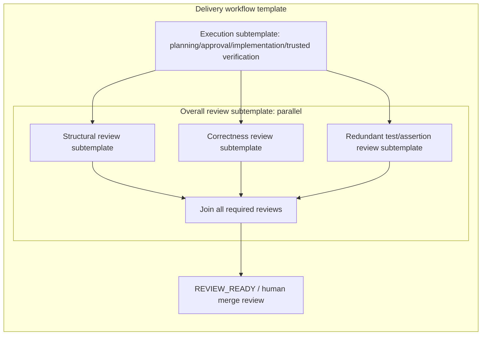

# ADR0005: Nested workflows and ancestor resource inheritance

English · [Documentation](../../README.md)

Date: 2026-11-08. This ADR records the nested workflow decision, supplementing [ADR0004](0004-agent-composition.md); see the [workflow guide](../../definitions/workflows/contracts.md#definitions-and-data-flow) for current configuration, inheritance, and permission contracts.

## Requirements and current gaps

The user requires templates to nest and express serial, parallel, and join relationships: structural review, correctness review, and redundant test/assertion checks are each reusable templates; together they form a parallel overall review template, which follows the overall execution template in sequence. Every template can declare MCP, Skills, context, and permissions; child templates inherit all ancestor Skills and context, resources only accumulate, and permissions cannot exceed the parent template. Parent/child permissions may be raised together in one configuration revision, but must still remain within every ancestor and the project grant ceiling.

The current `development.drafts.save → reference.validate_input` saves task inputs for two development templates. Frozen `DevelopmentWorkflow.units` supports work-unit DAGs and bounded concurrency, but `run` hardcodes six stages; the portable workflow schema also fixes these stages. There are currently no general child workflow definitions, nested execution, ancestor resource merging, or multiple-review joins. AC1.2 only fixes actual loading of the template instructions already fixed for current tasks; it does not implement this ADR.

## Separate definitions from runs

|Object|Responsibility|
|---|---|
|AgentDefinition|Reusable specialist recipe: roles, specialties, backend, prompts, resource requests, and budget defaults; follows ADR0004.|
|WorkflowDefinition|Reusable bounded subgraph: named inputs/outputs, nodes, explicit dependencies, referenced versions, concurrency/join policy, and this template's resource and permission requests. Nodes may reference Agent definitions or other workflow definitions.|
|Workflow instance|Each reference creates an independent instance with a stable invocation path, parent instance, input, state, attempts, and child results. Referencing one definition twice creates two instances.|
|Frozen run manifest|Recursively resolves static definitions, known behavioral materials, and assembly rules for runtime inputs; stores the ancestor chain, effective resources/permissions, members, backends, budgets, graph, and content identities; its digest enters the creation/approval identity chain.|

Templates resemble reusable classes, and instances resemble objects after construction; this analogy does not require a Python subclass for every template. The first version stores data as versioned JSON/JSON Schema and equivalent YAML, using explicit DAGs for sequencing and concurrency. LangGraph's Python builder is a reference, not a directly importable general JSON standard. Arbitrary Python expressions, infinite loops, and runtime topology changes are not provided at this stage.

Work dependencies and inheritance are expressed separately. Structural parent templates determine resource/permission inheritance; dependency predecessors deliver data only through named ports and do not automatically become parent templates. Sibling branches do not share mutable context or sessions. Instance IDs derive from stable node reference paths, not canvas positions, display names, or completion order.

## Accumulating resources, bounded permissions

For parent node `p` and child node `n` on the current instance path, the target contract is:

```text
required_resources(n) = required_resources(p) ∪ local_resources(n)
effective_permissions(n) ⊆ effective_permissions(p) ⊆ project_grant
```

Resources here include ancestor-declared Skill instructions, context/materials, MCP configuration references, and this template's additions; merge deterministically from root→leaf. In the first version, all ancestor-declared Skill instructions and context are required reading, with no switch to make them optional. Identical content may be deduplicated by identity while retaining all provenance. When one logical resource ID has different versions/content, the first version rejects the conflict rather than overwriting ancestors with the last write; input mappings cannot remove required inherited materials either.

New MCP, Skills, or materials must satisfy the child instance's effective grant. Inheriting an MCP service configuration grants no additional tool invocation rights; Skill scripts add no file/network/command permissions; new materials cannot exceed ancestor read access. If narrowed child permissions prevent access to required ancestor materials, reject the composition before execution rather than silently dropping materials or expanding permissions to make it runnable. The actual `enforced/advisory/unsupported` permission scope continues to be established under ADR0004.

A single configuration revision may adjust parent and child permissions/resources together; the page previews the whole affected ancestor chain, members, and effective differences, saving them as one atomic revision. Admission checks the entire revised chain and project grant ceiling; a running child instance does not change parent grants. Approved/in-flight manifests remain unchanged; new tasks explicitly adopt the new revision. Credential values are not stored in templates/context; MCP stores only resolvable credential references.

## All ancestor Skills and context must actually load

Before every actual leaf Agent invocation, fully load the Skill instructions and context declared along the current structural ancestor chain, then add its own declarations; resource names, accessible directories, or digests alone are insufficient. When a composite template has no model itself, the compilation/assembly layer inherits and validates resources without inventing extra model calls for “reading.” Every repeated reference is assembled independently and cannot reuse mutable session state from another parent chain.

At creation, freeze known context and runtime input schemas, sources/ports, and assembly rules. Before a child invocation, task materials subsequently generated by the parent instance form a complete invocation snapshot through the original parent instance and immutable artifact identities, then bind to the actual prompt. Future result bodies cannot be frozen from nothing at creation, nor can recovery read “latest parent state” to replace original invocation materials.

The first version chooses bounded context that can load completely: check known materials at compilation, then check the complete input again before the child invocation after adding runtime parent materials. If it exceeds the selected backend's capacity, reject explicitly before the Agent starts execution and show sources and the capacity gap; do not truncate silently or treat continuation references alone as complete reading. Required Skill instructions and explicitly declared context bodies enter this contract; on-demand scripts/binaries in Skill directories still follow their resource protocols and cannot be claimed as understood by the model. Dedicated adapters must demonstrate actual loading, without treating ambient installation or UI checkboxes as evidence.

Run records preserve ancestor provenance, order, each content identity, assembly digest, and actual delivery evidence, proving what the system delivered; logs cannot establish that the model understood, obeyed, or possesses corresponding expertise. Trusted stage/authorization constraints take precedence over inherited template instructions, and task/external materials cannot elevate permissions.

## Serial, parallel, and trusted joins

The following is a target relationship, not a template executable by the current CLI:



Parallel joins must await all explicitly listed required branches, rather than starting aggregation based on the arrival count of an incoming edge. Store results by stable instance path so branches do not overwrite one shared `result` field. All reviews bind to the same exact candidate, requirements, and trusted checks; preserve original findings, author/session/delegation provenance, and ADR0004's backend diversity policy. Required branch request-changes, failure, absence, or timeout cannot pass; advisory results are separate, and majority votes cannot override failures. After the candidate changes, old reviews retain their original identities and the new candidate undergoes acceptance again.

Parallel executors each have a single writer owning an isolated work unit/checkout; parallel reviewers gain no permission to write the candidate. The root task bounds recursion depth, expanded nodes, total budget, and effective concurrency; nesting cannot multiply subgraphs beyond limits. The first version supports only static bounded DAGs; compilation rejects definition reference cycles, graph cycles, unknown ports/resources, unsatisfied required capabilities, and invalid stage placement.

## Durable execution, compatibility, and delivery order

Continue using Temporal as the owner of durable execution facts, reusing existing process monitors, native IDs, trusted checks, and side-effect intents/reconciliation. Choosing child workflows or bounded activities is a local implementation decision after AC4d measurements; do not run another top-level LangGraph scheduler concurrently. LangGraph may later integrate as a constrained leaf adapter, without taking over Ergora's trusted approval and joins.

The first vertical slice resolves execution/review subgraphs into execution plans within the original six-stage contract, first supporting parallel specialist subgraphs in the review stage and explicit work units in the work stage. Original plan approval, trusted integrate/verify, and the REVIEW_READY exit remain mandatory. Further topologies crossing these contracts require separate versioned design; do not nest an entire legacy workflow and repeat approvals, checks, or reviews. The old 283 files and old run contracts remain unchanged; new capabilities enter through explicit new-version admission, while old tasks read and recover under original IDs.

Every child instance/attempt has stable identity, and parent cancellation propagates to all active children. Unknown external state is retained and reconciled through original IDs; never blindly resend side-effecting steps. Parent completion must list unconfirmed child processes/cleanup; one child branch returning cannot establish completion of the entire composite template. Recovery continues through the original manifest and atomic results without repeating confirmed external writes.

Implementation dependencies: AC2 backend interface → AC3a Agent packages → AC3d workflow/inheritance schema and compilation → AC3b actual resource loading and authorization, AC3c recursive manifest admission → AC4a/4b members and review → AC4d nested execution/recovery → AC4c default three-template composition → AC5 nested canvas and permission revisions → AC6 real journeys. Each node has separate validation and a new independent review; being able to save configuration does not mean runtime support exists.
