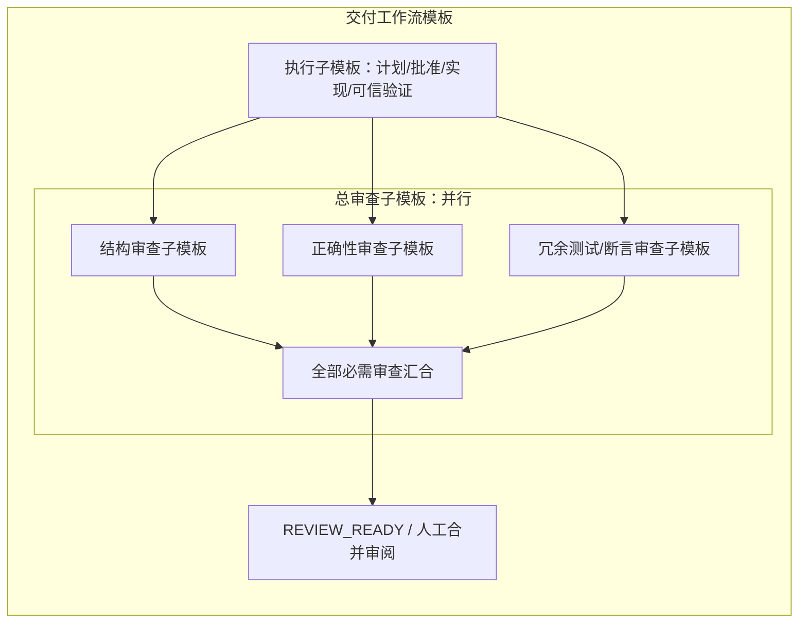

# ADR0005：可嵌套工作流与祖先资源继承

日期：2026-11-08。状态：已采纳，AC3d静态包/继承编译已本地实现并验证，r2独立修正复核通过，最终交付进行中；实际资源装载、准入、冻结及嵌套执行仍待AC3b/c/4。按[AC计划](../../plans/2026-11-08-agent-composition.md)中的AC0b、AC3d和AC4d分片交付。补充[ADR0004](0004-agent-composition.md)，不将已有成员组合等同子工作流。实现依据和一手来源见[嵌套工作流研究](../../research/2026-11-08-nested-workflows.md)。

## 需求与当前差距

用户要求模板可相互嵌套并表达串行、并行和汇合：结构审查、正确性审查、冗余测试/断言检查分别为可复用模板，三者组成并行的总审查模板，再与总执行模板串行承接。每个模板都可声明MCP、Skill、上下文与权限；子模板继承所有祖先的Skill和上下文，资源只增不减，权限不得超过父模板。可以在同一配置修订中同时提高父/子权限，最终仍不得越过任何祖先及项目授权上限。

当前`drafts.save → reference.validate_input`保存的是两开发模板的任务输入。冻结`DevelopmentWorkflow.units`支持工作单元DAG和有限并行，但`run`硬编码六阶段；portable的工作流schema也固定这些阶段。当前没有通用子工作流定义、嵌套执行、祖先资源合并或多审查汇合。AC1.2只修复当前任务已固定模板说明的实际装载，不实现本ADR。

## 定义与运行分开

|对象|责任|
|---|---|
|AgentDefinition|可复用专家配方：职能、专长、后端、提示、资源请求和预算默认值；沿ADR0004。|
|WorkflowDefinition|可复用有界子图：具名输入/输出、节点、显式依赖、引用版本、并发/汇合策略，以及本模板的资源和权限请求。节点可以引用Agent定义或其他工作流定义。|
|工作流实例|一次引用产生独立实例，拥有稳定调用路径、父实例、输入、状态、尝试和子结果。同一定义被两处引用，产生两个实例。|
|冻结运行manifest|递归解析静态定义、已知行为材料与运行态输入的装配规则，保存祖先链、有效资源/权限、成员、后端、预算、图及内容身份；摘要进入创建/批准身份链。|

模板像可复用的类，实例像一次构造后的对象；此类比不要求每种模板创建Python子类。第一版以版本化JSON/JSON Schema及等价YAML保存数据，用显式DAG表达顺序和并行。LangGraph的Python builder可供参考，不是可直接导入的通用JSON标准。暂不提供任意Python表达式、无限循环或运行中修改拓扑。

工作依赖与继承分别表达。结构父模板决定资源/权限继承；依赖前驱只通过具名端口交付数据，不自动成为父模板。兄弟分支不共享可变上下文或会话。实例ID由稳定节点引用路径产生，不用画布位置、显示名称或执行完成次序作为身份。

## 资源累加，权限受限

对当前实例路径上的父节点`p`和子节点`n`，目标合同为：

```text
required_resources(n) = required_resources(p) ∪ local_resources(n)
effective_permissions(n) ⊆ effective_permissions(p) ⊆ project_grant
```

这里的资源包括祖先声明的Skill指令、上下文/资料、MCP配置引用及本模板追加项；沿root→leaf确定性合并。首版所有祖先声明的Skill指令和上下文都是必读材料，不提供将其改为可选的开关。同一内容可按身份去重，但保留全部来源。相同逻辑资源ID对应不同版本/内容时，首版拒绝冲突，不用最后写入覆盖祖先；输入映射也不能删除必需的继承材料。

新增MCP、Skill或资料须满足子实例的有效授权。MCP服务配置的继承不授予额外工具调用权，Skill脚本不增加文件/网络/命令权限，新增资料也不能越过祖先的可读范围。如果子权限收窄后无法访问必需祖先资料，该组合在执行前拒绝，不能静默丢弃资料或扩大权限来凑成可运行配置。权限的真实`enforced/advisory/unsupported`范围继续按ADR0004核定。

允许一次配置修订同时调整父级及子级权限与资源，页面预览整条受影响祖先链、成员和有效差异，作为一次原子修订保存。准入检查整个修订后的链及项目授权上限；子实例运行中不修改父级授权。已批准/在途manifest不变，新的任务显式采用新修订。凭据值不保存在模板/上下文中，MCP只保存可解析的凭据引用。

## 所有祖先Skill和上下文必须实际装载

每个实际叶子Agent调用前，完整装载当前结构祖先链上声明的Skill指令与上下文，再加入自身声明；不能只给资源名称、可访问目录或摘要。组合模板本身没有模型时，由编译/装配层继承并验证，不为“阅读”虚增模型调用。每次重复引用独立装配，不能复用另一父链的可变会话状态。

创建时冻结已知上下文及运行态输入的schema、来源/端口和装配规则；父实例随后生成的任务材料在子调用前，沿原父实例和不可变产物身份形成完整调用快照，再绑定实际prompt。未来结果的正文不能在创建时凭空冻结，也不能恢复时读取“最新父状态”替换原调用材料。

第一版选择能够完整装载的有界上下文：编译时检查已知材料，子调用前再检查加入运行态父材料后的完整输入。超出选定后端容量时，在Agent开始执行前明确拒绝并展示来源及容量缺口，不静默截断，也不把仅提供续读引用当作已完整阅读。Skill的必读指令与明确声明的上下文正文进入该合同，Skill目录内供按需调用的脚本/二进制仍按其资源协议使用，不能冒称模型理解了它们。专用adapter须证明实际加载方式，不以ambient安装或界面勾选作为证据。

运行记录保留祖先来源、顺序、每份内容身份、装配摘要和实际交付证据，证明系统交付了什么；不能由日志宣称模型已经理解、遵从或具有相应专业能力。可信阶段/授权约束优先于继承模板说明，任务和外部材料不能提高权限。

## 串行、并行与可信汇合

以下是目标关系，不是当前CLI可执行的模板：



并行汇合必须等待显式列出的全部必需分支，不按某条入边到达次数启动聚合。按稳定实例路径保存结果，避免多个分支覆盖一个共享`result`字段。审查都绑定同一精确候选、需求和可信检查；保留原始finding、作者/session/委派来源，以及ADR0004的后端多样性策略。必需分支request-changes、失败、缺失或超时均不能通过，advisory另列，不使用多数票覆盖失败。候选改变后，旧审查保留原身份并重新验收新候选。

并行执行者各有隔离工作单元/checkout的单写所有者；并行审查者不获得写入候选的权力。根任务约束递归深度、展开节点、总预算与有效并发，子图不能通过嵌套倍增突破上限。首版仅支持静态有界DAG；定义引用环、图环、未知端口/资源、无法满足的必需能力和不合法阶段放置在编译时拒绝。

## 持久执行、兼容与交付顺序

继续使用Temporal作为持久执行事实所有者，复用现有进程monitor、原生ID、可信检查和副作用意图/对账。是否采用child workflow或有界activities属于AC4d实测后的局部实现选择；不同时运行另一个顶层LangGraph调度器。LangGraph可作为将来受限叶子adapter接入，不能接管Ergora可信批准和汇合。

第一条纵向切片把执行/审查子图解析为原六阶段合同内的执行计划，先在review阶段支持并行专家子图、在work阶段支持明确工作单元。原计划批准、可信integrate/verify及REVIEW_READY出口仍不可绕过。跨越这些合同的更多拓扑须另行版本化设计；不能将完整legacy工作流嵌套运行一遍，造成重复批准、检查或审查。旧283文件及旧运行合同不改；新能力通过显式新版本准入，旧任务照原ID读取恢复。

每个子实例/尝试有稳定身份，父取消向所有活动子实例传播；未知外部状态保留并沿原ID对账，不能盲重发有副作用步骤。父结束须列明未确认子进程/清理，不能因一个子分支返回就宣称整个复合模板完成。恢复时沿原manifest与原子结果继续，不重复已确认的外部写入。

实施依赖：AC2后端interface → AC3a Agent包 → AC3d工作流/继承schema及编译 → AC3b资源真实装载与授权、AC3c递归manifest准入 → AC4a/4b成员与审查 → AC4d嵌套执行/恢复 → AC4c默认三模板组合 → AC5嵌套画布与权限修订 → AC6真实旅程。每个节点分别验证和新独立审查，配置可保存不等于运行已支持。
