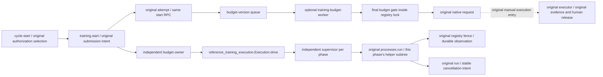
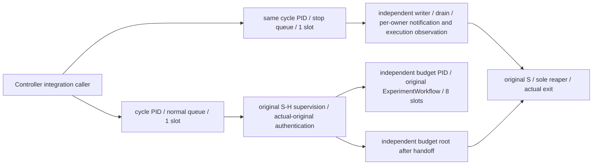
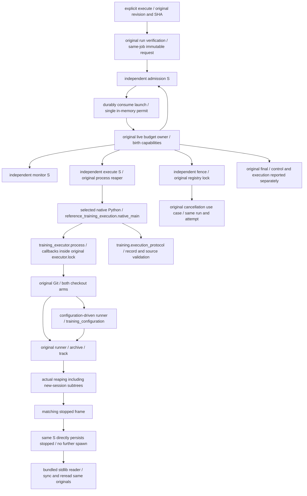

# Managed training execution and recovery

English · [Documentation](../../README.md)

## Original training-budget submission and deadline owner

`training.cycles.start` selects manifests only from original finite selection and calls the same `training.application.start`. Original submission intent holds an optional budget reference; original attempt is a nonrefundable slot, with no training ledger or second start client. `training.runtime.budget` owns original sources / clocks and independent owner lifecycle; `training.runtime.worker` owns application process entries, budget adapter factory, original cancellation wiring and SDK worker registration. The owner does not import submission / cancellation modules in reverse.

`training.cycles.authorize_controller` is an independent application use case reusing the same authorization publication algorithm; at new-ID birth it saves schema2/3/4 complete execution consent for the corresponding controller version, while ordinary authorization and historical reads retain schema1. It durably creates `controller/admission.lock` before ready; later operations only read / open the existing ordinary empty file. `training.execution_protocol.CycleAdmission` owns parent shared permits and stop records at the stdlib boundary; once an O_EXCL path appears, new admission is vetoed. Durability is confirmed only after syncing the same file / directory and rereading the same inode and complete bytes; exclusive locking proves only that parent admissions drained, not that the execution subtree stopped. `stop_controller` owns storage of the local stop veto; public stop calls do not treat successful storage as proof of subtree stopping. See the [current contract](../../training/controllers.md#start-a-local-training-budget-and-recover-original-authorization) for exact birth and stop-record boundaries.

The [current contract](../../training/controllers.md#submit-within-the-original-budget-and-supervise-deadlines-continuously) adds a complete controller selector to original three-field binding: protocol, fixed workflow / run, complete intent SHA and original ordinal. `CycleAdmission.bind` is shared by `BudgetedStart.source` and native context, checking original parent intent / attempt / receipt and the same admission; parent attempt's `workflow_input_sha256` saves parent workflow input canonical SHA separately from cycle raw-input SHA. submission, worker and Execution verify parent run RUNNING, describe / started memo, type / queue and complete input within original asynchronous operations; prepare's SQLite reservation and original registry / executor locks make no remote queries. Parent shared permits cover original RPC, original create, request / launch and native processes; original locks and post-final-sync checks can still veto late work, and consumed attempts / launches are not refunded. Automatic actors are fixed to original authorization; manual mode follows original explicit operator. schema2 still cannot dispatch through old manual binding, and schema1 cannot carry controller. Consumption gates, independent fan-out and cycle worker connect through the same current owner; finite V2/V3 controllers use explicit authorize / prepare / submit / reconcile entries. See the [training guide](../../training/controllers.md#start-a-local-training-budget-and-recover-original-authorization). Real-service acceptance and static / substitute consumption-gate checks remain separate.

The [current contract](../../training/execution.md#cancel-original-runs-and-observe-stop-facts-separately)'s internal entry `training.runtime.worker.stop_live_controller` first uses asynchronous S-H cold inspect to verify complete original authorization / policy and ordered candidates, then independently supervises writer, parent-permit drain, exact per-owner pidfd notifications and original execution-chain observation. All business files / locks / fsync remain in their respective H; asynchronous parent loop supervises only pipes, kernel identities and clock. Cold inspect fixes one 1-to-60-second observation deadline before spawn, while effect branches follow original total; overflow or unknown remains unknown without renewing authority. Each S calls original `runtime.processes.run(supervised=True)` only to reap one H and descendants, never spawning after matching stopped; final result reads remain under the same deadline. Notifications, visible / durable stopping, parent-permit drain and executor-stop proof return separately, preserving manual release of original completed rounds. Shared `training.execution_protocol.PhaseFrames` owns only two-frame parsing; original budget selector and new asyncio driver retain original runtime boundaries. cycles retains Path record reading and does not depend on worker in reverse. See [service boundaries](#independent-cycle-activity-service) below for cycle service / stop queue; finite-candidate execution uses the same original budget and stop protocol.

Under the [current contract](../../training/controllers.md#freeze-finite-candidates-and-budget-policy), `training.cycles.prepare_controller` combines original status and no-overwrite publisher under local project reservation and original parent shared permit; `CycleAdmission.intent_record` generates the same identity for producer and original complete reader. Preparation is blocked while original ready publisher still holds the lock; retry only syncs and rereads original intent without creating attempts / receipts or changing clocks. Results include final cycle observation, and exhausted compute windows cannot report ready; a null-intent stop before link preserves original veto without repairing stop files. Preparation is not delivery / execution permission; [controller submission and reconciliation](../../training/controllers.md#start-a-local-training-budget-and-recover-original-authorization) explicitly consume original intent.

The [current contract](../../training/controllers.md#freeze-finite-candidates-and-budget-policy) adds `prepare-controller` mode to original S-H driver, reusing original application preparation. Ordinary requests fix one BOOT window before spawn, constrained jointly by original compute remaining and control timeout; complete requests also verify original boot, absolute compute bound and control span. Parent pipe / wait, S stop checks and H before/after active consume the same window. All State / SQLite / fsync remain in H; timeouts can return only unknown, and intent metadata may have been saved without attempt / training permission. Original cold inspect and stop total remain; caller cancellation still reraises after actual reaping. A single preparation result does not prove SDK delivery, cross-process recovery or service operation.

Budget queues are separate from old workers; absent owner / original authorization / deadline prevents new create. Reading existing requests, fence and release are not rewritten by this new-work gate. The owner holds no submission lock across RPC; blocking operations run only inside supervised helpers. Cached full-text digest binds original owner identity for original deadline cleanup; durable fence, control-plane cancellation, native results and executor stopping are reported separately. Single-job managed execution connects to the same owner in the next section; adaptive candidate generation and automatic per-round profiling remain separate work; finite frozen controllers use the explicit current authorization and submission contract. See the [training guide](../../training/controllers.md#submit-within-the-original-budget-and-supervise-deadlines-continuously) for user entries and recovery.

Current `BudgetedStart.own` fixes complete source / context capabilities, then delegates interleaved monitor / admission / execute / fence / cleanup supervision to `training.runtime.execution.Execution.drive`; final publication still uses original supervise. Each phase supervisor exclusively owns original Linux subreaper; the budget owner itself starts no subreaper. Owner passes complete context through nonblocking PIPE; after original run returns from actual reaping, supervisor first flushes a stopped frame with complete identity, then reads helper results. Total deadlines or catchable cancellation cannot interrupt already-started safe reaping; only a valid stopped frame permits ending an overdue result reader. Original final saves short phase observations, reporting business unknown separately from that subtree's stopped. A separate 2MiB final read/write envelope accommodates original results and added summaries; helper and ordinary records retain 1MiB. Stored owners are observed under original identities without restart or capability supplementation.

`_BudgetPhase` provides start / request_stop / nonblocking poll / finish, and Execution consumes the same lifecycle. Parent only constructs fixed phase paths from verified budget directories; corresponding S handles safe_file / directories and stderr files when actually used. stderr pipes are read with bounds; initialization failures before requests are sent clean up and wait for processes. Callers of multiple phases first request stop for all, then poll all, and finish only terminated phases; after stopped, S only directly reads / writes / observes and no longer spawns. The phase interface itself creates no execution permission.

[`PhaseFrames`](../../../src/ergora/training/execution_protocol.py) owns two-frame packet splitting, complete identity / ordering, process observations and capacity checks, moved into existing stdlib `training.execution_protocol.PhaseFrames`. Original budget configures 2 MiB result capacity; its poll / finish and record_phase read the same response, while original owner retains selector, original clock, TERM and sole reaper. Shared codec parses facts only, producing no actions or stop proof; subsequent cycle operations separately use 32 KiB result capacity. The codec itself owns no fan-out or Workflow scheduling authority.

training.cycles' original private record functions directly accept home Path, checking complete identity through [original registration recovery](../../training/execution.md#recover-in-the-original-registration-context); public application entries retain State and pass state.root, with all actual budget / worker calls migrated together. Subsequent read-only inspect can reuse original complete validation without initializing the database; no second reader, validator or persistent format. Original worker owns asynchronous operations and stop entries.

Original schema3/4 authorizations retain their complete saved measurement-source map as data. Historical status and storage-only stop keep that original subject under their other identity/clock constraints; they do not relabel it with new source paths. Admission of a new effect separately requires the exact current physical source keys and bytes. Archived source declarations are read as data with explicit capability/subject and fixed raw-artifact associations; missing associations remain unavailable. This does not scan for renamed files or execute archived source.

## Independent cycle activity service

`native.commands.training_cycle_worker_command` launches `cycle_main` in original worker owner using the current application interpreter; `services` manages it as an independent Supervisor program. Original budget entry and eight activity slots remain; cycle entry establishes two real SDK Workers in a separate PID / event loop, one ordinary slot and one stop slot. Activity SDK source comes from adapter; H / original protocol rechecks complete authorization, controller intent / attempt / receipt and final action permission.

SDK parent loop only supervises asynchronous processes / pipes; all State, locks, fsync, native loading and business SDK operations remain in H or original budget root. Original S reads actual stdout and computes refs after a matching stopped frame; subsequent parent-side Popen / transfer / cleanup facts remain inline in the same operation, and incomplete originals cannot produce refs. SDK Payloads' 32KiB capacity including metadata, all `2+2N` stop branches and one cold-observation / compute∩control window are each checked at original boundaries. Original training.cycles reader owns typed capacity exceptions, directly reused by worker without duplicating safe readers.

The service uses public SDK `on_fatal_error` to promptly enter normal-first shutdown and coordinates actual run / shutdown terminal states; after startup validation failure it does not blindly wait on an impossible shutdown waiter. stop shuts down only after ordinary activities' actual resources end; handed-off roots remain self-owned under original budgets. Supervisor's forced kill after 70 seconds proves only service-PID exit; business stopping remains separately observed. See the [training guide](../../training/controllers.md#integration-entry-point-for-the-independent-cycle-service) for four activities and usage boundaries; finite-candidate controller execution and recovery use the same original worker, and service status does not replace actual acceptance.

## Native training sources and locked admission seam

`native.resources.prepare_training` and `validate_installation` share current local-source validation. CLI explicitly selects the sole protocol `training-executor-admission-v3` and a new directory; preparation directly copies current `data/reference/platform`, syncing an empty descriptor first, then the final declaration after complete bundled-manifest verification. Training sources must carry matching current descriptor; missing / tampered content fails visibly. Ordinary task installations still verify their actual Python-source contracts. The preparation command is `ergora reference prepare-training --protocol training-executor-admission-v3 --directory NEW_DIRECTORY`.

Current `training_executor.process` calls narrow admit inside original `executor.lock`, before started / Git / runner; old started without result and hookless takeover of managed namespaces are rejected, while existing results remain read-only. Original owner retains execution / archive / tracking / result algorithms. Source preparation installs no native dependencies, creates no experiments, consumes no requests and grants original budget owner no new capabilities; explicit managed execution under the same budget follows below, while automatic loops remain open. See [reference boundary](../reference-boundary.md#versioned-native-training-sources) for lifecycle and source diagrams; kernel experts continue evaluation through original v3 proposal path.

## Single-job explicit managed execution

`training.application.execute → training.native.training_execution → reference_training_worker.execution_main` assembles original `_Submission` / `BudgetedStart` and `training.runtime.execution.Execution`. The execution use case owns original run/history/memo / QUEUED admission, immutable requests, single launch and original phase interleaving supervision, without another submission client, experiment database or scheduler. Only schema2 owners fully verifying new sources at birth declare capability; old schema1 / null gains no execution authority. Ordinary start, status, recovery and upgrade do not create explicit requests.

`training.runtime.execution.native_main` owns native entry and locked admit / before_runner callbacks, calling current `training_executor.process`. `training.execution_protocol` owns cross-interpreter shared strict records, complete context / original-source validation and offline reads; its top-level import closure contains only stdlib and original reference / clock / processes. Native entry directly reuses these rules; State / file_lock imports are delayed to application control methods only. Native uses selected independent `.venv` and original dependencies; bootstrap locates the Ergora package only briefly.

Configuration-driven runners call `training.configuration.stage_request` through before_runner after original clone, fixing trusted driver source and baseline / candidate configuration source code. `training_configuration` calls driver prepare / describe / run, first observing, saving and rereading receipts for the same actual configuration objects, then training; receipts archive as hashed artifacts in original full evidence. Original execution, archive, quality-gate and approval owners remain.

Existing launch, partial publication, lost grant, Popen failure or hook interruption cannot grant another launch. Native callback verifies complete birth context / original authorization / cycle / policy / ready, registration and experiment sources, original request and process identity inside original lock, syncs attempt / ack in order, then finally rechecks original compute / owner / fence before entering original body. New records are each 1MiB; original intent / cycle / final capacities remain, with no second approval authority.

Parent owner performs no business disk I/O; it polls all phases nonblockingly. On compute expiry / catchable cancellation, it first actually notifies business phases, then starts independent fence without waiting for registry or sync; execute work stops according to compute, and complete stop results after reaping can be collected within original total. Original `runtime.processes.run(supervised=True)` is the sole reaping implementation; after actual reap, S sends frames before direct storage. Native results appearing first cannot trigger managed completion; absent complete durable stop remains unknown.

After saving the exact-run cancellation intent, original cancellation owner notifies the same capable owner using pidfd and boot / start_ticks; if Python wrappers are missing, it uses the same libc pidfd interface without broad PID-signal fallback. Remote signal still uses original attempt/history. Offline `training execution` uses bundled `-S` reader without requiring selected native to still exist; durability is confirmed only after syncing existing files / directories in the same chain and rereading unchanged originals. Source drift is observed independently within a time limit, without restoring execution authority. See the [training guide](../../training/execution.md#explicit-managed-execution-and-offline-stop-observation).
