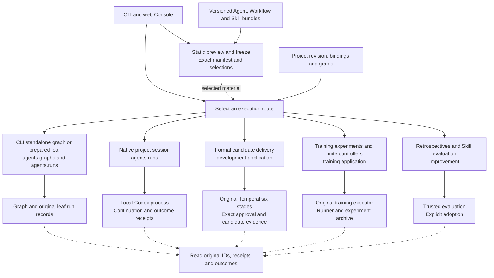

# Ergora framework tour

English · [Documentation](../README.md) · [Architecture contract](current.md)

Ergora is a control plane for project-bound specialist Agents, workflow composition, formal software delivery, training experiments and reusable improvements. Definitions describe reusable behavior. Each operation freezes its own inputs, checks its execution authority and produces evidence under its original identity.

This tour describes published main `0ad3d7655796b3bb3ac2f3cf23f6c9b0f536729c` and its `src` tree `4765f76fdf2d905ff19b5c10b1825820f4d9a4ab`. Packages, installed applications and local definition libraries have separate identities. The [current plan](../PLAN.md) and its delivery records track CI and installation status.

## The whole system

Reusable definitions can be previewed and frozen before an operator selects an execution route. The five branches show who runs each operation and which original records it produces.

Development's [workflow extensions](../../src/ergora/development/runtime/workflows.py) and [executor](../../src/ergora/development/runtime/executor.py) extend the bundled reference. Training's [native entry point](../../src/ergora/training/runtime/execution.py) enters the bundled training executor. Dedicated processes select the installation, configuration and state before importing the reference. [Reference boundary](reference-boundary.md)

## Definitions and execution routes

`DefinitionLibrary` stores immutable Agent and Workflow versions with their complete ordinary-file bundles. The compiler resolves exact ID/version/digest references, ancestor instructions and Skills, permissions, capacity, dependencies and named ports. Structural ancestry supplies instructions and resources. Dependencies order work. Ports carry declared outputs. Inherited material stays within the original grants. Preview and freeze are static operations. Execution binds the selected manifest or session context to the project revision and admitted inputs. [Workflow compiler](../../src/ergora/definitions/workflows.py) · [Save an edited graph under a different template ID](../definitions/workflows/revisions.md#revise-workflows-on-the-page)

### Standalone graph

`ergora composition run-graph` explicitly selects a complete manifest by digest, the exact root input object and a new run directory. The graph runner checks that every leaf has a read-only grant and a backend that supports text-only mode. It walks compiled dependency levels serially under one deadline. Nested workflows receive and return their declared ports. An all-join collects each declared predecessor's outputs under its exact instance path. This path creates an ordinary graph run without a formal task or candidate approval. [Graph commands and limits](../definitions/workflows/compose.md#run-a-standalone-workflow-graph) · [Graph runner](../../src/ergora/agents/graphs.py)

`run.json` records the manifest digest, inputs, attempted child run IDs and any completed graph outputs. Each leaf goes through `agents.runs.run_input`. The graph checks that the original saved input, prompt and result are available and that the input and result digests match the attempted leaf. After an interruption, read the existing graph record and use `composition inspect-run` with each original child ID. The directory is reserved for that original run. [Read an original leaf run](../definitions/workflows/leaf-calls.md#read-an-original-composition-run-by-exact-id)

### One leaf or a native project session

`composition run-input` explicitly runs one admitted leaf. Supply its prerequisite evidence with the prepared input. The backend validates the requested mode; fixed task MCP, when used, exposes the frozen resource table and records resource reads. Backend admission, delivered bytes, actual reading and model quality are separate observations. [Leaf calls](../definitions/workflows/leaf-calls.md)

An ordinary native project session uses the role's original workspace grants. It freezes the role, repository, selected backend configuration and context at session start. The current persistent native session route uses Codex on Linux/WSL2. Continuation selects the latest stopped parent with its saved native session identity and a stable turn intent. The CLI and Console read the same receipt by original session, parent and intent. [Project sessions](../operations/services.md#project-native-sessions)

|Receipt evidence|What it establishes|
|---|---|
|`dispatch`| `reserved` records the request. `attempted` records the original dispatch before launching supervision. `accepted` records that the original supervision process acquired the inherited session lock and accepted the request. `unrecorded` can mean the read raced publication. Damaged or missing required evidence is `incomplete`.|
|`native_start`|The supervision process records the actual child after obtaining its process handle. `running` checks the saved PID, boot ID and process start ticks at readback. `started` preserves verified historical launch evidence. `unrecorded` includes older turns without the receipt. `incomplete` reports a failed publication or invalid evidence.|
|`run` and cleanup|The original run can show a live supervision process, a verified final record or an unknown outcome. Stop request and notification are separate from `execution_stopped`, which confirms the original owner has no remaining execution to reap. Use the same original intent for readback after a lost response.|

The start receipt's metadata writer runs in a separate thread from the native child's sole reaper, so storage publication can stay pending while cancellation and cleanup proceed. The owner bounds any wait for that writer by the original stop and deadline. A missing receipt leaves the independent dispatch and outcome readable. These records concern the local Agent process. Provider receipt and external training execution have their own evidence. [Continuation reader and session owner](../../src/ergora/agents/runs.py) · [Process owner](../../src/ergora/runtime/processes.py)

## From a development request to a reviewable candidate

Choose the formal task route when delivery requires an approved plan, an exact Git candidate and trusted checks. The operator selects the registered repository, exact definitions, baseline, permissions, budget and optional issue, memory and Skill snapshots. `development.application` previews the selected route, prepares and creates the frozen task, then explicitly submits it. Current preparation uses Definition8/Input12 and `PreparationDAGWorkflow`. One native six-stage instance can be explicitly selected beneath a supported ordinary parent composition. The original Temporal run owns these stages.

1. **`inventory`** inspects the exact starting Git objects. Frozen inventory specialists supply declared results to their coordinator; the canonical inventory records the trusted sources.
2. **`plan`** uses that inventory and the selected planning DAG. The original workflow computes the plan receipt digest and waits for **the original owner's approval of that exact request and plan**. `development.application.approve` delivers this decision through the native approval owner. A proposed plan alone grants no work execution.
3. **`work`** runs approved work units (`work:<unit-id>`), respecting dependency commits, path scopes and concurrency limits. Isolated worktrees and original receipts bind each output to its producer; declared ports supply predecessor artifacts.
4. **`integrate`** combines the work through the trusted executor and establishes the candidate Git SHA. An Agent's text cannot substitute for this integration result.
5. **`verify`** runs trusted checks against that candidate. Registered fixed verification freezes its check declaration at task creation and validates the complete check-results report, source binding and process evidence. A model's claim that tests passed is insufficient.
6. **`review`** collects candidate-bound independent sessions, required/advisory duties and verification material. Success returns `REVIEW_READY` with original evidence. Explicit export obtains the exact candidate for human merge review; merge, push and deployment are separate actions.

The [workflow contract](../definitions/workflows/contracts.md) owns detailed graph rules. [Formal recovery](../development/run-and-recover.md) follows the original task and run IDs.

PR/MR review also works without creating a formal development task. `development.review.packets.prepare` captures exact local base/head Git material and requirements; `review.sources.collect` binds supported same-repository platform observations; `review.requests.prepare` freezes reviewer inputs and `report` aggregates actual results. Issue snapshots are optional context. External comments/labels and candidate associations have explicit writeback owners; collecting a review does not approve or merge a remote request.

## Training experiments and evaluation

**Training optimization.** `training.application` previews/registers baselines and runners, prepares experiment manifests, submits original runs, explicitly requests managed execution, reads archives and delivers exact-evidence approval. `training.native` uses dedicated operations/readers; `training.runtime.execution.Execution` checks the original queued run and publishes a single request/launch chain before the native executor enters its existing lock, sandbox, runner and archive path. `training.execution_protocol` owns cross-process records, source/context bindings and offline lifecycle reads. Target models, optimizers, datasets, gradients and numerical quality remain the target training project's responsibility.

`training.search` freezes a finite candidate package. `training.cycles` authorizes a bounded controller; `training.runtime.worker` executes its supported protocol using the original submission, budget and stop owners. Current consent distinguishes full-accepted execution from bounded screen/profile/no-effect-skip. `training.rounds` links original observations; its index neither executes candidates nor advances the baseline. Resource grants, specialist proposals, experiment execution and evidence approval stay separate. A template's GPU topology or optimization suggestion is not a GPU measurement.

**Improvement, memory and RSI.** `improvement.retrospectives` turns source-bound handoff material into checked Skill, memory or Workflow candidates. `memory` owns revisions, validity, deletion/restore and optional ReMe mirroring. `evaluation` freezes trusted evaluator files and train/validation/holdout cases, then binds results to exact Skill content. Optional GEPA search in `optimization` proposes Skill text and evaluates visible cases under call/time/reported-cost bounds; failed or unknown cost coverage remains explicit. `skill_adoption.adopt` compares full-suite runs and explicitly moves a revision-checked head; rollback and later task-context freezing are separate operations. This RSI path improves reusable instructions and workflows, rather than training model weights. Project-document correction suggestions have their own exact-preview consent/apply owner. Research scheduling and native kernel campaigns retain separate domain lifecycles and capability checks.

## Where each responsibility lives

|Responsibility|Code entry points and contract|
|---|---|
|Transport and pages|[cli.main](../../src/ergora/interfaces/cli.py), [web.create_app](../../src/ergora/interfaces/web.py), [console assets](../../src/ergora/data/console). Parse requests and render domain results; pages own no scheduler.|
|Configuration|[catalog](../../src/ergora/configuration/catalog.py), [bindings](../../src/ergora/configuration/bindings.py), [projects](../../src/ergora/configuration/projects.py), [registrations](../../src/ergora/configuration/registrations.py). Effective choices, project revisions and one-way native publication.|
|Reusable assets|[agents](../../src/ergora/definitions/agents.py), [workflows](../../src/ergora/definitions/workflows.py), [bundles](../../src/ergora/definitions/bundles.py), [skills](../../src/ergora/definitions/skills.py). Admission, compilation, immutable content and active Skill heads.|
|Graph and Agent calls|[graphs](../../src/ergora/agents/graphs.py), [runs](../../src/ergora/agents/runs.py), [native record readers](../../src/ergora/agents/native_sources.py), [invocation](../../src/ergora/agents/invocation.py), [backends](../../src/ergora/agents/backends.py), [MCP](../../src/ergora/agents/mcp.py). Standalone dispatch, leaf and session records, backend selection, native processes and fixed resources.|
|Development and review|[application](../../src/ergora/development/application.py), [native](../../src/ergora/development/native.py), [runtime](../../src/ergora/development/runtime), [review](../../src/ergora/development/review), [verification](../../src/ergora/development/verification.py). Exact task/candidate decisions and trusted evidence.|
|External sources|[issue backends](../../src/ergora/issues/backends.py), [snapshots](../../src/ergora/issues/snapshots.py), [writebacks](../../src/ergora/issues/writebacks.py). Platform identity, frozen context and attempted external effects.|
|Training|[application](../../src/ergora/training/application.py), [execution protocol](../../src/ergora/training/execution_protocol.py), [runtime](../../src/ergora/training/runtime), [cycles](../../src/ergora/training/cycles.py), [rounds](../../src/ergora/training/rounds.py). Original experiments, finite controllers and observation links.|
|Improvement|[retrospectives](../../src/ergora/improvement/retrospectives.py), [memory](../../src/ergora/improvement/memory.py), [evaluation](../../src/ergora/improvement/evaluation.py), [optimization](../../src/ergora/improvement/optimization.py), [adoption](../../src/ergora/improvement/skill_adoption.py). Generation, evaluation and explicit reuse.|
|Persistence and live resources|[State](../../src/ergora/storage/state.py), [assets](../../src/ergora/storage/assets.py), [Git material](../../src/ergora/storage/git.py), [processes](../../src/ergora/runtime/processes.py), [budget clock](../../src/ergora/runtime/budget_clock.py), [GPU pool](../../src/ergora/runtime/gpu_pool.py). Durable control records, complete material and owned lifetimes.|
|Native integration and operations|[resources](../../src/ergora/native/resources.py), [compiler](../../src/ergora/native/compiler.py), [registration](../../src/ergora/native/registration.py), [operations](../../src/ergora/operations). Source identity, isolated integration, diagnostics, services and coordinated backups.|

## Evidence, recovery and current limits

Control-plane SQLite is not the execution ledger: native task/training directories retain original jobs, claims, receipts, archives and runtime history. Exact Git objects, bundle digests, raw-file hashes and record digests have [distinct identity contracts](contracts/identities.md). A changed registration or library head affects new selections; recovery reads the original frozen materials.

External effects record an attempt before sending. A lost reply remains **unknown** until reconciliation of the original ID/history/receipt; restarting cannot authorize duplicate execution. Budgets retain their original clock and consumed slots across recovery. Cancellation delivery, fences, actual process stopping, durable cleanup, terminal outcome and lease release are separate facts. Each supervised subtree has one reaper; its stopped record follows actual collection, and it cannot spawn after stopping. See [development](execution/development.md) and [training recovery](execution/training.md) before changing these owners.

General Repeat, arbitrary mixed-stage graphs, multiple native six-stage instances and the protected human design-approval channel remain outside the current execution scope. Optional backend modes, ReMe, GEPA, research and ForgeKernel depend on actual integration support and availability. Model quality and GPU gains require corresponding run evidence. Full native development and persistent Codex sessions use Linux/WSL2. Windows has its own control-plane and backend support. Local containers run in the trusted current-user boundary. [Supported scope](current.md) · [Windows guide](../install/windows.md) · [Current plan](../PLAN.md)

## A short source-reading route

1. Start at `interfaces.cli.main` or `interfaces.web.create_app`; follow one domain call.
2. Read `configuration.catalog`, `bindings` and `registrations` for effective authority and publication.
3. Follow `definitions.workflows.preview` into `_Compilation` and `DefinitionLibrary` for frozen material, then `agents.graphs.run_graph` for standalone execution and `agents.runs` for original leaf or session receipts.
4. Trace `development.application` → `development.native` → `PreparationDAGWorkflow` → bundled `DevelopmentWorkflow.run`.
5. Read `development.runtime.executor.Executor`, `jobs` and `verification`, then `agents.invocation.invoke` and `AgentBackend`.
6. Compare `training.application.execute`, `runtime.execution.Execution` and `execution_protocol`; follow the native runner and controller separately.
7. Trace `retrospectives` → candidate import/evaluation → `skill_adoption.adopt` → `development.context` for the next task.
8. Finish with `storage.state`, `runtime.processes` and `budget_clock`; inspect the relevant recovery guide and [component protocol](component-change-protocols.md) before editing.

Keep this tour focused on relationships and boundaries. Update affected source links and explanations when ownership changes; keep detailed schemas, operational commands and changing acceptance status in their existing owners.
