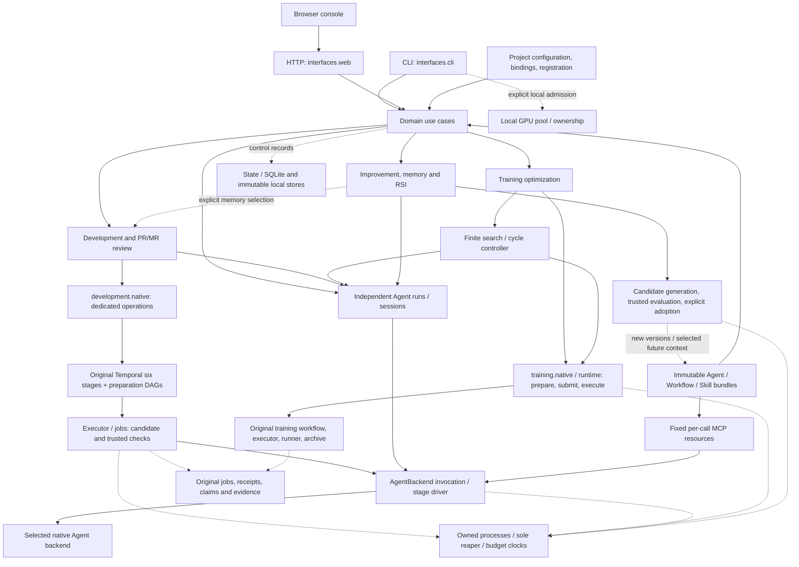

# Ergora framework tour

English · [Documentation](../README.md) · [Architecture contract](current.md)

Ergora is a control plane for project-bound specialist Agents, formal software delivery, training optimization, and improvements carried into later work. Its central question is: **which exact inputs, authority, candidate and evidence belong to this operation?** Definitions describe reusable behavior; domain use cases admit concrete operations; execution owners produce original receipts; explicit decisions approve plans, release results or adopt improvements.

This tour follows source baseline `23724780b7b41598925068c8c0fa9853cc9d9483`. The [current plan](../PLAN.md) owns changing delivery status. A source checkout, published package, installed daily application and stored definition library have separate identities; the daily installation can run older code. Verify the selected installation before attributing source behavior to it.

## The whole system

Solid arrows show requests, execution or supplied material; dotted arrows show persistence, resource use or explicit reuse. The three domain paths share infrastructure while keeping their own authorization and recovery records.

The native boundary is concrete. [Development workflow extensions](../../src/ergora/development/runtime/workflows.py) inherit the bundled [DevelopmentWorkflow](../../src/ergora/data/reference/platform/upstream/platform/dev_platform/workflow.py); [Executor](../../src/ergora/development/runtime/executor.py) inherits the bundled [native executor](../../src/ergora/data/reference/platform/local/agent_platform/executor.py). Training's [native_main](../../src/ergora/training/runtime/execution.py) enters the bundled [training executor](../../src/ergora/data/reference/platform/local/agent_platform/training_executor.py). Dedicated processes select installation/configuration/state before native imports. HTTP does not hot-switch native globals in one interpreter. See the [reference boundary](reference-boundary.md) for exact operations.

## From a development request to a reviewable candidate

Consider a registered repository receiving a request to change its implementation. The operator selects exact definitions, baseline, permissions, budget and optional issue/memory/Skill context. `development.application.prepare`, `preview` and `create` freeze and validate these materials; `start` submits the original task. Current preparation uses Definition8/Input12 and `PreparationDAGWorkflow`. This is one native instance with six stages:

1. **`inventory`** inspects the exact starting Git objects. Frozen inventory specialists supply declared results to their coordinator; the canonical inventory records the trusted sources.
2. **`plan`** uses that inventory and the selected planning DAG. The original workflow computes the plan receipt digest and waits for **the original owner's approval of that exact request and plan**. `development.application.approve` delivers this decision through the native approval owner. A proposed plan alone grants no work execution.
3. **`work`** runs approved work units (`work:<unit-id>`), respecting dependency commits, path scopes and concurrency limits. Isolated worktrees and original receipts bind each output to its producer; declared ports supply predecessor artifacts.
4. **`integrate`** combines the work through the trusted executor and establishes the candidate Git SHA. An Agent's text cannot substitute for this integration result.
5. **`verify`** runs trusted checks against that candidate. Registered fixed verification freezes its check declaration at task creation and validates the complete check-results report, source binding and process evidence. A model's claim that tests passed is insufficient.
6. **`review`** collects candidate-bound independent sessions, required/advisory duties and verification material. Success returns `REVIEW_READY` with original evidence. Explicit export obtains the exact candidate for human merge review; merge, push and deployment are separate actions.

The [workflow contract](../definitions/workflows/contracts.md) owns detailed graph rules. Structural ancestry supplies instructions/resources, control dependencies order work, and named ports carry declared outputs. These are three different relationships. Inherited material expands context within the grant; it does not enlarge permissions. [Operational guidance](../development/run-and-recover.md) retains original task/run IDs throughout recovery.

PR/MR review also works without creating a formal development task. `development.review.packets.prepare` captures exact local base/head Git material and requirements; `review.sources.collect` binds supported same-repository platform observations; `review.requests.prepare` freezes reviewer inputs and `report` aggregates actual results. Issue snapshots are optional context. External comments/labels and candidate associations have explicit writeback owners; collecting a review does not approve or merge a remote request.

## Three complementary work paths

**Definitions and Agent execution.** `DefinitionLibrary` stores complete ordinary-file bundles, including attachments and executable bits. Workflow compilation resolves immutable ID/version/digest references, complete ancestors, permissions, named ports and scoped capacity; a preview is explicitly non-executable. An independent `agents.runs.run_input` invokes one admitted leaf without scheduling its predecessors. `agents.invocation.invoke` asks the family factory for an `AgentBackend`, validates its actual mode, launches its native command and checks structured results. Fixed task MCP exposes only the frozen resource table and records read coverage. Backend admission, delivered bytes, actual reading and model quality remain separate observations.

**Training optimization.** `training.application` previews/registers baselines and runners, prepares experiment manifests, submits original runs, explicitly requests managed execution, reads archives and delivers exact-evidence approval. `training.native` uses dedicated operations/readers; `training.runtime.execution.Execution` checks the original queued run and publishes a single request/launch chain before the native executor enters its existing lock, sandbox, runner and archive path. `training.execution_protocol` owns cross-process records, source/context bindings and offline lifecycle reads. Target models, optimizers, datasets, gradients and numerical quality remain the target training project's responsibility.

`training.search` freezes a finite candidate package. `training.cycles` authorizes a bounded controller; `training.runtime.worker` executes its supported protocol using the original submission, budget and stop owners. Current consent distinguishes full-accepted execution from bounded screen/profile/no-effect-skip. `training.rounds` links original observations; its index neither executes candidates nor advances the baseline. Resource grants, specialist proposals, experiment execution and evidence approval stay separate. A template's GPU topology or optimization suggestion is not a GPU measurement.

**Improvement, memory and RSI.** `improvement.retrospectives` turns source-bound handoff material into checked Skill, memory or Workflow candidates. `memory` owns revisions, validity, deletion/restore and optional ReMe mirroring. `evaluation` freezes trusted evaluator files and train/validation/holdout cases, then binds results to exact Skill content. Optional GEPA search in `optimization` proposes Skill text and evaluates visible cases under call/time/reported-cost bounds; failed or unknown cost coverage remains explicit. `skill_adoption.adopt` compares full-suite runs and explicitly moves a revision-checked head; rollback and later task-context freezing are separate operations. This RSI path improves reusable instructions and workflows, rather than training model weights. Project-document correction suggestions have their own exact-preview consent/apply owner. Research scheduling and native kernel campaigns retain separate domain lifecycles and capability checks.

## Where each responsibility lives

|Responsibility|Code entry points and contract|
|---|---|
|Transport and pages|[cli.main](../../src/ergora/interfaces/cli.py), [web.create_app](../../src/ergora/interfaces/web.py), [console assets](../../src/ergora/data/console). Parse requests and render domain results; pages own no scheduler.|
|Configuration|[catalog](../../src/ergora/configuration/catalog.py), [bindings](../../src/ergora/configuration/bindings.py), [projects](../../src/ergora/configuration/projects.py), [registrations](../../src/ergora/configuration/registrations.py). Effective choices, project revisions and one-way native publication.|
|Reusable assets|[agents](../../src/ergora/definitions/agents.py), [workflows](../../src/ergora/definitions/workflows.py), [bundles](../../src/ergora/definitions/bundles.py), [skills](../../src/ergora/definitions/skills.py). Admission, compilation, immutable content and active Skill heads.|
|Agent calls|[backends](../../src/ergora/agents/backends.py), [runs](../../src/ergora/agents/runs.py), [invocation](../../src/ergora/agents/invocation.py), [MCP](../../src/ergora/agents/mcp.py), [stage_driver](../../src/ergora/agents/stage_driver.py). Family selection, sessions, native execution and fixed resources.|
|Development and review|[application](../../src/ergora/development/application.py), [native](../../src/ergora/development/native.py), [runtime](../../src/ergora/development/runtime), [review](../../src/ergora/development/review), [verification](../../src/ergora/development/verification.py). Exact task/candidate decisions and trusted evidence.|
|External sources|[issue backends](../../src/ergora/issues/backends.py), [snapshots](../../src/ergora/issues/snapshots.py), [writebacks](../../src/ergora/issues/writebacks.py). Platform identity, frozen context and attempted external effects.|
|Training|[application](../../src/ergora/training/application.py), [execution protocol](../../src/ergora/training/execution_protocol.py), [runtime](../../src/ergora/training/runtime), [cycles](../../src/ergora/training/cycles.py), [rounds](../../src/ergora/training/rounds.py). Original experiments, finite controllers and observation links.|
|Improvement|[retrospectives](../../src/ergora/improvement/retrospectives.py), [memory](../../src/ergora/improvement/memory.py), [evaluation](../../src/ergora/improvement/evaluation.py), [optimization](../../src/ergora/improvement/optimization.py), [adoption](../../src/ergora/improvement/skill_adoption.py). Generation, evaluation and explicit reuse.|
|Persistence and live resources|[State](../../src/ergora/storage/state.py), [assets](../../src/ergora/storage/assets.py), [Git material](../../src/ergora/storage/git.py), [processes](../../src/ergora/runtime/processes.py), [budget clock](../../src/ergora/runtime/budget_clock.py), [GPU pool](../../src/ergora/runtime/gpu_pool.py). Durable control records, complete material and owned lifetimes.|
|Native integration and operations|[resources](../../src/ergora/native/resources.py), [compiler](../../src/ergora/native/compiler.py), [registration](../../src/ergora/native/registration.py), [operations](../../src/ergora/operations). Source identity, isolated integration, diagnostics, services and coordinated backups.|

## Evidence, recovery and current limits

Control-plane SQLite is not the execution ledger: native task/training directories retain original jobs, claims, receipts, archives and runtime history. Exact Git objects, bundle digests, raw-file hashes and record digests have [distinct identity contracts](contracts/identities.md). A changed registration or library head affects new selections; recovery reads the original frozen materials.

External effects record an attempt before sending. A lost reply remains **unknown** until reconciliation of the original ID/history/receipt; restarting cannot authorize duplicate execution. Budgets retain their original clock and consumed slots across recovery. Cancellation delivery, fences, actual process stopping, durable cleanup, terminal outcome and lease release are separate facts. Each supervised subtree has one reaper; its stopped record follows actual collection, and it cannot spawn after stopping. See [development](execution/development.md) and [training recovery](execution/training.md) before changing these owners.

Implemented paths include formal six-stage development, independent leaf/session calls, exact local/platform review material, managed training, finite controllers, and explicit improvement/adoption. Generalized Repeat, arbitrary mixed-stage graphs and multiple native six-stage instances are not a general executable scheduler. Optional backend modes, ReMe, GEPA, research and ForgeKernel require their actual integration support and availability; metadata, credentials or a successful doctor check establish no model/GPU result. Linux/WSL2 execution and native Windows control-plane/static support have different boundaries. The trusted current-user container is not inter-Agent OS isolation. [Supported scope](current.md) and the [plan](../PLAN.md) own the detailed limits and pending work.

## A short source-reading route

1. Start at `interfaces.cli.main` or `interfaces.web.create_app`; follow one domain call.
2. Read `configuration.catalog`, `bindings` and `registrations` for effective authority and publication.
3. Follow `definitions.workflows.preview` into `_Compilation` and `DefinitionLibrary` for frozen material.
4. Trace `development.application` → `development.native` → `PreparationDAGWorkflow` → bundled `DevelopmentWorkflow.run`.
5. Read `development.runtime.executor.Executor`, `jobs` and `verification`, then `agents.invocation.invoke` and `AgentBackend`.
6. Compare `training.application.execute`, `runtime.execution.Execution` and `execution_protocol`; follow the native runner and controller separately.
7. Trace `retrospectives` → candidate import/evaluation → `skill_adoption.adopt` → `development.context` for the next task.
8. Finish with `storage.state`, `runtime.processes` and `budget_clock`; inspect the relevant recovery guide and [component protocol](component-change-protocols.md) before editing.

Keep this tour focused on relationships and boundaries. Update affected source links and explanations when ownership changes; keep detailed schemas, operational commands and changing acceptance status in their existing owners.
