# Ergora framework tour

English · [Documentation](../README.md) · [Architecture contract](current.md)

Ergora is a control plane for project-bound specialist Agents, workflow composition, formal software delivery, training experiments and reusable improvements. Definitions describe reusable behavior. Each operation freezes its own inputs, checks its execution authority and produces evidence under its original identity.

This tour uses runtime revision `9839d2765cae034fce7bf242c796e599c0969040` and its `src` tree `f84311ffaa18a3b52516de0d0e75eeae8b24413b` as the exact source reference. Packages, installed applications and local definition libraries have separate identities. The [current plan](../PLAN.md) and its delivery records track review, CI and installation status.

## The whole system

The template library offers exact bundled and saved starter graphs. An operator can preview and freeze a template before choosing its execution route.

```mermaid
flowchart TB
  Entry["CLI and web Console"] --> Select["Select an operation"]
  Entry --> Freeze["Static preview and freeze<br/>Exact manifest and selections"]
  Entry --> RoutePreview["Selected-route preview<br/>Static admission and exact blocker"]
  Entry -->|CLI| SharedCases["Shared case CLI<br/>Local Markdown library"]
  Assets["Starter library<br/>Default six-stage or another exact graph"] --> Freeze
  Freeze -. "selected material" .-> Select
  Freeze -. "original graph and bindings" .-> RoutePreview
  RoutePreview -. "admission facts" .-> Select
  Config["State home, project revision, bindings and grants"] --> Select

  Select --> Check["Fixed-check CLI<br/>Separate authorization"]
  Select --> Graph["Standalone graph<br/>Ready Agents and declared policies"]
  Select --> Session["Prepared leaf or native project session<br/>Fresh Codex turns check recalled memory"]
  Select --> NativeImplementer["Native CLI implementer<br/>Antigravity and DeepSeek options"]
  Select --> Dev["Formal task<br/>Original preparation and creation readiness"]
  Select --> Train["Training experiments and finite controllers<br/>training.application"]
  Select --> Campaign["Campaign operator CLI<br/>Record, observe or stop"]
  Select --> Improve["Retrospectives and Skill evaluation<br/>improvement"]

  Check --> CheckJob["Registered executor<br/>Original fixed-check Job"]
  Graph --> GraphProof["Offline inspect-graph<br/>Saved recovery and historical Agent evidence"]
  Graph --> Choice["Optional supervisor checkpoint<br/>Original recommendation or finish"]
  Choice -. "saved decision" .-> GraphProof
  Choice -. "predeclared Python follow-up" .-> Child["Pinned fixed review<br/>Original grant, deadline and STOP"]
  Child -. "original child receipt" .-> GraphProof
  Choice -. "selected packaging consultation" .-> Consultation["Packaged reviewer request and reply<br/>Original Agent evidence"]
  Consultation -. "saved consultation decision" .-> GraphProof
  Graph --> BranchPolicy["Declared failure policy<br/>Independent branches and required outputs"]
  BranchPolicy -. "verified failure or omitted output" .-> GraphProof
  Graph --> Gate["verify-fixed-check<br/>Receipt gate before advisory review"]
  CheckJob -. "receipt or bounded wait" .-> Gate
  Gate --> GraphProof
  Graph --> CandidateRead["verify-evidence<br/>One read alongside ready Agents"]
  CandidateRead -. "verified evidence" .-> GraphProof
  Graph --> FlowMap["Training proposal<br/>Verified FlowMap before profile"]
  FlowMap -. "original producer or block" .-> GraphProof
  Graph -. "Agent graph, saved proof or interrupted wait" .-> Resume["Opt-in resume-graph<br/>Acquire original lock and check saved cutoffs"]
  Resume --> GraphProof
  Session --> Turn["Original leaf result or Codex turn<br/>Dispatch and native observations"]
  Dev -. "explicit preparation selection" .-> CaseLeaf["One frozen preparation leaf<br/>Current-case check at first intent if required<br/>Saved-intent replay"]
  SharedCases -. "operator selects ID, revision and digest" .-> CaseLeaf
  Dev -->|explicit submit| Six["Original Temporal six stages<br/>Exact approval and candidate evidence"]
  Train --> Runner["Original training executor<br/>Guard preflight, runner and archive"]
  Campaign --> CampaignRun["Original Temporal campaign<br/>Explicit observations, STOP and expiry"]
  Campaign --> Worker["Local record-only Worker service<br/>Poll health and original STOP fence"]
  Worker -. "original queue" .-> CampaignRun
  CampaignRun -. "confirmed record-only rollover" .-> Rollover["One verified successor Run<br/>Original Job and deadline"]
  CampaignRun --> CampaignRead["Optional timer or immediate due read<br/>One guarded status Activity"]
  CampaignRead -->|fixed-check wake| Ready["One verified original readiness<br/>Guarded result or opted-in observation"]
  CampaignRead -. "managed full result with optional live wait" .-> TrainingRoot["Observed training root<br/>Result and separate lease evidence"]
  CampaignRead -. "full-result read heartbeat timeout" .-> FullResultRecovery["Opt-in full-result receipt-only Activity<br/>Same Run, read window and STOP"]
  FullResultRecovery -. "verified saved result and cleanup" .-> TrainingRoot
  CampaignRead -. "guarded managed screen" .-> ScreenRoot["Observed screen decision<br/>Original outcome and separate lease"]
  CampaignRead -. "guarded owner release" .-> ReleaseRoot["Observed local owner release<br/>Original Run, attempt, session and lease"]
  CampaignRead -. "release read heartbeat timeout" .-> ReleaseRecovery["Opt-in receipt-only Activity<br/>Same Run, read window and STOP"]
  ReleaseRecovery -. "verified receipt and cleanup" .-> ReleaseRoot
  TrainingRoot -. "recorded prerequisite result" .-> DependentCheck["Dependent fixed-check observation<br/>Live eligibility and pre-authorized Job"]
  CheckJob -. "own original Job evidence" .-> DependentCheck
  CampaignRun -. "confirmed passing observation" .-> Ready
  Ready --> Wake["Opt-in Codex wake<br/>One original attempt and owned STOP"]
  TrainingRoot -. "opt-in verified training readiness" .-> Wake
  ScreenRoot -. "opt-in verified screen decision" .-> Wake
  ReleaseRoot -. "opt-in verified owner release" .-> Wake
  Wake --> Turn
  Improve --> Eval["Trusted evaluation<br/>Reviewed identity and explicit adoption"]

  GraphProof -.-> Recover["Read original IDs, receipts and outcomes"]
  CheckJob -.-> ActionRead["Original action observation<br/>Fixed-check and training receipts"]
  Turn -.-> Recover
  NativeImplementer -. "original native terminal and result" .-> Recover
  Six -. "Plan lookup by original Run" .-> Recover
  Runner -.-> Recover
  Runner -. "archive retained after failure" .-> RetainedArchive["Training evidence<br/>Explicit retained archive read"]
  Runner -. "passing managed full archive" .-> Primary["Durable primary checkpoint<br/>Before original tracking"]
  Primary -. "saved evidence" .-> RetainedArchive
  RetainedArchive -.-> Recover
  Runner -. "original managed attempt" .-> Lease["Training execution readback<br/>Bounded release proof and historical clock"]
  Lease -.-> ActionRead
  ActionRead -. "same original Job" .-> CampaignRead
  ActionRead -. "original Job status" .-> CampaignStatus
  ActionRead -.-> Recover
  CampaignRun -. "live Workflow state or verified History" .-> CampaignStatus["Campaign status<br/>History timing and Job correlation"]
  Rollover -. "first and current Run" .-> CampaignStatus
  CampaignRead -. "verified completion or full-result read terminal" .-> CampaignStatus
  FullResultRecovery -. "full-result timeout and recovery events" .-> CampaignStatus
  TrainingRoot -. "verified root result" .-> CampaignStatus
  ScreenRoot -. "retained decision evidence" .-> CampaignStatus
  ReleaseRoot -. "original release receipt" .-> CampaignStatus
  ReleaseRecovery -. "original timeout and recovery events" .-> CampaignStatus
  DependentCheck -. "saved observation Update" .-> CampaignStatus
  Ready -. "original readiness evidence" .-> CampaignStatus
  Wake -. "same native receipt" .-> CampaignStatus
  CampaignStatus -. "selected task and direct dependency states" .-> ConsoleTimeline["Formal Tasks timeline<br/>Selected eligibility and original evidence"]
  ConsoleTimeline -.-> Recover
  CampaignStatus -.-> Recover
  Eval -.-> Recover
  Recover -. "offline recovery check" .-> Scope["Registered recovery scope<br/>Original paths, Git and SQLite"]
```

Development's [workflow extensions](../../src/ergora/development/runtime/workflows.py) and [executor](../../src/ergora/development/runtime/executor.py) extend the bundled reference. Training's [native entry point](../../src/ergora/training/runtime/execution.py) enters the bundled training executor. Dedicated processes select the installation, configuration and state before importing the reference. [Reference boundary](reference-boundary.md)

`ergora memory shared` searches and reads an explicitly selected local Markdown library from any workspace, independently of project State. A pinned read checks the case revision and digest. Publishing checks the reviewed Markdown SHA-256 and expected revision. [Shared local case library](../improvement/memory.md#shared-local-case-library)

## Definitions and execution routes

`DefinitionLibrary` stores immutable Agent and Workflow versions with their complete ordinary-file bundles. The compiler resolves exact ID/version/digest references, ancestor instructions and Skills, permissions, capacity, dependencies and named ports. Structural ancestry supplies instructions and resources. Dependencies order work. Ports carry declared outputs. Inherited material stays within the original grants. Preview and freeze are static operations. Execution binds the selected manifest or session context to the project revision and admitted inputs. [Workflow compiler](../../src/ergora/definitions/workflows.py)

“New template” preselects the bundled six-stage graph. Other bundled graphs and exact saved versions are peer choices. The selected starter opens an editable draft under its own destination ID and version. Formal task admission separately checks the published graph and explicitly selected route. [Choose a starter and save a template](../definitions/workflows/revisions.md#revise-workflows-on-the-page)

The optional route check in the definition preview takes the selected standalone graph inputs, complete formal task definition, or prepared leaf. CLI, HTTP and Console show the static admission and required bindings from the original execution gates. A refusal names the affected instance when the gate identifies one. The route facts preserve the graph and manifest identities, and live readiness remains `not_queried`. [Inspect a selected execution route](../definitions/workflows/compose.md#inspect-a-selected-execution-route) · [Preview entry point](../../src/ergora/interfaces/composition_preview.py)

### Standalone graph

`ergora composition run-graph` selects a complete manifest by digest, the exact root inputs and a new run directory. Read-only, text-only Agent leaves start when their dependencies are satisfied and project, root and ancestor concurrency limits have room. A ready successor can run while an unrelated branch is still active. The graph coordinator reserves each original attempt before dispatch. Failure fences new dispatch by default. Global STOP and expiry fence dispatch and drain the original owned calls. Nested workflows pass declared ports, and all-joins collect outputs by exact instance path. [Graph commands and limits](../definitions/workflows/compose.md#run-a-standalone-workflow-graph) · [Graph runner](../../src/ergora/agents/graphs.py)

For a standalone Workflow v2 graph of Agents, Workflows and all-joins with ordinary ports, the root can explicitly name a direct Agent in `completion.continue_after_failure` and declare `optional_outputs`. A verified original normal exit with a code from 1 to 255 blocks hard dependents and lets independent branches finish under the same deadline. The graph retains the original failure and records blocked optional ports in `unavailable_outputs`. Success requires all required outputs. Other failures, global STOP and expiry still fence new work. [Declared branch failure policy](../definitions/workflows/compose.md#continue-independent-work-after-a-declared-failure)

- `choose-agent` reads the verified analyzer result and records the decision before any follow-up dispatch. Its typed route selects one declared sibling Agent or `none`. The all-join carries the selected branch's original result and explicit skipped states for untaken branches. [Routing contract](../definitions/workflows/contracts.md#conditional-agent-routing)
- An operator can select one frozen `choose-agent` instance with `run-graph --recoverable --pause-before-route`. A specialist recommendation pauses before its original reservation. `resume-graph` accepts `follow-up` or `finish` at the same checkpoint digest, under the same owner lock and deadline. A `none` recommendation completes the selector without a pause. [Decide on a recommended follow-up](../definitions/workflows/compose.md#decide-on-a-recommended-follow-up)
- The Python `ergora.agents.graphs.run_graph` entry can pin one fixed-check review child with `fixed_follow_up=PinnedFixedReview(...)` when admitting a recoverable parent at its selected route pause. It binds the declared branch, exact child manifest and inputs, and a passing original fixed-check receipt. The supervisor's decision, original grant, deadline and STOP carry into the child. Parent recovery corroborates the saved child reservation, original attempt, verification proof and named output. An incomplete child remains unresolved. [Pinned Python follow-up](../definitions/workflows/compose.md#decide-on-a-recommended-follow-up)
- `--packaging-consultation` uses the original supervised checkpoint to ask one fixed question about an eager Temporal import in the standalone CLI. It pins the complete `ergora-structure-reviewer@1.0.2` and `ergora-dependency-reviewer@1.0.1` references. The graph verifies the original Agent input, prompt and result before issuing the scoped request and accepting the matching reply under the original deadline and STOP. A wrong reply blocks dependent output and leaves the specialist's original result readable. `inspect-graph` reads the request and reply evidence under the original graph identity. [Confirm one packaging consultation](../definitions/workflows/compose.md#confirm-one-packaging-consultation)
- `verify-evidence` takes an exact original fixed-verify locator from a declared root input. The native reader uses the registered reference installation, original Temporal History and Job artifacts to validate the candidate, receipt, complete check results and process records. One candidate evidence read can wait alongside dependency-ready Agents. The graph saves the original locator and verified result before exposing the node's output and joins the original reader on stop or deadline. The formal executor owns execution of that verify Job. [Verification readback](../definitions/workflows/compose.md#read-original-fixed-verification-evidence)
- `verify-fixed-check` reads a separately authorized fixed-check Job. Given a queued or attempted Job, it can wait until the earlier of the original graph deadline and the requested observation window. The original executor owns check execution, stop and cleanup. The gate requires a passing receipt and confirmed cleanup bound to the exact candidate, review packet, frozen manifest and prepared task before the pinned correctness reviewer starts. The graph publishes the verified receipt and report identities in `proof` alongside the separate advisory result. [Gated advisory review](../definitions/workflows/compose.md#gate-an-advisory-review-on-a-completed-fixed-check)

In the standalone `ergora-training-proposal@4.2.12` graph, profile receives the original task with its checked FlowMap and producer identity. The gate verifies the map against the original source and baseline digests. Null, missing, malformed, mismatched or over-limit evidence blocks profile before reservation and preserves the independent design result. `inspect-graph` can corroborate the saved block from the original task and producer. [Training proposal and original evidence](../training/proposals.md#organize-complete-proposals-around-bottlenecks)

After an interrupted run, `composition inspect-graph` uses the original directory and manifest digest and opens the existing control database read-only. It reports the saved graph status and attempts alongside the observed original Agent input, prompt and result identities. A corroborated route matches the frozen branches and original analyzer evidence. Saved verification references show native receipts as `not_queried`.

For recoverable runs, `recovery` reports the saved authorization, lock file identity, clock and stop observations, and the binding of local fixed-check attempt and completion witnesses. A matching completion can appear alongside captured `attempted` progress after the coordinator advances. Valid saved evidence remains readable when comparison with the current boot is unavailable. `owner_activity` stays `unknown`. [Graph observation](../definitions/workflows/compose.md#observe-an-original-graph-run)

For a collected text-only graph leaf on Linux/WSL2, `original_run.process_start` can show the historical direct local child's PID, boot ID and start ticks. The original process owner samples the child at launch and returns the sample after its wait. The leaf reader verifies the sample's binding to the original run, frozen input and prompt. The graph-level `process_start` and `stop_and_cleanup` fields remain `unknown`. Use `composition inspect-run` on the exact original leaf run ID for complete result content. [Original leaf readback](../definitions/workflows/leaf-calls.md#read-an-original-composition-run-by-exact-id)

On Linux/WSL2, graphs with read-only, text-only Agent leaves, nested Workflows, all-joins and `choose-agent` can opt into recovery at launch with `run-graph --recoverable`. `resume-graph` acquires the original lock and checks admission for the same directory, control home, boot and saved deadline. It verifies original reservations and successful Agent results to reconstruct the graph's ports. Saved typed choices must match the original analyzer result. If a choice is missing and its dependent work has yet to be prepared or reserved, the coordinator records the same branch or `none` before proceeding. Only previously unreserved, ready Agent leaves can start. An active, stopped, terminal or expired graph, or any unproven original Agent attempt, blocks resume. [Standalone recovery](../definitions/workflows/compose.md#resume-an-interrupted-graph)

The pinned correctness-review graph can opt in with a completed locator or a bounded wait on its separately authorized fixed-check Job. When passing proof is already durable, resume revalidates it within the first gate read's saved cutoff and the graph deadline. For proof from an initial wait, the native reader uses the captured receipt and report digests for a completed lookup of the same Job. The graph keeps the original wait locator and proof.

A surviving reader can hold the original lock after coordinator loss. Once resume acquires the lock, it can continue an unfinished wait whose durable attempt matches the saved `attempted` progress, with no completion record or dependent work. The native reader observes the same authorized Job under the original cutoff and graph deadline. The graph durably records passing proof before preparing the reviewer. The original executor retains ownership of the Job. Formal `verify-evidence` uses ordinary standalone execution. [Fixed-check-gated recovery](../definitions/workflows/compose.md#resume-a-fixed-check-gated-review)

### Separately authorized fixed checks

On Linux/WSL2, `task candidate-check` authorizes one fixed-check Job for an already exported Git candidate using an exact request SHA256 and a stable operation ID. The registered reference executor runs `CandidateCheckJob` under the original clock, owns checker launch and cleanup, and publishes the scoped receipt. `task candidate-check-status` reads that original Job and `task candidate-check-stop` fences it. The checker Job's execution authority stays with its original permit and executor. [Fixed-check CLI and recovery](../development/run-and-recover.md#run-registered-fixed-checks-on-an-exported-candidate) · [Native operation](../../src/ergora/development/runtime/candidate_checks.py) · [Job owner](../../src/ergora/development/runtime/jobs.py)

The fixed-check status CLI and Campaign status Activity share the same read-only original action observer. `training execution` uses its training operation to read the registered attempt. The observer verifies returned identities through the original native readers. Outcome, executor stop and resource release each come from their owner. [Original action observations](../../src/ergora/runtime/action_observations.py)

### Campaign operator record

On Unix, `campaign create` binds an exact confirmed plan to the original published project revision, selected Temporal scheduler and absolute expiry. This operator entry uses local Unix process assurance. `campaign status` reads saved evidence offline or verifies the first Start event in the original Temporal History online. After a saved Start attempt, recovery checks its original identity and reports uncertainty unless it finds matching History. The foreground `campaign worker` serves its dedicated queue and the Workflow records expiry under the original deadline. [Campaign operator guide](../improvement/campaigns.md)

On Linux/WSL2, `campaign worker-service` can give a local record-only Campaign one Supervisor-managed Worker on its original queue. The service reports the process generation and original polling evidence separately. A Worker can be replaced under the same Supervisor. Maintenance retains the owner during an in-flight Campaign command or a saved unresolved STOP. Repeating Campaign STOP reads the same Update ID. Verified Campaign closure allows maintenance to drain. [Manage one Campaign Worker](../improvement/campaigns.md#manage-one-campaign-worker)

`campaign stop` binds the local operator's confirmed request to the saved scheduler and original first Run or its verified opted-in successor. The CLI checks that the current Worker can handle the Update before saving an Update attempt. With an authorized native recipient on the first Run, the same confirmed operation can save the local STOP fence while the Worker is unavailable. The native owner reads that fence during execution, stops its payload and records actual reap. A replacement Worker receives the same saved STOP intent. [Stop the campaign plan](../improvement/campaigns.md#stop-the-original-campaign-plan)

A record-only Campaign with one pending fixed check can opt in at creation with `rollover: true`. After the original waiting receipt is recorded manually, confirmed `campaign rollover` can request one Continue-As-New on the same queue. Verification binds both Run histories to the original Job, waiting Update and absolute deadline. The first Run ID stays fixed, and terminal observation and STOP can target the verified successor. An unresolved rollover fences new observations and STOP until the original Update is reconciled. The local acceptance exercised foreground Worker replacement while the same fixed-check Job remained active. [Continue one Campaign with a pending fixed check](../improvement/campaigns.md#continue-one-campaign-with-a-pending-fixed-check)

A Campaign can freeze up to eight tasks in a dependency DAG. A fixed-check task binds one original Job. Confirmed `campaign observe-check` reads that Job through its existing status owner. It can record a waiting receipt for an opted-in pending source or a passing terminal receipt with confirmed Job cleanup. The original Workflow checks prerequisite observations before accepting an Update. Repeat the command after a lost reply to read the saved Update. STOP and expiry close new observations. [Record an original fixed check](../improvement/campaigns.md#record-an-original-fixed-check-for-a-task) · [Observe a pending check](../improvement/campaigns.md#observe-an-original-check-that-is-still-pending)

With the Linux Worker, one pending task can opt in to a bounded readback. An accepted waiting receipt arms the read. A future due time uses a Temporal Timer. The Workflow schedules one guarded status Activity within the original window and cleanup reserve. If the waiting receipt arrives at or after the due time, the Workflow can schedule it immediately. Available evidence binds the passing Job result and local reader cleanup. Its original window and single attempt carry across Worker replacement. [Timed readback](../improvement/campaigns.md#allow-one-timed-readback-of-a-waiting-check)

With a reachable Temporal service and unavailable Workflow state, `campaign status --online` can recover a verified `readback_completion` from the original Temporal History. For a timed fixed check, it matches the accepted waiting receipt, frozen Activity grant and original passing result, and reports the schedule and completion event IDs. The same status call can verify saved waiting and terminal Update receipts by task and stage in `task_observation_history`. A verified entry carries the original accepted and completed event IDs. A verified managed full result, screen decision or lease release can also give its original root task `status: observed`, `state_source: history` and `eligible: false`. The dependent task's current state and eligibility require live Workflow state. A dependent task can become eligible only after its prerequisites have accepted evidence and the original Run still admits observations. The executor owns the original Job. [Campaign operator guide](../improvement/campaigns.md#allow-one-timed-readback-of-a-waiting-check)

For a fixed-check task, `campaign status --online --task-id TASK` reads its original Update History and separately owned Job together. `matched` requires the same Job identity, terminal fields and complete observation digest. Differing, contradictory or unavailable evidence retains its own status and the saved Run and Update identities. Offline `status --task-id` reads the original Job and local attempt IDs. Both are read-only, including after Campaign STOP or expiry. [Correlate an original fixed check and task Update](../improvement/campaigns.md#record-an-original-fixed-check-for-a-task)

The read-only Formal Tasks Console selects one original task by Campaign and task ID. Each frozen direct dependency has a row with its original ID, available status and evidence source. The selected task keeps its own eligibility and evidence. For a fixed-check task the Console shows the current Workflow Activity, verified original History and separately owned Job evidence. A failed terminal Update shows its saved reason, when supplied, with its original Run, Update and event IDs. A typed training root displays its frozen locator and reader guard cleanup. Full and screen roots show the verified original result and training reap. A selected screen root also shows its original native screen state, literal decision and screen result SHA-256. A release root shows the original pool session, lease, release sequence and stopped-guard proof digest. The separate lease panel uses the observation saved in verified History. When the root has a recipient, the timeline shows its original wake Activity and native continuation receipt separately. A recorded Activity timeout can coexist with a verified native success. [Inspect direct dependencies](../improvement/campaigns.md#inspect-direct-dependencies-in-formal-tasks) · [Formal Tasks Campaign timeline](../../src/ergora/data/console/campaign-timeline.js)

The confirmed plan can explicitly authorize one existing local Codex recipient for the timed task. After the original waiting receipt, `wake_on_observe` lets the first verified passing guarded result or confirmed terminal observation admit one original readiness under the same readback window, deadline and STOP fence. The guarded result can also make dependents eligible. `recipient.history.intent.source` identifies the guarded Activity by `activity_id`, or a `manual_update` by its original `update_id`. If a matching terminal Update loses the race to a guarded result, History preserves its failed disposition, original events and `readback_already_admitted` reason with a null receipt. [Admit the guarded result or a confirmed observation](../improvement/campaigns.md#admit-the-guarded-result-or-a-confirmed-observation)

The Worker schedules one original wake from the admitted source. The native session owner reserves the same turn and protects the selected installed ELF through the launch using a Linux read lease. The original Campaign expiry, native turn deadline and STOP fence bind launch and cleanup. Unknown delivery is read back through the pinned wake History and the same native receipt. [Authorize one local Codex recipient](../improvement/campaigns.md#authorize-one-local-codex-recipient) · [Recipient Activity](../../src/ergora/campaigns/recipient.py) · [Launch gate](../../src/ergora/campaigns/recipient_gate.py)

`recipient.history.timing` links the original readiness event, wake scheduling, Worker start and delivery termination by original event ID and Temporal timestamp. Intervals use nanoseconds on that History clock. Missing or reversed timestamps leave the affected interval null. The original native receipt reports actual payload start and cleanup. [Campaign timing and receipts](../improvement/campaigns.md#authorize-one-local-codex-recipient)

A plan can bind one root to `training_full_result` for an already authorized managed full verification. The locator pins the original experiment, Workflow, Run, Job and raw request and attempt digests under the same registered project revision. The original Campaign Run schedules one guarded read. A verified successful native result and archive evidence make the root observed. The readback reports the result digest and the resource owner's lease observation separately. A dependent fixed-check task uses confirmed `campaign observe-check` on its own pre-authorized Job.

Set `wait_for_live: true` on the full-result source to wait within that same guarded Activity for the original acknowledged attempt's executor exit and durable reap. The reader follows the original supervisor generation under the frozen read cutoff and STOP fence, with time reserved for cleanup. Omitting the option requests one immediate read at `due_at`.

For the original full-result read Activity, `readback_terminal` reports a verified failure, timeout or cancellation with the original schedule and terminal event IDs and the start event ID when present. It includes a typed cause when available and binds a cancellation to its original request. `readback_completion` carries verified successful readbacks. The original Job owner supplies the execution outcome and the live Workflow supplies task eligibility.

On a full-result task with a declared recipient, set `recover_full_result_receipt: true` at the task level to allow one separate receipt-only Activity after the original heartbeat timeout. It verifies the durable full-result receipt, original reader reap and process identities on the same Run under the original read cutoff and STOP fence. A missing or incomplete durable receipt leaves the read unavailable. History verification requires a valid recovery completion timestamp strictly before the original read deadline.

`readback_terminal` retains the original heartbeat timeout. `readback_completion.recovery_history` links that timeout to the recovery Activity's schedule, start and completion. The accepted recovery completion supplies readiness for the declared recipient. The wake has its own `recipient.history`, and the native receipt records the continuation's start and cleanup. [Read one managed training full result](../improvement/campaigns.md#read-one-managed-training-full-result)

An explicit `recipient` on that root opts in to one wake from the verified original training Activity. The existing local Codex recipient uses its authorized stopped parent and approved prompt under the same registered project revision. The native gate checks the original result and wake schedule before reserving the turn under the original cutoff and STOP fence. Local acceptance used loopback Temporal, a registered CPU attempt and a provider-free Codex fixture to verify one wake Activity, one reservation, one native start and confirmed reap. [Training-result recipient gate](../../src/ergora/campaigns/recipient_gate.py)

A `training_screen_result` root selects one original managed screen by its exact locator and read window. The existing guard and History verify `SCREEN_COMPLETED` or `SCREEN_REJECTED`, the literal decision, diagnostic evidence and separate lease observation. A verified rejection is usable decision evidence and can trigger one wake for its explicitly authorized recipient. A linked full verification requires its own prepared experiment and execution grant. [Read one managed training screen decision](../improvement/campaigns.md#read-one-managed-training-screen-decision)

A `training_gpu_release` root opts in to observing one original local pool release. Its locator binds the registered Run and raw training attempt to the exact pool session and lease, alongside the original experiment, Workflow, Job and raw request digest. The guarded reader can wait for the matching owner receipt through its original authorized release cutoff. One declared recipient can wake after the original owner release is verified. Release, training result and STOP retain separate evidence. The current pool determines present capacity, and a successor uses its own authorization and consume request. [Read one original managed GPU lease release](../improvement/campaigns.md#read-one-original-managed-gpu-lease-release)

A release task with a declared recipient can set `recover_release_receipt: true` to authorize one separate receipt-only Activity after the original read Activity times out on heartbeat. It verifies the durable owner receipt and original reader cleanup on the same Run under the original read window and STOP fence. History verification requires a valid recovery completion timestamp strictly before the original read deadline. `readback_completion.recovery_history` retains the original timeout event ID and the recovery Activity event IDs. The verified receipt can wake the declared recipient under its original authorization.

For a verified original readback, `readback_completion.timing` shows the available schedule, Worker start and accepted completion event IDs and timestamps. Schedule-to-start and start-to-completion spans use nanoseconds from one Temporal History clock. Missing, malformed or reversed endpoints leave the affected span null. Wake timing uses `recipient.history.timing`, with the accepted recovery completion as readiness on the receipt-only path. Use the pool receipt for lease release and the native receipt for payload start and cleanup. [Readback and wake timing](../improvement/campaigns.md#authorize-one-local-codex-recipient)

The original read cutoff and Campaign STOP fence govern the reader and publication of its observation. A saved local STOP closes new dependent eligibility and leaves verified result evidence readable, including through original online History after Worker exit. The registered training executor keeps execution control and the original resource owner confirms lease release. [Guarded Campaign readback](../../src/ergora/campaigns/readback.py)

### Native CLI implementer calls

On Linux/WSL2, `agent run` can use `antigravity-cli` (`agy`) or `deepseek-cli` (`dsh`) for one native implementer call in a trusted workspace. Ergora verifies the original working directory and a successful terminal event for the invocation. Structured calls also validate the Ergora result schema. Antigravity requests its terminal sandbox, and DeepSeek selects its headless `workspace-write` preset. The executable probe reports `authentication: not_checked`. Account access, effective sandbox permissions, actual edits and test results require their own evidence. [Antigravity CLI and DeepSeek CLI](../agents/backends.md#antigravity-cli-and-deepseek-cli)

### One leaf or a native project session

`composition run-input` explicitly runs one admitted leaf. Supply its prerequisite evidence with the prepared input. The backend validates the requested mode; fixed task MCP, when used, exposes the frozen resource table and records resource reads. Backend admission, delivered bytes, actual reading and model quality are separate observations. [Leaf calls](../definitions/workflows/leaf-calls.md)

Restricted DeepSeek leaves use the DeepSeek Harness SDK. For completed `text-only` Chat Completions leaves, `composition inspect-run` verifies `native_usage` against the original native result hash and zero-based assistant event index. It retains the SDK's token fields, including separate input and cache-read counters when supplied. The SDK's identical all-zero counters for omitted and explicit-zero usage appear as `zero_or_unreported`. An invalid optional usage observation can stay unavailable while the accepted leaf result remains readable. Billing and workflow-wide cost have their own evidence. [DeepSeek Harness leaf readback](../agents/deepseek-harness.md#deepseek-harness-read-only-leaf-backend)

An ordinary native project session uses the role's original workspace grants. It freezes the role, repository, selected backend configuration and context at session start. The current persistent native session route uses Codex on Linux/WSL2. Continuation selects the latest stopped parent with its saved native session identity and a stable turn intent. A caller that opts in with `agent continue --wait-for-slot` waits for the original session slot within the same turn timeout. The CLI and Console read the same receipt by original session, parent and intent. [Project sessions](../operations/services.md#project-native-sessions)

A new ordinary turn supplies the current project revision and records the revision checked at admission. Unrelated binding updates can preserve the frozen session context. An effective change to the selected role, registration or correction policy revokes the original authority, including when the earlier setting is restored. Campaign recipients retain the grant frozen by their original Campaign. [Native session authority](../operations/services.md#project-native-sessions) · [Campaign recipient selection](../improvement/campaigns.md#authorize-one-local-codex-recipient)

A fresh native continuation includes only the session's originally selected memory records that still match valid revisions in the current catalog. A final check before the first durable write leaves the intent unrecorded if the selection changed, the catalog is unavailable or the turn cutoff elapsed. Exact-intent readback keeps the saved inputs, and the native transcript can still carry historical copies. [Native continuation and recalled memory](../agents/deepseek-harness.md#project-native-development-sessions)

|Receipt evidence|What it establishes|
|---|---|
|`dispatch`|`reserved` records the original reservation. `attempted` records dispatch before launching supervision. `accepted` records original supervision under the inherited session lock. A published request without its verified reservation is `incomplete` with `run: null` and keeps the original intent pending. `unrecorded` can race publication.|
|`native_start`|The native owner observes the actual child. For a Campaign recipient, it verifies exec of the selected Codex payload by that process. `running` checks the saved PID, boot ID and process start ticks. `started` preserves historical launch evidence. `incomplete` reports missing or invalid evidence.|
|`run` and cleanup|The original run can show a live supervision process, a verified final record or an unknown outcome. Stop request and notification are separate from `execution_stopped`, which confirms the original owner has no remaining execution to reap. Use the same original intent for readback after a lost response.|

The start receipt's metadata writer runs in a separate thread from the native child's sole reaper, so storage publication can stay pending while cancellation and cleanup proceed. The owner bounds any wait for that writer by the original stop and deadline. A missing receipt leaves the independent dispatch and outcome readable. These records concern the local Agent process. Provider receipt and external training execution have their own evidence. [Continuation reader and session owner](../../src/ergora/agents/runs.py) · [Process owner](../../src/ergora/runtime/processes.py)

## From a development request to a reviewable candidate

Choose the formal task route when delivery requires an approved plan, an exact Git candidate and trusted checks. In Definition8, `composition.native` can explicitly select one six-stage instance at `root` or under a supported parent that forwards its task and result. `development.application` checks the registered repository, baseline, permissions, budget and optional issue, memory and Skill snapshots, then prepares and creates the frozen task. Explicit submission uses Input12 and `PreparationDAGWorkflow`. The original Temporal run owns these stages. [Formal route selection](../definitions/workflows/compose.md#select-a-composition-on-the-formal-task-page)

For a prepared, budgeted native task, the Console checks the original preparation and preview digests and reads original creation status before offering first creation. `task preview` reports this readiness on standard error and preserves its static JSON and exit status. When an original creation is pending, published or uncertain, `task creation` reads that intent by the original task ID. `task preparation` reads the receipt when the original budget blocks publication. The creation owner checks that budget again on explicit publication. [Formal task page](../development/tasks.md#formal-task-page)

A budgeted formal task can explicitly set `context.shared_case` for one read-only preparation Agent in `task-mcp` mode. Preparation freezes the exact Markdown and source references in the selected leaf's context resource. Frozen input verification binds the case ID and revision to the Markdown front matter and the digest to the complete bytes. With `require_current: true`, the creation owner rechecks revision, digest and validity under the library lock while saving the first intent. With `false`, first creation uses the valid case frozen during preparation. `task resume-create` replays the saved intent with its original frozen case, including after correction or withdrawal. [Select one shared case for a preparation Agent](../development/preparation.md#select-one-shared-case-for-a-preparation-agent)

1. **`inventory`** inspects the exact starting Git objects. Frozen inventory specialists supply declared results to their coordinator; the canonical inventory records the trusted sources.
2. **`plan`** uses that inventory and the selected planning DAG. The original workflow computes the plan receipt digest and waits for **the original owner's approval of that exact request and plan**. `development.application.approve` delivers this decision through the native approval owner. A proposed plan alone grants no work execution.
3. **`work`** runs approved work units (`work:<unit-id>`), respecting dependency commits, path scopes and concurrency limits. Isolated worktrees and original receipts bind each output to its producer; declared ports supply predecessor artifacts.
4. **`integrate`** combines the work through the trusted executor and establishes the candidate Git SHA. An Agent's text cannot substitute for this integration result.
5. **`verify`** runs trusted checks against that candidate. Registered fixed verification freezes its check declaration at task creation and validates the complete check-results report, source binding and process evidence. A model's claim that tests passed is insufficient.
6. **`review`** collects candidate-bound independent sessions, required/advisory duties and verification material. Success returns `REVIEW_READY` with original evidence. Explicit export obtains the exact candidate for human merge review; merge, push and deployment are separate actions.

If the browser loses the Plan decision ID, the Formal task page can find original local approval records by submitted task and Run. The lookup is read-only. Recovering a prepared intent or reconciling an unknown signal uses the same original decision and explicit confirmation. Read the original Run separately to observe actual acceptance. [Formal task page](../development/tasks.md#formal-task-page)

The [workflow contract](../definitions/workflows/contracts.md) owns detailed graph rules. [Formal recovery](../development/run-and-recover.md) follows the original task and run IDs.

PR/MR review also works without creating a formal development task. `development.review.packets.prepare` captures exact local base/head Git material and requirements; `review.sources.collect` binds supported same-repository platform observations; `review.requests.prepare` freezes reviewer inputs and `report` aggregates actual results. Issue snapshots are optional context. External comments/labels and candidate associations have explicit writeback owners; collecting a review does not approve or merge a remote request.

## Training experiments and evaluation

### Managed training and original evidence

`training.application` previews and registers baselines and runners, prepares experiment manifests, submits original runs, explicitly requests managed execution, reads archives and delivers exact-evidence approval. `training.native` uses dedicated operations and readers. `training.runtime.execution.Execution` checks the original queued run and publishes a single request and launch chain before the executor enters its existing lock, sandbox, runner and archive path. `training.execution_protocol` owns cross-process records, source and context bindings and offline lifecycle reads. Target models, optimizers, datasets, gradients and numerical quality remain the target training project's responsibility.

`training evidence --retained-archive` verifies the local archive of an unsuccessful managed full experiment against its original request, process outcome, gate, archive output and artifact digests. The response preserves the original execution state and reports retained evidence separately from accepted evidence. Baseline references and approval still use the original accepted archive. [Retained archive guide](../training/evidence-and-approval.md#read-a-retained-local-archive-after-unsuccessful-execution)

For a passing managed full archive, the archive step synchronizes its verified primary evidence before reporting success. The original executor then persists a checkpoint bound to the managed attempt, original clock, gate, archive output and evidence digests before calling the original MLflow exporter. Retained readback reports a saved exporter return or local error. A verified checkpoint with no saved tracking outcome remains `unknown`, leaving the external outcome and any retry unresolved. [Durable primary evidence and tracking](../training/evidence-and-approval.md#read-a-retained-local-archive-after-unsuccessful-execution)

The local GPU guard resolves the registered executable using the child's actual working directory and PATH before READY and pool admission. If process launch raises an OS error after lease consumption, the original guard checks for an empty child list and can publish stopped evidence for that attempt. The pool independently verifies the guard's proof and assigned devices before accepting the original release. [GPU guard](../../src/ergora/runtime/gpu_guard.py)

For a reviewed local GPU runner, `training execution PROJECT EXPERIMENT_ID` links `local_gpu_lease` to the raw SHA-256 of the original managed attempt and its resource request. It can read the original open pool or recover the accepted release from its closed journal after a successor takes over. Release requires the original stopped guard proof and the pool's own observation that the assigned devices are clear. Execution outcome, confirmed cleanup, release and current capacity each have their original owner. [Observe the local GPU lease](../training/execution.md#observe-the-local-gpu-lease-of-a-managed-run) · [Read a closed-pool release](../training/execution.md#read-an-original-local-gpu-release-after-pool-closure)

The local pool commits required stop and device evidence within its bounded journal. A fresh release records that required evidence. Live and archived reads preserve `release_ref.owner_decision_clock` when the owner already recorded it. Those UTC and Linux boot-clock values describe the original decision before journal publication. Recovery and later payload starts have their own events. [Pool owner decision clock](../training/execution.md#read-an-original-local-gpu-release-after-pool-closure)

`training.search` freezes a finite candidate package. `training.cycles` authorizes a bounded controller; `training.runtime.worker` executes its supported protocol using the original submission, budget and stop owners. Current consent distinguishes full-accepted execution from bounded screen/profile/no-effect-skip. `training.rounds` links original observations; its index neither executes candidates nor advances the baseline. Resource grants, specialist proposals, experiment execution and evidence approval stay separate. A template's GPU topology or optimization suggestion is not a GPU measurement.

### Trusted evaluation and adoption

`improvement.retrospectives` turns source-bound handoff material into checked Skill, memory or Workflow candidates. `memory` owns revisions, validity, deletion and restore, and optional ReMe mirroring. `evaluation` freezes trusted evaluator files and train, validation and holdout cases, then binds results to exact Skill content. A registered suite can pin the evaluator-reported provider, model and cost unit. A missing or different report withholds the grade and retains the original evidence. Paired comparison checks that identity on both runs. Provider and billing claims depend on the trusted evaluator's evidence. [Evaluation and adoption](../improvement/skills-and-evaluation.md)

Optional GEPA search in `optimization` starts from the registered Skill's exact seed bytes and evaluates visible cases under call, time and reported-cost bounds. A suite with pinned execution identity requires the proposer to use the same cost unit. Ambiguous proposer cost ends the search with incomplete cost coverage. `skill_adoption.adopt` compares full-suite runs and explicitly moves a revision-checked head. Rollback and later task-context freezing have their own operations. Project-document correction suggestions have their own exact-preview consent and apply owner. Research scheduling and native kernel campaigns retain separate domain lifecycles and capability checks. [GEPA cost and adoption](../improvement/skills-and-evaluation.md)

## Where each responsibility lives

|Responsibility|Code entry points and contract|
|---|---|
|Transport and pages|[cli.main](../../src/ergora/interfaces/cli.py), [web.create_app](../../src/ergora/interfaces/web.py), [route preview](../../src/ergora/interfaces/composition_preview.py), [console assets](../../src/ergora/data/console). Parse requests, call the original admission gates and render domain results.|
|Configuration|[catalog](../../src/ergora/configuration/catalog.py), [bindings](../../src/ergora/configuration/bindings.py), [projects](../../src/ergora/configuration/projects.py), [registrations](../../src/ergora/configuration/registrations.py). Effective choices, project revisions and one-way native publication.|
|Reusable assets|[agents](../../src/ergora/definitions/agents.py), [workflows](../../src/ergora/definitions/workflows.py), [bundles](../../src/ergora/definitions/bundles.py), [skills](../../src/ergora/definitions/skills.py). Admission, compilation, immutable content and active Skill heads.|
|Graph and Agent calls|[graphs](../../src/ergora/agents/graphs.py), [runs](../../src/ergora/agents/runs.py), [native record readers](../../src/ergora/agents/native_sources.py), [invocation](../../src/ergora/agents/invocation.py), [backends](../../src/ergora/agents/backends.py), [MCP](../../src/ergora/agents/mcp.py). Standalone scheduling, route decisions and inspection, original leaf and session records, backend selection and fixed resources.|
|Development and review|[application](../../src/ergora/development/application.py), [native](../../src/ergora/development/native.py), [runtime](../../src/ergora/development/runtime), [review](../../src/ergora/development/review), [verification](../../src/ergora/development/verification.py). Exact task/candidate decisions and trusted evidence.|
|External sources|[issue backends](../../src/ergora/issues/backends.py), [snapshots](../../src/ergora/issues/snapshots.py), [writebacks](../../src/ergora/issues/writebacks.py). Platform identity, frozen context and attempted external effects.|
|Training|[application](../../src/ergora/training/application.py), [execution protocol](../../src/ergora/training/execution_protocol.py), [runtime](../../src/ergora/training/runtime), [cycles](../../src/ergora/training/cycles.py), [rounds](../../src/ergora/training/rounds.py). Original experiments, managed attempt and local lease readback, finite controllers and [archive evidence reads](../../src/ergora/training/runtime/evidence.py).|
|Campaign operator records|[application](../../src/ergora/campaigns/application.py), [records](../../src/ergora/campaigns/records.py), [workflow](../../src/ergora/campaigns/workflow.py), [readback](../../src/ergora/campaigns/readback.py), [Worker service](../../src/ergora/campaigns/worker_service.py), [recipient](../../src/ergora/campaigns/recipient.py). Original plan, Updates, Worker ownership, History and Job correlation, timed readback and optional wake.|
|Improvement|[retrospectives](../../src/ergora/improvement/retrospectives.py), [memory](../../src/ergora/improvement/memory.py), [evaluation](../../src/ergora/improvement/evaluation.py), [optimization](../../src/ergora/improvement/optimization.py), [adoption](../../src/ergora/improvement/skill_adoption.py). Generation, evaluation and explicit reuse.|
|Persistence and live resources|[State](../../src/ergora/storage/state.py), [assets](../../src/ergora/storage/assets.py), [Git material](../../src/ergora/storage/git.py), [processes](../../src/ergora/runtime/processes.py), [budget clock](../../src/ergora/runtime/budget_clock.py), [GPU pool](../../src/ergora/runtime/gpu_pool.py). Durable control records, complete material and owned lifetimes.|
|Native integration and operations|[resources](../../src/ergora/native/resources.py), [compiler](../../src/ergora/native/compiler.py), [registration](../../src/ergora/native/registration.py), [operations](../../src/ergora/operations). Source identity, isolated integration, diagnostics, services and coordinated backups.|

## Evidence, recovery and current limits

Control-plane SQLite is not the execution ledger: native task/training directories retain original jobs, claims, receipts, archives and runtime history. Exact Git objects, bundle digests, raw-file hashes and record digests have [distinct identity contracts](contracts/identities.md). A changed registration or library head affects new selections; recovery reads the original frozen materials.

State home resolution takes an explicit root such as CLI `--home` first, then `ERGORA_HOME`, then the configured platform data directory from `XDG_DATA_HOME` or Windows `LOCALAPPDATA`. The system user home is the final fallback. [State home resolution](../../src/ergora/storage/state.py)

With writers stopped, `state recovery-scope` discovers a registered local stack's original paths, canonical Git metadata and Temporal SQLite link and payload, including retained sidecars. It reads the control database and retained WAL in a verified private copy. An optional original task selector binds its local creation and submission records. After a same-path restore, `--expected` checks the saved scope before services reopen, including an external SQLite payload behind a restored link. [Registered recovery scope](../operations/backup-recovery.md#create-and-verify-the-offline-copy) · [Same-path restore](../operations/backup-recovery.md#restore-on-the-same-platform-at-the-original-paths)

External effects record an attempt before sending. A lost reply remains **unknown** until reconciliation of the original ID/history/receipt; restarting cannot authorize duplicate execution. Budgets retain their original clock and consumed slots across recovery. Cancellation delivery, fences, actual process stopping, durable cleanup, terminal outcome and lease release are separate facts. Each supervised subtree has one reaper; its stopped record follows actual collection, and it cannot spawn after stopping. See [development](execution/development.md) and [training recovery](execution/training.md) before changing these owners.

Local acceptance exercised a stock Codex recipient through the foreground Campaign Worker and original fixed check with a credential-free loopback response substitute. It verified original wake recovery, STOP, expiry and process cleanup. Host isolation and provider adoption have their own evidence. The local GPU pool retains the managed attempt's resource request and accepted release independently of training output. [Current plan](../PLAN.md) · [Local GPU pool](../../src/ergora/runtime/gpu_pool.py)

General Repeat, arbitrary mixed-stage graphs, multiple native six-stage instances and the protected human design-approval channel remain outside the current execution scope. Optional backend modes, ReMe, GEPA, research and ForgeKernel depend on actual integration support and availability. Model quality and GPU gains require corresponding run evidence. Full native development and persistent Codex sessions use Linux/WSL2. Windows has its own control-plane and backend support. Local containers run in the trusted current-user boundary. [Supported scope](current.md) · [Windows guide](../install/windows.md) · [Current plan](../PLAN.md)

## A short source-reading route

1. Start at `interfaces.cli.main` or `interfaces.web.create_app`; follow one domain call.
2. Read `configuration.catalog`, `bindings` and `registrations` for effective authority and publication.
3. Follow `definitions.workflows.preview` into `_Compilation` and `DefinitionLibrary`. Read `interfaces.composition_preview` and `agents.graphs` for selected admission, standalone execution and evidence readback.
4. Trace `development.application` → `development.native` → `PreparationDAGWorkflow` → bundled `DevelopmentWorkflow.run`.
5. Read `development.runtime.executor.Executor`, `jobs` and `verification`, then `agents.invocation.invoke` and `AgentBackend`.
6. Compare `training.application.execute`, `runtime.execution.Execution` and `execution_protocol`. Follow archive and local lease reads through their original owners.
7. Trace the original Campaign from `campaigns.workflow` through `readback` and `recipient` to `agents.runs` and native receipts.
8. Trace `retrospectives` through trusted `evaluation` and `skill_adoption.adopt` to `development.context` for the next task.
9. Inspect `storage.state`, `runtime.processes`, `budget_clock` and the relevant recovery guide before editing an owner. [Component protocol](component-change-protocols.md)

Keep this tour focused on relationships and boundaries. Update affected source links and explanations when ownership changes; keep detailed schemas, operational commands and changing acceptance status in their existing owners.
