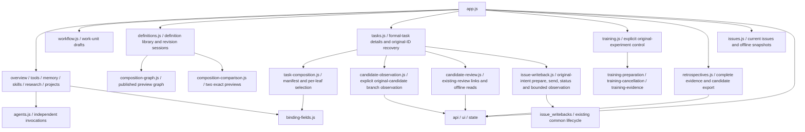

# CLI, HTTP and console transport

English · [Documentation](../README.md)

## Graphical pages and low code

The frontend uses first-party native ES modules with bundled Cytoscape, without Node builds or runtime CDN. `app.js` owns navigation, refresh and graph mount/dispose; `api / ui / state` provide transport, DOM and UI selection, without storing formal execution truth.

- **Work-unit drafts**: `workflow.js` owns semantics, complete JSON / raw unit text, target IDs / observed revisions, bounded commands / undo-redo and layout. Buffers are isolated by control directory / project; saving still calls drafts/reference and does not directly become a formal task.
- **Independent definition revision**: `definitions.js` calls the two original use-case types; JSON/YAML are only input syntaxes for the same structure. Complete resource changes derive from a new staging tree; preview returns candidate digest and directories, and check/publish rechecks the accepted candidate. CLI/HTTP do not implement separate file-identity algorithms.
- **Published graphs and comparison**: `composition-graph.js` displays original-compiler complete paths, structural / control / data relationships and full-text inspector, supporting collapse / search / keyboard selection; graph positions do not enter digests. Comparison only projects two published previews under the same grant, without inferring permissions or compiling unpublished candidates in the browser.
- **Formal task selection**: `tasks.js` follows original creation / original-ID recovery use cases, collects optional source snapshots and submits existing definition3 when a complete execution composition exists; `task-composition.js` holds only complete manifest selection, unit allocation and per-leaf bindings; `binding-fields.js` handles shared schema-field display. Formal admission remains in the backend. Original v7 exported records can open the cohesive observation dialog in `candidate-observation.js`, calling existing `issues.application.remote_candidate`; the task owner supplies fixed original records and liveness conditions independent of old modal contents. Observation owner manages only temporary base selection, asynchronous generations and safe result display, without persistence or provider dispatch. `candidate-review.js` encapsulates explicit saving / original-field recovery and independent SHA reads for existing PRs/MRs, reusing original `issues.application.link_review / review_link`; recovery through the same idempotent POST may save for the first time, so the page does not claim read-only status or create a browser recovery ledger. `issue-writeback.js` encapsulates comment / label preparation and original-field recovery, independent SHA status, explicit sending and bounded observation, directly consuming original `issue_writebacks` common lifecycle; the page manages only temporary selection / busy state, without provider dispatch or a second ledger, and unknown offers no send entry.

View / home / project / original run / edit generation constrain late replies; replaced sessions cannot save into new sessions. Draft and resource buffers use bounded in-memory history / sessionStorage, with explicit download / clear options on corruption or quota failure. Layouts, collapse state and browser caches are not contracts, execution ledgers or collaborative-editing stores.

Current low code can adjust supported tools / models, budgets, resources, expert compositions, constrained DAGs and per-instance backends. New trusted stages, arbitrary-role scheduling, runners or communication protocols still require code and versioned acceptance; drawing an edge does not implement them automatically.
