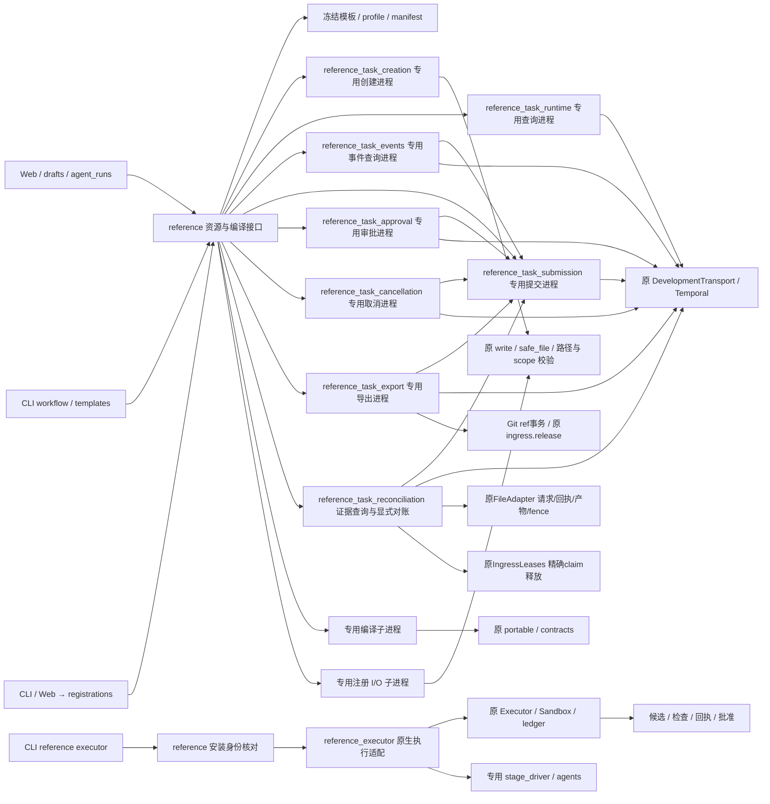
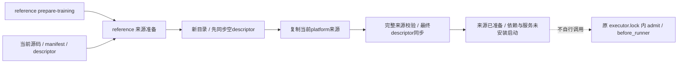

# reference 访问与迁出边界

当前实现：R6边界及F1注册/导入增量，2026-11-03。[R6交付](../delivery/2026-11-02-reference-boundary.md) · [F1阶段记录](../delivery/2026-11-03-f1-completion.md) · [运行契约](2026-11-02-runtime-contracts.md) · [ADR 0001](decisions/0001-refactoring-foundations.md)。

## 入口与所有者

|操作|当前所有者 / 实际消费者|边界|
|---|---|---|
|随包资源身份|`reference.info / verify`；CLI|manifest负责当前资源的逐件字节身份，HTML/zip保留原分发基线身份；verify不启动runtime|
|模板复制 / 角色合同 / 页面输入|`reference.copy_template / agent_contract / template_details`；CLI、Web、agent_runs|Web只取得结构化数据，不再拼接ROOT；复制保留源字节并附加角色合同；开发模板返回input，训练返回files，不将训练伪装为开发DAG|
|草稿结构校验|`reference.validate_input`；drafts、Web|专用子进程调用原make_spec；只报告结构PASS及原输入摘要，不创建正式任务或批准|
|portable编译/转换/导出|`reference.workflow`；CLI|专用Python进程使用明确的随包路径和`-P -S`，不让业务仓库/可选site package替换原编译器；Windows有界no-follow reader patch只作用于相应专用子进程|
|当前训练来源准备／识别|`reference.prepare_training / validate_installation`；CLI与原训练入口|当前native源码直接归随包owner；只物化新目录，复制前同步不完整descriptor，复制后核完整platform来源与current descriptor；不装依赖或调用executor。普通任务安装按其实际Python来源核验；识别来源不授执行权限|
|原执行安装定位|`reference.executor`；CLI及隔离验收fixture|仅Linux，先核对所选安装的local/upstream Python文件身份，再加载适配；不从任意配置字符串导入执行插件|
|项目投影读取、校验与发布|`reference.registration_io / validate_installation / registration_paths`；registrations与执行入口|固定随包代码的专用子进程，按项目只读取登记文件与其他项目tracker，不读密钥或平台配置；复用原路径/scope校验、有界no-follow读取和不可变write；Windows复用reader patch|
|新任务角色绑定快照|`bindings.development_snapshot`；tasks创建与reference_executor首次选择|复用同一快照格式冻结4角色、项目修订；执行器首次选择仍核对同一个Git根；后续阶段读同一`agent-bindings.json`；旧任务已有receipt时拒绝换为可选择执行器|
|阶段Agent及原生继承hook|`reference_executor.Executor.model / receipt`|只替换生成阶段调用及actor标识；原Executor保留提交、只读检查、集成/验证、候选SHA和回执；stage_driver负责专用进程的凭据/信号处理|
|原配置、文件、回执发布与ledger更新|`reference_executor`／`reference_job_lifecycle`内的原core/FileAdapter接口|原CONFIG/STATE、claim/ledger、immutable write/publish不向应用层扩散；v9专用owner确认停止和collection后才发布正式终态，原OWNED保留跨重启占用；不复制账本或调度|
|正式任务本地合同读取|`reference.task_files` → 固定只读子进程；tasks/CLI/API|按项目/Git根/tracker/基线/目录ID复用validate_spec和有界no-follow读取；每页最多100项合同检查，目录名流式枚举为O(N)，不读取日志/凭据、不连接Temporal、不推断运行终态|
|正式任务预览/create/创建状态/恢复|`reference.task_creation` → 专用`reference_task_creation`；tasks/CLI/API|父进程管理临时目录及超时清理；子进程在导入前使用临时STATE复用原create_task/portable，实际发布使用登记目录；原write/安全reader、Windows适配、意图/同ID非阻塞锁/结果回执集中在该边界|
|正式任务原生运行状态|`reference.task_runtime_status` → 专用`reference_task_runtime`；tasks/CLI/API|登记安装的原Transport.lookup/poll核对原始spec并固定run ID；明确SDK/网络预算和not-found/错误区别，不start/signal/改lease/ledger|
|原运行有界事件读取|`reference.task_events` → 专用`reference_task_events`；tasks/CLI/GET API|复用原submission/spec/memo；原验证后单SDK物理页及页内位置游标，1–100条/1 MiB响应、显式继续和live尾部保留；事件投影不解码payload，不写执行账本|
|正式任务start/本地提交状态/原ID恢复|`reference.task_submission` → 专用`reference_task_submission`；tasks/CLI/API|创建所有者校验七合同；完整原生环境复用原task_action，短revision事务只做本地prepare，网络阶段仅持task锁；窄Transport继承只保存dispatch检查点，unknown禁止重新start，既有run持久拒绝；原生依赖/全局不进入Web|
|精确plan批准/投递读取/恢复|`reference.task_approval` → 专用`reference_task_approval`；tasks/CLI/API|复用原创建/提交所有者、严格spec/memo/固定run、原owner receipt和approve_plan；无网络准备后释放控制库，未知只核原history；不新增授权状态机|
|取消请求/本地记录/投递恢复|`reference.task_cancellation` → 专用`reference_task_cancellation`；tasks/CLI/API|复用原Transport.cancel、严格原spec/memo/run，实际signal前检查点及操作SHA；闭合明确无信号，unknown仅核分页history，不接管fence/租约|
|精确候选导出/本地回执/恢复|`reference.task_export` → 专用`reference_task_export`；tasks/CLI/API|原提交固定spec/memo/run，原REVIEW_READY结果核精确candidate；写前attempt、异步Git对象fetch与条件事务，原ingress.release和export.json；unknown只核实际ref补回执，不fetch/创建；不checkout/merge/push|
|原run外部证据查询|`reference.task_external_status` → 专用`reference_task_reconciliation`；tasks/CLI/API|原创建/提交归属、固定闭合run与最新run检查；连续全history按真实converter还原job，绑定登记STATE五根和原FileAdapter/poll；缺失/额外/无效证据保持未决；GET不发布fence、不保存运行记录或释放租约|
|原run显式外部对账/本地记录/恢复|`reference.task_reconciliation` → 同一专用进程；tasks/CLI/API|组合原Inspection；短revision事务只保存意图，远程前保存原outcome/history检查点；原fence发布后重验完整history/两目录/可信证据，持久清理evidence后由原IngressLeases释放精确原claim；恢复保持原摘要/原run，GET只读本地记录|
|正式任务运行结果|原`DevelopmentTransport / Runtime / Workflow`；`tasks.status`只读返回原outcome|运行事实与可信验收仍在原runtime；显式终态对账保存独立清理事实，原CANCEL_UNCONFIRMED等结果保持；适用租约释放只在明确写操作中执行|

`reference.ROOT`仍保留给既有Python调用者和身份/兼容测试；生产布局知识只在reference及其专用原生边界。没有删除公共常量或改变CLI响应/退出码。`template_details`是实际Web使用的资源读取接口，没有另造模板存储层。

## 配置与进程范围

安装位置由`reference executor --installation`明确提供，或由`--project ID`选择统一注册保存的安装/配置/状态。原配置/状态由导入前的`AGENTFLOW_CONFIG_DIR / AGENTFLOW_STATE_DIR`决定，未设置时继续使用原默认目录。Ergora`--home`是控制项目来源。统一注册通过单向投影生成项目/策略/归属文件，保留adapter、凭据和服务设置。旧注册仍需显式导入；在途任务继续使用原runtime与冻结快照。

`agent_platform.core`在导入时固定ROOT/CONFIG/STATE，`reference.executor`为单一安装的专用进程入口。它不是Web中可并行热切换多个安装/配置的服务对象；同一解释器内缓存模块不能用于切换runtime。当前HTTP没有调用它。F1登记I/O采用固定代码的专用子进程，明确选择配置/状态；F3若接任务查询/命令，也须隔离调用，不能把现有全局当成request-local数据。

原编译/发布生命周期在reference_task_creation；原Executor的继承和Windows reader兼容分别留在`reference_executor.py`与`reference.py`，属于现成框架/平台接口的真实变化点。编译器的`sys.path / PYTHONPATH`及私有reader知识不下放到项目/资产/Web。没有新Runtime基类、配置镜像、文件repository或与Temporal竞争的调度器。

## 身份、恢复及迁出条件

六阶段状态、精确计划批准、工作单元DAG、可信integrate/verify、候选SHA、review会话和回执继续由原合同验证。项目binding变更只影响新任务；在途任务仍使用冻结快照。原submission已开始而无terminal时保持未知并拒绝自动重执行；只重启worker不应创建新任务或换引擎。训练prepare/control worker不会隐式生成执行请求；新受管execute需确认原run／request，旧run-local仍需确认manifest SHA。

当前reference资源由随包manifest固定身份，生产仍消费local/bootstrap镜像及HTML／安装报告。历史283文件分发基线保留原验证身份；当前源码按现owner更新，并同步当前manifest及相应镜像。以下是迁出条件：

|尚在使用的部分|迁出 / 仅归档的前提|
|---|---|
|独立项目注册、配置、原agentflow命令|F1有效项目配置单向投影与显式旧注册导入；F2安装/服务与F3任务操作可代替当前入口，保留旧在途任务恢复|
|原正式工作流与执行文件/ledger|有实际修改需求时才逐项迁出；新路径对正常/取消/未知/重启、精确批准、候选证据与导出做等价验收，再切新任务默认；不搬迁在途history|
|原训练runner/实验gate|F9对齐workload/baseline/evidence与人工执行授权，真实CPU/GPU范围分别验收，不把native campaign完成当作采用|
|原工单/通信/服务和bootstrap分发镜像|对应F2/F7及通信节点有实际替代消费者，安装器/报告/手册不再依赖镜像；更新来源清单及退出记录后才能删除|
|Windows reader兼容patch|上游/迁入编译器有真实Windows下等价的限长、no-follow/reparse拒绝与不可变发布证据；不能仅凭Linux测试移除|

R6迁出资源读取，R8已增加整体依赖图及静态边界检查；F1统一项目、显式采用与单向投影复用同一边界。后续F3接正式任务用例、F9接训练闭环。新增工具仍经agents/kernel等实际适配，不修改冻结模板来绑定厂商。

## 版本化原生训练来源

`training-executor-admission-v3` 使用当前data/reference中的训练实现、runner示例、reference-manifest与一个固定descriptor。来源准备及完整字节校验归同一reference owner。准备先同步空descriptor，复制后核完整platform文件，再同步当前manifest绑定的最终声明；缺损／篡改声明明确失败。普通任务安装仍按其实际Python来源合同核验。

当前process保留同一原锁、Git两臂、Sandbox、full归档与结果owner：业务副作用前检查不确定started／缺callback的managed命名空间，admit一次发布attempt／ack；配置驱动只在原clone后进入before_runner，沿原active检查准备request。已有result先只读返回，不能据此追认停止。wrapper在末次source检查后、首work前独立复核原完整chain、parent、owner、native fence及clock；不重复admit，不建立另一实验账本。

应用`_BudgetPhase`交错start／poll／finish原监管进程；父不执行phase业务文件系统I/O，S持唯一processes.run回收算法。stopped只在真实reap后发出，此后S禁止再生子进程。当前owner固定source/context能力，执行、观察、fence与清理共享原期限；来源准备自身不授执行权限。具体使用见[训练手册](../TRAINING.md#准备版本化原生来源)。

### 同预算显式执行与冻结离线读取

`training.execute`经`reference.training_execution`调用受监督的应用worker；`reference_training_execution.Execution`接受原submission／budget对象，持有请求／launch／原run准入和交错phase监管，不反向import两owner。其`native_main`拥有所选native解释器入口与原锁内admit／before_runner回调；`training_execution_protocol`以stdlib提供完整记录、context／来源验证及离线读取，供应用writer、执行S、离线reader和native回调共用。State／file_lock只在应用控制方法内延迟导入；原clock、SHA、安全发布及唯一reaper仍沿原owner，native解释器独立使用其锁定依赖。

出生能力固定完整来源及context；request→launch→attempt→ack→stopped保留在原job的`managed-execution`下，launch永不复用。父owner只交错poll／signal，磁盘／RPC／锁在各自S子树中；实际reap之后发stopped，S此后只直接存储。fence等待不扣住已有执行停止，compute与total分别约束工作和清理结果。

`training.execution`读取分支沿原`_training_reader`，固定随包platform来源与`-S`，先读历史原链，后用另一个有界进程观察当前来源；所选native缺失不能挡住历史。确认durable时仅同步／重读现存原件，不创建记录、不改原bytes或恢复运行。原`training_files`共用该reader传输实现，CLI只解析参数；历史记录按原身份观察，不授予执行能力或重启owner。完整用法见[训练手册](../TRAINING.md#显式受管执行与离线停止观察)。
