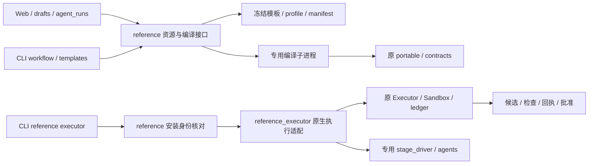

# reference 访问与迁出边界

当前实现：R6，2026-11-02。[交付/验收](../delivery/2026-11-02-reference-boundary.md) · [运行契约](2026-11-02-runtime-contracts.md) · [ADR 0001](decisions/0001-refactoring-foundations.md)。

## 入口与所有者

|操作|当前所有者 / 实际消费者|边界|
|---|---|---|
|冻结资源身份|`reference.info / verify`；CLI|manifest负责283文件身份，旧HTML/zip是原分发基线；verify不启动runtime|
|模板复制 / 角色合同 / 页面输入|`reference.copy_template / agent_contract / template_details`；CLI、Web、agent_runs|Web只取得结构化数据，不再拼接ROOT；复制保留源字节并附加角色合同；开发模板返回input，训练返回files，不将训练伪装为开发DAG|
|草稿结构校验|`reference.validate_input`；drafts、Web|专用子进程调用原make_spec；只报告结构PASS及原输入摘要，不创建正式任务或批准|
|portable编译/转换/导出|`reference.workflow`；CLI|专用Python进程使用明确的随包路径和`-P -S`，不让业务仓库/可选site package替换原编译器；Windows有界no-follow reader patch只在此子进程|
|原执行安装定位|`reference.executor`；CLI及隔离验收fixture|仅Linux，先核对所选安装的local/upstream Python文件身份，再加载适配；不从任意配置字符串导入执行插件|
|新任务角色绑定快照|`reference_executor.Executor.__init__`；原执行链|首次核对同一个Git根并冻结4角色、项目修订；后续阶段读同一`agent-bindings.json`；旧任务已有receipt时拒绝换为可选择执行器|
|阶段Agent及原生继承hook|`reference_executor.Executor.model / receipt`|只替换生成阶段调用及actor标识；原Executor保留提交、只读检查、集成/验证、候选SHA和回执；stage_driver负责专用进程的凭据/信号处理|
|原配置、文件、回执发布与ledger更新|`reference_executor`内的原core/FileAdapter接口|原CONFIG/STATE、claim/ledger、immutable write/publish不向应用层扩散；不逐个函数增加第二层转发；不复制原文件/SQL逻辑|
|正式任务create/start/status/result/approve/cancel/export|当前原`agentflow`、`DevelopmentTransport / Runtime / Workflow`|这是现有事实来源，尚无统一Ergora任务API；后续F1/F3接入此边界，不让HTTP或前端直接操作原全局/ledger|

`reference.ROOT`仍保留给既有Python调用者和身份/兼容测试；生产布局知识只在reference模块。没有删除公共常量或改变CLI响应/退出码。`template_details`是实际Web使用的资源读取接口，没有另造模板存储层。

## 配置与进程范围

安装位置由现有`reference executor --installation`明确提供。原配置/状态由导入前的`AGENTFLOW_CONFIG_DIR / AGENTFLOW_STATE_DIR`决定，未设置时继续使用原默认目录。Ergora `--home`是控制面项目/绑定的来源，不会隐式改写原注册、adapter、凭据或服务设置。

`agent_platform.core`在导入时固定ROOT/CONFIG/STATE，`reference.executor`为单一安装的专用进程入口。它不是Web中可并行热切换多个安装/配置的服务对象；同一解释器内缓存模块不能用于切换runtime。当前HTTP没有调用它。F1/F3若接查询/命令，须在边界明确选择安装/配置/状态并隔离调用，不能把现有全局当成request-local数据。

原Executor的继承和Windows reader兼容分别留在`reference_executor.py`与`reference.py`，属于现成框架/平台接口的真实变化点。编译器的`sys.path / PYTHONPATH`及私有reader知识不下放到项目/资产/Web。没有新Runtime基类、配置镜像、文件repository或与Temporal竞争的调度器。

## 身份、恢复及迁出条件

六阶段状态、精确计划批准、工作单元DAG、可信integrate/verify、候选SHA、review会话和回执继续由原合同验证。项目binding变更只影响新任务；在途任务仍使用冻结快照。原submission已开始而无terminal时保持未知并拒绝自动重执行；只重启worker不应创建新任务或换引擎。训练prepare/control worker仍不自动启动训练，run-local需操作者确认manifest SHA。

283冻结文件、21对local/bootstrap镜像及旧HTML继续作为生产参考分发，**尚未降为只供测试的归档**。以下是未来退出条件，不代表R6已经迁入：

|尚在使用的部分|迁出 / 仅归档的前提|
|---|---|
|独立项目注册、配置、原agentflow命令|F1有效项目配置单向投影与显式旧注册导入；F2安装/服务与F3任务操作可代替当前入口，保留旧在途任务恢复|
|原正式工作流与执行文件/ledger|有实际修改需求时才逐项迁出；新路径对正常/取消/未知/重启、精确批准、候选证据与导出做等价验收，再切新任务默认；不搬迁在途history|
|原训练runner/实验gate|F9对齐workload/baseline/evidence与人工执行授权，真实CPU/GPU范围分别验收，不把native campaign完成当作采用|
|原工单/通信/服务和bootstrap分发镜像|对应F2/F7及通信节点有实际替代消费者，安装器/报告/手册不再依赖镜像；更新来源清单及退出记录后才能删除|
|Windows reader兼容patch|上游/迁入编译器有真实Windows下等价的限长、no-follow/reparse拒绝与不可变发布证据；不能仅凭Linux测试移除|

R6只迁出有真实消费者的资源读取；其余已符合当前适配边界的代码保留。R8更新整体依赖图及静态边界检查；F1/F3再补统一项目与正式任务用例，F9接训练闭环。新增工具仍经agents/kernel等实际适配，不修改冻结模板来绑定厂商。
