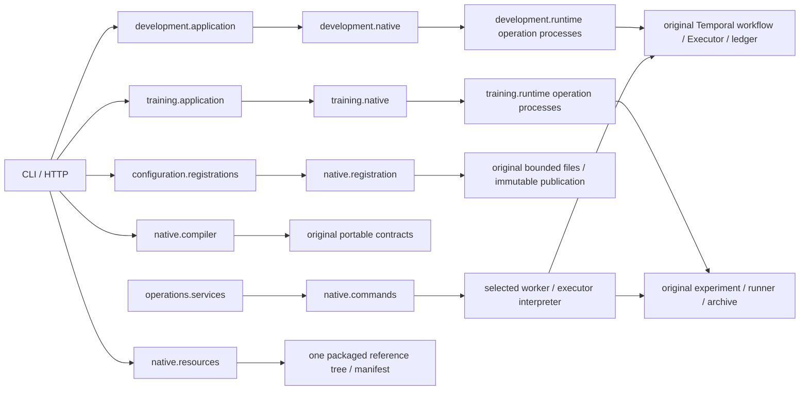
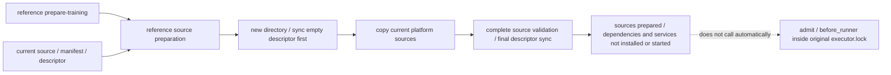

# Native reference access and migration responsibilities

English · [Documentation](../README.md)

Access the reference implementation through the semantic owners on this page; see [identity contracts](contracts/formats.md) for persistent identities, the [project guide](../projects/registration.md#unified-registration) for registration, and [ADR0001](decisions/0001-refactoring-foundations.md) for the original foundational decision.

## Entry points and owners

|Operation|Current owner / actual consumer|Boundary|
|---|---|---|
|Bundled resource identity|`native.resources.info / verify`; CLI|manifest owns item-by-item byte identities of current resources; HTML/zip preserve original distribution-baseline identity; verify starts no runtime|
|Template copying / role contracts / page inputs|`native.resources.copy_template / agent_contract / template_details`; CLI, HTTP, agents.runs|Web obtains structured data without constructing ROOT paths; copies preserve source bytes and append role contracts; development templates return input, training returns files, without presenting training as a development DAG|
|Draft structural validation|`native.compiler.validate_input`; drafts, Web|Dedicated subprocess invokes original make_spec; reports only structural PASS and original-input digest, without creating formal tasks or approvals|
|portable compilation/conversion/export|`native.compiler.workflow`; CLI|Dedicated Python process uses explicit bundled paths and `-P -S`, preventing business repositories / optional site packages from replacing original compiler; Windows bounded no-follow reader patch applies only to the corresponding dedicated subprocess|
|Current training-source preparation / identification|`native.resources.prepare_training / validate_installation`; CLI and original training entry|Current native source belongs directly to bundled owner; only materializes a new directory, syncing an incomplete descriptor before copying and checking complete platform sources and current descriptor afterward; installs no dependencies or invokes executor. Ordinary task installations verify actual Python sources; identifying sources grants no execution authority|
|Original execution-installation location|`native.commands.executor`; CLI and isolated acceptance fixtures|Linux only; first verifies local/upstream Python-file identities in selected installation, then loads adapter; no execution plugins imported from arbitrary configuration strings|
|Project projection reading, validation and publication|`native.registration.registration_io / registration_paths` and `native.resources.validate_installation`; registrations and execution entries|Dedicated subprocess with fixed bundled code reads only registration files and other projects' trackers per project, not secrets or platform configuration; reuses original path/scope validation, bounded no-follow reads and immutable write; Windows reuses reader patch|
|New-task role-binding snapshots|`configuration.bindings.development_snapshot`; tasks creation and development.runtime.executor first selection|Reuses the same snapshot format to freeze 4 roles and project revision; executor first selection still checks the same Git root; later stages read the same `agent-bindings.json`; old tasks with existing receipts reject switching to a selectable executor|
|Stage Agents and native inheritance hooks|`development.runtime.executor.Executor.model / receipt`|Replaces only generation-stage invocations and actor identifiers; original Executor retains commits, read-only checks, integration/verification, candidate SHAs and receipts; agents.stage_driver handles credentials/signals in dedicated processes|
|Original configuration, files, receipt publication and ledger updates|Original core/FileAdapter interfaces in `development.runtime.executor` / `development.runtime.jobs`|Original CONFIG/STATE, claim/ledger and immutable write/publish do not spread to application layers; the current budgeted owner publishes formal terminal states only after confirmed stopping and collection, with original OWNED retaining occupancy across restarts; no duplicated ledger or scheduling|
|Formal-task local contract reads|`development.native.task_files` → fixed read-only subprocess; tasks/CLI/API|Reuses validate_spec and bounded no-follow reads by project/Git root/tracker/baseline/directory ID; at most 100 contract checks per page, streaming O(N) directory-name enumeration, without reading logs/credentials, connecting to Temporal or inferring runtime terminal state|
|Formal-task preview/create/creation status/recovery|`development.runtime.creation_process.task_creation` → dedicated `development.runtime.creation`; tasks/CLI/API|Parent manages temporary directories and timeout cleanup; child uses temporary STATE before importing to reuse original create_task/portable, while actual publication uses registered directories; original write/safe reader, Windows adapter, intent/same-ID nonblocking lock/result receipts stay at this boundary|
|Formal-task native runtime status|`development.native.task_runtime_status` → dedicated `development.runtime.status`; tasks/CLI/API|Registered installation's original Transport.lookup/poll verifies original spec and fixes run ID; explicit SDK/network budgets and distinction between not-found/errors; no start/signal/lease/ledger changes|
|Bounded original-run event reads|`development.native.task_events` → dedicated `development.runtime.events`; tasks/CLI/GET API|Reuses original submission/spec/memo; after original validation, one physical SDK page and in-page-position cursor, 1–100 events/1 MiB response, explicit continuation and live-tail retention; event projections decode no payloads and write no execution ledger|
|Formal-task start/local submission status/original-ID recovery|`development.native.task_submission` → dedicated `development.runtime.submission`; tasks/CLI/API|Creation checks the original contracts. Formal submission and the native CLI share `agent_platform.cli.start_task` for readiness, policy, trusted checks and lease claim. Formal submission holds the task lock while it validates the original input, saves the attempt and calls the native transport with its submission memo. Recovery queries the original identity, and competing runs remain separately recorded.|
|Exact plan approval/delivery reads/recovery|`development.native.task_approval` → dedicated `development.runtime.approval`; tasks/CLI/API|Reuses original creation/submission owners, strict spec/memo/fixed run, original owner receipt and approve_plan; releases control database after network-free preparation, unknown only checks original history; no new authorization state machine|
|Cancellation requests/local records/delivery recovery|`development.native.task_cancellation` → dedicated `development.runtime.cancellation`; tasks/CLI/API|Reuses original Transport.cancel, strict original spec/memo/run, checkpoints and operation SHA before actual signal; closed runs explicitly produce no signal, unknown only checks paginated history without taking over fence/leases|
|Exact-candidate export/local receipts/recovery|`development.native.task_export` → dedicated `development.runtime.export`; tasks/CLI/API|Original submission fixes spec/memo/run; original REVIEW_READY result verifies exact candidate. attempt before write, asynchronous Git-object fetch and conditional transaction, original ingress.release and export.json; unknown only checks actual refs to supplement receipts, without fetch/creation; no checkout/merge/push|
|Original-run external-evidence queries|`development.native.task_external_status` → dedicated `development.runtime.reconciliation`; tasks/CLI/API|Original creation/submission ownership, fixed closed run and latest-run checks; continuous complete history restores jobs with actual converter, binding five registered STATE roots and original FileAdapter/poll; missing/extra/invalid evidence stays unresolved. GET publishes no fence, saves no run records and releases no leases|
|Original-run explicit external reconciliation/local records/recovery|`development.native.task_reconciliation` → same dedicated process; tasks/CLI/API|Composes original Inspection; short revision transactions save only intent, saving original outcome/history checkpoint before remote operations. After original fence publication it rechecks complete history/two directories/trusted evidence; after durable cleanup evidence, original IngressLeases releases exact original claim. Recovery preserves original digest/run; GET reads only local records|
|Formal-task runtime results|Original `DevelopmentTransport / Runtime / Workflow`; `development.application.status` returns original outcome read-only|Runtime facts and trusted acceptance remain in original runtime; explicit terminal reconciliation saves separate cleanup facts, preserving original CANCEL_UNCONFIRMED and other results; applicable lease release occurs only through explicit writes|

`native.resources.ROOT` is the direct packaged-reference constant used by resource/tool readers. The current import is `from ergora.native.resources import ROOT`; no root facade or old-path reexport is retained. `native.resources.template_details` supplies Web's structured resource data. Domain clients and fixed native readers own path construction.

## Configuration and process scope

Installation location is explicitly provided by `reference executor --installation`, or `--project ID` selects installation/configuration/state saved by unified registration. Original configuration/state comes from `AGENTFLOW_CONFIG_DIR / AGENTFLOW_STATE_DIR` before import, retaining original default directories when unset. Ergora `--home` supplies the control project. Unified registration generates project/policy/ownership files through one-way projection, preserving adapter, credentials and service settings. Old registrations still require explicit import; in-flight tasks keep original runtime and frozen snapshots.

`agent_platform.core` fixes ROOT/CONFIG/STATE on import; `native.commands.executor` is a dedicated process entry for one installation. It is not a service object for parallel hot-switching of multiple installations/configurations in Web; cached modules in one interpreter cannot switch runtime. Current HTTP does not call it. Registration I/O and task/training queries use dedicated fixed-code processes with explicit configuration/state selection. Existing native globals are not request-local data.

Original compilation/publication lifecycle stays in development.runtime.creation; original Executor inheritance and Windows reader compatibility remain in `development/runtime/executor.py` and `native/files.py` respectively, representing actual change points of existing framework/platform interfaces. Compiler `sys.path / PYTHONPATH` and private-reader knowledge do not move into projects/assets/Web. No new Runtime base class, configuration mirror, file repository or scheduler competing with Temporal.

## Identity, recovery and migration conditions

Original contracts continue to validate six-stage state, exact-plan approval, work-unit DAGs, trusted integrate/verify, candidate SHAs, review sessions and receipts. Project-binding changes affect only new tasks; in-flight tasks retain frozen snapshots. Original submissions started without terminal remain unknown and reject automatic reexecution; merely restarting workers should not create tasks or change engines. Training prepare/control workers do not implicitly generate execution requests; new managed execute requires confirmation of original run/request, and old run-local still requires manifest SHA confirmation.

The bundled manifest fixes current reference-resource identities. Original distribution, installation and measurement evidence retain their recorded identities; changed source cannot inherit an earlier run's result. Persistent field/table/schema/queue names and existing evidence keys do not move with Python modules.

|Change point|Obligations before replacing its current consumer|
|---|---|
|Project registration and native configuration|Preserve one-way projection, explicit import, complete identities and recovery of original publication intents.|
|Formal workflows, execution files and ledger|Preserve normal/cancellation/unknown/restart behavior, exact approval, candidate evidence, export and owned-process cleanup. In-flight history stays original.|
|Training runner, gates and archives|Keep workload/baseline/evidence binding and human execution approval; CPU, real service and GPU quality/performance acceptance remain separate.|
|Packaged sources and bootstrap payloads|Update actual source inventories, manifests and every current consumer together; retain one resource tree. Source relocation alone does not update a registered installation.|
|Windows bounded reader|Preserve length bounds, no-follow/reparse refusal and immutable publication. Linux source checks do not certify native Windows behavior.|

New backend/tool integration uses its actual family owner and supported modes. Neither a source refactor nor metadata declares new execution authority.

## Versioned native training sources

`training-executor-admission-v3` uses current training implementation, runner examples, reference-manifest and a fixed descriptor at `data/native-runtime/training-executor-admission-v3.json`; its reference manifest is `data/reference-manifest.json`. The same reference owner owns source preparation and complete-byte validation. Preparation first syncs an empty descriptor, checks complete platform files after copying, then syncs the final declaration bound by current manifest; missing/tampered declarations fail visibly. Ordinary task installations still verify their actual Python-source contracts.

Current process retains the same original lock, both Git arms, Sandbox, full archiving and result owner: before business side effects it checks uncertain started / managed namespaces lacking callbacks, and admit publishes attempt/ack once; configuration drivers enter before_runner only after original clone, preparing requests under original active checks. Existing results return read-only first and cannot retrospectively confirm stopping. After the final source check and before first work, wrapper independently rechecks original complete chain, parent, owner, native fence and clock; no repeated admit or additional experiment ledger.

Pure-stdlib `training.materials` owns exact descriptor, raw JSON and immutable publication/durable readback of configuration materials; native prepare/create_job, reference-original reader and configuration wrapper share consumption. Lower layers do not import wrapper, protocol, reference or State/SDK in reverse. manifest `configuration_inputs` exclusively selects Git files or prepared-json; runner declares only trusted source and `prepared_json_format` capability. Complete search input package is persisted first; under original preparation lock, original intent file/directory chain is synced and same inode/raw reread before formal publication of two materials and original three files. Material raw SHA enters original source inventory/cycle; runs freeze actual input copies in original jobs, archiving context receipts and both raw files through original full artifacts, without another result ledger or budget.

Application `_BudgetPhase` interleaves start/poll/finish of original supervisors; parent performs no phase business filesystem I/O, and S owns the sole processes.run reaping algorithm. stopped is emitted only after actual reap, after which S cannot spawn children. Current owner fixes source/context capabilities; execution, observation, fence and cleanup share original deadlines. Source preparation itself grants no execution authority. See the [training guide](../training/prepare-experiments.md#prepare-versioned-native-sources).

### Explicit execution under the same budget and frozen offline reads

`training.application.execute` calls a supervised application worker through `training.native.training_execution`; `training.runtime.execution.Execution` accepts original submission/budget objects and owns request/launch/original-run admission and interleaved phase supervision, without importing either owner in reverse. Its `native_main` owns the selected native-interpreter entry and admit/before_runner callbacks under original lock; `training.execution_protocol` provides complete records, context/source validation and offline reads with stdlib, shared by application writers, execution S, offline readers and native callbacks. State/file_lock imports are delayed to application control methods only; original clock, SHA, safe publication and sole reaper remain with original owners, and native interpreter independently uses its locked dependencies.

Birth capabilities fix complete sources and context; request→launch→attempt→ack→stopped remain under original job's `managed-execution`, and launch is never reused. Parent owner only interleaves poll/signal; disk/RPC/locks stay in respective S subtrees. stopped follows actual reap, after which S only stores directly. Waiting for fence does not hold up stopping existing execution; compute and total constrain work and cleanup results separately.

`training.application.execution` reads through original `_training_reader`, fixing bundled platform sources and `-S`, first reading original historical chain, then observing current sources in another bounded process; `training.application.evidence` and `training.application.baseline_reference` use the same reader, and missing selected native cannot block history. The latter shares current `training.runtime.evidence` complete inventory algorithm with managed configuration wrapper; ordinary inspect and fixed reference share accepted-archive binding validation. Fixed paths do not consume diagnostic side reads of current head/runner/ticket. Original evidence and current registration guard share the same bounded initial raw/device/inode and final confirmation; guard-only does not enter immutable index/hash. Fence absence is confirmed by final lstat, without ignoring late files or dangling links. Saved capability is read under original structure; original manifest/protocol literal declarations and descriptor original bytes verify historical sources, with missing dimensions each unavailable. Current effects still require complete current source, native installation, live owner and original clock. Confirming durable only syncs/rereads existing originals, without creating records, changing original bytes or resuming execution. Original `training_files` shares this reader transport implementation; CLI only parses arguments. Historical records are observed under original identities, without execution capabilities or restarting owners. See the [training guide](../training/execution.md#explicit-managed-execution-and-offline-stop-observation) for complete usage.
