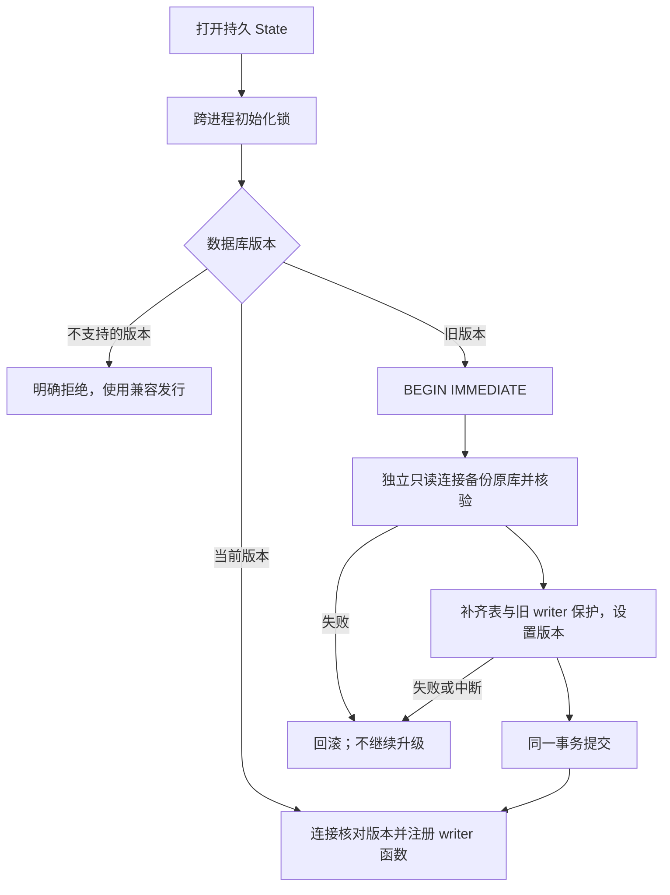
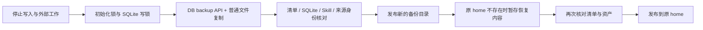

# 控制面数据库的升级与回退

`ergora.state.State` 拥有本地 SQLite 的初始化、连接和有序迁移；领域模块继续拥有查询、修订冲突和事务。这里的数据库 schema 版本与 Python 包版本、项目 JSON 版本、正式工作流合同版本分别管理。

## 初始化与所有权

当前 schema 为 1。旧 0.2.0 数据库是 user_version 0，可能只含两个基础表，也可能已由各领域按需建立全部 16 表。首次打开时集中补齐表，并保留已有行、JSON 字节、原 SQL 查询语义及额外用户表/索引/触发器；不匹配已知旧列布局的库拒绝升级。已是 schema 1 的库不会重复迁移或产生额外升级备份。

DDL 只在存储初始化执行。记忆、Skill、评价、优化、研究、草稿和 kernel 不再自行 CREATE TABLE；没有新增 ORM 或通用记录封装。新代码每次连接都检查版本，已存在的 State 实例也不能忽略后续出现的不支持版本。revision 的读/比较/写仍在各领域的 BEGIN IMMEDIATE 内，不靠初始化锁代替。

## 升级前备份

先停止 CLI 工作、控制台、研究 worker 和可选执行器，并对账在途外部工作；再备份整个持久 home。SQLite 与本地资产、业务仓库、完整参考发行 / Temporal / MLflow 状态分别需要相应备份。不能在文件正在变化时把一次目录复制称为一致恢复点。

迁移非空旧库时会在 home 的 `backups/` 下生成 `schema-v0-<随机身份>.sqlite3`。迁移连接持有 SQLite 写锁，另一个只读连接用标准库 SQLite backup API 获取原库，包括 WAL 中已提交的数据；经过 integrity_check 后，临时 `.part` 文件才改为正式文件。备份失败时不开始迁移。已有行和文件资产不会被迁移重写。

这个自动文件仅覆盖数据库，不包含 Skill、来源快照、运行输出或外部服务。它是升级前的数据库恢复点；升级后新增的数据也不会自动出现在此旧快照。完整离线资产备份与核对属于独立恢复流程，不能用一个 `.sqlite3` 文件替代。

迁移步骤和 user_version 在同一显式事务内提交；中断后依赖 SQLite 的 journal 恢复。失败信息包含完成的数据库备份路径或明确说明没有完整备份；不要采用遗留 `.part` 文件。保留失败原因，确认磁盘与原库可用后用兼容程序重新打开，不删除未知状态来假装升级成功。

## 离线完整备份与恢复

`ergora state info` 读取版本而不创建/升级库。`state backup DIRECTORY --offline` 在原始 SQLite 上操作，可用于 schema 0 升级之前；`state verify-backup DIRECTORY` 不需要原 home 仍然存在。命令默认沿用 ERGORA_HOME / 平台用户数据目录，全局 `--home` 可明确选择目标，位置解析与正常 State 共用。

`ergora.backups` 拥有以下流程，CLI 只解析参数和输出结果：

备份是一个含 `manifest.json` 和 `data/` 的目录，根目录权限按用户私有目录创建。清单采用 `state-backup-v1.json` / Draft 2020-12，版本严格为整数 1；记录原 home、平台、数据库 schema、创建时间、每个文件的大小 / SHA-256 / 文件模式和空目录。清单自身的原 UTF-8 字节 SHA 作为快照身份返回，不改变评价、Skill 或正式合同的旧摘要。

控制面数据库通过 SQLite backup API 获取已提交数据，包括 WAL；快照切为独立数据库，不改写原库的领域行和 JSON 内容。根目录的控制面数据库 sidecar 与 `.schema.lock` 不单独复制。其他普通文件、子目录、运行输出和已有迁移快照按文件清单保存；数据资产中的符号链接、Windows junction / reparse point 和特殊文件明确拒绝，在下降到子目录前检查。备份目标必须在 home 外，且是新路径，避免将快照递归装进自身。

复制前后比较源文件清单，核对复制内容，再验证暂存备份。SQLite 检查完整性和版本；Skill 目录复用原 digest_tree（含执行位），来源原文 SHA 必须符合数据库 source_snapshots。增改、缺失、额外文件/目录、模式变化或领域身份不一致均拒绝，复制失败不发布残缺目标。所有这些检查仍以已停止写入为前提，不是在线事务跨文件保证。

恢复先校验备份，再在目标父目录暂存复制并重新校验清单身份与内容，完成后才发布到原 home。要求同平台、原绝对 home 和不存在的目标，不自动重定位或覆盖现有数据；用户应先将现有 home 移到另一处持久位置保留。恢复 schema 0 会保留版本 0；用新 State 再打开时才执行已验证的 0→1 升级。暂存中断最多遗留临时目录，不把它当成完成的备份或 home。

清单覆盖控制面 home 的本地文件，不代表业务仓库、模型认证、外部 evaluator、Temporal / MLflow、reference 运行状态或远端 ReMe 已恢复。恢复后仍须核对它们的路径、可信文件和在途任务；不要让运行状态行触发自动重提。ReMe 投影使用已有显式 rebuild，不修改 canonical 记忆。

## 旧程序访问和回退

旧程序从不检查 user_version，单独写一个版本号无法阻止它继续修改新库。schema 1 给每张已知表的 INSERT / UPDATE / DELETE 建立触发器，要求连接提供匹配的 `ergora_writer_schema_version()`。新 State 注册当前版本；未修改的旧程序没有该函数，写入会收到 SQLite 的 `no such function: ergora_writer_schema_version`。迁移前已打开的旧连接也受此限制。普通读取可以继续。

这个机制保护已知旧二进制的数据库 DML，不隔离同一用户，也不会停止旧进程写文件、运行 Agent 或提交外部作业。因此停旧服务是升级步骤的一部分。手工注册函数、删除触发器或降低 user_version 不能作为受支持的降级方法。

若要回到旧二进制，先停止所有新旧进程，保留当前完整 home，再恢复升级前彼此匹配的数据库和文件资产到原位置，最后启动对应旧版本。旧快照恢复意味着放弃该快照之后的变更；仅 git revert 不会回退数据。目录中存在绝对路径的运行记录和可信 evaluator 身份，不应为了换目录而静默重写 JSON / 摘要。外部 ReMe 是检索投影，恢复后可通过 `ergora memory sync PROJECT --rebuild` 重建；canonical 记忆与修订仍来自本地库。
