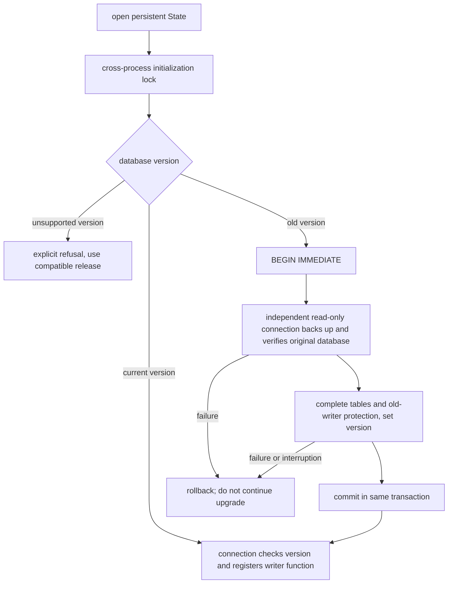

# Control-plane database migration and rollback

English · [Documentation](../README.md)

`ergora.storage.state.State` owns local SQLite initialization, connections and ordered migrations; domain modules continue to own queries, revision conflicts and transactions. The database schema version is managed separately from the Python package version, project JSON version and formal workflow contract version.

## Initialization and ownership

The current database schema is **6**, determined by the ordered migration list in `storage/state.py`. Early programs also numbered 0.2.0 may create a `user_version: 0` database; the package version cannot identify the database version. The current database has 21 application tables; INSERT/UPDATE/DELETE on known tables are protected by 63 v6 triggers.

|Migration|Contents|Application tables after migration|
|---|---|---|
|v1|Complete the original 16 tables, check old column layouts and establish protection against known old writers|16|
|v2|Add `issue_snapshots`, `issue_task_links` and the linked-target index; replace all writer fences|18|
|v3|Add `issue_writebacks`, `issue_writeback_observations`; replace all writer fences|20|
|v4|Add `candidate_review_links`; replace all writer fences|21|
|v5|Memory validity changes persistent semantics; add no tables or column-layout changes, and update all writer fences to v5|21|
|v6|Protect frozen design requirements from older project writers; replace writer fences with v6 without new tables or columns|21|

Existing rows, JSON bytes, original SQL semantics and extra user objects are preserved; databases that do not match known old column layouts are refused upgrades. Opening an old database applies subsequent migrations in order from its version: for example, v0 runs v1 through v6, while v4 runs v5 then v6. A current-version database is not migrated again and produces no additional upgrade backup. Application-table and trigger counts exclude extra user objects.

DDL runs only during storage initialization. Issues, memory, Skills, evaluation, optimization, research, drafts and kernel do not CREATE TABLE themselves; no ORM or generic record wrapper is added. New code checks the version on every connection; an existing State instance cannot ignore an unsupported version that appears later. Reading/comparing/writing revision remains inside each domain's BEGIN IMMEDIATE transaction; the initialization lock does not replace it.

## Backup before upgrading

First stop CLI work, the console, research workers and optional executors, and reconcile external work in flight; then back up the entire persistent home. SQLite and local assets, business repositories, the full reference distribution / Temporal / MLflow state each need their respective backups. A directory copy while files are changing cannot be called a consistent recovery point.

Migrating a nonempty old database creates `schema-vN-<随机身份>.sqlite3` under the home's `backups/`, where N is the original database version before this open, for example v4. One open saves just one original database snapshot; subsequent migrations run sequentially in the same transaction. The migration connection holds the SQLite write lock, and another read-only connection uses the standard-library SQLite backup API to capture the original database, including committed WAL data; only after integrity_check does the temporary `.part` file become a final file. Migration does not start if backup fails. Migration does not rewrite existing rows or file assets.

This automatic file covers only the database, excluding Skills, source snapshots, run outputs and external services. It is a database recovery point from before the upgrade; data added after the upgrade does not automatically appear in this old snapshot. Complete offline asset backup and verification are a separate recovery process and cannot be replaced by one `.sqlite3` file.

Migration steps and user_version commit in the same explicit transaction; interruptions rely on SQLite journal recovery. Failure messages include the completed database backup path or explicitly state that no complete backup exists; do not use leftover `.part` files. Preserve the failure reason, confirm disk and original-database availability, then reopen with a compatible program; do not delete unknown state to present an upgrade as successful.

## Complete offline backup and restore

`ergora state info` reads the version without creating/upgrading the database. `state backup DIRECTORY --offline` operates on raw SQLite and can be used before a schema 0 upgrade; `state verify-backup DIRECTORY` does not require the original home to still exist. Commands default to ERGORA_HOME / the platform user-data directory; global `--home` explicitly selects the target, using the same location resolution as normal State.

`ergora.operations.backups` owns the following process; CLI only parses arguments and outputs results:

```mermaid
flowchart LR
  Offline[stop writes and external work] --> Lock[initialization lock and SQLite write lock]
  Lock --> Snapshot[DB backup API + ordinary-file copies]
  Snapshot --> Verify[manifest / SQLite / Skill / source-identity verification]
  Verify --> Publish[publish new backup directory]
  Publish --> Stage[stage restore when original home is absent]
  Stage --> Recheck[recheck manifest and assets]
  Recheck --> Restore[publish to original home]
```

A backup is a directory containing `manifest.json` and `data/`, with root permissions created as a user-private directory. The manifest uses `state-backup-v1.json` / Draft 2020-12, with a strictly integer version 1; it records original home, platform, database schema, creation time, every file's size / SHA-256 / mode, and empty directories. The SHA of the manifest's original UTF-8 bytes is returned as the snapshot identity; it does not change old evaluation, Skill or formal-contract digests.

The control-plane database uses the SQLite backup API to obtain committed data, including WAL; the snapshot becomes a standalone database without rewriting the original database's domain rows or JSON content. Control-plane database sidecars and `.schema.lock` at the root are not copied separately. Other regular files, subdirectories, run outputs and existing migration snapshots are saved according to the file inventory; symlinks, Windows junction / reparse points and special files in data assets are explicitly rejected, with checks before descending into subdirectories. The backup target must be a new path outside home, to avoid recursively including the snapshot in itself.

Compare source-file inventories before and after copying, check copied contents, then verify the staged backup. SQLite checks integrity and version; Skill directories reuse the original digest_tree (including executable bits), and source-text SHAs must match database source_snapshots; the issue domain checks snapshot/link fields, content digests, SQL columns and references, and v0/v1 can still be verified offline without the new tables. Additions, modifications, missing or extra files/directories, mode changes and inconsistent domain identities are all rejected; copying failures do not publish incomplete targets. All these checks still assume writers have stopped; they do not provide an online transaction guarantee across files.

Restore first verifies the backup, then stages a copy in the target's parent directory and rechecks manifest identity and contents before publishing to the original home. It requires the same platform, original absolute home and an absent target; it does not automatically relocate or overwrite existing data. Users should first move the existing home elsewhere in persistent storage to preserve it. Restoring an old database preserves its original version; subsequent migrations run in order only when a compatible State formally opens it. `state info`, backup and package verification do not themselves upgrade it. Interrupted staging may leave a temporary directory; do not treat it as a completed backup or home.

The manifest covers local files in the control-plane home; it does not mean that business repositories, model authentication, external evaluators, Temporal / MLflow, reference runtime state or remote ReMe have been restored. After restore, still check their paths, trusted files and tasks in flight; do not let runtime-state rows trigger automatic resubmission. The ReMe projection uses the existing explicit rebuild without changing canonical memory.

## Old-program access and rollback

Early v0 programs do not check user_version; setting the version alone cannot stop them modifying a new database. Each migration creates or replaces INSERT/UPDATE/DELETE triggers for known tables, requiring the connection to provide a matching `ergora_writer_schema_version()`; v6 currently has 63 protections across 21 tables. Current State registers version 6 and checks the database version on every connection; unchanged v0 programs are denied writes because the function is missing, and already-open connections still returning an old version cannot write these tables either. Raw SQLite reads do not depend on the writer function, but old Ergora entry points may refuse to open the new database during version checking.

This mechanism protects database DML against known old binaries. It does not isolate the same user or stop old processes writing files, running Agents or submitting external jobs. Stopping old services is therefore part of upgrading. Manually registering the function, deleting triggers or lowering user_version is not a supported downgrade method.

To return to an old binary, first stop all old and new processes, separately back up and retain the complete current home, restore the matching pre-upgrade database and file assets to the original location, then start the corresponding old version. An old snapshot excludes later changes; do not overwrite the only copy of new data with it. A git revert alone does not roll back data. Run records with absolute paths and trusted evaluator identities exist in the directory; do not silently rewrite JSON / digests to change directories. External ReMe is a retrieval projection and can be rebuilt after restore with `ergora memory sync PROJECT --rebuild`; canonical memory and revisions still come from the local database. The complete task stack also requires external execution directories and services to be saved according to the [joint backup guide](../operations/backup-recovery.md).
