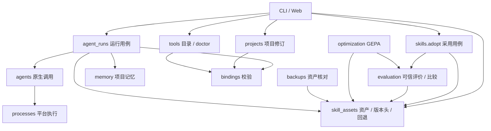

# S11 / R4：用例所有权与依赖整理

日期：2026-11-02。分支 `refactor/architecture-foundations`。基线 `9633962c29240319c54d07a3942cffe0ccd77ce3`，开始时工作区干净。前置 R1–R3、L0/L1 已完成；本切片不继承旧身份的运行验收。

## 范围与验收

用户批准继续既有重构计划，并要求每步更新文档、将 DeepSeek 值得采纳的参考项列入计划。DS1–DS7 已对应到详细计划的 F/D 节点，当前仅登记待实施，不安装 DSH 或改动任务协议。

R4 只调整职责和依赖方向：资产拥有身份、导入/读取/导出、版本头事务和回退；评价拥有冻结评价集、可信执行及比较；采用用例协调两者。独立 Agent 用例拥有上下文选择、绑定快照、调用及运行记录，CLI/Web 调用同一实现。保留公开 Python 入口、CLI/API、持久 JSON/摘要、拒绝语义与六阶段。

|分步|实现|验证|独立审查|
|---|---|---|---|
|R4.1 Skill 资产与采用|已实现|源码定向 44 passed / 1 Windows-only skip|随完整 R4 审查|
|R4.2 独立 Agent 运行|已实现|源码定向 69 passed / 6 skipped|随完整 R4 审查|

两步组成一个可回退的依赖整理切片，完整检查与 fresh-context 独立审查通过后才标为完成。不增加 service 基类、调度器、会话、额外依赖或数据迁移。

## 已核实的调用与设计

- `skills.adopt → evaluation.compare → skills.get` 形成职责环。将原资产实现迁到 `skill_assets.py`，`skills.py` 保留实际采用用例及资产 API 的直接重导出。evaluation、optimization、backups 和 CLI/Web 资产操作直接依赖资产所有者，评价不再导入采用模块。原摘要及活动头事务原样保留。
- `tools.run_agent/runs/output` 迁到 `agent_runs.py`；旧 `tools` 入口为相同函数的直接别名，CLI/Web 使用新所有者。运行内容、Skill/recall 快照、prompt SHA、revision、错误记录和输出上限保持。
- 通用绑定验证从 `tools` 迁入 `bindings.py`，复用原 agents/kernel/schema 校验，三个生产消费者为 projects、tools.doctor、agent_runs。它持有实际校验逻辑，避免 tools 兼容导出与运行用例形成新环，也保留旧配置错误的诊断；组件描述继续保持无执行依赖。`tools.validate_binding` 直接重导出。
- 现有测试的旧 Python 入口继续用于兼容验收，优先复用 Skill 旅程、Agent/模板、Web、备份、A2 固定旧数据和 Windows 测试。必要的依赖边界检查只保护本切片的所有权，不按文件长度或行数拆分。

图示实际业务调用；旧 tools 运行函数及 skills 资产导出只是同一函数的兼容别名，不构成第二条写入路径。bindings 将 Agent/kernel 校验委托给原所有者，其余层按既有 schema/规则检查；components 仍只持有描述。没有加入 application 目录或基类来包裹已有单函数用例。

## 计划检查

先跑受影响定向回归，再构建非 editable wheel、核对随包文件和冻结 reference，运行当前完整 Linux 回归；基础包在可选库缺席时仍可导入/调用。推送后核对精确提交的 Windows/Ubuntu CI，未实际检查的维度明确保留。运行数据仅写忽略的持久检查目录，不改现有用户服务或真实项目。

## 分步实际检查

R4.1 已将原资产逻辑迁入 skill_assets，采用仍由 skills 协调 comparison 和原子头事务；七个原资产入口直接重导出。evaluation / optimization / backups 及 CLI/Web 的资产消费者已切到新所有者，评价不再导入采用模块。

源码定向命令：`PYTHONPATH=src PYTHONDONTWRITEBYTECODE=1 .venv-dev/bin/python -m pytest -q --tb=short -p no:cacheprovider --basetemp .ergora/checks/r4/skill-tests tests/test_skills_evaluation.py tests/test_state_backups.py tests/test_compatibility_baseline.py tests/test_web.py`。结果 **44 passed、1 Windows-only skip、1 既有 Starlette warning，42.30s**，完整输出 `.ergora/checks/r4/skill-regression.log`。包括真实 GEPA 库的有界 fixture 搜索和失败预算检查，未运行模型效果或真实业务任务。

R4.2 已迁出 agent_runs 的完整上下文/运行用例与 bindings 的实际通用校验。CLI/Web 调用 agent_runs；projects、tools.doctor 和 agent_runs 共用 bindings。旧 tools 的 run_agent/runs/output/validate_binding 直接别名保持函数身份；运行记录、校验顺序、输出上限和错误文本不变。

源码定向命令沿用上述参数，改用 `--basetemp .ergora/checks/r4/agent-tests`，检查 `tests/test_agents.py tests/test_projects_tools.py tests/test_components.py tests/test_schema_contracts.py tests/test_compatibility_baseline.py tests/test_skills_evaluation.py tests/test_web.py`。结果 **69 passed、6 skipped、1 既有 warning，57.29s**，完整输出 `.ergora/checks/r4/agent-regression.log`。新增的四项保护覆盖旧入口共用函数、冷进程下层不导入兼容 facade、缺失资产在执行前拒绝、不同评价集不能采用。已有测试仍验证实际 Skill/recall 内容、活动头 revision、原摘要及 API 错误。

另以 Python AST 对照基线逐一检查 8 个资产函数、3 个运行函数及通用绑定校验，共 12 个迁移函数；除 `_move_head → move_head` 及 `skills → skill_assets` 的名称调整外 AST 相同。该静态核对用于限定机械迁移范围，不代替回归或运行验收。

## 包及公开入口检查

- 通过既有 `uv build --wheel --out-dir .ergora/checks/r4/dist` 构建，再用 `uv pip install --python .venv-dev/bin/python --no-deps --reinstall` 安装非 editable wheel。初轮 **324 个包文件**与源码及 wheel 逐字节一致，包含三个新增所有者；身份清单 `.ergora/checks/r4/package-identity.json`。初轮 wheel SHA-256：`3e6e96069aaa888002ae0c9435de85a80c99e4f90d09c08067d89b8260fec959`。
- 安装包 `python -m ergora reference verify` **283 PASS**，旧 zip SHA 仍为 `8018be5094623ca0646d28d3671daaf7ac60774280eefc1c5c023bc19dc5c760`，未启动 reference runtime。
- 非 editable wheel 的完整 Linux 回归 **206 passed、18 skipped、36 subtests passed、1 既有 warning，178.92s**；日志 `.ergora/checks/r4/wheel-regression.log`。命令：`.venv-dev/bin/python -m pytest -q -rs --tb=short -p no:cacheprovider --basetemp .ergora/checks/r4/wheel-tests tests src/ergora/data/reference/platform/upstream/platform/tests/test_contracts.py src/ergora/data/reference/platform/upstream/platform/tests/test_portable.py src/ergora/data/reference/platform/upstream/platform/tests/test_workflow.py::AdapterTests src/ergora/data/reference/platform/upstream/platform/tests/test_runtime.py`，`PYTHONPATH` 仅指冻结 reference 的 `upstream/platform`，`PYTHONDONTWRITEBYTECODE=1`。18项跳过为11项Windows-only、6项未显式选择的Forge/mini SDK检查及1项未选择隔离Temporal的检查，不能据此声称这些路径已重验。
- 在隔离基础 venv 重装同一 wheel，fastapi / uvicorn / gepa / temporalio / minisweagent 均缺席。真实执行 **21 次 CLI 调用全部通过**：项目/绑定、带来源记忆、两版 Skill 导入、固定评价集/评价/比较、采用、带 Skill/recall 的 Agent、运行与输出、回退后的新上下文、原运行快照不变、旧 revision 拒绝、候选导出和 reference 核对。使用本地确定性 command/evaluator，不涉及模型或外部服务。可复跑脚本 `.ergora/checks/r4/cli-journey.py`，逐次参数/输出 `.ergora/checks/r4/base-cli-journey.json`，演示数据只在忽略目录。
- 随后对未跟踪新文件补做 diff 空白检查，删除 bindings.py 末尾一个多余空行，Python AST 不变。重建最终 wheel 并在上述两套 venv 重装，**324 文件两套均与最终源码一致**，最终 SHA-256：`b58be7546fb3af84886e1654631c1a55972cde51bfee0c7c07c639b8adbee83d`，清单 `package-identity-final.json`。最终包再跑 `test_components.py test_schema_contracts.py test_compatibility_baseline.py`，**35 passed、1 既有 warning，12.70s**（`boundary-regression-final.log`）；基础包仍无五项 optional，原21调用留下的两条运行及Skill revision3保持（`base-final-check.log`）。完整206项和21调用属于初轮wheel，最终精确提交的完整两OS回归由CI另核对。
- 构建起初尝试该开发 venv 的 `python -m build` / `pip wheel`，因它由 uv 管理且未装 build/pip 而失败；最终复用已有 uv，未增加应用或测试依赖。失败日志与成功日志均保留，不属于应用回归失败。
- 已核对当前四份 Markdown 的 105 个本地文件链接目标存在，`git diff --check` 通过。README 源码组织已更新，日期化历史审计保留原身份。

当前源码、完整 Linux 包回归和基础 CLI 旅程已验证，独立审查进行中；精确提交的两 OS CI 待推送后核对，未标 R4 完成。

## 迁移、回退与下一动作

没有库或文件格式迁移，无需重写旧运行和证据。旧 Python 入口用于已有测试及外部脚本；本轮不删除，退出须在未来明确 API 版本、迁移公告和调用者核对后单独处理。移除旧转发调用不影响新实现；出现回归可普通 revert 源码提交，不回写数据。

当前下一动作：处置独立审查、提交/推送并核对精确候选两 OS CI，再关闭 R4 并进入 R5。代码/包身份和未验证范围分别保留。
