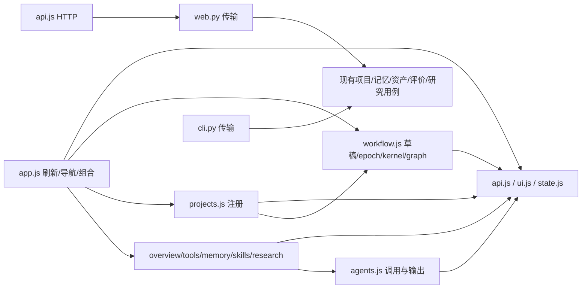

# S11 / R7：CLI/Web 入口与前端模块

日期：2026-11-02。分支`refactor/architecture-foundations`，开始时工作区干净，HEAD `c0ad3433f0b507d28e0d4e219a7f1860a64e6367`；运行基线`277ec1f76e0b304dc30fb82a14e0f95ac9d022d1`。R6已完成独立审查和推送，按用户授权继续R7。

## 范围及分步

基线`app.js`为1959行，混合HTTP、DOM、导航、项目绑定、记忆、Skill、资料与工作流。CLI和HTTP大多直接调用现有领域用例；将HTTP中的Skill diff资产读取/比较归入资产查询所有者。保持页面、HTTP/CLI结果、schema元数据、原六阶段及证据语义；除窄屏路径折行外，不增加产品行为，没有依赖或数据迁移。

|分步|产出|实现|验证|独立审查|
|---|---|---|---|---|
|R7.1 前端责任拆分|原生ES modules；请求/DOM/应用状态、项目、绑定、Agent/总览、记忆、Skill、研究、工作流各归属|12模块已移动，入口149行|原生语法/导入、包/真实浏览器通过|通过|
|R7.2 传输入口归位|Skill diff移到资产查询；CLI/API共用现有用例及错误语义|只读查询已归入skill_assets|20项定向/最终完整回归及30次CLI/API对照通过|通过|
|R7.3 窄屏验收修复|总览长仓库路径可折行，避免撑出屏幕|单条overflow-wrap规则已加入|390px六页及图均无页面横向溢出|通过|
|R7完整验收|非editable wheel包含全部模块；完整相关回归、窄屏/异步/冲突/同源及两OS CI，提交推送|已打包安装并推送|最终Linux206项+36子测试/18跳过、335文件×两安装/21次基础CLI/30次API对照、浏览器及精确两OS CI通过|[通过，含最终远端复核](2026-11-02-console-modules-review.md)|

## 状态及依赖决定

- `app.js`只组合入口、刷新/项目导航及render；保留原refreshSequence。`state.js`保留既有选中项目/tab/bootstrap/dashboard和派生层元数据，不拥有业务终态。HTTP放`api.js`；纯文本DOM、通知、对话框、表单等既有通用组件放`ui.js`。
- 项目/绑定、Agent调用、总览、记忆、Skill、资料分别迁入对应视图模块；入口向实际视图传入`refresh/render`回调，视图不导入入口。共享资源/协议显示仍来自bootstrap元数据；不新造插件表或通用view基类。
- 工作流草稿、workflowEpoch、kernelInvocation及图实例共同留在`workflow.js`，保持同一个请求/编辑身份。入口调用reset/draw/dispose生命周期操作，不直接修改草稿内部；项目注册和项目切换都复用同一个reset。原native状态、预算与可信门禁继续由后台拥有。
- `skill_assets`拥有只读diff查询；Web仅解析传输参数并调用它。新增查询有实际Web消费者、需要资产身份检查与内容读取，属于资产接口；不为每个路由另包一层服务类。

主体是职责移动，没有新增前端框架、Node构建步骤、状态库、第二执行器或正式任务API；F3/F4/F6仍按各自节点实现。窄屏验收发现的原有长路径溢出另作最小样式修复并分别保留差异与验收。283冻结参考文件、旧HTML和原合同摘要不改。

## 验证计划

先核对移动前后的函数正文与必要参数/状态访问变化，检查所有相对import及原生module语法；复用既有Web/兼容回归，再构建非editable包并核对随包资源。基础环境确认CLI不暗需Web，CLI/API查看同一项目、绑定、Agent/记忆/Skill状态及相同拒绝行为。

真实浏览器使用Playwright CLI、隔离持久演示项目和loopback服务，复验项目切换、schema绑定、带来源记忆、Skill评价/采用、资料观察与取消、三模板/图、草稿保存/revision及窄屏。延迟真实服务响应，验证旧模板不能盖过新选择，保存后较新编辑仍保留且可继续保存；关闭/切项目/JSON载入等请求身份保护保持。只用确定性本地命令/HTTP fixture，不调用模型/GPU或真实工单。

检查数据放忽略的`.ergora/checks/r7/`，浏览器材料放`output/playwright/`，不改用户实际项目/服务。每步补录命令、身份、通过与未验项；全切片由新的fresh-context reviewer审查后才收口及推送。

## 实施及初步检查

- 原`app.js`正文按职责移动到`api/ui/state/projects/overview/agents/tools/memory/skills/research/workflow.js`；入口只刷新、导航及组合。视图通过明确回调刷新/重绘，无视图导入入口。原DOM文本处理、请求头、schema表单、refreshSequence及工作流epoch/revision判断保持。
- `skill_assets.diff`接管原HTTP中的资产读取和文本/文件比较，继续调用`get`检查项目归属与内容身份；响应字段和错误保持。CLI用例未变，未新增diff命令。
- Node原生`vm.SourceTextModule`编译并链接全部**12模块**通过，记录`.ergora/checks/r7/modules.json`；仅作开发检查，运行/安装不需Node。
- 源码定向：`PYTHONPATH=src PYTHONDONTWRITEBYTECODE=1 .venv-dev/bin/python -m pytest -q -rs --tb=short -p no:cacheprovider --basetemp .ergora/checks/r7/targeted-tests tests/test_reference.py tests/test_web.py tests/test_compatibility_baseline.py`，**20 passed、1既有Starlette warning，20.77s**；日志`.ergora/checks/r7/targeted-regression.log`。包含Skill diff、采用门禁、模板/草稿revision和同源HTTP边界。
- 本节是初轮定向结果；后续最终包、浏览器及完整回归见下文，仍待两OS CI及独立审查。

## 包与浏览器检查进度

首轮非editable wheel与源码/两安装的335文件一致；基础环境无fastapi/uvicorn/gepa/temporalio/minisweagent时，21次CLI结果符合预期，三模板及两golden编译身份保持。首轮完整Linux为**206 passed、18 skipped、36 subtests passed，178.88s**，1既有warning；日志`initial-wheel-regression.log`。18跳过为11 Windows、6未选择SDK、1未选择Temporal。首轮包身份保留于检查记录；修正后最终包身份及复验见下文。

真实浏览器已跑通schema绑定、带来源记忆持久/检索/纯文本显示、双方Skill固定评价及采用r2、Agent消费活动Skill/记忆。初轮脚本在导入的refresh完成前比较、以及假设大型开发首单元是client，分别导致测试超时；已改等待条件/核对真实模板，原日志保留。第二处“查看调用记录”失败是实际拆分遗漏：overview使用展开的`outputPanels`时未导入，已补显式导入并重建安装，`browser-record.log`复验真实归档输出成功。未改原业务算法、超时或断言来绕过失败。

以下保留发现与修正依据；最终状态在“最终本地验收”，下一步为独立审查和精确候选两OS CI。

第二轮隔离项目`browser-core-final.log`完整成功：schema绑定→记忆→Skill导入/diff→固定train/validation/holdout评价（0.5→0.9）→采用r2→Agent消费两种上下文→归档预览。`browser-workflow-retry.log`通过模板乱序、循环拒绝、保存期间较新编辑保留及后续r3、外部r4与旧revision拒绝、JSON编辑身份、切项目、下载和训练/未绑定kernel错误。资料流程已确认抓取、审阅、取消和项目注册/归属；组合脚本随后在窄屏总览失败。用同一数据、同一浏览器分别加载原始`c0ad343`的app.js及当前模块，390px下二者scrollWidth均589px（`browser-mobile-baseline.log`），定位为`.check-row strong`长仓库路径不折行；新增R7.3单条样式修复，后续复验全部六页及图。

## 最终本地验收

- 最终wheel SHA **`e67755fb3b109ed6794a98beb45fe33a0edfa2a7bed9a6569a625851fdf8d673`**；335个应用文件与源码、开发/基础两套非editable安装逐字节一致，包含12个原生模块及原vendor资源。脚本`verify-package.py`及`package-identity.json`保留实际身份；与首轮包相比只修正遗漏导入及长路径折行。
- 最终完整命令与R6相同：`PYTHONPATH=src/ergora/data/reference/platform/upstream/platform PYTHONDONTWRITEBYTECODE=1 .venv-dev/bin/python -m pytest -q -rs --tb=short -p no:cacheprovider --basetemp .ergora/checks/r7/final-wheel-tests tests src/ergora/data/reference/platform/upstream/platform/tests/test_contracts.py src/ergora/data/reference/platform/upstream/platform/tests/test_portable.py src/ergora/data/reference/platform/upstream/platform/tests/test_workflow.py::AdapterTests src/ergora/data/reference/platform/upstream/platform/tests/test_runtime.py`，实际PYTHONPATH为绝对路径，仅加载冻结参考依赖，Ergora来自安装包。**206 passed、18 skipped、36 subtests passed，176.14s**；1既有warning，日志`wheel-regression.log`。覆盖原六阶段、绑定冻结、候选证据、恢复和精确批准等原回归。
- 最终基础环境重新运行`final-base-journey.py`：**21次CLI**符合预期，283冻结文件、三模板/角色、两golden编译及不可变导出通过；fastapi/uvicorn/gepa/temporalio/minisweagent均不存在。日志`final-base-journey.log`和逐次结果JSON。
- 最终Chromium通过`browser-mobile-stable.log`：**390×844下六页及草稿图**无页面横向溢出，项目切换可用；使用指南、跨项目记忆、延迟dashboard顺序通过。截图`output/playwright/r7-mobile.png`已实际查看，桌面/归档/Skill截图另存同目录。表格与代码仍按原滚动容器显示。
- 最终资料脚本`browser-research-stable-retry.log`完整通过：本地HTTP来源、过滤script的快照、审阅r2、取消确认`cancelled`、新项目注册/ID校验/数据归属。验证脚本一度与安装替换重叠造成资源读取失败、随后复用了其他项目的全局观察ID导致400；均保留失败日志。最终已停止/重启隔离服务、固定安装并使用唯一ID，未改产品合同或超时。实际用户服务从未替换。
- `cli-api.py`对三个同一持久项目实际执行**30次CLI**，项目/工具、记忆与检索、Skill/评价、Agent记录/输出、资料、kernel列表与HTTP快照完全一致；跨项目归档拒绝理由相同（CLI既有退出码2、HTTP400），跨站GET/外部Origin/缺少请求头三种请求均403。日志`cli-api.log`、逐次`cli-api.json`。初轮仅脚本误设普通CLI拒绝码为1，核对原CLI合同后改为2，失败记录保留；产品未修改退出码。
- `static-checks.py`核对12个模块正文与基线的明确移动/参数变换一致，导入无环且视图不导入入口，100个当前文档本地链接及空白检查通过；原reference/测试/依赖/CI无差异。原生模块编译/链接再次通过。新增资产接口复用原完整比较代码，无第二个diff实现。
- 真实模型/GPU、原生Forge成功响应在浏览器中的晚到行为、外部工单、ReMe/GEPA/Temporal服务及空白Windows安装未在本切片重验；Windows仍待真实CI。不从确定性fixture分数推导模型改进效果。

## 责任图与后续修改位置

图中的Views→agents实际由overview消费；其他视图不依赖Agent实现。`state.js`只保存UI选择、后台快照及显示元数据。记忆/Skill/研究视图只依赖HTTP和UI，不反向导入入口或模板。工作流内部所有权保持完整，`resetWorkflow`有项目注册/项目切换两实际调用位置，graph销毁/绘制由入口调用。单消费者视图按完整页面责任划分；未创造通用view基类、注册平台或万能context。新增层/工具的字段仍由R1/R2描述驱动；新增产品行为继续走F1–F10。

## 审查与远端状态

新的fresh-context [独立审查](2026-11-02-console-modules-review.md)完成：需求符合性、可维护性通过，无findings；独立核对18个变更文件、335文件×源码/wheel/两安装、移动正文、Python比较AST及实际浏览器断言。源码无须修正；后续同一reviewer又独立复核下述提交分离、远端SHA及精确两OS CI，全部通过。

预检查官方Actions API返回匿名限流403（不是审批拒绝）；已核对官方Actions页面的内嵌JSON包含完整commit URL和run状态，公开expanded matrix包含两个job的独立状态；后续据精确候选读取，不借用历史run。测试浏览器及两个独立loopback服务已关闭，18977/19087端口均关闭（`cleanup.json`）。实际用户环境未升级。

职责移动已单独提交 **`ad73bec7c7bbdf271e18c90ce01d80e7b7423719`**；单条样式及验收文档提交 **`b8bee53bdc85a803109a9b8b804aee7408d7a535`**，二者已推送`origin/refactor/architecture-foundations`。`git ls-remote`核对远端完整SHA等于后者，推送时工作区干净；15个被审查生产文件的SHA全部保持。

精确最终候选的[Portability CI 41410702773](https://github.com/626619403/Ergora/actions/runs/41410702773)为 **completed / success**：Ubuntu job **`125162845678`**、Windows job **`125162845984`**均completed/success。2026-11-02 **08:10:35 UTC**官方API恢复后的run和两个job的`head_sha`全部等于`b8bee53bdc85a803109a9b8b804aee7408d7a535`。原始`ci-run.json / ci-jobs.json` SHA256分别为`972349427905adcae50db79d0a5c32e6b2845f7af2c18e52c9052654c0677707`、`ce4dbef476c62e19899e6391ba215dc473a646472fb00144781aee0ddb416191`，摘要`ci-api-status.json`。

官方HTML的完整commit URL及run状态也与API一致；最后一次expanded matrix刷新遇到SSL EOF，故最终两job结论以完整API响应为准，未拿旧running图当成功。未下载逐项Windows日志，不补造其测试项数。reviewer于08:13 UTC直接查询官方API、核对workflow与安装脚本，确认两个job及相应成功步骤、完整候选和远端身份均通过。

## 完成及下一节点

**R7完成。** 生产验收身份为`b8bee53bdc85a803109a9b8b804aee7408d7a535`；本次收尾只更新本报告、独立审查及计划，不改变运行代码或测试。按已有授权提交推送状态文档，继续保存真实未验范围，不重复已通过的代码检查。需要回退时按两生产提交的逆序处理；本切片没有数据迁移，不重算原证据。

收尾核对：包含独立审查的四份当前Markdown共**111个本地文件链接**目标存在，空白检查通过；`git diff b8bee53 -- src tests README.md pyproject.toml .github/workflows`为空，15个受审生产文件SHA保持。记录`closure-checks.json`；只做状态/审查文档收尾，无须再次运行已通过的代码测试。

下一节点R8：以此生产树和各R切片证据核对重构出口，更新完整模块/调用/状态归属图与ADR；逐项关闭已审计的删除/保留/兼容清单，评估并启用最小静态边界检查，核对包、三方向能力和跨平台支持范围。生产行为变化继续放在后续F1–F10，不把重构出口当作统一任务/低代码/远端会话已实现。
