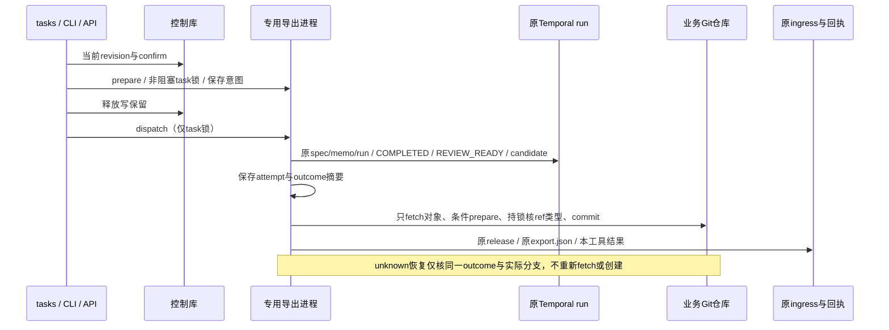

# F3.4a：固定原运行与精确候选的可恢复本地导出

日期：2026-11-03。实现基线`722a3cb392dd5be03964845fa7d35c8c1bc90d1f`，生产基线为已独立验收的765c39a。当前源码修正已独立复审，最终发行及CI验收中；完整状态以末尾记录为准。依赖[F3.4总设计](2026-11-03-formal-task-acceptance.md)和已通过的D短事务边界。

## 接口与所有权

CLI `task export PROJECT TASK --revision N --run-id RUN --candidate-sha SHA --branch BRANCH --confirm`、`task export-status PROJECT TASK`、`task resume-export PROJECT TASK --revision N --intent-sha256 SHA --confirm`；网络预算沿用timeout。API GET/POST `.../tasks/TASK/export`及POST同路径`/resume`。单个任务保留一个不可变目标，与原export.json一份记录的合同一致；变更候选/分支拒绝，不用换操作ID绕过未知。

复用tasks的严格确认/当前revision短事务、reference原生子进程、_Submission的原创建/提交/spec/memo/run归属及原ingress.release；新reference_task_export仅拥有导出意图/检查点/回执和Git条件写入。无新依赖、表、调度器、第二套验证/审查规则，不改冻结283参考文件。父CLI/API无需导入SDK。status只读本地记录；真实完成outcome继续由已有task status提供，不用GET释放租约。

意图固定项目修订、原提交摘要/run、目标repo、候选、分支和操作者。准备只做本地校验，非阻塞同task锁；离开控制DB后才核原run COMPLETED/REVIEW_READY及原task/request/profile/base身份和精确candidate。长网络/Git阶段只持task锁。原运行结果负责可信检查与独立审查，控制面不重算通过。

## 写入与恢复

变更前保存attempt，含原outcome规范SHA。Git只fetch对象（不写FETCH_HEAD/业务ref），再以no-deref/旧值条件创建目标分支；已有不同commit的分支明确拒绝，已有相同candidate可接受。条件更新失败只有读到确切目标candidate时才可继续，不吞权限/冲突错误。此出口不checkout、不merge、不推业务仓库。分支确认后才复用原租约释放规则、不可变写原格式export.json，最后写本工具回执。

状态为not_recorded/prepared/unknown/exported。重复export只读原记录，既有意图必须匹配同run/candidate/branch；prepared明确resume可继续。已有attempt时恢复只核原run/outcome及实际目标分支；若不存在，保留unknown/branch_not_found，不重新fetch/创建，以免复活操作者已删除的分支。已有正确分支只补原回执/适用原租约释放；不同分支或outcome明确报错，不移动ref。最终回执表示已记录的导出事实，重复读取不代替对分支后续人工修改的实时检查。

原入口的export.json若无本工具意图，保留原入口管理，不隐式采用。旧创建/提交/批准/取消记录及其原run保持；不覆盖冲突文件，不迁移在途history。

## 验收与审查

先两模板正常/重复及真实Git CAS竞争；覆盖旧run/spec/memo/结果身份、非REVIEW_READY/错误candidate、无确认/旧revision/非法分支、同ID冲突、意图/attempt/ref/原export/result各边界中断、丢父响应、unknown分支缺失/冲突/原结果漂移、已有分支/工作树/HEAD不动、原租约证据、CLI/API同源与确认、网络等待跨项目写者不被阻塞。源码定向后新fresh-context结构/性能审查，修正后最终非editable包/两安装/冻结283、基础两模板CLI与兼容/性能、适用完整回归/精确两OS CI、独立最终核对及提交推送。真实六阶段/终态对账归F3.4b–e，不能由端口fixture替代。

## 首轮实现与正在补齐的边界

已接入tasks、原生专用子进程、CLI及API，复用原创建/提交归属、spec/memo、短修订事务和IngressLeases。新增测试仅替换SDK服务端口；候选Git对象/目标分支、意图/检查点/原生回执以及租约均使用真实本地实现。首轮源码测试正在运行，未构建本切片新包，现有开发安装仍是D发行；不能沿用D验收结论。

真实产品反例`source/dangling-before.log`两例均失败：已存在或检查后并发创建的悬空symbolic ref会被普通no-deref零旧值更新替换。隔离Git2.43探针`ref-transaction-probe.py/json`验证，update-ref --stdin的start/create/prepare持锁后可识别该符号引用，abort保持它；正常缺失分支可commit，其他写者取得不了同一ref锁，结束无残留lock。后续将该小段现成Git事务用于实际出口，不自行实现ref文件锁。

原core.git是同步调用且最长120秒，直接放进async超时不能回收其Git后代；本切片需让真正变更阶段的Git调用参与异步预算并在专用进程组内清理。原core被冻结，现有processes.run面向落盘命令输出且为同步一次性stdin，不能持有Git交互事务，因此实现限于导出所有者内部的stdlib异步进程生命周期，不新增公共runner/插件/后台服务。准备阶段仍只运行原本地Git根/分支格式校验，无网络或Git写入。需要实际超时/事务中断反例证明清理，并由独立审查核查这一必要性和复杂度。

## 源码自查与独立审查准备

首轮49项通过（361.37秒、1个已有warning）；悬空符号引用修正后的11项Git定向通过（86.11秒）。两者范围与源码不同：首轮未含事务修正，11项尚未含下述后代收养/回收加强，不能冒充最终验收。最终源码命令为`PYTHONDONTWRITEBYTECODE=1 PYTHONPATH=src .venv-dev/bin/python -B -m pytest -q -p no:cacheprovider tests/test_task_export.py tests/test_architecture_boundaries.py --basetemp=.ergora/checks/f3-task-export/source/final-fixtures --tb=short`，原始final-source.log，当前在运行。

Git变更阶段现为私有异步进程组，超时先TERM清理Git事务锁，1秒后KILL兜底；网络专用原生子进程复用既有processes的Linux subreaper与回收函数，避免只停止后代却遗留僵尸。准备/状态不启用它。测试要求fetch模拟进程及fork后代的/proc记录均消失，并验证准备完成的真实Git事务超时后无ref/lock遗留。强制杀死客户端/机器断电仍需沿不可变检查点与实际分支对账，不能将正常预算清理测试扩大为任意崩溃下的绝对保证。

已自查实际CLI/API消费者、原生边界、原创建/提交调用链和字段归属；无新依赖/表/公共抽象，无冻结参考内容修改。新生产模块是该专用子进程入口和连贯导出算法的所有者；私有Git生命周期只服务它的交互事务与预算，不能以假想复用建设通用runner。公开USAGE、PROJECTS与AGENT_BACKENDS已同步命令、未知恢复、原入口保留和备份范围。独立审查、发行安装/兼容/性能/完整回归与两OS CI均尚待完成。

## 独立审查与当前修正

fresh-context独立审查确认一项P2：目标ref不存在但已是当前或关联worktree的unborn HEAD时，普通创建会改变HEAD可解析结果。真实失败反例见reviewer/first-unborn-head.json及probe.log；unborn-head.json为修后保持证据。现已在Git事务prepare持ref锁后核`worktree list --porcelain -z`，占用则abort；新增当前与linked-worktree反例，保留HEAD、索引/用户文件及租约。修正后定向结果另记，不提前关闭finding。

源码联合首轮为68 passed、1 failed、445.06秒；唯一失败是路径越界已被原safe_file明确拒绝，而测试regex未接受原错误`Path escapes trusted root`。修正只校正诊断期望，保留无越界写断言，没有修改产品的拒绝行为。此前11项Git修正不包括这次HEAD修复。

首个55f38b…候选已完成346文件×源码/wheel/两安装及冻结283、基础Python3.12.3无SDK两模板74CLI、D十态升级和B/C1/C2六历史原生记录核查；但其不含HEAD修正，不能作为最终包验收。已明确停止该候选的完整回归（95 passed、10 skipped后SIGINT，退出码2），保留first-candidate原日志/包/身份；没有宣称通过。当前源码修正将重建/重装并完成最终发行回归、旅程及独立复核。

## 修正后源码复审与最终发行候选

HEAD/路径/超时定向7 passed（47.81秒）；独立原反例及当前/关联worktree三例3 passed（18.30秒），原HEAD、用户文件/索引和租约保持。独立源码审查无未解决finding，P2 HEAD问题已在源码层关闭；发行/CI验收仍待完成。8个生产/测试文件aggregate `7238c7fec9ffb664bed1dfe80bfd812721eb864960dbf8e55d1e4f4a8911e3e3`。

修正后候选wheel SHA256 `7c1fa4bfe066a42eb89e612a2fc9c6234f26b4722c55c8333cbf2fcf00175477`；346文件×源码/wheel/两非editable安装一致，冻结283通过。最终完整发行回归及全新基础两模板74CLI正在运行，尚无结论；精确两OS CI与远端均待完成。本切片只验统一出口合同，不继承旧L0真实六阶段结果。

## 最终旅程、兼容与并发实测

生产/测试候选`ef8068a754446ae8da85fc25e8515f6acce60250`已提交推送；提交归档346文件与7c1fa4…wheel、源码及两安装一致，8文件aggregate仍7238c7fe…。当前分支refactor/architecture-foundations；尚未标记F3.4a完成。

最终Python3.12.3基础控制环境无FastAPI/Temporal/GEPA，完整登记运行时使用Python3.11.15 SDK；两模板74次CLI通过，包括注册/预览/创建/缺运行时明确失败/单次提交/精确候选导出及每模板export-status、export、resume-export各10次。两模板都只调用一次fetch/目标ref事务/结果查询和一次doctor/start，重复原生字节不变，HEAD与未提交文件保持。治理/大型首次导出2245.82/2268.90ms；三类本地重复中位分别1250.13/1135.81/1080.65ms及1098.66/1104.18/1214.81ms，最大1314.59ms。包含CLI/原生进程与SDK导入且并发完整回归，没有真实RPC/模型或纯启动性能提升结论。journey-performance-final.py/log及journey-performance.json固定最终wheel身份。

最终18秒受控connect、每阶段25秒预算下，另一项目真实SQLite写者18.80ms成功；同task的export/resume-export/create/resume-create分别843.02/824.62/106.16/89.10ms明确busy，随后另一项目仍继续写至revision6，均早于远程导出结果；实际仅一次fetch和ref事务，总20043.56ms。lock-contention.py/json/log记录隔离项目、实际Git/租约/锁及可复核范围；不修改用户已有服务。

升级分两层记录：固定D非editable包先创建两模板10种submitted/prepared/unknown/rejected状态，经首候选实际恢复；原D文件字节保持，未知无run不重发，prepared原准入一次，丢响应只补原run。HEAD修正后的最终wheel再逐个原地读取/明确重复，核全部原D字节、恢复后原生记录、总start次数及状态不变；B/C1/C2六历史项目的响应/原生字节保持；首候选两个原export回执也可由最终包读取/重复而无文件变更。upgrade-d-baseline/candidate和final-compatibility各JSON/log分别保存，不能把最终只读复核冒充再次首次恢复。

完整最终发行回归及精确两OS CI仍在运行，最终独立包/日志/CI/远端复核待完成。真实两模板六阶段/重启异常、终态fence对账仍留F3.4b–e。

独立最终本地核对已通过，详见[审查报告](2026-11-03-task-export-review.md)：源码/wheel/ef8068a归档/两安装346文件逐项一致、两安装冻结283、基础环境无三个可选SDK、D十态原字节与start总数、六历史原生字节及原approval/cancellation响应、首候选/最终旅程四个导出回执、74CLI计数均核实。审查原脚本/JSON/log在reviewer/final-local-check.*。精确CI41589227955及完整发行回归继续待完成，不以本地子集核对代替它们。

精确[CI41589227955](https://github.com/626619403/Ergora/actions/runs/41589227955)已成功：Ubuntu job125761835523的构建安装/冻结身份/完整原生回归三必需步骤，Windows job125761835367另加PowerShell5.1安装升级共四必需步骤均success；run页面与各步骤log URL均匹配完整ef8068a提交。ci/ci-html-status.json与两份job/原run HTML保留来源哈希；只读远端仍为完整ef8068a。最后仍待本地完整发行回归终结及同一独立审查者终结核对，当前不标记完成。
