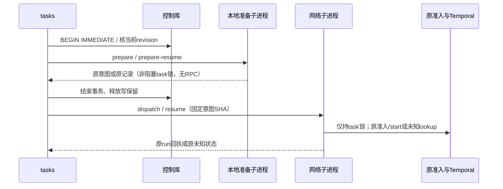

# F3.3d：提交意图准备与长远程等待分段

日期：2026-11-03。当前源码实现与独立修正完成，最终发行验收进行中。依赖已固定并完成独立本地审计的c2生产/测试`c3113ad119c72ed933876ddae95d3c849c804852`；c2源码/测试身份`b215f9553a3ba8ac716b70bd86ecf285af7eb1d3c0fc6e92956078dd023255bd`、发行候选`4abad37…`；c2最终本地/精确CI/远端均已独立核对通过。d可并行实施但必须分开核验，不把c2证据当d验收。

## 已实测问题与目标

F3.3b原提交把SQLite BEGIN IMMEDIATE持有到doctor、claim和远程start/lookup结束。原最终f8d92f…包的隔离探针在SDK connect延迟18秒时，使另一个项目真实写者15.04秒后busy失败；无部分写，结束后显式重试成功，见[提交记录](2026-11-03-task-submission.md#共享控制库锁争用补测)。c1/c2的新入口已经分段，但没有修复该旧提交路径。

目标是保留修订授权、不可变原创建/提交意图、原准入/claim、原task锁、spec/memo及写前attempt语义，同时让长远程操作不占全库写锁。不是替换SQLite、增加后台队列、另造调度器或重试未知提交。原提交记录格式和已有run/任务ID保持，不迁移在途history。

## 预定实现

1. start/resume-start在当前revision的短控制库保留下，仅运行无网络prepare/prepare-resume子进程：核原创建/登记、原意图或摘要，以非阻塞原任务锁保存或读取意图。准备不调用doctor、claim、connect，也不读取完整连接环境。
2. 退出控制库事务后，才运行dispatch/resume。网络阶段只持原任务锁，加载原环境，复用既有dispatch/Transport检查点和严格spec/memo恢复。初次prepare返回created；相同start已有意图只读原状态，不隐式重试准备失败的准入。resume携带原意图SHA；已有attempt仅lookup，不因NOT_FOUND或历史消失重发。
3. 已有submitted/rejected回执可直接返回；阶段间父进程中断保持prepared，明确resume再继续。另一明确resume若先取得锁，后续dispatch只读其原结果/unknown，不重复start。
4. 短本地准备事务与c1/c2归入tasks中同一修订保留所有者；确认/输入约束保留各入口差异，不能为复用而给start捏造人工确认。保持原doctor、可信检查、IngressLeases和局部SDK归属hook不变。

同任务准备遇活跃任务锁时将及时报busy；并发读到已保存意图时也可得到prepared/unknown快照，而不是等待另一请求变成submitted。相同已完成意图的后续调用仍返回同一原run回执。验证应固定“只有一次start、未知不重发、没有半份意图及跨项目写锁等待”，不能以两个并发调用一定取得相同时间点状态为条件。公开手册需明确这一可观察并发响应；不自动轮询、重试或延长预算来掩盖busy。

## 验收

- 重放原提交全部中断/竞争/memo/严格JSON反例；旧意图/attempt/result/rejection字节保持，提交/批准/取消/status联合回归。新prepare不产生doctor/claim/connect证据。
- 准备完成后、派发前父响应丢失；当阶段之间项目revision/角色变更，意图和原任务绑定仍固定，后续显式恢复使用当前revision核原SHA；配置/创建文件漂移仍拒绝。
- 同任务并发准备/明确resume/dispatch交错不重发；busy及时释放全库保留，未创建意图的错误不伪造prepared。保存意图后发生错误仍可查原记录，不改变task/run ID。
- 同等18秒connect延迟下，另一个项目真实写入在远程完成前成功；同任务prepare及时拒绝、其后跨项目仍可写。测新路径额外子进程启动成本、明确fixture/RPC范围，不由并发收益推导模型吞吐提升。
- 最终非editable包、两安装/冻结283、基础两模板完整操作旅程及限定性能、适用完整回归/精确两OS CI；新的fresh-context结构/性能审计、最终独立核对与提交推送。d完成后才进入F3.4真实新六阶段/导出/重启综合旅程。

## 当前实现与自查

已将`tasks._submission`改为本地prepare/prepare-resume、释放DB、再dispatch/resume；`_native_prepare`在同一tasks所有者内集中三个真实原生操作的修订保留事务。决定入口仍由`_decision_prepare`检查明确确认，start保留原creation SHA授权，没有伪造人工确认。`reference_task_submission.run`的prepare仅非阻塞锁/意图，main不加载连接环境；网络阶段依原意图/检查点继续原dispatch/reconcile。未改原意图/回执字段、doctor/claim或start hook。

新增四项语义回归：连接环境拒绝发生前已保存意图、准备后父中断无准入、阶段间角色/revision变化保持原快照、远程等待期间其他项目可写且同任务prepare及时busy。原并发测试改为验证一个精确意图/run、仅一次start，允许并发观察prepared/unknown或busy，完成后重复返回原回执；保留父响应丢失不重发检查。

联合源码检查正在运行：`PYTHONDONTWRITEBYTECODE=1 PYTHONPATH=src .venv-dev/bin/python -B -m pytest -q --tb=short -p no:cacheprovider tests/test_task_submission_locks.py tests/test_task_submission.py tests/test_task_approval.py tests/test_task_cancellation.py tests/test_task_runtime.py tests/test_architecture_boundaries.py`，原始`.ergora/checks/f3-task-submission-locks/source-first.log`，最终156项通过（修正前身份）。执行该命令时开发安装仍为C2，明确使用src；之后新fresh-context审查、发行包/18秒同条件并发、原记录升级/完整旅程、完整发行回归和精确CI分别验收。

## 首轮与独立审查反馈

首轮六套源码联合最终156 passed、1个已有warning、715.79秒。该结果绑定创建锁修正前的D源码，不自动覆盖后续修正。C2精确CI41576751862及独立CI/远端已完成，文档收口e590af4已推送；D的生产基线仍固定c3113ad。

独立审查发现可达的相邻锁路径：远程提交已持task锁时，create/resume-create仍会先保留DB再阻塞同task锁，另一项目写者在3秒受控延迟下实测等待约3.04秒。已将创建发布/恢复的同task锁改为非阻塞；相同创建之间仍由原DB短事务串行，原意图/发布/修订及回执格式不变。任务正忙时明确busy，不隐式重试。新增两项真实子进程回归分别覆盖create/resume-create，核无文件/准入变化且拒绝后其他项目可写。该修正属于D锁次序目标，不新增生命周期或重写创建实现；34项源码定向通过，独立原场景复核通过（busy约72ms、另一项目写者约2.49ms，3秒受控延迟），原finding已关闭。

已在安装切换前用C2保留同解释器/同fixture的每模板5次初次提交基线，以及两模板10类已有submitted/prepared/unknown/rejected状态；另保存B/C1/C2六个原项目的原生字节/响应，用于D升级后原地只读/恢复核验。证据在.ergora/checks/f3-task-submission-locks，不修改既有用户项目或服务。

## 当前发行候选与并发测量

最终候选wheel SHA256 `c774ba4f3eb1d8d553f86253cc23954c33404fe0eaec10f5106597d54a4d38bf`。源码/wheel/开发及基础两安装345文件逐项一致，无新依赖/表/包模块；生产/测试6文件聚合`7aface07b4ad9239e0e5519aa4a835b5c420d45d9750a416ce0a5755a9183878`。开发安装已切换D，不能据当前安装重验旧C2。完整非editable回归与无SDK两模板CLI、固定C2升级恢复正在运行，尚无最终结论。

同旧B基线的18秒受控connect延迟、每阶段25秒预算下，真实共享SQLite另一项目写者21.32ms成功；同任务start/create/resume-create分别780.11/113.31/94.18ms明确busy，随后其他项目继续写至revision5，均早于远程结果。最终仅一次doctor/start、原run为submitted，总19859.92ms。旧B同18秒延迟下写者15040ms后database is locked。原脚本/JSON/log为lock-contention.*；这是本地协调行为测量，不代表真实RPC/模型吞吐提升。精确两OS CI和最终独立发行核对仍待完成。

升级兼容探针首轮对prepared恢复的新增文件断言过严：原准入会正常新增cli-ingress和attempt/result，但旧文件未变；保留upgrade-candidate.log，不作为通过。修正探针仅允许该原生命周期的预期新增，再从固定C2 wheel的隔离overlay生成新两模板10个状态，使用upgrade-compatibility-v2.py及upgrade-v2-*记录，不重用已恢复的样本。

## 独立源码审查与已完成发行旅程

新的fresh-context审查者[源码/结构审查](2026-11-03-task-submission-locks-review.md)完成；初审相邻创建锁P1已修正并独立复验，当前无未解决finding。独立10项旧C2六类journal/三种resume抢先交错/新revision恢复探针通过（54.02秒），六文件身份与候选一致；独立3秒真实并发修正检查通过（5.85秒）。这些不替代最终发行/真实服务验收。

无FastAPI/Temporal/GEPA的Python3.12基础安装通过两模板72次CLI：缺完整环境明确失败、创建/提交、每模板submission/start/resume-start各10次重复、相同原run/回执及原生字节不变、每模板仅一次doctor/start；冻结283保持。重复路径中位ms：治理1114.92/1135.77/1140.95，大型1066.19/1105.31/1124.02，最大1341.41ms，包含CLI/子进程/SDK导入与完整回归并发开销，没有网络重发。

初次提交成本使用同一Python3.11解释器/同一fixture，固定C2与D各每模板5个全新任务；设置不计入计时。治理中位971.85→1943.50ms（+971.65ms），大型1033.69→1821.87ms（+788.19ms）。两阶段增加一个原生子进程/导入，代价在本测量约0.79–0.97秒；保留该显式成本以换取远程等待不保留共享DB。两期与不同回归并发，不能将差值视为精确的进程启动微基准；没有模型吞吐结论。不引入常驻进程、缓存或新的RPC层来掩盖这项成本。原startup-cost.py与startup-{baseline,candidate}.json/log、journey-performance.*保留。

## 旧记录升级复验

最终v3探针通过：固定C2 wheel隔离overlay生成两模板10个原submitted/prepared/unknown/rejected状态，再由D wheel读取/明确恢复。submitted/rejected保持；prepared经原准入一次提交；lost-response只查原run补回执、总start仍为1；attempt已保存而原run不存在的两例继续unknown/not_found且start为0。原task、意图、attempt和既有回执逐文件字节均不变，只新增原恢复合同所需文件。B/C1/C2六个历史项目原地读取及重复终态操作的响应/原生字节保持。独立审查者已重算345文件×两安装、冻结283及全部升级旧文件身份，已完成范围通过。

辅助v2在unknown的临时reconciliation/instruction字段与仅本地持久状态做全等时失败；没有生产代码变更。最终v3只在该返回值比较中排除这两个瞬时查询字段，保留未知、零start和全部原字节断言，并重新使用固定C2生成的新样本。v1/v2失败日志保留，不能算作通过。

完整非editable回归仍在运行。准备将已独立源码审查的精确候选提交推送以并行触发两OS CI；该候选不提前标记D完成，最终本地回归及独立CI/远端均待收口。下一F3.4已按[出口与综合验收设计](2026-11-03-formal-task-acceptance.md)拆为a候选导出、b终态外部对账、c正常旅程、d异常恢复、e阶段收口，尚未开始实现。
