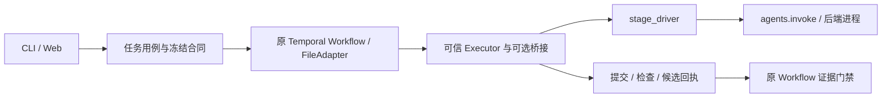

# Agent 组合与当前架构：独立评审及共同处置

日期：2026-11-08。状态：独立评审已完成，主代理已阅读并处置，修复与设计交付分别进行。固定源码为`b1dbe48a1b14e8e2ec59d4f44e30b2ea367fa1fe`，分支`refactor/architecture-foundations`。本轮审查当前完整源码快照；变更历史可辅助定位，不能把未出现在近期diff中的代码排除在外。

## 原始需求与评审范围

用户要求参照AI Hero的工程方法全面评审当前代码，将评审及重整理建议汇总于共享文档。其目标是每个工作流模板可以选择多个按职能划分的Agent，例如审查者、监管者、执行者；每个具体Agent另存独立定义，描述权限、MCP、Skill、初始提示及运行所需资料，并参考成熟框架和论文调整既有计划。此前要求保留六阶段可信执行与候选证据、逐项目工单、Linux/Windows及每个完整切片的独立审查。

评审覆盖控制面、模板/角色与工具选择、执行器/参考实现、审查与权限、配置/状态格式、CLI/Web、tests/CI及工程记录。区分可复现缺陷、已承诺但未完成的功能、架构建议和研究假设；每项重要结论给实际文件/位置、触发路径、影响及最小修正。不要将未来组合需求直接判为旧功能回归，也不要凭文件长度或代码气味认定缺陷。

## 独立评审者工作区

由新的独立评审者负责写入，按Standards与Spec两轴分别记录，并明确实读范围、未验部分及建议优先级。

评审者写作期间主代理只读本文件；评审者完成后，主代理在下一节追加逐项回应，不覆盖原结论。评审仅授权本报告写入，不授权修改生产代码、依赖、测试、CI、数据库或远端。

### 身份、方法与结论

评审者：fresh-context独立代理`comprehensive_agent_model_review`。本工作区已完成，供主代理逐项处置。固定源码为`b1dbe48a1b14e8e2ec59d4f44e30b2ea367fa1fe`；历史参考基线`cab3a724e421d0a7d9ff6f03dfcbd3225361e2f1`可解析，历史三点diff为275文件（+31594/-2717），仅辅助定位。本轮检查对象是完整当前快照中的真实调用与数据所有权。工作树中的上一片F6评审追加、主代理更新的`docs/PLAN.md`及本报告均不当作待审生产变更。

已完整阅读根`AGENTS.md`、AIHERO索引、AI Hero `code-review`、`codebase-design`、`improve-codebase-architecture`、`maintainable-project-delivery`及其独立评审说明。两个fresh-context只读子评审者分别检查Standards与Spec，不互传结论、不递归委派；本评审者核对主调用链并保留分轴结果。架构skill的HTML选型流程与本次共享Markdown写入范围不符；采用其模块深度、接口、扩展接缝、adapter和修改局部性原则。未按文件长短或抽象数量判定缺陷。

**Standards轴发现一项P2资产发布缺陷；Spec轴发现一项P2模板指令消费缺陷及一项P3文档契约不一致。** 当前六阶段和候选证据门禁有源码及定向检查支撑，应继续保留。用户新增的“独立Agent定义＋每模板多个职能Agent”尚未实现，以下另列能力缺口，不计作旧功能回归。现有分层可支持渐进扩展；没有足够证据支持整体重写或为每个命名Agent增加一套类体系。

### 实读范围与覆盖边界

|检查域|本轮实读和核对|结果与边界|
|---|---|---|
|规格与工程记录|README、AGENTS、PLAN相关现有承诺及当前检查点、详细计划F6–F10/D节点、INTEGRATIONS、AGENT_BACKENDS、USAGE相关流程；当前架构、合同身份、迁移、reference边界及ADR0001/0002/0003|区分已交付、历史验收和未来计划；本轮没有继承历史模型/CI结果为新通过|
|项目、绑定、模板与组件|`projects`、`bindings`、`components`、`contracts`、`registrations`、`reference`、`drafts`及实际schema/组件目录|核对有效配置、revision、注册投影、模板合同和正式任务冻结；当前仍是一职能一绑定|
|执行与证据|`tasks`及全部`reference_task_*`用例、`reference_executor`、`stage_driver`、`agents`、`agent_runs`、`processes`、`windows_job`；原`workflow/activities/registry/portable`和本地`executor/sandbox/process_job`|跟踪创建、提交、批准、取消、对账、导出及六阶段；定向验证实际fixture子进程与候选身份，不等于模型质量验收|
|权限、MCP、Skill与上下文|Agent配置和调用参数、Skill资产/评价/采用/搜索、记忆及ReMe投影路径；普通调用与正式阶段分别检查|普通调用有已选Skill/记忆快照；正式任务尚无F10上下文消费；MCP未成为逐Agent授权模型|
|持久化与恢复|`state`、`backups`、配置/合同schema、创建与操作意图、短事务/同任务锁、未知结果恢复|核对16表和有序迁移、旧写者拒绝、DB与文件/原生状态的责任划分；发现S-1，不宣称已穷尽所有崩溃/并发交错|
|CLI、Web与交接|CLI parser/关键dispatch、Web payload/routes/本地信任边界；UI入口、state/api、agents/tools/workflow主要路径，tasks的调用/修订/生命周期及相关记录；其余视图代表性检查|入口复用后端用例；未逐行等深阅读全部前端和每个测试；本轮没有运行浏览器旅程|
|研究、训练与调度|`research`、`scheduling`、`evaluation`、`optimization`、`kernel`及其实际消费者|Agent提案、原生运行、可信评分和采用相互区分；未运行GPU或外部研究/搜索服务|
|tests、CI、冻结与分发|架构边界、组件/schema、项目配置、迁移、Agent/正式执行器、真实SDK payload等代表性测试；现有CI矩阵、安装/打包入口及F6原型边界；283文件身份和21对分发镜像的消费者|139项既有检查通过、283文件身份通过；冻结树做身份与关键路径语义检查，未逐行审计全部vendor；未实际运行Windows或远端CI|

### Standards轴

#### S-1 · P2 · Skill最终目录的中断发布可在重试时登记为完整活动基线

位置：[skill_assets.py](../../src/ergora/skill_assets.py)，`import_bundle`第103–120行；后续拒绝点是`get`第69–72行。[当前架构](../architecture/current.md)第204行将不可变树身份、活动头和采用历史归该模块所有。

触发：导入先在临时目录校验源树，再用`shutil.copytree`直接写入内容寻址的最终`skills/…/digest/name`目录。如果第二次复制在创建目录后中断，最终路径已存在而内容不全。重试同一稳定源时，第104行因目录存在跳过复制及再次校验，随后将预期digest写入`skill_versions`；同名首次导入还会在第118行设为活动头。之后`get`重新计算树身份，拒绝这份“成功导入”的基线。

子评审在独立临时目录注入最终复制中断后重试：返回了预期digest，活动头已建立，资源文件仍缺失，随后`get`报`Stored skill content changed; refuse to use modified evidence`。探针未使用实际项目或用户库。这是已存在的资产发布/恢复缺陷，与新Agent组合需求无关；它不会让损坏内容绕过`get`，但会把不可用版本登记为成功并阻塞后续消费。

最小修正：先完成可校验的暂存树，再以有同摘要并发协调的方式发布；已存在最终路径也必须校验完整身份，不能仅凭`exists()`登记。保留已验证有效树和不可变资产语义，避免用重试覆盖已有有效版本。验收应覆盖“最终复制中断→重试→可读取完整资产”和同摘要并发导入；不需要新增整套存储框架。

#### 非阻塞架构判断：后端分支已有重复，但现在抽成全局插件框架依据不足

实际变化点在[agents.py](../../src/ergora/agents.py)第30–51行的程序/可用性、第86–127行的argv与结果解码，[stage_driver.py](../../src/ergora/stage_driver.py)第29–39行的Codex配置以及[tools.py](../../src/ergora/tools.py)的诊断路径。加入真正的新harness时会同时触及多处，呈现Repeated Switches/Shotgun Surgery风险。普通调用和正式阶段已共享`agents.invoke`，且[ADR0001](../architecture/decisions/0001-refactoring-foundations.md)和F8明确保留现状并按真实消费者演进，故本项是已知扩展债务，不作为规范硬性违规。

合适的触发点是F8接入一个真实新后端：让窄adapter集中拥有本后端的准备、调用、能力说明和原始结果归一化，调用者保留用例编排。一个新增命名Agent若仍复用Codex，应当是定义数据，无需再增一个backend类。没有证据支持删除有分发消费者的冻结镜像/兼容别名，或新增通用lint、CI分类器与镜像式测试。

### Spec轴

#### Q-1 · P2 · 已冻结并校验的模板指令没有进入正式阶段的Agent提示

现有承诺见[AGENT_BACKENDS](../AGENT_BACKENDS.md)第3行“模板保存目标、角色、能力、产物和验收”。模板确有额外行为要求，例如[large-change/instructions.md](../../src/ergora/data/reference/platform/templates/large-change/instructions.md)第7–11行要求规划者分析消费者、兼容、所有权、迁移与回退，[repository-governance/instructions.md](../../src/ergora/data/reference/platform/templates/repository-governance/instructions.md)第24行规定fresh-context审查范围及例外检查。

真实路径：[portable.py](../../src/ergora/data/reference/platform/upstream/platform/dev_platform/portable.py)第248–255行把完整package冻结到compiled合同，但其第162–170行生成的profile只保留模板文件哈希；[registry.py](../../src/ergora/data/reference/platform/upstream/platform/dev_platform/registry.py)第45–51行检查文件哈希后也只返回profile。[workflow.py](../../src/ergora/data/reference/platform/upstream/platform/dev_platform/workflow.py)第78–87行传入阶段的是spec/profile上下文，没有package中的指令正文。最终[reference_executor.py](../../src/ergora/reference_executor.py)第58–69行只拼接通用阶段提示、context、依赖产物和结果schema，没有读取或提示选中模板的`instructions.md`。默认冻结[executor.py](../../src/ergora/data/reference/platform/local/agent_platform/executor.py)第174–209行同样未消费这份正文。

影响：普通正式任务虽然绑定了正确模板身份和产物形状，规划者/审查者却没有被提供模板特有的行为要求。哈希证明内容未漂移，不能代替把内容交给执行者。Agent可能自行作出类似判断，但这不是实现了模板指令消费。六阶段、路径、批准、检查和候选证据门禁仍在；本项不声称这些门禁被绕过，也不等同于新增的“每个具体Agent有独立初始提示”需求。

最小修正：在现有非冻结的reference桥接/适配边界，从已冻结且校验通过的模板合同取得真实指令，带身份加入实际发出的阶段提示。旧任务应继续读取其原固定版本；不为此修改283个冻结文件或放宽spec/批准检查。验收应捕获真实发出的prompt，证明两种模板各自指令被消费且漂移被拒绝；只检验哈希字段存在不足以关闭本项。

#### Q-2 · P3 · 独立调用文档把reviewer的默认read-only写成了固定执行边界

位置：[INTEGRATIONS](../INTEGRATIONS.md)第9行无条件写“reviewer使用read-only sandbox”。实际[agents.py](../../src/ergora/agents.py)第87–89行先取显式保存的`sandbox`，再使用角色默认；[components.json](../../src/ergora/data/components.json)第192行起的schema允许reviewer绑定`workspace-write`及Linux下的`current-container`。纯配置验证探针确认两种覆盖都被接受。[AGENT_BACKENDS](../AGENT_BACKENDS.md)第39行已说明显式容器覆盖，因此不能以另一页的绝对表述推断固定只读。

[agent_runs.py](../../src/ergora/agent_runs.py)第58行在注册项目根直接调用工具，普通独立调用没有正式阶段的外层checkout/HEAD前后快照监控。用户照INTEGRATIONS理解为任意reviewer调用都强制只读，会高估实际边界。正式任务另有外层monitor，本项不构成正式审查绕过。

最小修正：将表述改为“默认read-only”，明确显式覆盖后的实际用户/容器边界，并使独立审查入口可见当前有效选择。是否禁止reviewer覆盖属于额外产品策略，不应通过本次文档修正擅自决定。

### 新Agent组合目标：当前能力与缺口

以下是用户新要求与当前实现之间的距离，均不作为上述旧行为缺陷计数。更换具体工具、独立进程和任意多Agent组合是不同能力。

评审收尾时主代理补充用户原始要求：执行者、审查者等各职能可以分别选择后端，执行/审查尽可能采用不同后端，以降低共同出错；用户说明本机已装Claude Code但较慢。本轮未测量其速度。该偏好进入未来选择策略规格：区分harness后端与底层模型/提供方，保留逐职能预算、同后端回退原因及冻结任务不热换的约束。当前固定角色本来就能分别选受支持后端，不将这一部分误判为缺失。

用户进一步明确同职能的具体实例可有不同专长：例如kernel执行者携带设计/优化Skill，架构审查者聚焦整体结构，模板通过互补职责组织工作。专长应体现在Agent定义的提示、Skill/资料与分配范围，和职能、权限分别建模；加载更多Skill并不证明该Agent已有相应能力或质量收益。

|目标|当前已实现的事实|新增能力缺口及边界|
|---|---|---|
|Agent定义独立于职能和后端|组件目录定义7个固定Agent角色及5个支持层；后端绑定保存工具、模型、sandbox或command协议/能力|没有独立`AgentDefinition`的稳定ID/版本、初始提示及资料定义；同工具的两个不同Agent也无法独立持久化后分配|
|各职能独立选后端，执行/审查优先不同后端|现有固定角色的项目绑定已可分别选择受支持工具；可用性/能力检查拒绝不兼容选择|新增组合模型仍需保留独立选择，并显式记录跨后端偏好、模型/提供方信息、预算与回退原因；不同CLI名字本身不能证明底层模型独立，也不能保证减少错误|
|每模板选择任意多个Agent，按reviewer/supervisor/executor组织|[bindings.py](../../src/ergora/bindings.py)第10–22行冻结4个开发角色，每角色一个绑定；[reference_executor.py](../../src/ergora/reference_executor.py)第53–54行按stage选中一个绑定|没有职能下多实例、监管者、每模板分配、审查聚合/分歧/失败策略；当前workflow画布是工作单元DAG，不是这种组合模型|
|同职能的多个实例有互补专长|现有角色合同表达阶段能力/产物，普通调用可以选择Skill和提示|缺少独立持久化的专长定义及模板成员的工作分配/审查覆盖；需能区分kernel专长执行者与架构专长审查者，但不能把专长标签当授权或验收成绩|
|每Agent独立权限及MCP|有角色能力、后端sandbox/工具参数和正式执行监控；Claude只读角色使用严格空MCP；正式Codex禁用用户plugins/apps并使用reference配置|没有逐Agent的MCP分配、凭据引用、授权/禁用/撤销和实际工具准入。继承某CLI配置不等于平台提供逐Agent授权；D1/D3仍是未来节点|
|每Agent独立Skill和运行资料|[agent_runs.py](../../src/ergora/agent_runs.py)第23–38行将选中的活动Skill正文/digest和有来源记忆加入普通调用；冻结有效配置与prompt身份|正式阶段走reference executor，没有调用这段上下文选择；正式证据中的`context_snapshots`仍为`not_recorded`。F10已经列出正式冻结/来源/失效/大小要求，不能提前标已支持|
|多Agent仍满足可信六阶段|integrate/verify、提交、检查、批准和回执由可信执行器拥有；生成角色只提交结构化结果|多审查者如何全部绑定同一candidate、如何聚合、部分失败如何处理、监管者可建议或可决定什么，需要版本化协议；不能只加数组或画布边|
|训练与逐项目tracker共同导航|训练Agent输出提案/分析/候选说明，原生workload/runner/compare/gate和owner evidence另有链路；注册/task合同已有逐项目tracker命名空间与本地模式|F9整合实验旅程、F7实际外部CRUD/状态回写仍未实现；Forge的`native_finished`不等于性能采用。新组合不应抹平训练与开发的可信结果差异|

未来节点的现有定义见[详细计划](../plans/2026-11-01-all-in-one.md)第401–415行：F7逐项目tracker、F8 harness/会话、F9实验闭环、F10正式Skill/记忆、D1 MCP、D3远端隔离。本轮没有远端tracker配置，也没有向外部发消息或创建工单；这不影响当前本地评审。

### 应保留的执行与身份所有权

创建和生命周期原生操作使用专用子进程边界；选择后端没有替换原六阶段状态机。可信executor继续拥有提交、路径检查、确定性检查、integrate/verify、计划批准和回执。`process_job.snapshot()`比较HEAD、status/diff和未跟踪内容；只读阶段改变checkout/HEAD会以126拒绝，受监控后代也有清理路径。这是实际实现的保护范围，不能延伸成对恶意同用户进程、宿主机或网络的强隔离证明。

[activities.py](../../src/ergora/data/reference/platform/upstream/platform/dev_platform/activities.py)第52–68行要求精确candidate、必需产物/检查、可信CI verifier和显式review pass；审查者actor ID与session均不得来自作者。[workflow.py](../../src/ergora/data/reference/platform/upstream/platform/dev_platform/workflow.py)第74–76行从已有回执导出作者集合，原job使用独立session。当前合同允许相同Codex后端作为新的独立审查进程；这是现有身份/会话门禁的最低约束，不替代用户新增的执行/审查优先不同后端策略，也不证明同模型错误独立。当前桥接把actor标为`tool:role`；未来多个具体Agent须补充稳定定义/实例身份，继续保留fresh session和作者排除门禁。

配置与注册已有有效来源、revision和冻结投影；操作意图先写检查点，远程等待不长期占用共享DB，未知投递不会盲目换ID重发。SQLite有16表的集中初始化、有序v0→v1迁移、迁移前DB备份/事务回滚及旧写者拒绝；文件资产、控制库、Temporal和原生训练状态各有所有者，不能为了“统一”制造第二写入源。合同中的不同摘要编码有真实兼容消费者，不宜统一改成一种身份。

283个冻结文件和local/bootstrap的21对镜像仍被安装/报告/正式开发与训练消费；[reference边界](../architecture/reference-boundary.md)及[ADR0001](../architecture/decisions/0001-refactoring-foundations.md)给出退出条件。`skills`/`tools`别名也有明确公共兼容责任。这些重复与无消费者的复制不同，应等替代路径、升级和在途恢复有证据后再退出。Web与CLI复用用例所有权，当前定位是本地可信用户；多人认证/租户隔离仍为后续边界。UI的workflow/tasks模块分别拥有实际编辑和任务生命周期，不应仅按行数拆分。

### 重整理建议与可验收顺序

这是架构建议的实施依赖顺序，不重排Standards/Spec两个轴的严重度，也不授权本轮修改代码。每个完整实现切片继续独立审查。

1. **先用小切片修复现有消费/恢复问题。** 分别关闭S-1、Q-1；Q-2做准确文档/有效配置展示。保留原证据协议，验证各自真实触发路径；不要将三个问题捆入大型Agent模型重写。
2. **先定义版本化领域合同，再扩展画布。** 在`components/bindings/reference`的现有消费者基础上，区分职能、带专长的具体Agent定义、后端实现、实际运行session、模板成员分配和受信策略。定义至少能冻结Agent版本、初始提示、Skill/资料身份、工具/权限请求及分配关系；明确互补实例的工作范围/审查覆盖、多审查策略、作者排除和谁有最终批准权。专长是定义/分配信息，权限是执行边界，能力表现由实际验收证明。现有职能名和一角色一绑定应有兼容转换；旧任务继续读取原快照，不按当前配置重解释。现有DAG的工作单元语义与新增Agent关系各自明确，避免一种`node`包办所有身份。
3. **交付一条真正的组合执行纵切片。** 先用现有后端保存并分配多个不同Agent定义，证明Agent的提示/资料/身份独立于后端；让它们在一个模板中产出真实且可追溯的阶段结果。按用户偏好让执行/审查优先选择不同后端，保留逐职能超时/预算；不支持或预算不足时显式记录回退理由，已冻结任务不热换。验收包含专长实例的工作分配/审查覆盖、模板分配、冻结/重开、同candidate独立审查、失败/分歧处理和旧单绑定任务继续运行。不同harness和不同模型/提供方分别记录，互补组合的质量/成本收益另做可比较评价。保持六阶段可信所有者；任意新增受信stage或决策能力应另做协议版本工作。
4. **把权限请求、可用性、执行和已验证边界分别表达。** 复用现有组件schema/诊断和官方MCP/后端接口；不支持的操作显式拒绝。每Agent的工具、凭据引用、Skill/上下文和初始提示可单独冻结，但声明权限不能冒充OS执行。以一个真实工具的成功/失败/禁用与一个上下文失效案例验收D1/F10；远端workspace/租约/取消再按D3实测，不先造通用授权引擎。
5. **在F8真实扩展时加深窄后端模块。** 将同一后端的探测、配置、调用、结构化输出及后续事件/usage归一化集中到局部adapter；上层使用现有用例接口。保持取消、unknown和原生ID可追溯。只有真实新后端需要这些变化时才抽取，不为每个Agent定义生成一层类或先建全球插件注册中心。
6. **让F6.2消费确定的组合合同。** 配置表单、JSON/YAML和图的支持语义来自同一版本化定义，编辑器负责编辑/撤销/差异，后端负责运行状态、批准和冻结身份；布局不改变批准SHA。沿[ADR0003](../architecture/decisions/0003-workflow-editor-stack.md)保留已有生产图形边界，等语义和测量结果充分再决定库迁移。F7仍是逐项目tracker adapter，F9仍有独立可信实验结果，不能塞进一个万能Agent基类。

测试扩展应落在现有行为所有者：资产测试验证中断恢复；正式执行器测试验证实际prompt及模板身份；组合切片验证多实例/独立性/聚合/兼容和能力拒绝。当前AST架构检查包含函数内导入、约束当前平包结构，已有明确用途；未发现以新框架替换它的必要性。CI已有Ubuntu3.11/Windows3.12矩阵、原生安装/回归及适当Linux-only skip；Markdown过滤只作用push，PR/manual仍执行完整流程。本轮未发现需要增加重复断言、重跑整套矩阵或重写CI的证据。

成熟框架和论文可帮助选择调度、委派及审查策略，但本评审没有运行这些框架或测量多Agent质量/成本。后续选择应以同任务、同候选/评分、可比较预算的基线与负面结果验证；不能仅据Agent数量、框架能力表或论文平均结果宣称本项目提升。该研究和计划映射由主代理在下一节独立记账。

### 本轮实际验证

使用既有Python3.11.15、pytest9.2.0环境，无安装。该环境的已安装Ergora为非editable包，因此运行时显式将当前`src`置于`PYTHONPATH`并禁写bytecode，避免误测旧安装。下列命令以仓库相对路径表达；均已完成，无遗留测试进程或服务。

|命令/检查|实际结果|能说明什么|
|---|---|---|
|`PYTHONPATH=src PYTHONDONTWRITEBYTECODE=1 python -m pytest -q tests/test_architecture_boundaries.py tests/test_components.py tests/test_schema_contracts.py tests/test_project_configuration.py tests/test_state_migrations.py tests/test_agents.py::test_template_roles_switch_actual_processes_without_template_edits tests/test_agents.py::test_missing_capability_and_malformed_stage_result_are_visible tests/test_agents.py::test_native_structured_output_normalization_uses_actual_process`|59 passed，9.25秒；一项Starlette TestClient/httpx弃用警告|架构/组件/schema/配置/迁移及实际fixture进程切换、结果归一化；弃用警告不是功能失败|
|`PYTHONPATH=src PYTHONDONTWRITEBYTECODE=1 python -m pytest -q tests/test_reference_executor.py::test_existing_six_stage_contract_consumes_selectable_agent_evidence tests/test_task_inputs.py tests/test_original_payloads.py`|80 passed，28.74秒，无skip|两开发模板×command/Codex CLI形状fixture、候选绑定、禁止审查后代迟写、任务输入及真实SDK payload codec；没有调用真实模型|
|`PYTHONPATH=src PYTHONDONTWRITEBYTECODE=1 python -m ergora reference verify`|PASS，283文件；源ZIP SHA256为`8018be5094623ca0646d28d3671daaf7ac60774280eefc1c5c023bc19dc5c760`；`runtime_started=false`|冻结参考内容身份；没有启动reference runtime|
|子评审的临时目录Skill复制中断/重试探针|复现S-1；成功登记/活动头与缺失资源同时存在，`get`拒绝|真实文件/临时State行为，不触碰用户数据|
|子评审的reviewer sandbox纯配置验证|`workspace-write`/`current-container`均被接受|复现Q-2的配置契约，不证明隔离强度|

合计139项既有检查通过；探针和283文件身份另计。未修改源码、依赖、测试、CI、Git状态中的其他文件或用户数据。本评审唯一仓库写入为本工作区。

尚未实验覆盖：真实模型任务正确性/质量，GPU训练及性能，外部ReMe/GEPA/OpenHands/MCP/tracker往返，真实Windows/远端CI/新浏览器旅程，大规模并发与长会话资源行为，以及恶意同用户下的强隔离。已读历史记录不能替代这些本轮未验维度。冻结vendor和全部测试未作逐行等深审计；“完整快照评审”表示所有主要责任域进入范围，不表示穷尽每行代码或证明无其他缺陷。

### 独立结论

Standards轴保留S-1一项P2，后端重复分支作为有真实扩展触发点的非阻塞债务；Spec轴保留Q-1一项P2和Q-2一项P3。现有承诺应在修复并复验后再关闭这三项。新增Agent组合愿景尚未交付，需以上述版本化合同和兼容执行纵切片为起点；现有可替换角色绑定不能作为已支持的证明。

可维护性基础可继续使用：用例所有权、可信执行/证据、状态迁移和兼容边界已有明确消费者及验证。建议按真实变化点加深模块与数据模型，保留六阶段、候选绑定、逐项目tracker、本地模式及Windows/Linux的实际支持边界。主代理应在下一节独立记录每项采纳理由、计划节点和退出证据，本工作区结论不由主代理覆盖。

## 主代理回应与计划映射

主代理在评审尚进行时读取了早期覆盖计划和阶段发现，随后完整读取以上定稿；没有参与独立两轴结论生成，也没有覆盖原发现。主代理另外核对`tasks → reference_task_creation → compiled/task.spec → workflow → reference_executor → stage_driver → agents.invoke → receipt → activities.poll`：模板正文和其摘要、实际prompt是不同材料；默认只读与显式sandbox覆盖确有差异；Skill发布直接写最终目录且重试仅检查存在。以下为本轮处置，接受发现不等于修复已完成。

|发现或建议|处置与理由|计划及关闭条件|
|---|---|---|
|S-1 Skill中断后登记残树|采纳。发布目录与DB/head有实际恢复错位，不扩大为重写存储层|[AC1.1修复](2026-11-08-skill-publication.md)已实现完整暂存/原子发布、锁内核树和事务登记；本地/包内/独立六例及五真实退出窗口通过，独立审查无finding。完整交付仍待本候选普通提交/推送与精确CI，不沿用AC0的成功。|
|Q-1 模板说明未进入prompt|采纳。哈希校验和模型实际收到正文不是同一保证；正式桥接应消费旧任务固定材料|AC1.2：两模板实际prompt包含已固定说明，漂移拒绝，旧任务不取当前活动版本；不改冻结283文件。当前仍open。|
|Q-2 reviewer默认只读表述|采纳。已有显式覆盖是用户选择，不在本次擅自禁止；本片已修正INTEGRATIONS并给出既有project config/调用记录查看路径|AC1.3：手册准确说明默认、override、普通调用与正式外层monitor；[新独立设计审查](2026-11-08-agent-composition-design-review.md)逐项对照源码通过，文档finding关闭。|
|后端Repeated Switches风险|采纳方向，微调实施时点。原计划已有新harness真实需求，且用户现在要求所有职能/多个专长实例可选不同后端，因此先完成局部interface，再加组合|AC2：Protocol/ABC及本实现工厂/局部登记；保持公共入口和生命周期；不先建通用插件平台。|
|先版本化领域模型、再画布|采纳。新增[ADR0004](../architecture/decisions/0004-agent-composition.md)，区分职能、专长化定义、模板成员、实际run、后端与冻结manifest|AC3/4后再把最终字段接F6；通用编辑缓冲可独立做，不能以数组改造冒充组合执行。|
|组合执行/权限前后顺序|部分采纳。保留小纵向切片，但必需资源和授权应在正式多成员执行前可核，故先AC3b准入/装载与3c冻结，再AC4执行|不支持的必需权限/MCP/Skill明确拒绝；配置声明不当隔离证明。|
|多审查、互补专长和不同后端|采纳。角色与专长分别保存；模板明确工作分配/审查覆盖。默认prefer-distinct比较解析后的harness，另记模型/提供方未知及回退理由|AC4：相同候选、fresh session、作者参与追踪、所有mandatory通过；失败/缺失/超时不能被多数票覆盖。慢后端独立预算，不热换已冻结任务。|
|保留既有可信执行和兼容重复|采纳。reference镜像/别名有现存消费者，当前无整体重写依据|六阶段、精确批准/候选、原生ID/unknown、旧项目、跨平台支持边界继续作为每片保护。|
|测试/CI删减|保留现状，按具体证据调整。当前没有已证实可直接删除的一组冗余检查，不按数量目标删测试|AC各片只加真实反例/合同验收，优先复用原检查；研究文档不重跑重型模型/浏览器。|

主代理完成[本轮研究](../research/2026-11-08-agent-composition.md)，核对六个新框架的固定实现并复用DeepSeek原固定研究，定向阅读六篇相关论文。DeepSeek知乎/公众号正文未取得，可读转载与官方原型分别标注，未声称全文逐字一致。论文效果与本项目质量提升分别记账，新增专家配置不是能力证明。

本机仅补做Codex与Claude Code的`--version`轻量查询，均exit0；未测试认证或模型速度，不将其写入公共产品规格。本轮设计/研究文档的静态与fresh-context审查在AC0另记，不能由本报告对b1源码的审查直接继承为通过。

AC0首轮本地静态已完成：11份Markdown的410个本地文件/锚点、30条README parser命令、来源JSON解析/22份已取得材料字节身份及`git diff --check`均通过。无生产代码、依赖或测试/CI变化；完整源码独立审查的139项不重复执行。新设计文档另交fresh-context审查，后续数量如因审查报告增加会刷新，不覆盖前次证据。

AC0的新[独立研究/设计审查](2026-11-08-agent-composition-design-review.md)已全文读取。它从原始需求检查12文件与来源、当前调用及未来合同，两轴均无新增finding，独立重核412本地链接/30 parser/22来源身份。主代理接受结论：Q-2在文档范围关闭，S-1/Q-1按AC1分别修复；新组合不因此登记实现。两份审查报告、F6.1的新独立终结及状态归档纳入最终交付范围，普通提交推送和实际CI仍另行核实。

最终归档静态：15文件（14 Markdown与1来源JSON）、434本地链接/锚点无缺失、30 README parser、22缓存来源字节身份及diff通过，原F6审查追加完整保留。没有生产源码、依赖、测试或CI修改；来源JSON会进入现有push自动检查范围。本轮只读GitHub REST探测实际403限流，后续沿公开HTML核CI，不把网络限制或尚未取得的结果写为成功。普通提交推送及精确CI另记。

AC0已完整交付：普通候选`0f8e2a98dbfa42ea96657ef80fbf2bc356f57abe`已推送，精确双OS CI42483036401的全部必需步骤success；原设计审查者另核15个Git对象及六份官方页面/索引身份，于2026-11-08 13:20:13 UTC实际只读核远端同SHA并[终结](2026-11-08-agent-composition-design-review.md)。研究/设计两轴无新增finding。该候选无生产变更，后续AC1源码仍按自身交付/CI核对。
