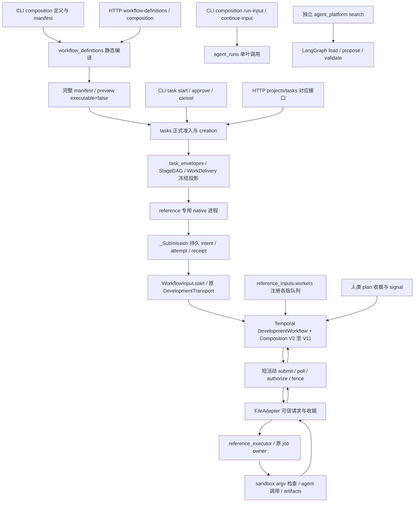

# WA2：工作流真实运行能力审计

日期：2026-11-15。固定源码基线：`a4371c8e19ddf32d5dbe1d57cf88f9e638baf373`，detached HEAD；开始时工作树干净。依据[原始需求与审计分工](../plans/2026-11-15-workflow-evidence-and-human-gates.md)，本片仅做独立只读审计与本文记录，不修改产品、测试、CI、全局 Skill，不提交、推送或调用外部系统。

**直接回答用户的问题：**

- **模板正式执行由 Ergora 自己的版本化定义、编译与阶段投影接到 Temporal，实现既有六阶段任务。** 不是由 LangGraph 调度这些模板。仓库另有实际使用 LangGraph 的独立候选搜索入口，因此不能概括为“仓库没有 LangGraph”。
- **嵌套、串行、并行在规定的正式阶段形状内确实有执行实现；任意条件路由、目标驱动循环、边际收益停止尚未成为通用运行能力。** 静态图中的依赖环和递归引用会被拒绝。训练总循环有预算、原件、停止及总投递／对账接缝，但本基线没有总 `TrainingCycleWorkflow` 定义和服务注册，不能把 c1a2 当作循环已交付。
- **已有真实的确定性检查及固定人工关卡。** 可信脚本／测试在 baseline、work、verify 等既定位置运行，失败阻断；plan approval 和训练 release 需可信收据。**尚不能在任意模板位置声明并执行脚本／测试／人类 Hook 节点。** 给 agent 一份要求它运行测试或等待讨论的说明，不会新增调度节点。

本文将“源码存在并有真实消费者”“本次离线已验”“仅定义／说明”“后续计划”分开。主树 c1b1 未完成改动、独立 BR1／BR2 产物和未来 c1c／c1d 均不计入此基线能力；历史交付里的服务验收也不冒充本次复测。WA1 负责来源采用，WA3 负责设计讨论与知识补齐；本文只提出运行契约的交叉约束。

## 1. 定义、投影与调度分别由谁负责

|层次|实际 owner 与源码证据|可核定的职责与边界|
|---|---|---|
|版本化 Agent／Workflow 与完整资源|[workflow-definition-v2.json:266](../../src/ergora/data/schemas/workflow-definition-v2.json#L266)、[workflow_definitions.py:124](../../src/ergora/workflow_definitions.py#L124)|Workflow 节点只有 Agent 引用、Workflow 引用和 `join: all`；ID／version／digest 固定引用，节点字段封闭。v2 在 reviewer 叶上增加 required／advisory；不是 executor 类型系统。|
|静态编译与祖先约束|[workflow_definitions.py:104](../../src/ergora/workflow_definitions.py#L104)、[同文件:197](../../src/ergora/workflow_definitions.py#L197)|检查局部拓扑、端口、引用 digest／递归、祖先权限、深度／实例／资源量与并发 scope；展开不同调用实例并保留祖先材料。`compile()` 明确输出 `executable: false`，preview 本身不授权启动。|
|正式准入与冻结|[tasks.py:87](../../src/ergora/tasks.py#L87)、[task_envelopes.py:42](../../src/ergora/task_envelopes.py#L42)、[同文件:63](../../src/ergora/task_envelopes.py#L63)|重新编译并核 manifest，冻结完整资源树和阶段选择，把静态定义接到旧 spec；formal envelope v2–v11 与 WorkflowDefinition v1／v2 是不同版本轴。|
|阶段 DAG／work 投影|[review_dags.py:54](../../src/ergora/review_dags.py#L54)、[同文件:233](../../src/ergora/review_dags.py#L233)|`StageDAG` 计算 predecessor／端口表，不运行任务、不保存第二执行图。work 叶必须是 implementer，review 叶必须是 reviewer；单 task 输入、单 terminal 输出、显式 all-join 覆盖全部叶。work 与原 work unit 一一对应，依赖传递闭包必须相同。|
|普通父模板调用六阶段|[native_six_stage.py:8](../../src/ergora/native_six_stage.py#L8)|原 six-stage 调用投影：祖先只能转发 root task、只含所选调用并转发结果；所选 work／review 是直接子模板，不得夹带未选分支。这是受支持的嵌套形状，不是任意父图执行器。|
|SDK 类型／队列与 worker|[reference_inputs.py:14](../../src/ergora/reference_inputs.py#L14)、[同文件:458](../../src/ergora/reference_inputs.py#L458)|`WorkflowInput` 通过同一 construction／start 契约选择 1–11 版；各版自己的队列、请求目录、活动和 Workflow 类型。`workers()` 注册已有版本，不靠上层增加具体类型分派。|
|真正的流程调度|[reference_workflows.py:238](../../src/ergora/reference_workflows.py#L238)、[同文件:337](../../src/ergora/reference_workflows.py#L337)、[DevelopmentWorkflow:185](../../src/ergora/data/reference/platform/upstream/platform/dev_platform/workflow.py#L185)|Temporal Workflow 维护原阶段／结果、启动就绪 work／review 叶、等待活动／计时器／signal；扩展继承原六阶段。v9 增加原总预算，v10／v11保留同一生命周期。|
|活动、真实执行与证据|[activities.py:28](../../src/ergora/data/reference/platform/upstream/platform/dev_platform/activities.py#L28)、[reference_executor.py:719](../../src/ergora/reference_executor.py#L719)、[reference_job_lifecycle.py:29](../../src/ergora/reference_job_lifecycle.py#L29)|活动只做短控制与可信文件交换；既有 executor／job owner 执行 Git、sandbox 命令、模型与原件收集，可信收据返回调度器。不能把活动发出、文件出现或模型自述当作执行成功。|

祖先资源累加不扩大权限：[编译器:190](../../src/ergora/workflow_definitions.py#L190)要求所需资源仍在有效读权限内，[编译器:271](../../src/ergora/workflow_definitions.py#L271)继续收紧子权限和祖先预算。新增 Hook／循环也必须延续此规则。



调用图表达的是源码真实连线，不表示本次启动了这些服务。`ergora workflow` 还有独立的旧 portable-contract 编译命令：[reference.py:302](../../src/ergora/reference.py#L302)；其绑定只接受 `temporal-development-v1`／`trusted-file-v1`，换成 LangGraph 会显式拒绝（[portable.py:215](../../src/ergora/data/reference/platform/upstream/platform/dev_platform/portable.py#L215)）。

### 实际 CLI／HTTP 消费者

- `composition preview / freeze / prepare / run-input` 的处理在 [cli.py:1129](../../src/ergora/cli.py#L1129)；HTTP 定义与 manifest 在 [web.py:509](../../src/ergora/web.py#L509)。`run-input / continue-input` 是单叶调用，CLI 帮助已注明不执行流程端口、不构成正式验收（[cli.py:222](../../src/ergora/cli.py#L222)）；HTTP `composition-inputs/run` 也直连 `agent_runs.run_input`（[web.py:996](../../src/ergora/web.py#L996)）。
- 正式 `task start / resume-start` 从 [cli.py:1053](../../src/ergora/cli.py#L1053) 或 [web.py:908](../../src/ergora/web.py#L908) 进入 [tasks.start:393](../../src/ergora/tasks.py#L393)，经原 subprocess 边界 [reference.py:777](../../src/ergora/reference.py#L777) 调 `_Submission`，再到 SDK。HTTP 没有另一个调度器。
- `approve / resume-approve / cancel` 经相同 use-case owner；HTTP 路由见 [web.py:920](../../src/ergora/web.py#L920)。调用成功只代表该操作的观测状态；例如 approve 的 `requested` 不等于 Workflow 已接受，更不等于任务完成。
- LangGraph 的真实入口是保存的 reference CLI `search`（[cli.py:211](../../src/ergora/data/reference/platform/local/agent_platform/cli.py#L211)）。其[源码:76](../../src/ergora/data/reference/platform/local/agent_platform/search.py#L76)只有 `START → load-baseline → propose → validate → END`，SQLite checkpoint 可恢复，候选上限 1–5；[提示与行为:52](../../src/ergora/data/reference/platform/local/agent_platform/search.py#L52)只产提案，需另选任务才进入实施／实验。没有因此获得模板循环或训练调度能力。

## 2. 支持矩阵：哪些真正可运行

“执行存在”表示本基线有生产调用路径；本次实际运行范围在第5节单列。未列出的外部自建 worker／adapter 不在本次证明范围内。

|能力|定义层|正式执行与限制|本次证据分类|
|---|---|---|---|
|嵌套 Workflow|支持固定版本引用与有界展开|work／review 同角色子图、准备叶及受限 native 父调用有消费者；任意混合角色父图没有通用 runner|源码＋嵌套端口离线正例|
|串行依赖|支持 `depends_on`|review DAG 等前驱成功；work 服从原 work unit 依赖及 exact commit|源码＋串行／取消离线正负例|
|并行与 all-join|支持无依赖就绪叶和显式 all-join|review 按祖先 semaphore；work 按原 `max_parallel_units` 与祖先 scope；独立分支不必等待无关慢分支|源码＋独立分支离线正例|
|条件路由／分支跳过|无 `when`／predicate／switch|仅有 owner 固定写死的成功、失败、取消、required／advisory 分支；不能按任意 artifact 值选择模板后继|schema 实际拒绝 `when`|
|图回边／递归循环|依赖环和引用环拒绝|没有 repeat／until 节点；有限 DAG 的调度 while 不是业务迭代|源码＋局部 cycle 离线负例|
|直到可验证目标达成|没有通用 goal oracle／loop contract|未连成“测量→重识别瓶颈→调整→再测量”的自动总闭环；自然语言“持续优化”仅约束 agent 行为|源码／模板约定，不算运行支持|
|收益不值得成本时停止|没有用户认可的量化 policy 字段|没有消费者按可复算边际收益／真实成本决定继续；agent 的“足够好”不构成客观停止判据|未实现；待 WA4 讨论|
|硬上限|静态 depth／instances／concurrency／material bytes；正式预算另有合同|v9+ 原 wall／cleanup／model call slot 已接 owner 与 Workflow；训练授权也有固定时钟／有限候选。没有因此支持所有成本维度或自动多轮|源码存在；本次未复测完整时钟／进程链|
|脚本执行|WorkflowDefinition 无脚本节点|项目可信 `checks` argv 与训练 runner 有真实执行路径，但只能在各 owner 的既定位置执行|源码存在；不等于任意 Hook|
|可验证测试硬关卡|无通用 test 节点|baseline／work／verify 确定性检查是真实命令和退出码，失败返回 FAILED；verify 必须是可信 CI actor、候选一致且所需 checks 齐全|源码存在；本次未跑真实 sandbox|
|人类计划关卡|不是任意图节点|六阶段 plan 后强制等待 owner 收据；绑定 request／profile／plan 与原 run，过期／撤回／不匹配不放行|源码存在；WA3 深核设计语义|
|人类训练 release|不是任意图节点|单实验 gate 通过后等待绑定原 evidence／manifest 的 owner 收据，只创建 integration task，不自动 merge|源码存在；不被未来循环替代|
|人类替换任意 review 叶|定义只有 Agent 叶|旧短活动契约可接受可信 human review receipt；新版 composition opinion 明确要求 `actor.kind == agent` 且绑定成功模型结果，不能直接插人工叶|仅旧 adapter 契约可表达；新版未接|
|任意硬 Hook／其他外部主体|无 typed executor／input／output／side-effect contract|FileAdapter 是既有可信交换接缝，actor enum 不是节点调度能力；没有任意位置的注册、暂停、恢复协议|schema 实际拒绝 script／human 引用|

两点容易误判：

1. `WorkflowDefinition` 的 preview 包含完整图，并不表示图已全部被正式调度。`WorkDelivery` 要求所选 work、review、preparation 恰好覆盖所有 Agent 叶（[review_dags.py:240](../../src/ergora/review_dags.py#L240)），且 work 依赖与原 work unit 一致；不合形状会拒绝，而非悄悄执行剩余节点。
2. `human` 出现在 [FileAdapter:142](../../src/ergora/data/reference/platform/upstream/platform/dev_platform/adapter.py#L142) 和旧 [activities:64](../../src/ergora/data/reference/platform/upstream/platform/dev_platform/activities.py#L64)，不证明新版人工 reviewer 已支持。[reference_review_opinions.py:43](../../src/ergora/reference_review_opinions.py#L43)还要求 agent 身份和真实模型调用结果。plan 收据是真实人类门禁，但不是设计问题全部已回答的证明。

## 3. 循环与训练 controller：不能跨越的完成边界

当前代码中的主要 `while` 分别用于：等待同一个 job 的 terminal receipt、在同一 approval 截止内等待新收据、消耗有限 DAG 的 `remaining` 集合、等待单个实验完成／release，以及停止／回收。不产生新候选、下一轮预算或目标判定。[DevelopmentWorkflow:94](../../src/ergora/data/reference/platform/upstream/platform/dev_platform/workflow.py#L94)、[同文件:120](../../src/ergora/data/reference/platform/upstream/platform/dev_platform/workflow.py#L120)、[ReviewDAGWorkflow:277](../../src/ergora/reference_workflows.py#L277)、[ExperimentWorkflow:118](../../src/ergora/data/reference/platform/upstream/temporal/perf_temporal/workflow.py#L118)可直接核对。控制活动最多3次 retry 也是同一操作的重试，不是新一轮优化。

训练方向已有值得保留的实际接缝：

- [training-cycle-v1.json:20](../../src/ergora/data/schemas/training-cycle-v1.json#L20)冻结 1–32 个候选与 wall／cleanup／control timeout；`change`、`next_bottleneck` 是注解，没有 goal／diminishing-return oracle。
- [training_cycles.py:382](../../src/ergora/training_cycles.py#L382)的公开 `cycle-start` 仅选择一个已冻结实验，交还原 `training.start` 与单 slot；[CLI:576](../../src/ergora/cli.py#L576)提供 create／read／authorize／status／start。基线 HTTP 未提供 cycle controller 等价入口；已有单实验 HTTP 路由不能补足总循环。
- [reference_training_worker.py:182](../../src/ergora/reference_training_worker.py#L182)已有被监管的 inspect、prepare／submit／reconcile-controller、停止 writer／notify／drain 等操作；[总投递:334](../../src/ergora/reference_training_worker.py#L334)会用 SDK 发送字符串类型 `TrainingCycleWorkflow`，并在发送前保存原 attempt。[原 run 对账:69](../../src/ergora/reference_training_runtime.py#L69)核初始 history、input 与 memo。这证明投递／对账接缝存在。
- **本基线没有该总 Workflow 的 `@workflow.defn`／run 实现，也没有注册它的 worker。** [实际 `_serve`:509](../../src/ergora/reference_training_worker.py#L509)只注册 `ExperimentWorkflow`；[services.NAMES:26](../../src/ergora/services.py#L26)也未提供独立 cycle 服务。源码中发送一个类型名，并不保证有 worker 消费它，更不证明会推进第二轮。
- [training_rounds.py:116](../../src/ergora/training_rounds.py#L116)能采集各轮原 records／evidence／submission／approval 并保留 SHA 链和旧前缀，是只读轮次索引，不能授权执行或 promotion。

这与[已记录的 c1 分片](../plans/2026-11-15-training-cycle-workflow.md)相符，但结论来自上述源码：c1a2 是投递／对账；c1b1 生命周期、c1b2 独立服务、c1c 确定性总 Workflow、c1d 测量接受与下一轮门槛分别仍有待交付的责任。本报告不把这些计划叠加成已实现功能。

## 4. Hook 需要延续的现有失败、取消、超时和原件义务

|边界|当前实际行为|未来节点不得削弱的义务|
|---|---|---|
|命令／测试失败|可信项目 `checks` 必须是 argv；在 sandbox 中执行并记录退出码、完整命令 log（[原 executor:154](../../src/ergora/data/reference/platform/local/agent_platform/executor.py#L154)）。work test fail 不提交成功；verify 比较原 baseline 检查集合并验 exact candidate 与 scope（[reference_executor:135](../../src/ergora/reference_executor.py#L135)）|失败必须阻断依赖者；不可由模型文字覆盖。测试原始 log／检查结果绑定 candidate、job、上下文 digest。缺失、unknown／超容量不能默认为 pass。|
|收据接受|[FileAdapter:131](../../src/ergora/data/reference/platform/upstream/platform/dev_platform/adapter.py#L131)验 job／context、terminal state、actor、artifact bytes SHA；[Activities:47](../../src/ergora/data/reference/platform/upstream/platform/dev_platform/activities.py#L47)再验角色、候选、所需产物／checks、独立性，verify 只接受 CI|“产物已发布”和“被 Workflow 接受”保持分列；不把 agent 自报通过作为确定性测试。可信存储和发布者仍是信任前提。|
|取消／并行清理|[DevelopmentWorkflow.stop:171](../../src/ergora/data/reference/platform/upstream/platform/dev_platform/workflow.py#L171)走 fence，按证据区分 BLOCKED／CANCEL_UNCONFIRMED／NEEDS_RECONCILIATION；取消 running coroutine 后仍等待清理。fence 只在所有原 job 有可信 terminal 时 confirmed（[adapter:187](../../src/ergora/data/reference/platform/upstream/platform/dev_platform/adapter.py#L187)）|取消 signal 送达不等于外部进程已停止；未证实保持 unknown／unconfirmed，不放行后继、release 或重复执行。Temporal terminate 不能被宣称能运行协作清理。|
|进程与停止证据|预算 job owner 在 [reference_job_lifecycle.py:132](../../src/ergora/reference_job_lifecycle.py#L132)保存 attempt，复用 `processes.run` 管理 body／collection；只有回收后发布 stopped／terminal；[恢复:212](../../src/ergora/reference_job_lifecycle.py#L212)不重跑不确定 body|复用原 driver／reaper／身份记录；Hook 输出返回不等于其后代已停。停止、产物收集、durable terminal 与 slot 释放保持各自证据。|
|时间与预算|原阶段／approval 有绝对截止；v9 [BudgetedWorkflow:478](../../src/ergora/reference_workflows.py#L478)限制排队／重试／人工等待等阶段外时间，预留 cleanup；[reference_budget:68](../../src/ergora/reference_budget.py#L68)使用原时钟，观察不续期；[有限 slots:82](../../src/ergora/reference_budget.py#L82)不因 retry／inspect 增加额度|每轮／节点从原剩余 allowance 推导超时，非正不派发；恢复不能刷新原预算。金钱／token／GPU 费用等额外维度需要明确定义和真实数据，不能暗中声称已严格支持。|
|投递／恢复|[_Submission:133](../../src/ergora/reference_task_submission.py#L133)在真实发送前持久 attempt，拒绝接管已存在 run；memo／原输入核同一 owner。lost reply 后只对账（[同文件:202](../../src/ergora/reference_task_submission.py#L202)）；有 attempt 的 resume 不重发|所有有副作用节点共用原 intent→attempt→receipt／拒绝合同，明确幂等与不可重发。避免新建一个可变 current-node／current-round 台账竞争权威。|
|人类门禁|[plan wait:120](../../src/ergora/data/reference/platform/upstream/platform/dev_platform/workflow.py#L120)验证 request／plan／receipt；[_Approval:114](../../src/ergora/reference_task_approval.py#L114)绑定 project revision、原 submission／run、profile／plan 与 owner；[dispatch:184](../../src/ergora/reference_task_approval.py#L184)先保存批准／attempt 再 signal，unknown 只查 history。后续执行器还检查原批准 SHA 与未撤回状态（[原 executor:96](../../src/ergora/data/reference/platform/local/agent_platform/executor.py#L96)）|设计确认需绑定具体可审版本与未决问题状态。原已授权动作保持有效；过期、拒绝、撤回、设计变化的状态由原批准 owner 延伸，不再建立第二批准权威。问题／答复和设计失效规则由 WA3／WA4讨论确定。|
|训练 release|[ExperimentWorkflow:140](../../src/ergora/data/reference/platform/upstream/temporal/perf_temporal/workflow.py#L140)保留原 release 截止，收据拒绝后等新收据；[LocalTrainingAdapter:177](../../src/ergora/data/reference/platform/local/agent_platform/training.py#L177)重核 gate、baseline、binding、evidence、owner／expiry／revoked，取消 fence 可压制 release|循环通过测量 gate 不自动获得人类 release／merge 权。旧实验、失败、取消、负结果和 release 原件须继续保留。|
|原始输出与容量|manifest 携带完整字节，受 500 文件／10 MB 合同约束（[task_envelopes:42](../../src/ergora/task_envelopes.py#L42)）；上下文 1,000,000 bytes、收据32 KiB、单 artifact16 MiB 等边界显式检查。[job evidence:43](../../src/ergora/reference_task_evidence.py#L43)从原 history 对照 request／receipt，再按 SHA读取原 artifact 并分页|报告可以摘要，原件、失败及不确定结果保持原 identity；不得只存 LLM 总结、静默截断再称完整。每轮索引应引用原件而不重写、重新授额。|

第4节是源码可追义务，除第5节列出的离线检查外，本次没有重新验证完整 sandbox、真实停止、预算耗尽或服务重启。能力存在与端到端验收必须继续分列。

## 5. 本次最小可达验证及限制

复用既有解释器与 fixture：Python `3.11.15`、`pytest 9.2.0`、`jsonschema 4.24.0`、`temporalio 1.34.0`。用本工作树 `src`，禁写 pyc、禁 pytest 自动加载插件，临时目录／cache／JUnit／日志全部放到 ignored `.ergora/checks/wa2-runtime-audit/`。没有安装依赖，没有启动 Temporal 服务、模型、真实训练或外部连接器，没有新增测试文件。

既有测试共 **18 passed，pytest 15.25秒；外层进程15.884秒、退出码0**：

|既有入口|本次覆盖|
|---|---|
|[test_workflow_definitions.py:293](../../tests/test_workflow_definitions.py#L293)|串行／并行 all-join 展开、资源继承、preview 明确不可执行、v2 required／advisory 保持。|
|[同文件:447](../../tests/test_workflow_definitions.py#L447)|7个负例：依赖环、重复／未知节点、空 join、非法 schema／limit 类型、未知字段。|
|[test_review_dags.py:39](../../tests/test_review_dags.py#L39)|嵌套多名输出的实际端口投影与完整前驱等待。|
|[同文件:65](../../tests/test_review_dags.py#L65)|5个拒绝：all-join 漏叶、输出 passthrough、多 terminal、空 join、未执行外部 producer。|
|[test_review_dag_runtime.py:145](../../tests/test_review_dag_runtime.py#L145)|3个实际 Workflow 方法接缝：前驱完成后并行放行、重复 session 拒绝、结果返回时取消导致不启动后继。活动调用使用离线替身。|
|[同文件:204](../../tests/test_review_dag_runtime.py#L204)|独立慢分支仍运行时，已完成前驱可放行自己的后继。|

可复跑命令（`PYTHON` 指已有解释器，`CHECKS` 指上述本地证据目录；无机器固定路径）：

```bash
PYTHONDONTWRITEBYTECODE=1 PYTEST_DISABLE_PLUGIN_AUTOLOAD=1 PYTHONPATH=src \
TMPDIR="$CHECKS/tmp" "$PYTHON" -m pytest -q \
  -o cache_dir="$CHECKS/pytest-cache" --basetemp="$CHECKS/pytest-temp" \
  --junitxml="$CHECKS/offline.xml" \
  tests/test_workflow_definitions.py::test_examples_expand_serial_and_parallel_all_join_without_dependency_inheritance \
  tests/test_workflow_definitions.py::test_local_graph_and_schema_are_checked_without_library_access \
  tests/test_review_dags.py::test_nested_multinamed_outputs_project_original_instances_once_and_wait_for_the_whole_call \
  tests/test_review_dags.py::test_admission_rejects_incomplete_terminal_or_unexecuted_external_sources \
  tests/test_review_dag_runtime.py::test_serial_predecessors_and_cancelled_results_cannot_launch_successors \
  tests/test_review_dag_runtime.py::test_finished_predecessor_can_release_a_successor_while_an_unrelated_branch_is_running
```

另用最小完整 v2 定义调用真实 `workflow_definitions.inspect_bundle`：合法 Agent 引用输入通过；相同输入添加节点 `when`、根 `until`，或把 `ref.kind` 改成 `script`／`human`，4项均抛 `ValueError`。这是输入边界验证，合法控制项没有解析真实 Agent 引用，所以不代表合法流程已经可执行。AST 及源码搜索核到 Composition v2–v11 类型和实际 worker 注册，未发现总 `TrainingCycleWorkflow` 的定义／注册；这一静态证据不替代未来总 Workflow 的真实 Temporal 运行。

本地原件为忽略目录，未随本文版本化；身份摘要如下，完整命令和输入在原件内：

|原件|bytes|SHA256|
|---|---:|---|
|`offline.log`|100|`963f4cadb271ad55a1ea7ddd8a60e1ff65fc10c29c27ec2205f8e6cad4d267fa`|
|`offline.xml`|3050|`40bc321f3d9667f74cae8b2cc2fefed212ee3db663a93351ea9d812e9e963c90`|
|`offline-run.json`|1514|`84fbe5df43f886e5a8485a328e74ecd1cdb66d0374cc180fc60e812d19f06f7b`|
|`schema-boundaries.json`|3645|`311f6862a1e8907a81fd88087a2d1ce85771c1adee131d679e6f160401c2ac3e`|

## 6. 最小缺口、实施顺序与可验证验收建议

以下是待主控汇总、与用户讨论后选定的建议，不是已批准的新产品实施，也不建议用 LangGraph 另起调度权威。

|顺序与最小行动|复用 owner／接口|需要证明的行为|
|---|---|---|
|1. 先闭合已排 c1b1／c1b2／c1c／c1d|原 training budget／CycleAdmission、SDK worker、ExperimentWorkflow、轮次索引；沿既定计划逐片交付|标准 Temporal sandbox 能装载总类型、独立服务实际注册；普通操作阻塞时停止配额仍可用；两轮 CPU 受控实验推进真实原件；worker 重启／丢回复不重占 start／launch；预算／停止后不发下一轮。|
|2. 定义受控迭代与停止合同|把 objective oracle 与 stop policy 放在相应训练／优化领域 owner；Temporal 只调已有活动与确定性决定|用户确认指标、阈值、质量不退化、真实成本来源、边际收益算法／测量窗口与不确定时的行为；相同原始输入重放得同一决定。分别保存 goal-met、预算耗尽、收益不足、失败、取消、unknown，保留每轮原数据与失败；不能把耗尽写成目标达成。|
|3. 从一个真实需求扩展非 agent 节点|WorkflowDefinition 新版本和原编译／envelope、既有 adapter／job owner／processes.run；实现族各自工厂／共享执行契约|先选实际脚本／测试用例，再固定 typed input/output artifact、argv／环境引用、权限、timeout／cancel、幂等与副作用分类。确定性失败、输出缺失、错 SHA、超容量、退出但后代仍活、lost reply 均阻断后继；恢复观察原 attempt，不重复副作用；同一 ready DAG 和预算继续拥有进度。|
|4. 把必要的人类设计决定接到原批准 owner|复用 plan receipt／run／request／profile／设计版本身份；WA3 的问题与决定模型进入同一准入上下文|未决关键问题、缺公司资料、拒绝／不答／超时、设计变化与撤回均可复现地阻断或使原决定失效；恢复仍展示原问题、选项、证据、答复和明确决定。准备和已授权可逆动作无需无关重复批准。|
|5. 最后公开 CLI／HTTP 与新模板版本|现有 tasks／training use case、版本化 manifest、原件与 handoff|两个入口对同一对象产生同一合同／失败状态；明确区分 preview、单叶、正式 run、pending／unknown；旧 manifest／历史／批准可读，新模板按新版本发布；人类 release 和原 acceptance 保持。|

在 WA4 需要向用户给出具体方案再讨论的运行问题至少包括：首先支持哪一种受控迭代（训练、开发整改还是优化）；目标与收益成本用哪些可取得、可重复测量的量；缺数据时停止还是等待；脚本节点允许何种副作用及重试；人工关卡绑定何份设计、何种变化使决定失效。此时没有必要先引入第二调度器、通用表达式语言或另一套预算／批准／恢复台账。

静态收尾：本文80个相对文件链接及所引用行号边界全部核过；未运行 Mermaid 渲染器。HEAD保持上述固定基线，唯一未跟踪交付为本文，产品／测试／CI无差异；本地证据路径被 Git 忽略，未产生 commit／push。

交付边界：本文是 WA2 独立审计记录，现有事实与离线证据已完成；WA4 汇总讨论、产品实施、真实服务／训练验收及实现片独立审查仍属后续工作。总计划状态由主控在原工作树统一更新，本审计没有越权修改计划。
