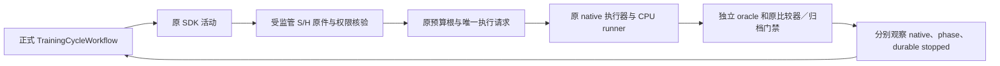

# 正式训练循环 Workflow 现场验收

日期：2026-11-16。本片用真实整数 CPU 工作负载验证首候选的提交、执行、证据门禁、停止与恢复。r4已完成正常／负gate、部分丢完成和阻塞取消范围，但W7取消暴露SDK eviction缺陷，阻断合入；原现场现已统一收尾。后继修正与新包／新现场另验。没有 GPU／模型训练结论。

## 固定环境与执行链

产品为[首轮实现](2026-11-16-training-cycle-workflow-first-round.md)的 r4：worker raw `187bda497043f70512f2fa28e8c54403b2da1c493eafa2e804ae9304643bb09b`，wheel `7ee6cb43eefc682f0ace5f3732369156ade5cb78978c004062eb0c3e4a2bda67`，SDK1.34.0。新 core／SDK 安装各663文件与 source／wheel bytes和执行位一致，283参考／依赖及52项安装runtime检查通过。真实Supervisor启动Temporal、MLflow、原预算Worker和独立循环Worker，循环normal／stop各slot1，预算slot8。使用正式模块级 `TrainingCycleWorkflow` 和默认sandbox，没有测试Workflow替代。

CPU合同对8组固定输入各测baseline／candidate两个新进程，每组32个整数，AB／BA交替。baseline重复求平方和，candidate使用等价闭式计算；独立进程以逐次奇数相加生成平方，再对全部512个输出作精确检查。两种实现存于同一真实Git提交，以各自真实配置摘要区分；计时包括进程启动和输出IO。原比较器按32个整数归一，8对测量、10000次bootstrap、95%区间，下界须超过10ms；共享CPU未声明独占或频率稳定。[独立样例审查](2026-11-16-training-cycle-cpu-contract-review.md)与实际运行分列，原审查不认证未来测量或平台集成。

## 实际结果

|序号／场景|实际证据|Workflow与效果|结论|
|---|---|---|---|
|1. 首次完整CPU链，归档拒绝|真实8对测量和512输出精确检查通过；原比较器PASS，节省166.477ms／32整数，95%区间[161.717,171.113]ms。原归档gate拒绝：平台在runner退出后追加execution.log，清单中的旧日志摘要失效|history为6次observe、start1、request1、独立stop1；所有ordinary ordinal0、所有attempt上限1，最大完成Payloads3507B；native SUCCEEDED与runtime GATE_FAILED分开，原执行链durable/executor stopped均true，最终needs_reconciliation|原门禁正确拒绝；未输出measurement_accepted、未发ordinal1。现场driver原positive期望断言失败保留；整条检查不记为正常首轮通过|
|2. 修正样例的正常首轮|真实8对测量、512输出精确检查通过；原比较器PASS，节省164.959ms／32整数，95%区间[160.758,169.433]ms；原archive gate通过，SDK-free原evidence reader为recorded、baseline_matches=true|6次observe、start1、request1、没有stop；最大完成Payloads3519B。native SUCCEEDED、原durable/executor stopped均true、固定子run仍RUNNING／AWAITING_RELEASE；父正式类以first_round_observed_c1d_required正常结束|真实首轮通过，默认sandbox Replayer通过；原人工release窗口保留，无ordinal1，measurement_accepted保持null|
|3. start原adapter返回后丢SDK完成|真正原adapter完成后保留完整返回，再显式注入retryable ApplicationError；原history最大attempt1。真实故意非零退出CPU runner没有生成测量证据|start1、request1、observe6、独立stop1，父COMPLETED／needs_reconciliation；原预算owner及request／launch／attempt／ack／stopped各保留一份，故障时已存在的4份不可变原件至终态摘要保持|post-return故障控制检查及实际history默认sandbox Replayer通过；没有重发start／ordinal1。不是物理网络丢包或发前故障证明；该wrapper已SIGTERM并实际wait退出，整体资源审计仍待|
|4. request原adapter返回后丢完成及信号边界|真实request返回后显式SDK失败；实际handler拒绝非dict、异身份和compact32768B／完整Payloads32800B的信号，随后完整合法reason生效；实际outcome967B|start1/request1、observe2、stop1；六份故障时已有的不可变原件至终态摘要保持，真实history Replayer通过，wrapper已退出|该次合法停止紧接丢完成，所以没有证明丢request后普通observe恢复；此项留同run重启场景补。没有accepted或cycle业务stop证明|
|5. 原H阻塞下重复signal|原authorization精确路径的真实flock；两次真实RPC前同一H完整身份仍活且normal未退出，history有两份完整匹配signal|独立stop schedule及adapter-enter均早于normal adapter-exit，stop进入时H仍活；唯一stop、原effect各至多一次、实际history Replayer通过；wrapper已wait退出|实际控制／时序范围通过；不以marker代替全资源停止，原链与最终sampler仍独立核验|
|6. 原H阻塞下重复SDK cancel|与上项相同真实flock及两次RPC窗口证据，不将两RPC推成两server cancel事件|独立stop同样先于normal清理；正式父run CANCELED、唯一stop、history默认sandbox Replayer通过；wrapper已wait退出|取消控制与时序通过，CANCELED与业务stop证明分开，未伪填durable／drain／executor true|
|7. 冷窗口实际history洪泛未达阈值并发现eviction缺陷|256份完整Payloads30070B的真实malformed信号；server实际history为7738810B，原冷10秒内未达8MiB，driver明确失败并取消同run|原父run已CANCELED，managed request／launch／attempt等缺失原件明确保留。实际Worker和离线默认sandbox Replayer均报Eviction processed, but 1 tasks remain，pending start.v1 handle；回放无法结束|W7未通过，产品取消／缓存清理问题阻断合入。8秒有界独立重放已再次精确复现；原失败、完整history及日志保持，不调预算／禁sandbox／换run来称通过|

第一场景样例源码提交 `1eba0f5a2b7a1a8d49faf0d98df699df0d68513a`，最终native manifest raw `b7187aac25fd6d055b78c7c5865d598b8beda820950fa259b556799d374cb8d6`。其原执行、比较器报告、完整失败gate及日志没有修改。导出真实history后使用原正式类、默认sandbox的Replayer通过，父Workflow终态COMPLETED；这证明该失败路径可回放，不证明正常首轮或取消历史已验。

第二场景源码提交 `d04229205fc5d9f2e90617d2592812e9229a36e6`，最终native manifest raw `7f3ce0ed0176e72c847b8f20362307272e2a58afdc0fd67ba2ec52bd9b1249ec`。第一次静态审查漏掉了平台日志的后续写入；真实故障经[原reviewer复核](2026-11-16-training-cycle-cpu-contract-review.md)，只排除该准确根路径，保留所有runner-owned产物和嵌套同名文件。旧review逐字保存，新review只绑定新身份。旧候选、baseline、gate、archive未补造或覆盖。

## 原件与后继

现场原件在项目ignored检查存储：`cw-live-r1/first/`含原授权／投递、result／status、完整history、activity audit及Replayer；对应runtime中保留原request／launch／attempt／ack／stopped、runner原数据／oracle／比较器和失败gate。公开仓库保存本报告与审查结论；这些本机检查原件没有作为公共下载发布。用户要求的长期材料保留于home持久目录。

第二场景原件存于 `cw-live-r1/first-positive/` 和对应native job原目录。其history明确start／request各一次，没有stop或ordinal1；query/outcome的cycle级stop证明仍null，不能因候选执行停止填成cycle已停止。成功与失败的实际archive／gate各保留，不把前一场景的失败测量改成接受。

后续运行原SDK丢completion、同run重启／Replayer、真实S/H阻塞下独立stop／cancel及实际history容量守界；全部结果按准确原身份保存。原window／source／权限与c1d后继门保持，最终核自建服务、Workflow、预算根、后代和端口收尾。目前进程sampler仍在运行，不能声称统一收尾完成。

## 故障验收准备与独立纠正

已通过原注册／baseline／runner／prepare接口建立五个独立的故意非零退出CPU夹具；不产测量或质量证据，不复用正例的授权／attempt。私有脚本的[fresh审查](2026-11-16-training-cycle-live-harness-review.md)发现原服务重启不会加载包装器、finally可能遮蔽失败、缺退出marker被误判通过等问题；最小修正后静态两轴approve／0，原失败与三次审查身份均保留。第3表行的真实start丢完成已通过；request丢完成及实际signal／完整编码探针正在执行，其余场景未验。

原服务owner已确认仅cycle worker STOPPED，其它三服务保持RUNNING。修正后的现场将由独立前台进程运行原安装的cycle_main和默认sandbox，注入只在原adapter或原H flock边界生效；不把该私有launcher称为Supervisor管理。另一外部sampler专门核这些wrapper及其后代，与原服务sampler合并收尾。未停掉Temporal或MLflow，也未修改产品／原pin／预算来适配故障脚本。

原来源门另做了新安装只读检查：对前置现场真实保留的schema2 owner调用原validate_sources，明确拒绝`Original execution gate source changed: reference_training_worker.py`；owner前后raw SHA均为`93860f0b73a2d4fa28c916732c522e778661db2276edfd6a7b377bc1b0ea3aa3`。原件在ignored `cw1/old-owner-source-probe.json`。这只证明新安装原校验器不会升级旧pin，不等于正式server旧run恢复；未修改旧owner／source、重启旧root或重新授予执行权。

第7项的完整导出history为10995598B、SHA256 `5e1dda7daabad517fac30ce9abaad47c2875488d229499ed1af996c25131bb40`；这是JSON导出文件大小，与server在洪泛driver最后确认时所报7738810B／256次成功RPC分列。最终history另含部分在途信号，共269个；SDK记录的最大history_size_bytes为8139050B，仍低于8388608B阈值，不能用后采样改写原timing miss。[独立诊断](2026-11-16-training-cycle-eviction-diagnosis.md)在原SDK／真实workflow ID／默认sandbox下8秒精确重现同一eviction与pending start handle，输出为RED_EXACT_EVICTION。后继真实重启／停机预算与extra fault均暂停，先最小化复现和修补实际取消链，再对新源码／新安装／相关现场重新验收。df43660自己的全平台CI成功仍仅归其已发布代码，不覆盖隔离树的本缺陷。

## r4现场统一收尾

正常CPU首轮保留的固定子run已通过原training.cancel接口显式结束测试：Temporal COMPLETED，业务outcome CANCELLED，原native scheduler仍SUCCEEDED，integration_task_url为null；没有release或baseline迁移。原始正常终点／gate／archive未覆盖。当前自建server的13个Workflow全部终态，RUNNING为0。

W7卡住的离线Replayer已按完整身份SIGTERM；原SDK worker收到SIGTERM仍无法完成缓存eviction，核全部已观测S/H退出后对该自建wrapper用pidfd完整身份SIGKILL，实际exec wait分别为143／137。此为异常收尾，不能记为优雅退出通过。其它wrapper均已正常SIGTERM／实际wait。

原services owner确认三服务stop、Supervisor shutdown均confirmed／not_running；7233／8233／5000无监听。两份独立外部sampler分别保留179和252份观察身份，各自survivor0／unknown0／observation_errors0；不相加冒作不重叠的进程数，也不声称0.1秒采样捕获全部极短子进程。原S/H、root／executor和stderr／stdout原件与采样分列保存。收尾原件为ignored `cw-live-r1/{workflow-inventory-r1,stop-infra-final-r1,shutdown-final-r1,observed-process-identities}.json`、`cleanup-positive/`及私有harness各case／observer报告。新源码若续测，需新安装／新授权与另记的现场身份，不能把本节充作新候选实测。

## r5独立新现场准备

原r4现场已统一收尾，新源码不会复用旧任务授权或覆盖旧原件。r5 worker `7996f73d…`／runtime测试`4b5d7ed4…`，新wheel`74e2f6f9…`，安装53项与原完整W7 history安装版Replayer已过；详见[修补交付](2026-11-16-training-cycle-eviction-fix.md)。新准备脚本只注册新CPU／故障身份与材料，不授权或投递；CPU review仍须独立绑定新最终manifest。代表性W2／W3／W4／W5／W7／W8、完整收尾和最终独立审查待实测后分别登记，未声称通过。

### r5现场逐场结果

新服务由原services owner重新生成配置，Temporal／MLflow／budget worker为RUNNING；cycle managed服务保持STOPPED，各fault使用root前台wrapper及新安装。新独立采样运行中，最终收尾另验，不提前声明无残留。

|场景|新身份下实际结果|边界|
|---|---|---|
|W1 新r5正式类真实CPU首轮|start1、request1、observe6、stop0；native SUCCEEDED＋durable/executor stopped＋原子run AWAITING_RELEASE，父first_round_observed_c1d_required；实际gate/archive通过、完整history默认sandbox Replayer通过，driver exit0|测量接受字段仍null，无ordinal1／release／baseline迁移。之后原training.cancel显式结束自建子run，Temporal COMPLETED／业务CANCELLED／native仍SUCCEEDED|
|W2 start在adapter调用前显式SDK失败|start1、request0、observe2、stop1；实际history记录选中活动失败，后续只读observe，原candidate intent／attempt及managed request／launch／attempt均缺席；actual history默认sandbox Replayer通过，wrapper SIGTERM后实际wait exit0|验证没有publication也不重授原start。返回needs_reconciliation，未证明的停止／接受字段保持null|
|W2 request在adapter调用前显式SDK失败|start1、request1、observe19、stop1；选中request实际失败后只读观察至原work窗口耗尽，managed request／launch／attempt始终缺席，4份共同原件SHA不变；实际history Replayer通过，wrapper实际wait exit0|原机会不因缺文件重授；SDK已过截止的late completion警告保留，不当作新attempt或资源停止证明|
|W3 request原返回后丢SDK完成＋同run重启（新r5b）|start1、request1、observe7、stop1；实际history确认原request失败，完整argv／source／config一致的不同身份wrapper恢复后实际调只读observe；7份root中断前原件及BOOT clock未变，actual history replay通过|原wrapper实际wait0；root helper实际wait新child0并exit0。不续预算、不重授effect；旧r5的argv失败保留|
|W4 真实Temporal断联跨原BOOT work截止（新r5b）|原非cold双QUEUED／无request结果held，原owner在原活动deadline内stop Temporal，等BOOT work≤0且total仍>30后恢复；start1／request0／observe2／stop1，实际reason work_budget_exhausted，managed request／launch／attempt缺席；原件SHA和clock保持，完整history replay通过|新driver固定只读等待deadline，无业务重试／新授权；root helper／driver／wrapper各实际exit0。旧r5只读RPC失败仍保持|
|W5 真实H flock阻塞期间两次cancel RPC|start1／request1／observe2／stop1；第二次RPC仍见原H活且normal未退出，独立stop在normal清理前已排队且已进入；原链4项SHA不变、actual history Replayer通过，父CANCELED，wrapper实际wait0|两个成功cancel调用不推断为两个server取消事件；SDK本地完成不证明executor/durable停止，完整资源终核另记|
|W5 真实H flock阻塞期间两次合法stop signal|start1／request1／observe2／stop1；第二次调用仍处原H未清理窗口，独立stop先于normal清理排队且进入，真实history精确两份原输入信号；原链4项SHA不变、history replay通过，wrapper实际wait0|只一次stop，无重复预算；最终原executor／root收尾仍单独核对|
|W2 request原返回后丢SDK完成＋W8真实信号容量|start1／request1／observe2／stop1；6份共同原件SHA不变，完整history replay通过，driver／probe／wrapper各实际exit0；实际non-dict和foreign身份拒绝，compact JSON32768B但完整Payloads32800B拒绝，随后首个合法reason完整采纳，query/outcome未证明字段均null（outcome967B）|首个合法signal立即stop，因此本场不证明故障后又observe；该项由W3新身份的实际后续observe补足。没有用compact JSON当完整编码容量|
|W2 start原adapter返回后丢SDK完成|start1／request1／observe8／stop1，实际post-return SDK失败仅选中start一次，原链4项SHA不变；真实history Replayer通过、wrapper实际wait0|故意非零runner保留原负gate，不造正常测量或重新投递|
|W8 原stop真实返回后显式capacity-type SDK失败桥接|start1／request1／observe2／stop1；原stop先实际完成并保存完整返回，随后非重试cycle_activity_capacity_exceeded进入正式类，实际history failed，outcome needs_reconciliation／stop_activity_status failed，未证明字段保持null；history replay、driver、wrapper实际wait均通过|本场是consumer桥接，未制造32KiB聚合真实溢出；该原producer溢出证据保留前置N32的原身份与范围|
|W7 新prefill变体原窗口真实8MiB guard|272次真实RPC／272份server signal；完整每份Payloads32070B，actual Describe=8766985B超过8388608B，原cold10秒及derived hold截止不变，首个server signal早于真实cold返回；start0／request0／observe1／stop1且实际reason history_capacity_limit，完整history replay通过，driver与wrapper实际wait0|history JSON11844323B／SHA5229dc97fd5a9f2ff2827de7f2c1a42915ddec9d0875892bdccbe9723ff36a12与server计量分列。旧timing misses保持；没有扩SDK／server／产品预算|

本场私有原件为`cw1/fault-harness-r5/runs/w2-pre-start-r5/`，新worker／wheel身份同r5固定包。失败是主动注入的SDK-before-adapter路径，不称网络断包或真实训练。所有源码修补的旧r4结果仍分列。

新CPU最终manifest `34e3c4f06912eca774dcd422f8e48df1df2e325f4c219d6f2d35eff7faff379c` 已由新fresh reviewer核对，真实静态review-r5 SHA256 `82098e26ea6768bf6396940a14918068090ddfea04c3a80a9efd18e7ab2b6f9b`，尚不认证新CPU运行。[r5 harness审查](2026-11-16-training-cycle-r5-harness-review.md)的原子marker与首因采集两项finding均修复复核，两轴approve／0。W4仅在新授权前配置wall90／cleanup60／control30；W7仅新私有flood_seconds=7并继续受原活动deadline约束。simple服务sampler只能报告survivors，不据其异常转false宣称unknown0；最终需增强fault sampler与原S/H/reaper和完整身份共同核对。

W3首个r5 case的root辅助程序严格拒绝了首次relative脚本路径与重启absolute路径的argv差异，helper exit1，原件和failed control-check保留。其实际start1／request1／observe3／stop1、request故障／重启后只读及不可变链检查通过各自范围，不能覆盖“同一完整命令”失败；该history仍真实replay通过。helper已实际wait其新child0；root随后用同source/settings短暂恢复一台wrapper以明确收尾，实际wait0，未更新authorization／clock／产品。原始wrapper实际wait0。新的全新tag r5b用相同绝对argv重测，不修改原失败记录。

W4首个r5 case真实暂停Temporal，原服务owner确认在原活动hold deadline内停止，并等原BOOT work=-0.004332秒后恢复；原件SHA与clock保持。actual history为start1／request0／observe2／stop1，reason=work_budget_exhausted，managed request／launch／attempt缺席；实际Replayer通过。**整场driver exit1保持**：其等待结果的只读SDK请求在断联期间用尽client重试抛RPCError，旧collector进入cancel收尾；不能将分项控制检查全true改称完整场景通过。辅助程序exit0，wrapper实际wait0。将最小调整新私有driver的只读结果等待，以一个初始固定测试deadline接续同run RPC，不改产品／activity尝试／原授权或预算，静态复核后用新身份另验。

新r5 CPU实测复用独立整数oracle的同一合同／clean commit d042292…，八组AB/BA成对进程、每组32整数；原比较器重算的归一化完整进程耗时 **211.815→44.053毫秒／32整数**，节省167.762毫秒，95%配对bootstrap区间[162.472,173.096]毫秒，10,000次重采样。实际archive/evidence SHA为`9da94e910e9cd8fba6dce021a8cfbca0253f4d16febd3038c2bab34d981a4af8`。这是共享CPU的固定样本算法冗余移除验收，不认证训练／模型／GPU／P99；比较器的独立性／来源义务及quality NOT_EVALUATED保留。现场原件`cw-live-r1/first-positive-r5/`、原输出`cw-live-r1/s/training/projects/cpu5/perf/experiments/positive-r5/`与`cleanup-positive-r5/`未覆盖旧结果。

W7新r5首次阈值验收仍未命中：单份真实Payloads32070B，driver确认256次RPC，最后完整describe样本240次／7736083B，后续describe在原hold deadline前截止而timing miss。真实history为start1／request0／observe1／stop1，清理取消后CANCELED；完整Replayer和wrapper SIGTERM实际wait0，无旧eviction挂起，但**8MiB门禁仍未通过**。没有用导出JSON大小替代server阈值。正在准备并独立审查仅私有producer的prefill变体：在原cold H工作时即从真实schedule事件固定同一截止并前填信号，SDK窗口／payload／server上限／产品不变，新身份另验。

r5新安装对真实前置owner的只读source校验再验：明确拒绝`Original execution gate source changed: reference_training_worker.py`，原owner raw SHA前后均`93860f0b73a2d4fa28c916732c522e778661db2276edfd6a7b377bc1b0ea3aa3`。原件`cw1/old-owner-source-probe-r5.json`。此为实际原validator的保旧pin拒绝，不认证正式server旧run恢复或升级。

## r5统一收尾与最后身份

专用server实际清单共38个Workflow，RUNNING为0；CPU子run通过原cancel结束，无release。所有新现场前台wrapper／driver的实际exec wait保存在`cw1/live-session-waits-r5.json`；W3重启的直接父helper另保存实际child.wait0。新现场没有使用SIGKILL清理wrapper，原r4的异常137不改写。

原services owner确认cycle／budget／MLflow／Temporal全STOPPED，Supervisor shutdown为confirmed／not_running；7233、8233、5000无监听。增强fault sampler独立观察647份完整身份，survivor0／unknown0／observation_error0；simple服务sampler观察98份身份，仅其原输出证明survivor0。随后将原记录与两sampler的实际身份去重，root对471份原件内的759个完整身份逐一只读核/proc，全部absent、unknown0／记录解析错误0；这是新的终核，不从simple sampler吞掉异常的行为推导，也不把98与647相加当不重叠进程数。0.1秒采样可能漏掉极短子进程，原S/H／reaper／executor记录仍各自保留。

另从实际保留的SDK／wrapper原返回／producer记录核273个独特operation，观察均为operation_stopped=true、S返回0；273份原H stdout引用的实际大小／SHA全部匹配。这只认证这些完整已返回观察，不将未回包／被取消活动凭空补成成功。原件为`cw-live-r1/{final-process-audit-r5,operation-refs-audit-r5,workflow-inventory-r5,stop-infra-final-r5,shutdown-final-r5,observed-process-identities-r5}.json`及新fault sampler文件。

最后重核新包冻结的853项源码／测试／配置／CI输入，0差异；HEAD仍fa78747d…加原两文件差异，raw diff SHA`4c1b0611cb56df62d667da0f455d83132ebc1f285705ce86d7d5043e2ae3e5fe`、worker7996f73d…、tests4b5d7ed4…保持。`cw1/post-live-identity-r5.json`保留完整值。整体fresh独立终审已核实这些实际原件，两轴approve／0；产品已固定ec6dcbc并普通导入5b04b2b，推送／新候选自己的CI另验。256 ordinary／8000事件的准确边界为SDK接缝检查，真实server此轮证明8MiB，不扩大为三项均实测。旧pin仅新安装原validator只读拒绝；真实GPU／训练质量、c1d接受与后继、c2公共入口和WA人工设计均仍后继。
