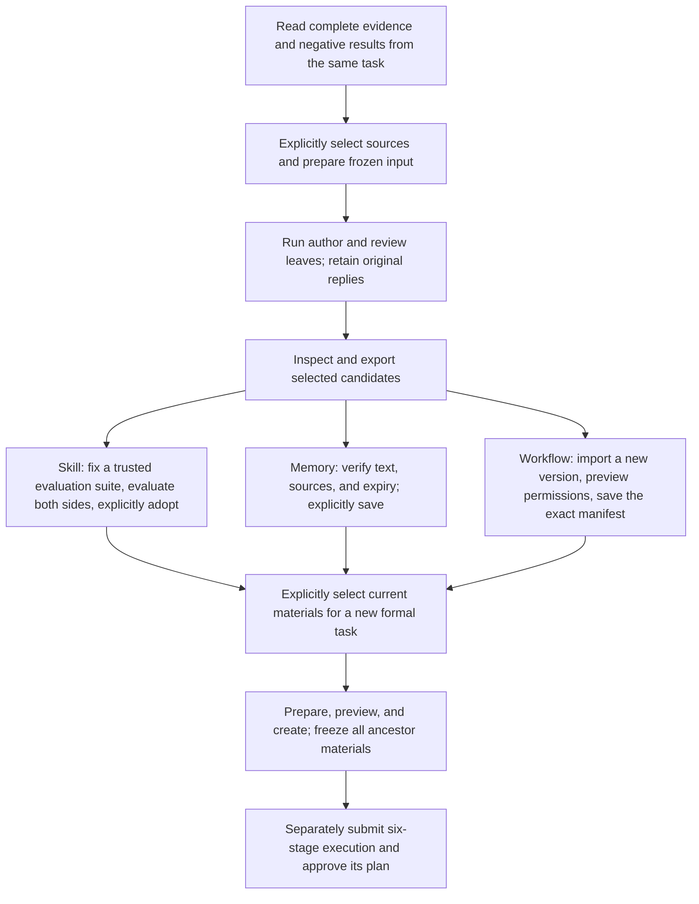

# Carry a retrospective into the next task

English · [Documentation](../README.md)

Ergora separates retrospective outputs into three independent candidates: project memory, a standard Skill, and a workflow version. You can adopt any one of them. Candidate generation, model review, and export do not adopt anything automatically; each output retains its own original record, and formal tasks explicitly select and freeze them again.

Before starting, prepare the environment using [installation and configuration](../install/linux.md#choose-an-installation-profile), register your project, and configure the backend you will actually use. `my-project` in the commands is the project ID; relative file paths are relative to the directory running the CLI. Web paths refer to directories readable by the machine hosting the console.



## Prepare and inspect candidates

First [collect and read the complete evidence](retrospectives.md#select-complete-offline-evidence-for-a-retrospective), retaining the original task, run, receipts, file digests, failures, and unknown costs. Authors and reviewers can use different backends; static graphs with dependency edges still require complete predecessor handoffs using the template's [single-leaf invocation steps](retrospectives.md#generate-a-provenance-bound-skill-retrospective-candidate). The graph itself does not mean those leaves have executed.

In the console's “复盘改进”, select the project and candidate direction, prepare complete inputs, explicitly invoke the selected leaves, then inspect the original results and export. The CLI uses `retrospective prepare` / `prepare-memory` / `prepare-workflow`, with inspection and export commands for the same direction. The table below links complete fields and examples. Save the input digest, original result SHA256, candidate digest, and export directory returned each time; they identify this selection and do not certify quality.

|Candidate|Instructions|Original interface for explicit adoption|
|---|---|---|
|Skill|[Complete Skill candidate](retrospectives.md#generate-a-provenance-bound-skill-retrospective-candidate)|Import the directory; fix the same trusted suite; evaluate both sides and compare; `skill adopt`|
|Project memory|[Memory candidate](retrospectives.md#generate-a-provenance-bound-memory-retrospective-candidate)|Run `memory save` with the complete `memory.txt`, original sources, and original revision|
|Workflow|[Complete root candidate](retrospectives.md#generate-a-provenance-bound-workflow-retrospective-candidate)|`composition import` a new version; preview original permissions; explicitly freeze-manifest|

## Adopt each output separately

**Skill:** Importing a later version only adds a candidate; the active head stays unchanged. A maintainer registers the trusted suite in advance, fixing evaluator files and train / validation / holdout cases; the generator cannot change the evaluator or access hidden holdout cases. Evaluate the original baseline and candidate separately, inspect the complete comparison, then adopt with a reason. Use “Skill 演进” in the console. The core CLI steps follow; use the digests and run IDs actually returned by each command.

```bash
ergora skill import my-project ./candidates/my-skill
ergora evaluation register my-project ./trusted-suite.json
ergora evaluation run my-project BASELINE_DIGEST --suite SUITE_DIGEST
ergora evaluation run my-project CANDIDATE_DIGEST --suite SUITE_DIGEST
ergora evaluation compare my-project BASELINE_RUN CANDIDATE_RUN
ergora skill adopt my-project --baseline-run BASELINE_RUN --candidate-run CANDIDATE_RUN --revision CURRENT_HEAD_REVISION --reason '已审阅完整评价与适用范围'
```

**Memory:** Explicitly add or correct an entry in “长期记忆”, select the exported UTF-8 file, and verify the source, ID, expected revision, and expiry in `receipt.json` before saving. `save.memory_id` / `save.expected_revision` in the export receipt map to CLI `--id` / `--revision` and HTTP `id` / `revision`; the receipt is not an HTTP request that can be submitted unchanged. Omit the original ID for a new entry; corrections append to its original revision history without overwriting it. Omitting expiry when correcting preserves the original deadline; restoring expired material does not renew it automatically.

**Workflow:** Explicitly import the complete directory in “Agent 与组合库”, close the receipt window, click “刷新定义库”, select the exact ID / version in the receipt, then preview and save the complete manifest. Import checks dependencies and rejects missing child definitions; when sharing a single root directory, separately provide and import its exact dependencies. Importing a new version does not change an old manifest or select or run it automatically.

## Freeze a new task and recover later

On Linux / WSL2, use [formal task material selection](../development/preparation.md#select-project-memories-and-active-skills-for-a-formal-task): the current task definition8/Input12 explicitly selects optional `context` to the existing native six-stage composition configuration. The following shows only that field; merge it into your complete configured task definition.

```json
{
  "context": {
    "root_version": "1.0.2",
    "memories": [{"id": "MEMORY_ID", "revision": 2}],
    "skills": [{"name": "my-skill", "digest": "CURRENT_ADOPTED_DIGEST", "revision": 2}]
  }
}
```

`composition.manifest` and `manifest_digest` identify the explicitly selected complete workflow; `root_version` is a new root version derived for these materials and must differ from its baseline root version. Memory revisions and Skill digests / head revisions must be exact, currently valid and active selections; the initially imported Skill baseline can also be selected, which does not mean an improvement has been measured. Relevant instances must deliver Skill attachments using `task-mcp` / `workspace-task-mcp`. Materials from every parent template accumulate in child instances; selecting materials does not expand parent permissions, and insufficient capacity rejects the complete preparation.

```bash
ergora task prepare my-project --definition ./task.json --revision PROJECT_REVISION
ergora task preview my-project --definition ./task.json --revision PROJECT_REVISION
ergora task create my-project --definition ./task.json --revision PROJECT_REVISION --prepare-sha256 PREPARE_SHA --preview-sha256 PREVIEW_SHA
ergora task show my-project TASK_ID
```

In “正式任务”, select the created record and expand “冻结项目资料与派生根来源” to see the original memory text, sources, expiry, and exact Skill identity. This section reads the task archive, not the currently active materials.

These steps create a frozen contract. Separately [submit the original run](../development/run-and-recover.md#submit-formal-tasks-and-recover-unknown-results), then [read and explicitly approve its plan](../development/design-and-approval.md#approve-an-exact-plan-and-recover-delivery) when it awaits that decision. A created task carries its original complete materials; later corrections, expiry, deletion, Skill rollback, or new workflow versions do not replace them during execution. Skill attachments are retained in the frozen package, and memory text preserves its original Unicode and newlines using JSON escaping in the context JSON.

If sources change after preparation but before the first creation, the old selection is rejected. Read the original creation record first; if no intent has been saved, explicitly select current materials and prepare again under a new task ID. With a pending intent, recover using the original ID / intent SHA; do not recompile the original task with current materials or reset its budget. An unknown response also requires reading the original record first and using the separate [creation / submission recovery](../development/tasks.md#formal-task-sequence-and-recovery) procedures; do not infer execution from page notifications.

To withdraw an improvement, use `skill rollback` with a reason for a previously active Skill version; memory `restore` appends historical text as a new revision; for workflows, select an old exact manifest for new tasks. Their revision rules are independent; reread current selections after each operation. Do not interpret synthetic scorers, model approve decisions, or successful imports as proof of real quality, training performance, or external resource availability.

Backend configuration and actual mode admission follow [Agent configuration](../agents/configuration.md) and [backend selection](../agents/backends.md). Static selection, authentication and an actual accepted task remain separate checks.

Continue: [Generate source-bound retrospective candidates](retrospectives.md) · [Evaluate and adopt Skill candidates](skills-and-evaluation.md) · [Prepare a task's frozen composition](../development/preparation.md).
