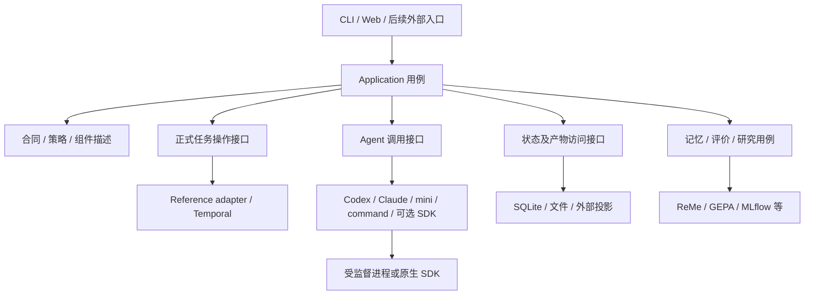
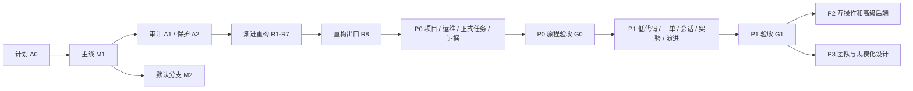

# Ergora：all-in-one 产品闭环、模块重构与后续功能计划

日期：2026-11-01。原始源码基线：`44c1c94d8c34ac3d6179eba91dfcd194ea9b005a`。A0 是计划和现状盘点；用户现已批准实施。当前状态见第 5 节登记表与各节点交付记录，不能从计划内容推导功能已完成。

[总计划与恢复入口](../PLAN.md) · [当前模块、五条调用流程与数据归属](../architecture/2026-11-01-baseline.md) · [本轮交付记录](../delivery/2026-11-01-all-in-one-plan.md)

## 1. 定位与本轮判断

Ergora 应定位为**面向软件交付和训练实验的多 Agent 协作工作台**：统一安装、项目配置、角色与工具选择、任务推进、人工决策、验收证据及持续改进；内部允许替换 Agent、执行环境、工单、检索和观测工具。

已有优势是把精确候选、可信验证、独立审查、明确采用/回退与持续演进放进同一项目合同。当前尚未形成充分可用性或效果对比，不能声称已优于其他平台。all-in-one 的验收应是用户能在同一入口完成工作，而非默认安装市场上的全部框架。

S0–S10 已交付。先把 Windows 工作纳入正式主线，完成有证据的渐进重构，再补下文 P0/P1 功能。真实模型认证、GPU、未配置外部服务等历史未验收范围继续单独记录，不把它们伪装为重构故障，也不重复实现已经交付的功能。

本次查看的代表性市场能力与我们的差距如下；完整历史分类见 [协作工具调研](../research/2026-10-28-multi-agent-landscape.md) 和 [持续演进调研](../research/2026-10-28-continuous-evolution.md)。

|参照方向|成熟实现可借鉴或直接复用的部分|Ergora 已有基础|应补齐的用户结果|
|---|---|---|---|
|OpenHands SDK / Agent Server、Agent Orchestrator|Agent 会话、工作空间、执行生命周期、界面与运行关联|Codex/Claude/command/mini 调用、Forge campaign、独立运行视图|正式任务和独立会话统一导航；第三方后端真实接入；失败/未知状态可操作|
|LangGraph / Deep Agents / Temporal|局部状态图、上下文、持久调度、人工等待与恢复|参考六阶段和资料观察已用持久执行；搜索局部复用|同一入口驱动正式任务，避免再建一个竞争的通用调度器|
|Dify / Langflow / Flowise / n8n 等产品|安装引导、组件目录、表单、受约束关系编辑|已有分层绑定、草稿 DAG 和 Cytoscape|描述驱动配置、预览差异、版本化组合和能力检查|
|MLflow / OpenTelemetry 等观测系统|实验、trace、事件与日志关联|已有实验记录、证据归档及分域运行记录|从任务直接找到精确候选、检查、成本、日志、原生产物和采用决定|
|ReMe / GEPA / 程序演化工具|检索整理、反思与搜索算法|记忆修订、Skill 评价采用闭环、有限研究已实现|正式任务中冻结上下文；任务复盘生成可评价候选；有预算地发现信息|

这是代表性官方资料与当前代码的对照，未声称穷尽市面所有 Agent 工具。

## 2. 优先级与阶段出口

|级别|要解决的问题|范围与出口|
|---|---|---|
|前置 M/A/R|没有正式主分支；扩展修改点分散；迁移保护尚未系统化|M1 → A1/A2 → R1–R8。先完成结构和兼容保护，生产行为与旧证据保持可比|
|P0：可独立使用的工作台|需双注册、手动接线，网页无法完整驱动正式开发，恢复/证据入口分散|F1–F5、G0：新用户安装 → 注册项目 → 绑定工具 → 发起正式开发 → 批准 → 查看六阶段 → 审查证据 → 导出；另验取消、重启与错误路径|
|P1：容易扩展与持续改进|工具表单硬编码、项目工单与会话不连贯、实验和演进未统一入流|F6–F10、G1：低代码配置；逐项目 tracker；可替换 harness/会话；训练入口；来源可追溯的复盘与上下文|
|P2：互操作与高级后端|跨服务、隔离执行、程序/参数搜索、外部格式转换|D1–D5：先固定版本做适配可行性与合同反例，再交付受支持子集；不进入默认必装|
|P3：团队与规模化|多用户权限、跨节点运行、权重训练、任意拓扑协议|X1/X2：独立产品与协议设计；不提前搭建整套平台|

P0 的完整开发运行首版以 Linux/WSL2 为执行位置；Windows 原生继续提供已经验收的控制面和工具子集。远端 Linux 执行由 D3 明确实现，不把“Windows 能打开页面”写成原生支持所有 Linux 功能。训练正式闭环在 F9 验收，P0 页面先清楚显示其现有入口和支持范围。

## 3. 目标结构与调用方向

采用一个模块化 Python 应用及轻量 Web 前端，优先组合与小接口。目录是**职责草案**，A1/A2 后按实际调用者决定最终路径；不先创建空目录、万能基类或一层层转发函数。

```text
src/ergora/
  cli.py / web.py              传输、参数和错误映射
  application/                项目、正式任务、Agent 调用、Skill 采用等完整用例
  contracts/                  版本化配置/请求/结果 schema、身份和兼容规则
  components/                 已支持组件描述、能力和绑定解析
  adapters/                   Agent、reference runtime、存储、tracker 等真实变化点
  processes.py / windows_job.py 既有进程所有者，按需内部拆分
  memory / research / ...      保留凝聚的领域实现，按真实需要移动
  data/                       模板、schema、console、固定 driver 与冻结参考
docs/                         计划、当前架构、ADR、验证与交接
tests/                        公开合同、迁移、生命周期和用户旅程测试
```



图中的接口不全部对应一个抽象类。CLI/Web 调相同用例；核心合同不 import Web、具体 SDK 或部署管理器；adapter 依赖它实现的合同。当前两个真正的重用入口是 CLI 和 Web，正式 executor/driver 是另一个真实消费者。

### 3.1 哪些上移、下沉、保留或重写

|调整|对象与原因|实施节点|
|---|---|---|
|上移到应用用例|tools.run_agent 的上下文/记录编排；Skill compare 后 adopt；跨 reference 的项目/任务操作|R4/R6、F1/F3；领域不变量仍留在所属模块|
|集中到组件描述|工具配置 schema、平台/操作/角色能力、默认绑定与安装配方引用|R1/R2、F6；动态认证/连通探测是独立结果，不写死为已可用|
|下沉到存储和生命周期所有者|DDL/迁移/连接、明确复用的文件操作、后代进程清理|R3/R5；不同事务、摘要规则和状态机不机械合并|
|保留差异化实现|Windows Job 与 Linux group/subreaper；研究抓取与 Agent 进程；Forge/native 与正式任务状态|R5；统一展示或操作合同，不丢掉原始语义|
|保留必要继承|mini 的上游 environment 钩子；reference Executor 的受控过渡继承|R5/R6；不能为“全部组合”而复制上游执行逻辑|
|逐步替换集中分派|agents.invoke 的工具分支、JS 的绑定字段分支|R1/F6/F8；真实实现之间组合，不建立角色/模板继承树|
|有条件重写|没有稳定外部钩子的适配片段或经反例证明错误的实现|必须有 A1 证据、兼容夹具、替代方案与单独切片；不默认重写可信执行器、协议或整个前端|

### 3.2 最小统一契约

|边界|建议合同及消费者|需要保留的不同点|
|---|---|---|
|组件描述|id/version、配置 schema、支持平台、角色能力、operations、安装/文档引用；目录/默认值/表单使用|描述可选能力不等于已实现；安装、认证、连通、实际验收分开|
|Agent 调用|固定 Binding + 输入/结果 schema + cwd/预算/上下文快照 → 运行结果/产物引用；独立调用与正式阶段使用|普通文本命令与 stage-json-v1 不混用；恢复/交互只向真实支持的工具开放|
|正式任务操作|创建/读取/批准/取消/恢复或对账/导出；application、CLI/Web 使用|query/command 与 Temporal workflow、FileAdapter、ledger 的权威归属分开；不能把取消意图写成停止成功|
|运行摘要|project/task/run/parent/native IDs、类别、展示状态、原生状态、能力、时间、错误和 artifact 引用|Agent、研究、评价、Forge、训练仍拥有不同状态机；未知结果保持未知|
|产物/证据引用|来源、内容摘要及算法版本、类型、位置、候选/合同/评价集身份、可读性|日志/trace 是观测；可信检查/批准是正式证据；不得互相替代|
|存储升级|版本、事务、兼容读写、备份/恢复和投影重建；使用现有 sqlite3 起步|不预设万能 Repository/ORM；复杂迁移达到实际需求时再选库|

优先 `Protocol`、dataclass/TypedDict 或有明确校验的函数。只有共享算法且有可替换的真实实现时才引入 ABC/继承；具体接口签名在 A2/R 节点定案。Web DTO 与核心 schema 的落地在“核心保持轻量 + jsonschema”和“采用 Pydantic 作核心模型”间比较，不在计划阶段偷偷引入依赖。

## 4. 配置、格式与低代码扩展

当前权威数据及格式已列在 [基线第 4 节](../architecture/2026-11-01-baseline.md#4-配置代码与数据的权威归属)。目标是复用 JSON Schema、JSON/YAML、标准 Agent Skills、Git 和原生 SDK/协议，不另造一门工作流或 Skill 语言。

1. 人工配置可用 JSON，增加 YAML 只作同一版本化结构的输入语法；规范化、校验、默认值解析、有效配置预览共用一个所有者。原有 schema version 和 hash 规则不变，新语义用明确的新版本。UI 布局/折叠状态另存，不进入执行或批准摘要。
2. 配置合并顺序、未知字段、列表覆盖、空值删除、禁用组件、必需层缺失都须有确定规则。项目策略给出不可放宽限制；任务冻结后改默认值只影响新修订，不影响在途执行。
3. 新项目有单一注册入口；reference 项目/策略配置成为显式投影或兼容导出，不形成双向写入。运行状态仍按域归属，读取投影包含来源和更新时间。
4. 凭据仅存 `env`/受支持存储的引用，不保存值到可共享项目定义。跨系统迁移导出逻辑配置与资产身份，不复制虚拟环境、活动 SQLite 或本机绝对路径。
5. DB schema、项目文档、组件配置、模板、命令协议、证据摘要分别版本化。迁移有事务、演练、备份、拒绝不支持版本和回退办法；不能靠 `CREATE TABLE IF NOT EXISTS` 假装升级已完成。

低代码分为三个层次：

|变更|用户需要做什么|是否应改核心代码及验收|
|---|---|---|
|切换已支持工具/模型、调整预算、启停可选组件|表单或 JSON/YAML 修改，查看有效配置和能力差异|不改代码；CLI/Web 解析一致，必需能力缺失立即指出|
|组合现有角色、模板输入、工作单元 DAG 与来源|编辑版本化定义或受约束画布，预览编译结果|不改具体 Agent；检查环、路径/权限、角色、输入输出与可信阶段保护|
|接入新 harness / runner / tracker / 通信协议|声明配置字段 + 实现最小 adapter + 合同测试 + 安装说明|需要代码；不能只填一条命令就宣称具备取消、恢复、隔离或可信评分|
|新增阶段语义、改变批准/评分权限、支持任意拓扑|单独协议版本与迁移设计|超出低代码配置；需要显式的兼容和行为验收|

关系图分开表示角色职责、工作依赖、资料/产物流和工具授权；四种边不可混成一条普通连线。首版保持六阶段及可信 integrate/verify。拖拽删除可信检查不应生成可执行合同。

### 4.1 可验收的变更影响范围

|从上到下的变化|允许改动|不应被迫改动|
|---|---|---|
|新增 CLI/HTTP 入口|传输与相应边界测试|领域算法、adapter、证据门禁|
|新增兼容模板|模板/schema/角色声明、合同样例与测试|每个 Agent 实现及平台进程层|
|新兼容 Agent|自身 adapter、组件描述、可选依赖/配方、合同测试和文档|模板、编译器、CLI/Web 中新增厂商专用分支|
|新存储/检索投影|该存储实现、迁移/一致性测试、配置|Agent 协议与模板；主数据所有权不能暗换|
|新 OS 支持|进程/文件/锁 adapter、安装器、doctor 和真实 OS CI|六阶段、Skill 采用和项目业务规则|
|新增/禁用 tracker、观测或通信|组件与对应边界、配置/状态映射|无工单场景的本地工作流；删除绑定不应破坏在途任务|
|改变核心合同|显式 schema/API 版本、迁移和对应消费者|不能承诺零影响；应由变更报告列出真实影响及拒绝旧用法的原因|

用既有 CLI/Web 等真实消费者、Codex/Claude 等实际变化检查接口价值，不能制造调用者或实现凑数量。只有一个消费者时优先留在原所有者；顶层配置接口按其配置职责评估。目标是缩小修改范围、减少必须同步的地方，不追求零依赖或“极致解耦”的名义指标。

## 5. 执行节点及进度登记

下表是本详细计划的节点状态权威。每个节点有单独交付记录；“完成”必须同时满足实现、验证、独立审查及该节点的交付动作。`—` 表示尚未开始，不代表通过。日期或文件数量不能替代验收。

|ID|前置|节点|实现|验证|独立审查|
|---|---|---|---|---|---|
|A0|无|本轮计划与基线盘点|完成，已推送|静态核查通过|[通过](../delivery/2026-11-01-all-in-one-plan-review.md)|
|M1|A0|建立正式主线并纳入 Windows|完成，已推送 main|main CI 41319564418 / 冻结身份通过|[通过](../delivery/2026-11-01-mainline-review.md)|
|M2|M1|设置并核对 GitHub 默认分支|完成，用户已设置|[远端 HEAD/main 一致](../delivery/2026-11-01-default-branch.md)|[通过](../delivery/2026-11-01-default-branch-review.md)|
|A1|M1|逐模块/函数调用与重复审计|[完成](../architecture/2026-11-01-audit.md)，只读审计|113 文件索引/链接/依赖/冻结身份通过|[通过](../delivery/2026-11-01-audit-review.md)|
|A2|A1|兼容保护、边界决策与测量基线|[完成，已推送](../delivery/2026-11-01-compatibility.md)|Linux144项+36子测试，17跳过；两OS CI41323798679成功|[通过](../delivery/2026-11-01-compatibility-review.md)|
|R1|A2|[组件目录与绑定责任集中](../delivery/2026-11-02-components.md)|完成|Linux 152 项+36子测试 / 浏览器 / 两 OS CI 41333003887|[通过](../delivery/2026-11-02-components-review.md)|
|R2|A2|[配置/结果 schema 与身份规则](../delivery/2026-11-02-schemas.md)|完成，已推送 d402d1b|Linux172项+36子测试 / 基础CLI / 两OS CI41336217446|[修正后通过](../delivery/2026-11-02-schemas-review.md)|
|R3|R2|[存储迁移与数据访问归属](../delivery/2026-11-02-storage.md)|完成，运行代码已推送 4fe2ec5|最终wheel / Linux202项+36子测试 / 基础CLI / 两OS CI41340075293通过|[R3.1](../delivery/2026-11-02-state-migrations-review.md)、[R3.2](../delivery/2026-11-02-state-backups-review.md)通过|
|L0|R3|[本地完整环境和 CLI 全流程验收](../delivery/2026-11-02-local-e2e.md)|完成，独立持久环境及通用说明已交付|两开发全流程/导出、GPU训练门禁/票据、控制面/调度/恢复通过；取消沿原ID对账|[修正后通过](../delivery/2026-11-02-local-e2e-review.md)|
|L1|L0|[DeepSeek Super-agent原型与Harness调研](../research/2026-11-02-deepseek-agents.md)|完成，报告/来源/已有节点验收细化；未接入运行时|84本地链接/50文件提交身份/diff静态核查通过|[修正后通过](../delivery/2026-11-02-deepseek-research-review.md)|
|R4|R1,R2,R3|[用例编排及 Skill 依赖环整理](../delivery/2026-11-02-application-use-cases.md)|完成，运行代码已推送 f9a9b74|wheel Linux206项+36子测试/324文件/基础21次CLI及最终35项通过；两OS CI41380351919成功|[通过，含最终CI复核](../delivery/2026-11-02-application-use-cases-review.md)|
|R5|R2|运行契约与跨平台生命周期整理|—|—|—|
|R6|R2,R3,R5|reference 边界与渐进迁移|—|—|—|
|R7|R1,R2,R4|Web/CLI 适配与前端模块化|—|—|—|
|R8|R1,R2,R3,R4,R5,R6,R7|重构出口验收与当前架构更新|—|—|—|
|F1|R8|P0 单一项目及有效配置入口|—|—|—|
|F2|F1|P0 安装组合、doctor 和服务运维|—|—|—|
|F3|F1,F2|P0 正式开发任务的 CLI/API 闭环|—|—|—|
|F4|F3,R7|P0 正式任务控制台及运行观察|—|—|—|
|F5|F3,F4|P0 证据/产物关联、预算和导出|—|—|—|
|G0|F1,F2,F3,F4,F5|P0 新用户与异常旅程验收|—|—|—|
|F6|G0|P1 描述驱动表单和受约束关系编辑|—|—|—|
|F7|G0|P1 逐项目 GitHub/GitLab 工单|—|—|—|
|F8|G0|P1 真实可选 harness 及会话交互|—|—|—|
|F9|G0|P1 训练实验入口与结果复验|—|—|—|
|F10|G0|P1 任务上下文和受评估的持续改进|—|—|—|
|G1|F6,F7,F8,F9,F10|P1 集成交接及易用性复测|—|—|—|
|D1|G1|P2 MCP 工具边界|—|—|—|
|D2|G1|P2 A2A 跨服务边界|—|—|—|
|D3|G1|P2 远端执行与真实隔离|—|—|—|
|D4|G1|P2 程序/参数搜索|—|—|—|
|D5|G1|P2 外部描述格式互操作|—|—|—|
|X1|G1|P3 多用户及团队部署设计|—|—|—|
|X2|G1|P3 集群/权重训练/新拓扑设计|—|—|—|
|PUB1|G0|公共发行与开源许可收口|—|—|—|

实施推荐顺序：M1 → A1 → A2 → R1/R2 → R3 → L0 → L1 → R4/R5/R6/R7 → R8 → F1 → F2 → F3 → F4 → F5 → G0 → P1 → G1 → 按实测需求选择 P2/P3。M2 只负责远端默认分支元数据，在具备管理认证或维护者完成设置后独立收口，不阻断 A/R/F。斜线表示可独立安排的工作包，不要求自动委派并行实现。PUB1 可准备资料，但根许可证仍由维护者选择；这不阻断内部重构与计划推送。



### L0 本地完整环境及 CLI 全流程验收（用户追加）

- 先清点现有持久安装、配置、服务端口、模型凭据存在性与 GPU；复用可用工具，在用户目录安装缺失的已选组件。配置与日志只写独立持久验收目录，演示项目使用独立本地 Git 仓库，不借用真实业务任务。
- 用实际命令验证控制面项目/绑定、真实 Codex 调用、记忆、Skill 评价/采用/回退、资料观察、Web/API，以及参考发行的 Temporal / MLflow / A2A。实际执行治理/大型开发的 inspect → plan → work → integrate → verify → review，阅读计划后只批准隔离演示任务的精确摘要，检查证据和分支导出。训练模板使用有界的小实验，分清准备、真实运行、可信复验和采用。
- 验收同时检查取消、服务重启/恢复和离线备份恢复的适用路径。记录命令、安装与源码身份、实际结果及失败；模型效果、GPU 收益和外部服务不可从 fixture/端口存活推导。权限或认证不足时不争取宿主机权限、不强行安装，明确保留未验项并继续可测范围。不得将现有实现的验收记成 F/G 规划功能完成。
- 对测试中发现的实际缺陷单列最小修复、针对性回归与独立审查；测试记录在 [L0 交付记录](../delivery/2026-11-02-local-e2e.md) 逐步更新。

L0 已发现的后续项归属：R6/F2 处理参考 CLI 的 Temporal 环境导出、旧部署身份检查与干净运行时选择、停止完成后再启动的就绪反馈；R6/F3 提供沿原 ID 的取消终态后对账入口，并清楚呈现每个工作单元执行全套检查对中间态的约束。当前先用明确配置与既有 SDK 对账，不修改冻结参考协议或伪造成功终态。

### L1 DeepSeek Agent 管理工具调研（用户追加）

- 在 L0 后核实用户所指的近期 DeepSeek 官方项目/产品：官方名称、仓库/公告、发布时间、固定源码身份及许可证；身份不明时明确证据和候选，不能将第三方工具写成官方发布。
- 对照实际接口分析 Agent 定义/关系、任务管理、记忆/Skill、模型、执行/隔离、通信与页面；区分已运行事实和文档宣称。评价可直接接入、部分复用、仅借鉴的边界、依赖和维护成本。
- 产出日期化研究报告并更新计划优先级。调研本身不自动安装、迁入或替换现有工作流，不把 API 兼容性当成功能已接入。

用户补充的Reddit帖子已确认指向 `deepseek-ai/dsh-superagent-prototype`，其DSH依赖分别固定源码和版本，见[研究报告](../research/2026-11-02-deepseek-agents.md)。文章全文本轮未取得，不采用转载性能数字；原型不作为成熟产品或默认安装项。

L1细化原有验收：F2固定版本/实际能力/有效配置和停止反馈；F3/F5保存native ID、不确定副作用及取消对账；F4人工待办优先且与任务列表一致；F6/F7描述驱动Source/Channel、事件去重及上下文与授权分离，主动接单先observe；F8评价DSH headless或SDK单一适配、同模板与精确候选复验；F10保留受评价的Skill/prompt采用；D3真实验证Landlock等可选执行边界。完整映射与反例在[报告第6节](../research/2026-11-02-deepseek-agents.md#6-回写计划的优先项与验收)，这些仍是待实现条目，不改变R4–R8优先顺序，不增加第二套持久调度器。

用户要求将值得采纳的参考项列入实施计划。以下为 L1 的执行清单，状态随所属 F/D 节点登记，当前均待实施；来源身份沿用研究报告，不把静态调研写成已接入。

|参考项|优先级 / 所属节点|采用方式与可验收结果|
|---|---|---|
|DS1 有效配置与能力探测|P0 / F1、F2|借鉴 profile 的有效配置视图，使用现有组件/schema 和项目修订；显示来源、固定版本、认证/连通/任务可用性，停止确认后再报告可重启。|
|DS2 执行身份、持久意图与回执|P0 / F3、F5|复用 Temporal 和原生 ID；外部写操作先保存意图及去重身份，恢复时对账实际回执。取消未确认、失联、未知费用保持可见，不盲目重提，也不新增竞争调度器。|
|DS3 人工待办优先|P0 / F4|按权威任务显示待批准、待回答、待审查/放行和阻塞原因，提供对应操作；首页计数、筛选和列表来自同一查询语义。|
|DS4 事件、上下文与授权分开|P1 / F6、F7|用项目级 Source/Channel 描述及稳定 Trigger ID 去重；Thread 后续消息只补充上下文，不能扩大授权。批准绑定修订，重放/机器人消息不重复派工；主动接单先提供 observe 预览。|
|DS5 DSH 可选后端及会话|P1 / F8|固定兼容版本和独立 home，先在 headless 与 Python SDK 中选一种真实适配。验结构化结果、native ID、停止/恢复/未知、同模板与精确候选门禁；不整包迁入 Super-agent 的数据库、派工和页面。|
|DS6 受评价的 prompt/Skill 改进|P1 / F10|借鉴修订与按需加载，继续走候选 → 固定评价 → 显式采用/回退；可导出已采用 Skill 给兼容 harness。失败/成本/来源可复查，生成器不能修改可信评分或放宽权限。|
|DS7 可选执行边界实测|P2 / D3|评价 Landlock、可用容器或远端执行；用实际读写反例及生命周期确认能力。探测失败明确报告，不因源码支持就声明本机可隔离，不要求用户取得宿主机权限。|

其中 DS1–DS4 主要迁入设计方法与现有用例，DS5 是可选工具接入，DS6 复用既有资产/评价，DS7 先作可行性验收。实验 Team、完整原型 Engine、另一套 DSL 和自建持久调度不列为默认迁入项。

## 6. M/A/R：先完成主线整理与重构

### M1 建立主线，纳入 Windows

- 产出：重新读取远端 refs、工作区、CI 和祖先关系；远端仍无主分支时，从已验收历史建立 `main` 并纳入 Windows 及本计划；如出现他人提交，正常合并并解决冲突。保留研究和功能分支，不强推、不删分支。
- 验收：记录合入前后 SHA/父提交；核对远端 main 与本地一致；main 的 Windows/Ubuntu CI 通过。公开安装入口指向 main；GitHub 默认分支元数据由 M2 单独验收，不能把 push main 记成已更改默认分支。
- 迁移/回退：无业务数据迁移；不改运行代码来伪造合并成功。后续有问题用独立 revert 提交；不重写已公开历史。已获得用户合并意向，实施前不重复询问相同授权。

### M2 GitHub 默认分支元数据

- 产出：main 可用后，使用已授权的仓库管理接口设置默认分支并重新读取；缺少认证时由维护者在仓库 Settings 的 Default branch 设置为 main，再用远端 HEAD 核对。不要求通过聊天发送 token。
- 验收：`git ls-remote --symref origin HEAD` 指向 `refs/heads/main`，并记录设置/核对时间和 main SHA。没有实际完成前保持待办；不改现有分支历史、不删除研究/功能分支。
- 迁移/回退：只改仓库元数据，必要时可恢复旧默认值。此项从 M1 中拆出，以区分 Git 推送认证与 GitHub 管理 API 认证，不改变工程工作流合同。

### A1 完整审计与调用证据

- 产出：更新当前模块图，补函数级公共入口/消费者、静态及动态调用、状态读写、配置来源、冻结参考内部实际依赖、前端 API 使用、安装/打包路径。对重复候选记录文件/函数、触发条件、可复用库及保留/合并/迁移/删除结论。
- 验收：五条基线流程逐步对应实际函数；新增正式任务入口、部署启动、恢复/取消另绘序列图；核查 tools 遗留分支可达性、Skill/evaluation 环、哈希差异及进程差异。生成“影响范围与删除清单”，不只给文件树或相似率。
- 迁移/回退：只读审计及文档；自动相似/复杂度报告只提供线索。若没有证据支持某项重构，记录保留理由并缩小 R 节点，不为原计划制造代码。

### A2 保护既有行为与记录边界决策

A1 的 [影响与删除清单](../architecture/2026-11-01-audit.md#6-可执行的保留合并与删除清单)约束 R 节点的实际范围：保留分发镜像、运行模式/平台差异、已有 Protocol 与框架 hook；不重复抽 CLI/Web 业务，不要求整体算法重写。没有新增生命周期复用依据时，R5 以契约/边界核查和必要的最小整理验收，不为计划制造基类或进程封装。

- 产出：确认可复跑的基线命令和来源身份；复用现有测试，补足迁移确实需要的公共合同夹具。为 schema/校验依赖、reference 运行边界、状态权威和组件注册写简短 ADR，记录不采用方案和退出条件。
- 验收：保存旧项目/草稿/Skill/评价/研究/Forge 状态样例（合成或脱敏），旧 canonical SHA、Skill digest/exec 位、候选/批准绑定、revision 冲突、拒绝错误证据、恢复和取消反例。测量安装步骤、首次无模型任务步骤、受影响修改文件，作为易用性比较基线。
- 迁移/回退：不改生产合同；不以复制实现逻辑的测试代替独立期望。模型效果/GPU测量另设真实环境记录。

### R1 组件与绑定

- 产出：统一工具能力、支持平台、操作、配置说明与默认选择的所有者；agents、tools、projects、CLI/Web 读同一描述；probe 返回实际状态，安装脚本使用明确配方或生成清单。只注册受支持内置实现，外部插件发现留到有真实消费者时。
- 验收：现有全部绑定的接受/拒绝与默认值保持；新增一个兼容测试组件不必修改模板或 JS 厂商分支；不可达旧分支经证据确认后删除；缺失可选 SDK 不阻断无关命令。
- 迁移/回退：先保持旧绑定 JSON/角色名/API 输出兼容；必要字段新增有版本说明。逐组件替换，不一次切换所有生产后端。

### R2 schema、配置与身份

- 产出：明确核心配置/请求/结果 schema 所有者、错误字段路径和版本；CLI/Web 共用业务校验。将不同摘要函数按语义命名，记录各自规范；不强制统一为一种哈希。
- 验收：CLI 与 Web 对同一有效/无效输入得出一致业务结论；额外字段、未知版本、BOM/UTF-8、数值边界检查有依据；旧编译合同/评价集/Skill 摘要保持 golden identity；安装基础包仍不暗需 Web。
- 迁移/回退：本节点保持既有存储与有效语义；若选择新依赖，记录固定版本、体积/许可、支持 Python 与替代成本，和迁移设计分开提交。

### R3 持久化与升级

- 产出：schema 版本登记、集中有序迁移、备份/恢复及故障提示；将 lazy DDL 移到存储初始化边界。按需要保留领域特定查询，不建立万能 JSON repository。
- 验收：旧库首次升级、再次升级、迁移中断/回滚、拒绝更新版本、revision 并发冲突、重新打开和跨进程锁；文件资产与库恢复能互相核对；ReMe 重建投影不改变 canonical 记录。
- 迁移/回退：事务化迁移，升级前可恢复备份；破坏性变更须独立迁移方案。不能让旧二进制写新库造成静默损坏；不可逆时用备份恢复而非声称支持 downgrade。

分为 [R3.1 集中迁移、R3.2 离线完整恢复](../delivery/2026-11-02-storage.md) 两个可验收子节点，各自记录实现/检查/独立审查。R3.1 的自动 DB 快照不替代 R3.2 的资产清单与恢复；两项均通过后才关闭 R3。

### R4 应用用例与依赖环

- 产出：独立 Agent 上下文/运行记录编排、Skill 比较后采用等放到完整用例；CLI/Web 共用。Skill 资产负责版本头，evaluation 负责可信评分，GEPA 负责调用这些能力；消除 skills/evaluation 的职责环。
- 验收：导入 → 固定评价 → 比较 → 采用/回退、独立 Agent 的 Skill/recall 快照均保持结果；候选改写、错误评价集、旧 revision、缺失资产仍拒绝；没有只增加转发层的“重构”。
- 迁移/回退：原公共入口按已确认兼容方式过渡，列出所有调用者和移除时机；不修改评价规则来完成拆分。

实施分步记录在 [R4 交付记录](../delivery/2026-11-02-application-use-cases.md)：R4.1 分离资产与评价后采用；R4.2 迁出独立 Agent 运行并让 CLI/API 使用同一用例。两步属于同一依赖整理切片，完整验证及新的独立审查通过后才关闭 R4，不顺带改变调度、会话或正式六阶段。

### R5 运行与平台责任

- 产出：共用运行摘要/产物引用与实际能力；保留各领域状态机。进程清理由既有所有者负责；只提取 processes/research 间可证实一致的原语，Windows Job 与 POSIX 实现可不同。
- 验收：Linux 和真实 Windows 的正常结束、超时、Ctrl+C、后代清理、控制器退出、UTF-8；supervised Linux 的取消仍由监控边界控制。Forge 不确定结果、查询失败、取消竞态不变成假成功或自动重跑。
- 迁移/回退：先兼容旧 run 文档及调用结果；统一展示字段不能覆盖 native state。此节点不顺带新增第二套任务调度器或安全沙箱。

### R6 reference 边界

- 产出：reference 的配置定位、编译、任务查询/命令、绑定快照、文件/ledger 操作收敛到明确 adapter；应用层不散布 sys.path、原全局 CONFIG/STATE 或私有字段。已有 Executor 继承/Windows reader 兼容只留在这层。
- 验收：隔离环境中两种开发模板的编译、执行绑定、可信集成/检查、回执、精确批准、导出与恢复可比较；在途任务冻结绑定不变化；283 参考文件/旧 HTML 身份保持。
- 迁移/回退：先包住既有运行时，再按真实修改需求迁出可变部分；不同时维护第二套六阶段。只有新路径经合同、取消、恢复和证据对比后才切默认。冻结目录何时仅作测试/兼容归档，另有退出清单，不承诺本轮整包重写。

### R7 CLI/Web 与前端

- 产出：入口只做传输适配；app.js 按请求/状态、项目绑定、资产、研究、模板图和运行视图的真实责任拆 ES modules。字段元数据消费 R1/R2；保留现有页面和 Cytoscape，复杂条件表单的库选型留 F6。
- 验收：同一用例的 CLI/API 结果一致；原有浏览器关键操作、窄屏、异步响应顺序、revision 冲突、错误提示、本地同源边界仍通过；构建后的 wheel 含所有新 JS/Python 文件。
- 迁移/回退：先移动再改行为，分开提交；不为拆文件增加 Node 构建要求或改写为 React。若以后新需求需要前端框架，再单独比较。

### R8 重构出口

- 产出：更新模块/调用/数据归属图与 ADR；删除清单逐项结案，临时兼容有明确调用者和退出条件；启用已选静态边界检查。新增子包须同步 setuptools 发现/随包数据及 wheel 验证。
- 验收：相关完整回归、跨平台 CI、非 editable wheel 安装、CLI/Web/参考模板及三方向能力检查；旧资产/证据身份不变，迁移恢复通过；没有遗留已弃用的双写路径。报告基线与完成后的改动影响范围，不以“文件更多”判定重构成功。
- 迁移/回退：各 R 切片可单独回退；通过本出口后才开始产品行为变化。无依据的重构项可经记录关闭，不能计为已实现了本不存在的功能。

## 7. P0：把现有能力接成完整产品

### F1 单一项目及有效配置

- 行为/产出：一次注册关联一个业务 Git 仓库；选择模板、角色、执行位置、检查/策略和可选组件；可查看有效配置及其来源/修订。reference 所需配置由同一用例生成，支持检测和显式导入旧注册，避免双向双写。
- 验收：CLI/API 双入口创建等价项目；冲突的旧注册、不同 Git 根、旧 revision、必需能力缺失明确报错；运行前冻结有效快照，改默认配置不影响已开始任务。
- 迁移/回退：已有项目可继续读；导入有 dry-run、差异和恢复记录；不收集用户模型密钥值到项目定义。

### F2 安装、doctor 与服务管理

- 行为/产出：提供轻量控制面、正式开发、实验研究的可选安装组合（最终名称实施时确定）；统一探测与修复指引，查看/启动/停止所选服务及日志。复用已有安装器、Supervisor 和平台可用管理方式。
- 验收：Linux/Windows 用户目录干净安装、重复升级、外来命令保护、离线/缺服务/缺认证可诊断；“已安装/已认证/已连通/此任务可用”分开显示；不会启动未选的后台探索。
- 迁移/回退：保留现有命令入口；数据目录与软件目录分开，升级不覆盖数据；正式开发组合明确 Linux/WSL2 要求。权限不足时给具体外部操作，不伪装成已完成。

### F3 正式开发任务 CLI/API

- 行为/产出：先读取正式任务，再接创建/编译/提交、精确计划批准、状态、取消、恢复/对账、结果导出。沿用 Temporal 和原证据合同；每次命令携带所需修订/身份与去重标识。
- 验收：repository-governance、large-change 从输入至六阶段结果在同一项目入口完成；重复提交不产生重复作业；旧批准、候选变化、审查者改 checkout、检查失败均拒绝；取消与重启后可查询真实状态。导出候选分支仍需按项目策略进行人工合入。
- 迁移/回退：先只读接入旧任务，写操作按明确版本分批开启；保持旧任务在原执行器恢复，不迁移正在执行的 workflow history。

### F4 正式任务控制台与运行视图

- 行为/产出：网页复用 F3，用同一任务创建、查看计划差异、批准、取消/恢复、查看六阶段/工作单元/候选与结果。以 task/run/native IDs 关联独立 Agent、研究和 Forge；长任务状态不依赖 HTTP 请求一直打开。
- 验收：浏览器走完正式开发；关闭页面/断线重连/服务重启后恢复正确状态，日志分页/流式读取有上限和游标。SSE 或轮询只投影权威状态，不制造已完成；不支持操作显示具体原因。
- 迁移/回退：后台正式任务优先复用 Temporal；轻量独立调用暂保留明确同步模式。若后续需要独立调用持久后台化，增加受支持的 Temporal activity 适配，避免自研竞争的持久调度器。先有稳定查询，再增量展示事件。

### F5 证据、成本与交接

- 行为/产出：从任务关联合同/候选、原始检查、审查、产物、评价集、Skill/记忆快照、来源及采用决定；可导出可复查结果。关联 MLflow，按需输出 OpenTelemetry trace，不让观测库成为核心启动依赖。
- 验收：只凭导出材料能核对确切候选和证据身份；缺失/篡改/错误项目产物不能被当作通过。展示预算与已用值，区分硬约束（墙钟/次数等）、估算和 provider 自报费用；未知费用不显示为零。重放导出不暴露凭据。
- 迁移/回退：先建立引用索引而非复制全部资产；旧证据保持摘要规范，外部投影可重建；保留/清理策略不移除仍被有效证据引用的材料。

### G0 新用户闭环验收

- 使用非 editable 安装包及全新持久数据目录，按公开手册完成 P0 正常旅程，再验取消、控制器重启、重复操作、缺可选服务、错误证据与恢复。Linux/Windows 支持子集分别检查，完整执行在 Linux/WSL2。
- 与 A2 对比手工注册、配置文件和操作步骤；目标是不再双注册、无需改 Supervisor 配置接入新项目、无需离开主入口定位批准/证据。没有真实测量前不写“降低了多少百分比”。
- 无模型 fixture 验证控制合同；真实模型、外部服务和 GPU 分别记录使用的版本/环境/预算及原始结果，未运行的维度明确保留，不以 fixture/CI 代替效果结论。

## 8. P1：低代码、更多真实工具与演进闭环

每项继承第 10 节的交付/回退规则，可再细分为“读取/预览 → 受约束写入 → 完整旅程”，禁止一项中同时更换底层协议和放宽验收。

|节点|应完成的行为与复用|验收与迁移边界|
|---|---|---|
|F6 描述驱动配置|组件 schema 生成 CLI/页面可配置字段；可导入/导出组合，预览有效值/差异；现有 Cytoscape 编辑受支持 DAG 和关系；比较有限字段渲染与成熟表单库，不自造通用 UI DSL|新增兼容工具/模板无需改厂商分支；未知字段/版本/环/必需层删除/越权明确拒绝；JSON 与 YAML 等价；画布和源码双向保留语义，布局不改变批准 SHA；配置回退形成新修订|
|F7 逐项目 tracker|GitHub/GitLab SDK/API 或 Symphony 适配；工单到多个 task/revision、状态回写和分支/PR/MR 关联；本地模式继续可用|一个项目一个业务仓库/工单命名空间，任务分支用于候选隔离，分支本身不拥有独立工单空间；去重、重放、人工修改冲突、外部不可用可复现；合同不信任工单文本自动改变权限；默认测试不向真实账号发工单|
|F8 harness 与会话|在现有 Codex/Claude/mini/command 基础上，先验证 OpenHands SDK 的兼容 Agent adapter；再按工具能力接交互会话/增量输出，优先原生 SDK/ACP 等现成接口|同模板不改即可切换支持的实现；会话身份/产物/停止/未知/恢复、精确候选审查一致；已开始阶段不得热换 Agent。OpenHands 当前 Python >=3.12，独立环境/服务或可选 driver 保持 Ergora 基础 Python >=3.11；固定版本实测后才显示兼容|
|F9 实验闭环|将既有 workload、baseline、experiment、可信 runner、compare/gate、MLflow、Forge 候选转交纳入同一导航；参数搜索按需求接 Optuna，先保留人工选择明确实验|CPU 合同回归和真实 GPU 对比各有记录；原生 campaign 完成不等于实验采用；预算、作业精确查询/取消、unknown 对账、负面结果、owner evidence SHA批准保持；旧 runner/结果不改身份|
|F10 持续改进|正式任务可选择/冻结项目记忆和 Skill；来源、有效期/失效、上下文大小可见；复盘从已有证据生成记忆/Skill/流程候选，复用 ReMe/GEPA 和有界来源观察|过期/删除记忆不继续进入新上下文，投影可重建；旧运行快照与证据按保留规则核对；提案不直接改核心/评价器/权限；基线/候选/成本/失败可复查，通过评价和明确采用后才更新活动版本|
|G1 集成验收|按开发/治理/训练三条公开旅程核对安装、配置、交互、角色可替换、工单与演进；更新当前架构和两本公开手册及 Windows 手册|每个所宣称兼容的真实后端有固定版本合同验收；效果和硬件结论仅按实际证据；旧项目升级与回退、配置导出跨机重建、相关完整回归和独立审查完成后推送|

## 9. P2/P3 与复用边界

P2 每项先交付固定版本的可行性样例及反例，再将生产实现拆成同样可验收节点；失败就记录不接入理由，而非假装可配置即已接入。

|节点|复用候选|必须自行负责的部分与首次验收|
|---|---|---|
|D1 MCP|官方协议和维护中的 SDK|项目范围/权限、tool schema、取消/错误、凭据引用；单个真实工具的成功/失败/禁用，不把 MCP 当 Agent 总调度|
|D2 A2A|现有参考 A2A 接口及官方 SDK|任务/消息/产物身份映射、幂等、对端能力、未知结果对账；一个服务往返及断线/取消测试，不另造通信协议|
|D3 远端执行与隔离|OpenHands Agent Server、已有容器/远端 workspace、平台可用 sandbox|明确实际信任边界、路径/产物/凭据传递、连接与租约、停机确认；一个远端 Linux 完整任务及失联/取消。无宿主权限时不承诺本地强隔离，不拿 Job Object 当沙箱|
|D4 程序/参数搜索|OpenEvolve/ShinkaEvolve/Optuna，按实际目标选一种起步|固定 evaluator、数据拆分、预算、负面结果及候选采用；与可复现基线同合同比较，未优于基线不改推荐默认|
|D5 描述互操作|Agent Spec 等现成格式；已有 JSON Schema 合同|Task/Package/Policy/Binding 的受支持子集转换；round-trip、拒绝无法表达的审批/角色/证据语义，不能仅以 JSON 能解析宣称可移植|
|X1 团队部署|成熟认证/会话/权限基础设施|项目与决策权限、审计、租户数据范围、部署边界；先设计和威胁边界评审，再开放远程多人入口|
|X2 规模化和新协议|Temporal 部署、Slurm/Kubernetes、Agent Lightning 等|精确作业、资源/预算、训练数据归属与评价、拓扑/合同版本；三类需求分开设计，不放进一个万能 Agent 基类|
|PUB1 公共发行|现有打包/CI/安装器、第三方 notice|维护者选择根许可证；来源/许可/固定版本清单；兼容与支持矩阵；发布前干净安装和真实支持范围。未知许可不擅自指定；普通重构和计划提交可继续|

优先调库：持久调度、搜索算法、检索引擎、模型/harness、绘图、观测、tracker/通信 SDK。自研重点：项目合同、角色/工具绑定、有效配置、精确候选证据、审批/采用、各工具状态映射和用户用例。小而明确的现有文件锁/进程实现先保留，不为了“全部调库”引入不能保留生命周期保证的包装。

## 10. 工程工具、skills 与验收纪律

### 10.1 本轮使用与调研结果

|skill / 工具|使用方式|范围与限制|
|---|---|---|
|已有 maintainable-project-delivery|本轮采用；后续每切片使用项目 docs、独立审查和恢复记录|沿用 AGENTS 规则；独立审查新开上下文，先给原需求与实际 diff/证据|
|已有 disciplined-repository-engineering|本轮采用；用调用证据、行为保护、最小变更约束重构|用户已要求写计划并授权后续方向；本轮不越过“先计划”实施生产重构，不反复请求相同授权|
|已有 find-skills|已查 skills.sh 目录，再核查来源仓库、完整说明及许可信息|目录热度只用于发现，不能证明适用或安全；本轮未全局安装第三方 skill|
|[improve-codebase-architecture](https://github.com/mattpocock/skills/blob/main/skills/engineering/improve-codebase-architecture/SKILL.md)、[codebase-design](https://github.com/mattpocock/skills/blob/main/skills/engineering/codebase-design/SKILL.md)|作为外部调研材料，借鉴按实际修改热点找摩擦、小接口和真实变化点的方法|源仓库为 MIT。未执行其完整工作流；目录摘要与当前源码流程有差异，以源码为准。其临时目录报告/强制交互或委派等流程不覆盖本项目持久 docs 与本轮范围|
|已有领域词汇及 domain-modeling 候选|先复用 CONTEXT.md；A1/A2 确有新概念时再使用领域建模 skill 更新|不为目录重构强行更名任务/工单、角色/工具、日志/证据等已明确概念|
|AST / rg / Git、现有 pytest|本轮静态盘点与后续公开入口/迁移/失败测试|动态 SDK/子进程调用需人工补核；本轮未运行生产回归|
|Ruff、Pyright；Import Linter 候选|A2 建适用基线，逐改动启用；Import Linter 在 R8 前评估固定版本|本轮未执行 lint/typecheck；不无差别格式化冻结/第三方文件，不为几条导入规则立即装一套平台|
|jscpd / 复杂度与依赖图工具候选|A1 可用其报告定位重复，再以语义及调用者确认|相似代码不能直接删；工具安装/维护成本需低于本项目实际收益|
|Playwright（已有可用技能/工具路径）|R7/F4/G0 真实浏览器旅程时使用并按技能读取说明|本轮文档无需浏览器验收；不新建只镜像页面实现的测试|

### 10.2 每节点的固定交付条件

1. 实施前核对 PLAN、当前交付记录、Git 分支/HEAD/工作区、依赖节点及原需求。压缩上下文或换机后重复此核对，不从聊天记忆重新猜任务状态。
2. 先读真实调用者，记 affected files、公开合同、原有 API/库选择和可达失败场景；把机械移动、行为变化、依赖升级、数据迁移分开提交。
3. 按风险验证公开行为。纯文档检查链接/来源/图与计划依赖；改合同需兼容/反例；改生命周期需两 OS 真实路径；改持久化需旧数据/中断/恢复。通过的检查不无理由重复扩大。
4. 更新该节点交付记录和本登记表，再交 fresh-context 独立 reviewer。给原需求、baseline、当前身份、完整差异（含 untracked）、实际命令/结果和缺失证据；修复有依据的问题后复审。
5. 每切片保留迁移/回退方式、仍有的兼容层和下一动作；完成后按用户已有授权提交、推送到 Ergora 远端并核对 SHA。不强推、不把不相干改动纳入提交。
6. 若外部权限/模型/GPU缺失，完成独立工作，准确记录未验证维度。未知能力显式失败，不能改为默认放行；发布许可等维护者决定在具体发行收口时处理。

### 10.3 本轮补核的主要官方来源

均为 2026-11-01 阅读快照，未由此安装相应引擎；移动分支文档只作选型依据，正式接入必须再固定版本。

|来源|本轮用于确认|
|---|---|
|[OpenHands SDK](https://github.com/OpenHands/software-agent-sdk)、[pyproject](https://raw.githubusercontent.com/OpenHands/software-agent-sdk/main/openhands-sdk/pyproject.toml)|SDK/Server/客户端与 UI/自动化的职责区分；当前元数据 1.59.0、Python >=3.12，不能无条件并入 Ergora 基础环境|
|[Agent Orchestrator adapters](https://docs.orchestrator.inc/plugins/agents/)|Agent 目录、平台/安装/认证 readiness 与实际启动验证分开；会话能力按 harness 区分|
|[LangGraph persistence](https://docs.langchain.com/oss/python/langgraph/persistence)|会话 checkpoint 与跨会话 store 不同；不能把内层持久化当作外层项目任务的全部状态|
|[Temporal execution](https://docs.temporal.io/workflow-execution)|持久编排及历史/恢复由已有引擎负责，适配时保持 execution identity|
|[JSON Schema 2020-12](https://json-schema.org/draft/2020-12)|新描述/配置复用标准 schema；现有冻结合同的规范单独保留|
|[OpenTelemetry Trace](https://opentelemetry.io/docs/specs/otel/trace/)|观测使用标准 trace/span 接口和可选导出，不另造追踪协议|
|[Import Linter](https://import-linter.readthedocs.io/en/stable/)|可检查 forbidden/layers/independence/acyclic imports，作为工具候选而非自研依赖分析平台|
|[skills.sh 目录](https://www.skills.sh/mattpocock/skills/improve-codebase-architecture)、[源码与许可](https://github.com/mattpocock/skills)|目录页当时约 1.2M installs、源码仓库约 309k stars，仅作发现信号；已读当前 SKILL 源码和 MIT 声明，未安装/完整执行|

## 11. 当前交接点

M1/M2/A1/A2/R1/R2/R3/R4/L0/L1均完成，运行代码已推送；L0实际适用验收及L1固定源码调研保留原身份。R4运行/测试身份 `f9a9b74`，两OS CI及[独立审查](../delivery/2026-11-02-application-use-cases-review.md)通过，[交付记录](../delivery/2026-11-02-application-use-cases.md)保存分步实现、验证、包身份及真实未验项。DeepSeek参考项按DS1–DS7回到已有F/D节点，尚未安装DSH。下一项为R5，先核查运行契约和生命周期责任，再继续R6–R8 → P0 → P1。每次上下文恢复重读PLAN、本表、活动记录和Git状态，不重复此前调研或把计划写成实现。
