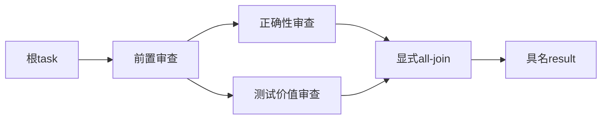

# AC4.3a：只读审查 DAG 的端口与来源合同

设计门禁通过，尚未改变生产格式或执行支持。基线 `91b09683aac9481d07a6cd1d2ea8da9777b25563`；前置 [AC4.2b](../delivery/2026-11-09-advisory-runtime.md) 已精确交付，自己的双OS CI及即时HTTPS远端终核通过；后续 AC4.3b 才实现新的正式入口与运行。本文把现有静态图接到原 review 阶段，不引入另一套调度器或执行账本。

## 接入与兼容

沿用已有 WorkflowDefinition v1/v2、AgentDefinition v1、完整 manifest 和用户任务定义 v2。拟给任务的 composition 增加显式 `review_protocol: "dag-v1"` 选择，由真正的新消费者处理；没有该字段时，原信封 v2/v3 的字节、队列、单叶/并行形状及历史保持。新增能力使用正式信封 v4、专用 queue/request-root/活动/Workflow；选定协议和职责进入原创建意图及信封身份。旧运行器明确拒绝，不自动升级旧任务，不增加尚无消费者的公共开关。

本片只确定合同和验收，不提前保存可启动的 v4 任务。AC4.3b 一起接通创建、启动、Executor、证据/恢复和真实旅程，避免留下伪运行支持。若真实调用链证明需要不同最小格式，先记录原因再调整。

## 三种关系

结构 parent 链决定所有祖先材料和权限；本地图的 depends_on 决定执行先后；input/output 绑定决定数据从哪个具名端口传入。数据前驱不是父模板，不继承其 Skill、MCP、权限或可变会话。只依赖而没有输入绑定的分支是控制前驱，不自动注入其全部提示词。所有结构祖先仍由原完整输入包实际装载，串行输入不能覆盖它们。

|关系|拥有者|作用|
|---|---|---|
|结构父子|原静态编译器|完整继承材料、收窄权限、共享祖先并发限额。|
|执行依赖|冻结的`depends_on`及原review Workflow|等待全部直接前驱，不引入无关同层屏障。|
|端口绑定|冻结的`inputs/outputs`及原Executor|投影明确来源的数据，保留原件身份，不继承前驱权限。|

以下是目标数据流，现有格式可静态表示，尚未接通正式运行。三个审查者都属于同一父模板；结构父子关系没有画成数据箭头。最终汇合的传递覆盖包含前置审查，最终原意见也不能丢失。

选定 review 子树仍通过完整结构祖先直接接入根 task，不能依赖没有执行的外部节点。子树内支持只读 reviewer、嵌套 Workflow、非空 all-join、已有具名输入/输出绑定和无环 depends_on。写执行者留给 AC4.3c，审批/验证阶段不重复运行。

## 数据值和 provenance

每个运行输出以稳定 `(实例路径, 端口)` 地址标识。Agent 的 result 指向原 stage/job/receipt 与原可信意见，不能由模型自报 job、候选或产物身份。Workflow 输出严格投影其已冻结绑定；all-join 的 result 是全部列出依赖的全部具名输出映射，键保留实例路径，不用数组位置辨别重复模板实例。

根 task 表示本次原审查材料；叶子结果保留原 FAILED/SUCCEEDED 收据、职责与意见，建议 request-changes 仍可作为完整输入传给后续审查，运行失败不能产生可传递的合格结果。端口传送原产物数据，不把文本当成配置、权限或工具指令执行。

运行输入携带完整来源引用和对应原产物字节：原 admission、candidate、stage/job/context/receipt SHA、原产物路径与 SHA。来源必须来自同一 review 子树的预期前驱，并由原 submission memo、指定 run history、原 request/context 及 claim 的允许恢复语义确认；不能采用这条来源链未确认的运行、活动库、另一个候选、任意宿主机路径或“最新结果”。现有 receipt 没有 Temporal run_id，job_id 由task_id与stage派生，同一原job/context恢复可以复用原执行记录；不能仅比较job_id就声称来自指定run，也不为此改写原receipt。

正式 start/resume 继续由原 `_Submission.lookup_run()/verify_run_owner()` 核原submission/memo；受信任 Workflow 只从自身已完成results构造预期前驱。Executor 在真正拼装输入时核 immutable published request/context/receipt、admission/candidate/stage/SHA 与原claim，再经 FileAdapter 检查原件并再次核实际读取字节；初始活动核验不替代后续读取。证据读取与关闭后 `_Inspection.jobs()` 再核指定history；它不接受活动run，不能从正在拼输入的Executor调用。

这保持原transport来源保证，不增加逐叶Temporal查询、新run_id字段或第二来源账本，也不额外承诺run_id级隔离。必须验未被原submission确认的裸run不能取得正式归属，以及允许恢复的同一原job/context仍幂等。缺失、篡改、会话复用和候选错配在模型调用前失败。实际所有者见[原提交](../../src/ergora/reference_task_submission.py)、[当前证据读取](../../src/ergora/reference_task_evidence.py)及[关闭后对账](../../src/ergora/reference_task_reconciliation.py)。

同一源端口被多处引用时，输入内部用稳定端口地址与有界内容表保持共享；不递归展开重复的大型 join 值。表是本次冻结阶段输入的数据表达，来源仍是唯一静态图与原 Temporal history/receipt，不保存另一份可漂移的调度图。叶子实际输入包含其全部绑定值与全部引用产物，没有用摘要或截断正文冒充完整输入。

## 调度、汇合与停止

直接依赖全部完成后才能计算节点输入和提交叶子。彼此独立的分支不因不相关同层慢分支形成额外屏障；所有叶子仍同时服从完整结构祖先共享并发上限，等待前驱/窄子树不占无关祖先容量。虚拟 Workflow/join 没有模型会话或新的正式 job；实际叶子继续用稳定 review:<路径> stage 和原 Executor/monitor。

选定 review 子树仍只声明一个终结输出端口，不新增输出选择器；这个端口的投影链终点必须是显式 all-join。嵌套子 Workflow 可以有多具名输出，all-join仍保留依赖的全部输出。对终结输出的执行依赖及端口来源计算有界传递覆盖，包含串行上游和嵌套全部成员。任何未纳入最终汇合的审查叶子拒绝准入，不能因只引用末尾结果漏掉早期原意见。所有成员都出现在原审查聚合中，全部 required approve 才到 REVIEW_READY；建议 finding 全量保留，聚合不是投票或人工批准。

同一次 review 中任意两个审查者不能复用会话，后续审查也不能复用前驱会话；执行者与审查者后端多样性沿原策略。任何业务必需拒绝、运行/合同失败、超时或取消继续走原 StopWork、fence 和 reconcile；取消在获得新结果后仍检查，不清空全局取消。重放仅从原历史继续，不重新计算活动头、不重派已完成调用，不对清理未知伪造终态。

## 容量与所有者

复用完整 manifest 的深度/实例/文件/材料上限、原每 stage context 与完整叶子输入 1,000,000 字节上限、原 receipt/产物上限、stage deadline 和 monitor walltime。动态端口表及所有读取正文共同计入实际输入预算；在构造大型值前按共享表去重并累计检查，不先指数展开再检查最终 JSON。容量不足在本次 stage 明确停止，不截断、不跳过祖先或产物。

共享端口表只减少相同值的重复展开，不能保证不同审计产物内部重复的完整正文也线性增长。原`composition-materials`与`composition-prompt`都包含完整输入，若作为前驱产物继续进入后继，串行审计链仍可能快速超限。AC4.3b须明确result的全部产物集合、核实际读取/构造预算，并测串行审计链；不承诺最大512实例的每一种图都能装入同一输入预算。

现有task-MCP只暴露结构资源，不会自动暴露新端口。首个运行切片可先将完整端口表与原正文放入实际prompt，保留原MCP scope；如实测容量需要固定MCP端口原件，再由真实消费者显式冻结URI/原件摘要/来源及完整分页，保持旧scope身份。只给摘要或假定新图自动授予MCP访问都不合格；具体支持方式在实际准入中可见，不从模式名称推导能力。

已有编译器仍唯一拥有结构/端口静态图；任务创建所有者拥有显式协议选择与冻结；原版本 Input Interface 拥有路由；原 review Workflow 拥有运行顺序/取消；原活动与 Executor 拥有意见/原件和完整输入；原 evidence/handoff 拥有输出读取。只有出现真实多处消费者时才提取共享端口/可信意见算法，不为了本合同先造通用插件、第二图编辑器或 pass-through 层。

## AC4.3b 可验收节点

1. 新协议显式冻结与旧身份保持：同旧定义不加开关，输入/路由/原行为不变；新选择固定全部成员/职责；旧 worker 在任何发布或意图发送前拒绝。来源链未确认的run拒绝，原submission确认的允许恢复保持同job/context幂等。
2. 端口来源：选定子树单终结输出、嵌套子图多具名端口、重复模板实例、控制依赖和数据依赖分别覆盖；新图串行上游均纳入完整汇合；多终结输出/遗漏叶子/外部来源/未知端口拒绝。
3. 原 Executor 输入：先完成前驱再提交下游，完整祖先与原产物实际进入固定 prompt/MCP，原候选/上下文/摘要/原件错配和容量拒绝；没有真实运行就不标称完成。
4. 取消与恢复：并行限额、两实例会话隔离、worker 停启、原 history 重放、活动取消/清理未知/原 ID 对账、原请求和调用次数保持。
5. 最终非 editable 包身份与 283 冻结、安装 CLI/Supervisor/Temporal 实际旅程、旧 v1/v2/v3 history 重放、原 evidence/离线 handoff、进程清理；自己的模板真实审查与新独立两轴审查，普通交付后核自己的必要 CI 和精确远端。

本片已通过[新独立设计评审](../delivery/2026-11-09-review-dag-contract-review.md)，DG-1/2消歧关闭；不代表这些功能已实现。完成每一节点时分别更新实际实现、测试/旅程、模型审查、独立审查与提交/CI 状态；不把确定性协议 fixture 的通过当作模型质量或不同模型错误独立的证据。
