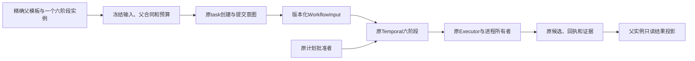

# D1：沿原所有者复用六阶段流程

日期：2026-11-12。承接[专家模板重整](2026-11-12-specialist-template-refresh.md)与[D0采用决策](../research/2026-11-12-specialist-adoption.md)。设计调查基线为`9abbb6448cf42548f598e53faa342e261671b354`，产品为`5ab6d350024de8515487d0bedb3b950be60ac867`。本文件记录下一片的源码事实、设计选择和验收节点；当前没有实现新输入或启动新模板。每次恢复先核[PLAN](../PLAN.md)、本文件、所属交付和Git状态。

## 首个消费者与唯一运行所有者

选择**扩展现有正式task消费者和版本化WorkflowInput**。一个普通父模板持有一个精确六阶段实例，由原`tasks preview/create/start`消费，原Temporal执行内部六阶段。CLI／HTTP继续共用同一用例；父实例只关联原task／workflow／run／candidate和证据，不维护另一份批准或成功状态。首片不新增Temporal parent／child层：当前client start已经拥有ingress、memo、attempt-before-send及unknown，child start会要求同时迁移这些语义，却不能解决材料、权限和预算缺口。

这是计划中的真实调用关系，不是当前已经可执行的通用图。首形状不执行父模板中的任意前驱或兄弟；额外native实例、未执行的外部数据依赖、共享可写checkout的递归调用在准入前拒绝。以后有实际外层运行消费者，再分别扩串行／并行组合；此片不以新增父记录建立调度器。

## D1a源码核对与决定

|接口与已核行为|需要补齐的合同|决定与实现位置|
|---|---|---|
|[tasks](../../src/ergora/tasks.py)的preview／create／start及原创建／提交意图；[WorkflowInput](../../src/ergora/reference_inputs.py)与[VerifiedSpecClient](../../src/ergora/reference_task_runtime.py)|六阶段实例、完整原输入与原创建／提交身份关联。|复用原所有者，不绕过准入调用裸start；不增加第二run或批准账本。|
|[Executor.model](../../src/ergora/reference_executor.py)仅work／review使用组合输入；inventory／plan走旧native调用，部分依赖文本每份截到60k。|全部结构祖先、固定模板正文、完整所需stage结果和实际后端进入前两阶段；完整输入容量不足明确失败。|新增显式版本的全阶段选择；普通只读前阶段复用原受限叶调用、快照、stage_driver、monitor和结果所有者。旧输入保持。|
|[WorkDelivery](../../src/ergora/review_dags.py)要求work与review恰好覆盖全部Agent叶；StageDAG限制所属职能。|新前阶段与work／review不遗漏、不重复，结构链与旧单元依赖正确。|新增显式全阶段数据投影，复用适用的旧算法；不改旧WorkDelivery含义，不把inspector／planner伪装成implementer，不新建混合图调度。|
|[受限后端](../../src/ergora/agent_backends.py)可禁模型shell／写工具；workspace-task-mcp明确使用可信current-container及advisory的read／write／egress。|声明上限、实际enforced／advisory／unsupported逐次绑定，不能由静态ceiling推导OS隔离。|保留已接受的可信执行模式及原Git门禁；新实例要求更强窄权限而后端不能实施时拒绝该模式。不要求宿主权限或追认旧模式未授权。|
|[task-mcp](../../src/ergora/task_mcp.py)提供固定scope的list／read，当前audit只记method／tool／success，native就绪核验要求tools/list。|附件或长文件的实际完整交付／连续读取证据；仓库读取也要有真实输入。|握手与scope完整性分别保留。需要时补URI／offset／实际返回范围审计或核完整native transcript；不能把摘要、路径、模型自述当全文，也不能把字节交付称为模型理解。|
|WorkflowDefinition limits是depth／instances／concurrency／material_bytes；原workflow、model及check timeout分别计算。|首次授权prepare前固定且恢复不重置的总deadline，含准备、队列、owner等待、执行与收集／清理；调用额度明确单位。|先实现总wall和已知模型invocation数量的实际约束；不把一次CLI当一次provider API。token／费用等尚无真实计量／限制的严格维度保持unsupported。|

只读前阶段没有现成任意仓库读取工具。以所需精确Git commit、路径和完整blob作为输入，复用现有Git读取算法的适用部分；当前review专用collector不能不经适配直接改叫inventory接口。必要仓库说明或配置超出父read范围时，要求父子共同修订或拒绝。声明资源和Skill附件仍须沿全部结构祖先完整继承，兄弟结果不能授予权限。

本次不引入新的受限patch writer。当前结果schema只返回summary、命名文本artifact和可选review decision，原Executor并没有可信patch／完整文件应用消费者。以后确需该模式再单独实现应用、scope和恢复；不能把返回一份patch误称仓库候选已修改，也不以该新模式阻塞已授权的trusted writer。

## 实施节点与可验收出口

|节点|范围与实际出口|主要所有者与必要验证|状态|
|---|---|---|---|
|A 源码设计|一个父、一个六阶段实例；选原task启动方式；列全阶段覆盖、材料、真实权限／预算和拒绝范围。|本计划及对应源码核对；研究不作运行判词。|设计完成；[D0同片独立补核](../delivery/2026-11-12-specialist-adoption-review.md)开放0／0|
|B1 全阶段材料消费者|显式新正式输入选择inventory／plan及work／review；前两者受限调用获得全部父材料、必要仓库及完整阶段结果；原writer模式如实保持。|tasks、task_envelopes、reference_inputs／executor及原stage_driver／agent_runs；版本化投影。验证超过60k依赖尾部完整或完整拒绝、祖先资源／附件完整、遗漏／重复叶拒绝、旧合同保持。|待实现|
|B2 最小总预算消费者|在首次授权prepare的原合同中保存同一预算身份／起点／deadline；剩余时间贯穿准备、等待、模型、可信命令及收集／清理，恢复不重领额度。|原创建／提交、WorkflowInput／workflow、Executor和原monitor。对真实入口注入受控时钟／丢回执，核超期fence／unknown及调用额度，不只测预算对象自身减数。|依赖B1，待实现|
|C 单实例原生调用|父manifest／精确定义链、实例路径、项目revision、原任务／baseline、全阶段选择、能力及预算冻结为调用输入；原创建／提交唯一消费。|按真实消费者扩版本化定义／静态编译；原任务保存完整原输入，原ID观察／取消／对账及候选证据投影。重复start、未知回应、wrong memo／full input及未执行外部边有行为验证。|依赖B1／B2，待实现|
|D 实际旅程与交付|隔离安装后，CLI一个小治理任务完成真实前阶段、精确计划批准、work／integrate／verify／review、候选／evidence及原ID恢复；核全部实际会话与拥有资源清理。|新候选自己的自身审查模板、新fresh-context两轴评审、受影响检查及必要CI；普通提交／推送。真实调用与失效注入分别记录；未成功异构后端不称双后端通过。|依赖C，待实现|

B1可独立交付“全阶段材料输入”，不能据此称预算闭合或六阶段已能嵌套。B2不宣称provider费用／token／内部API重试已精确受控。只有C／D实际出口完成，才能发布本片支持形状为可执行六阶段子模板；多个native、任意混合图、远端服务与GPU收益继续属于各自后续片。

实现前按当前注册表分配新版本：task-definition当前v1–v3，正式input当前v1–v7，workflow-definition当前v1／v2。每个已发布版本的语义、旧queue／request-root、history、批准和handoff原件保持；不能通过给旧严格schema加字段改变旧合同。未发布分片可共同形成一版完整合同，独立发布后续功能则使用新版本，具体编号随各实现片记录。

## 验证与持续记录

B1／B2／C各立实现交付记录，先固定实际改动文件与调用者，再运行足够覆盖真实失败面的已有suite；不新增与实现同形的断言、重复CI或强制所有片全量重跑。重点复用workflow定义、composition executor／invocation、work agents、task MCP和原task生命周期测试。283冻结文件仅核身份，不改副本；新逻辑放活跃所有者，不平行重写原训练／开发执行器。

附件交付必须核实际文件和连续范围；scope存在、模型返回“已读”或tools/list成功不能取代该证据。队列／owner等待是否计入预算在B2中固定，本片选择计入；取消投递与进程／job停止确认仍按原合同分别显示，父deadline到期不会使外部unknown自动完成。真实模型调用前先完成无模型容量／能力准入，不因旧native可以启动而跳过新合同。

每个完整产品片完成后，用本项目审查模板实际审查同一候选，另启新的独立评审检查正确性、代码结构、复用、冗余test／CI及相关成本；先处理finding再记录出口。文档设计补核不代替产品验收。每节点更新本文件、[上层计划](2026-11-12-specialist-template-refresh.md)、[交付记录](../delivery/2026-11-12-specialist-template-refresh.md)及[PLAN](../PLAN.md)；凭据仍为外部变量引用，验收原件留在持久私有目录。
