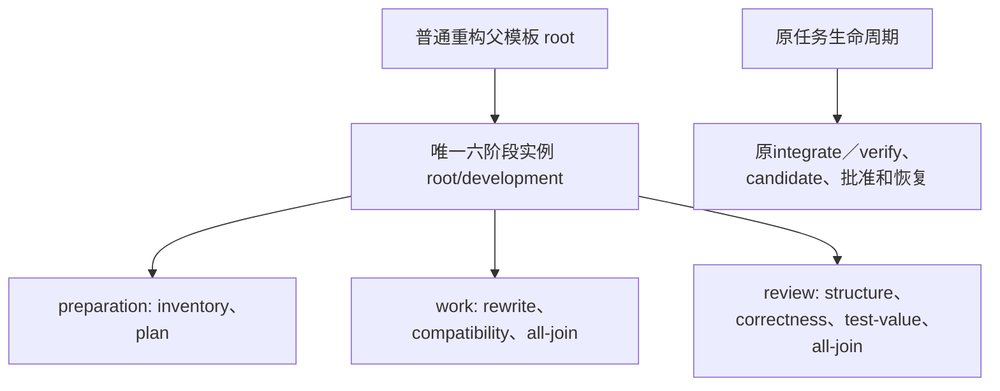

# D2：版本化专家、重构入口与优化方向子模板

日期：2026-11-13。承接[专家模板重整](2026-11-12-specialist-template-refresh.md)、[D0采用矩阵](../research/2026-11-12-specialist-adoption.md)和[D1六阶段消费者](2026-11-12-six-stage-native-consumer.md)。本文区分设计与逐片实施状态，具体出口见末尾和所属交付记录；设计内容本身不是独立产品审查或运行验收。恢复时先读[PLAN](../PLAN.md)与各片交付记录，再核实际工作树；研究报告中旧版本的“当前”不覆盖新源码。

原设计调查工作树以产品提交`a00896146c6499f58ae86a5b6b76fa13c3c7c796`及当时未提交C片为基础。C已实现definition6／input10及原`WorkflowInput`注册，隔离安装458产品／两RECORD／283冻结和受影响73项通过；实际D旅程由原D1片推进。设计调查阶段只读源码与文档；后续D2-A1实施以`5af9882367bbe5708f1a86ddabc16b2b665e9a49`为基线，实际验证与未验范围见[交付记录](../delivery/2026-11-13-refactoring-preset.md)。设计、实施、静态验收、模型旅程及独立评审分别记录，历史通过只授予原精确候选。

## 先实施的选择

1. 先向现有catalog v1增加可显式选择的新配方，保留三个当前入口与所有1.0.0包。复用已有CLI／HTTP安装Interface，首片仅改数据包和必要验证；版本选择增强有实际需求时另立小片。
2. 首个正式新入口是`refactoring`组合配方，映射已有`large-change`任务类型；先交付一条普通父模板→单六阶段实例的C支持形状。小范围治理继续选`repository-governance`，后续再按真实需求补同形配方，不自动猜测任务类型。
3. 优化先更新跨域设计、诊断、实验规划及独立评价的只读专家；技术方向用可引用资料子模板表示。先交付显存／重计算／卸载与图／packing两组，再按下表增加方向。原可信runner单独执行精确实验。
4. Forge保持旧pin与已有campaign所有者；不能满足逐内部会话父合同时，完整模式暂缓。D2实际kernel专家变化先是只读`kernel-designer`资料与输出合同；能力说明或拒绝门禁不算替换kernel agent。后续执行片只在已证实的逐会话接缝上适配一个有界原生入口。

以上顺序不要求为每个方向新建Python类、运行状态表或搜索器。当前已有的AgentBackend抽象和本地`for_binding` factory、`WorkflowInput`注册、定义库、StageDAG／WorkDelivery足够承担各自已支持的职责；D2资料片无需修改它们的执行分派。

## 已核Interface及归属

|实际所有者|当前行为及本设计使用方式|
|---|---|
|[workflow_definitions.py](../../src/ergora/workflow_definitions.py)|`presets/install_preset`读取bundled catalog，按依赖导入不可覆盖的Agent／Workflow版本；两个生产调用者是[CLI](../../src/ergora/cli.py)和[HTTP](../../src/ergora/web.py)。`_Compilation/_materials`解析精确引用、完整结构祖先资料、端口、权限及预算。发行选择放在此Module，不另立preset registry或编译器。|
|[agent_definitions.py](../../src/ergora/agent_definitions.py)与[definition_bundles.py](../../src/ergora/definition_bundles.py)|一份定义可声明多个`roles/specialties`；每个实例选择一个受支持role。内容定址、资源树、不可覆盖版本、历史读取及当前准入继续由原库负责。|
|[tasks.py](../../src/ergora/tasks.py)、[task_envelopes.py](../../src/ergora/task_envelopes.py)|冻结逐实例`backend_overrides`、原因及多样性政策；prepare/create/start仍是正式入口。定义6选择原六阶段，不产生第二任务或批准身份。|
|[native_six_stage.py](../../src/ergora/native_six_stage.py)|父链每层只有所选子调用，直接转发root task和唯一结果；选定work／review为native实例直接子模板，preparation／work／review覆盖全部Agent。父兄弟、第二调用、外部前驱或未选分支拒绝。它是数据投影，不是通用图运行器。|
|[review_dags.py](../../src/ergora/review_dags.py)|inventory／plan各选一个只读叶；work是implementer图，review是只读reviewer图，均有覆盖全部成员的非空all-join。每个原work unit一对一分配一个writer实例，依赖关系相等；不能把任意职能塞进work。|
|[agent_backends.py](../../src/ergora/agent_backends.py)、[agent_runs.py](../../src/ergora/agent_runs.py)|同一后端Interface实施已支持mode，保存完整输入、实际binding、独立session、MCP与进程原件。`workspace-task-mcp`的current-container仍为已接受的可信当前用户模式，部分read／write／egress为advisory；静态权限不是新增OS隔离证明。|
|[reference.py](../../src/ergora/reference.py)|`TEMPLATES`仍有三个领域；正式task type只有治理与大型变更。`templates copy`来自冻结参考发行。新增组合配方不向此元组偷偷加第四正式类型。|
|[kernel.py](../../src/ergora/kernel.py)与[forge driver](../../src/ergora/data/drivers/forge.py)|已有plan／prepare／run／status、固定版本与global config摘要、campaign及unknown对账；缺父材料、父权限和cancel。使用原`kernel_runs`及native record，不新建Forge任务账本。|
|[训练手册](../TRAINING.md)所指原`agentflow training`／runner／perfctl|原实验manifest、逐实验run-local、证据SHA批准、配对评价和恢复仍为执行／采用所有者。活跃包没有一个可直接改叫通用训练运行器的`training.py`；283冻结参考文件保持原样。|

## 版本选择先沿现有catalog

catalog v1已能按配方键固定整套精确依赖，首片无需改它的schema或安装用例。新增`refactoring`键；训练v2先新增显式`training-optimization-v2`键，指向原逻辑Agent／Workflow ID的新version。旧`repository-governance`、`large-change`、`training-optimization`键和全部1.0.0物理目录逐字保持。新包使用`<id>-v2/`等独立物理目录；路径不充当运行类型。

安装仍为`composition install-preset ID`及既有HTTP安装路径。catalog明确导入子依赖再导入父，digest由现有`check/import`生成；重复导入和中断恢复沿原逐定义发布，不新增跨库事务。新旧配方可同时安装，旧State对象／完整manifest保持其原引用。catalog的新键表示显式新选择，不自动替换已冻结任务。

只有版本化配方键造成真实检索／选择问题时，才考虑在`workflow_definitions`增加`install_preset(..., release=None)`及可选CLI／HTTP参数，继续由现有两个caller消费；该Interface不作为A1前置，不先建release registry。默认切换另记录精确新旧根、影响与回退，不把读取活动头替代固定引用。

## D2-A：正式重构入口

### A1：一个最小可运行形状

新增catalog配方`refactoring`，初版各新Workflow为1.0.0，在`composition presets`中明确说明“行为保持的Module重构；正式task_type为large-change；一个six-stage-v1实例”。其目录与逻辑定义如下；每个包内只声明自身实际需要的resources。

|新包路径（均位于`src/ergora/data/presets/`）|Interface与真实消费者|
|---|---|
|`agents/ergora-development-preparer/`|Agent v1；roles为inspector／planner，在两个独立阶段会话使用。instructions按实际role区分盘点与计划；Skill定义完整材料、baseline、未知项和回退交接。`ergora-development-preparation`两个节点消费，后续治理／大型变更的准备适配可复用。|
|`workflows/ergora-development-preparation/`|两个直接root-task只读叶inventory／plan，复用[现有preparation-guide形状](../../examples/composition/preparation-guide/workflow.json)。计划的真实stage结果仍由原runtime注入，不虚构静态inventory→plan数据边。|
|`agents/ergora-refactoring-engineer/`|一个implementer Agent及自身Skill，专长为Module深度、Interface迁移和行为保持；只在批准unit内修改。当前一个生产工作模板是合理的职责所有者，不为凑复用新增类或包装。|
|`agents/ergora-compatibility-validator-v2/`|原逻辑ID的v2；将server/client特定说明推广到本任务批准的Interface／持久格式／回退合同，仍是实现验证unit而非最终独立审查。新重构work消费；旧大型变更仍固定v1。|
|`workflows/ergora-refactoring-work/`|默认`rewrite → compatibility → done(all)`，分别引用上述writer与validator；每叶对应一个原unit。两单元的paths、产物及真实依赖由任务定义冻结。需要更多writer时通过现有修订Interface增加节点和units。|
|`workflows/ergora-refactoring-delivery/`|一个六阶段实例的静态定义；直接子模板为preparation、work、review，review引用现有精确`ergora-delivery-review@1.0.0`。输出直接转发review唯一结果；integrate／verify继续由可信原阶段执行，不造两个Agent。|
|`workflows/ergora-refactoring-template/`|普通父，仅以`development`节点引用上述delivery并转发task／result。root资源保存行为保持／迁移约束，全链所有模型均继承。catalog根为此包。|

每个Agent目录新增`agent.json`、`instructions.md`及`skills/<name>/SKILL.md`；每个Workflow目录新增`workflow.json`和`instructions.md`。资料片不修改AgentBackend、WorkflowInput或六阶段调度。新内容和引用按依赖由内至外发布，catalog依赖清单显式列出复用的三类review子模板和review Agents。

任务选择沿当前C合同，路径必须来自实际manifest：`native={protocol:six-stage-v1, instance:root/development}`；`preparation.inventory/plan`指向`root/development/preparation/inventory|plan`，`execution.instance`为`root/development/work`，`review_instance`为`root/development/review`。execution仍为`work-units-v2`，分配rewrite及compatibility两个unit到对应叶。definition6／input10原队列、总预算、prepare witness、双摘要create及start均复用；不是新增任务协议。

**明确输入：**示例任务使用`task_type: large-change`，baseline放现有`starting_sha`及原项目Git身份；`input.goal`说明行为保持目标和拟改变的Interface；`allowed_paths`限定改动；`acceptance`列可观察不变量、旧新消费者／持久格式兼容及回退证据；`constraints`列允许的语义变化、迁移顺序和未授权操作；`work_units`列精确paths／依赖／交付。完整重构背景可放父context或所选仓库材料。继续使用现有input schema，不追加被严格schema拒绝的`refactoring`自由字段。

示例及review应具体回答：哪个真实caller受影响、哪项外部行为保持、改变哪个Interface、旧调用如何迁移、持久数据／checkpoint／wire格式是否受影响、回退到什么精确版本、用什么证据检查。普通JSON schema无法判定字符串的语义完整性；inventory记录缺项，owner据精确plan决定是否批准，文档不能声称字段存在就已证明行为保持。

**实际改／增文件：**上述包、catalog；新增`examples/composition/refactoring/README.md`及一份可填写的definition6任务例，明确manifest路径／digest和项目资料需由操作者替换；`docs/WORKFLOW_DEFINITIONS.md`、`docs/USAGE.md`、`docs/TEMPLATE_WALKTHROUGHS.md`、`tests/test_presets.py`。现有preset测试将catalog ID集合与`reference.TEMPLATES`三领域硬绑定，新增配方时应分开“旧三领域保持”与“新配方可用”两个行为，不能据测试扩正式task_type。复用`tests/test_native_six_stage.py`的公开父形状和原合同验证，不为仅文字变化建新测试框架。

**A1完成条件：**新的配方可列出／安装／preview；例子经原prepare产生input10，父链、阶段选择及两个unit映射正确；每份叶输入含root、delivery、准备／工作／review祖先与自身资料，超限／冲突／越父权限按原消费者拒绝；默认三个互补必需review职责有独立实例及会话。用户通过既有修订可改为不同数量writer／reviewer，不被默认两writer／三reviewer写死。没有真实D旅程时，只记“静态与正式准备已验”，不称完整重构已执行。

**首片最小实质验证：**在`tests/test_presets.py`复用原安装／完整manifest检查，验证新配方重复安装及旧三配方身份保持；为新根核结构祖先内容／来源和有效只读review权限。沿现有C测试夹具增加一项新bundled根的正式prepare检查，核definition6→input10、两个units／writer及三类review精确覆盖，并核完整父链投影。已有后端覆盖、任意重复实例、容量／越权与unknown测试继续覆盖原算法；没有修改算法时不为每一条Skill文字复制负向suite。若新模板本身改变了这些行为，再补对应的真实回归。实际完整模型旅程属于A2。

### A2：独立行为与迁移验收

选择一个真实但小的行为保持重构，在隔离项目沿原CLI完成prepare→双摘要create→start→精确plan批准→work／integrate／verify／review→candidate／evidence；检查baseline和最终内容、旧调用及回退。重试与unknown沿原task／run，父只投影原native事实。结构、正确性、测试价值审查分别查同一最终候选；validator unit自身报告不替代独立correctness reviewer。

结构审查用真实caller、Depth、Locality、Seam及deletion test检查收益；正确性审查覆盖可达失败、迁移与旧对象；测试价值审查要求每项新增检查对应一种有价值的失败及oracle，并指明保留／删除的重叠，不以覆盖率或数量作通过条件。按风险复用既有测试，只为尚无覆盖的静默错误补回归；不因低影响资料变化重复整套模型／CI。

治理／大型变更原默认不自动迁到新根。后续确需两者使用C准备叶时，分别发布新的delivery与普通单子父wrapper，复用preparer、原work和review；它们是独立数据片，不能借A2重构旅程授予运行通过。

## D2-B：跨域优化只读专家与方向子模板

### B1：复用四份专家，先改变交付内容

发布原四个训练Agent的v2与`ergora-training-analysis`、`ergora-measurement-review`、`ergora-training-proposal`的v2，保留v1全部字节。实施前核对发现旧measurement子模板精确引用reviewer v1，因此须同时发布该子模板v2，否则新根仍会使用旧专家；这是原精确引用的必要数据依赖，不增加新的运行角色。四个专家仍分别使用已支持的experiment-planner、performance-analyst、kernel-tuner、reviewer角色；通过多项specialties表达交叉能力，暂不增加新role／capability或AgentBackend implementation。

|精确定义的新内容|必要交付与独立职责|
|---|---|
|`ergora-experiment-designer@2`|跨域全局约束、有限动作空间、资源／质量／预算、单项与组合干预冲突；按真实baseline选择方向，而非默认每个方向都运行。输出可冻结的实验提案与未验项。|
|`ergora-performance-analyst@2`|跨trace／memory／rank／拓扑／数据路径提出可证伪假设；区分采集、已有报告分析及无profiler配对测量，给关键路径与收益上限；资料不足直接指出。|
|`ergora-kernel-designer@2`|kernel能力同时覆盖precision／layout／fusion／graph／memory／communication影响；冻结真实shape／stride／alias／RNG／导数及wrapper消费者。生成文本仍是candidate。|
|`ergora-measurement-reviewer@2`|核候选、测量窗口、所有rank峰值、质量与总成本；失败／no_gain／noise／unknown保留，micro→wrapper→step／服务证据等级分别解释。独立correctness／quality与结构／测试价值审查可引用现有review专家，不让一个measurement标签代替全部职责。|

根只带共同优化合同：目标、baseline、原候选身份、允许干预、预算、原件和交接。方向资料放选中的子模板，避免每叶默认累加整套外部技能库。v2默认图仍为只读proposal，`runtime`保持`proposal-leaves`；`run-input`每次只运行所选叶，操作者提供完整前驱产物。图中的先后边及all-join没有新增运行权。完整自动提案图、动态选方向及混合训练图另立真实消费者后再实现。

**实际改／增文件：**`data/presets/agents/`下上述四个`*-v2/`包、`workflows/ergora-training-analysis-v2/`、`ergora-measurement-review-v2/`及`ergora-training-proposal-v2/`，catalog；`docs/TRAINING.md`、`docs/TEMPLATE_WALKTHROUGHS.md`及`tests/test_presets.py`。根不内联巨大官方库；新增Skill有短的有序步骤、可检查完成条件和按方向分包的references。完整资料交付仍按原Skill树处理，选定祖先已经声明的资料全部保留，不能把一个外网URL清单当实际正文。

**B1完成条件：**v1／v2可分别安装、导出和从完整manifest恢复；每个v2叶确为只读、shell=false、network=[]，换后端仍满足mode和完整资源合同；真实单叶运行分别交付上述有来源的提案／分析／审查，不能将其称GPU实测。不同职能的实际role、specialties、请求binding、实际binding与回退理由在原证据中可区分。

### B2：按决策粒度发布资料子模板

以下每项是独立可引用的只读WorkflowDefinition候选，采用`ergora-opt-<slug>-proposal`命名；一个方向可引用多位不同职责专家，一个专家可被多方向复用。它们先进入catalog的依赖清单供选择，不全部强制实例化到根。只为已实际实现与验收的行发布bundle；目录其余行是待做方向，不在产品catalog假装可用。

|方向slug／独立决策|优先复用的专家与知识来源|最小只读验收|
|---|---|---|
|`memory-tuning`、`activation-recompute`、`cpu-offloading`|design＋diagnose＋measurement；[R5](../research/2026-11-12-optimization-memory-agents.md)对应三个Bridge Skill。第一批。|容量分解、状态及重算粒度、host／pinned／NVMe预算和吞吐代价分别交付；不把不同offload接口统一成开关。|
|`cuda-graphs`、`sequence-packing`|design＋diagnose＋correctness；[R6](../research/2026-11-12-optimization-execution-graph-agents.md)。第一批。|真实capture scope／地址寿命与动态形状；packing的mask／loss／样本边界；明确版本组合限制及重验。|
|`parallelism`、`megatron-fsdp`、`hierarchical-cp`|design＋diagnose；[R4](../research/2026-11-12-optimization-parallelism-agents.md)、[X1](../research/2026-11-12-horizontal-architecture-agents.md)。后续按需求。|mesh与资源／模型合法性、CP／EP／DP／PP影响；推荐配方、solver输出和真实runtime分开。|
|`tp-dp-overlap`、`moe-dispatcher`、`moe-overlap`|design＋diagnose＋measurement；[R3](../research/2026-11-12-optimization-communication-agents.md)。kernel执行另由原生方向接入。|关键路径暴露、SM／HBM争用、成套版本、buffer／stream和多rank正确性；两个MoE overlap Skill的共享实现不拆成两个agent。|
|`profiling`、`memory-snapshot`|diagnose＋measurement；[R7](../research/2026-11-12-optimization-profiling-agents.md)。|已有原报告、窗口／rank／缺失事件／缓存副作用；离线解释不能称新采集或测得收益。|
|`recipe-model`、`model-verification`|design＋correctness；[R9](../research/2026-11-12-optimization-model-recipe-agents.md)。|区分LLM／VLM／RL与框架；权重转换、forward／导数／optimizer／checkpoint和质量所需证据；recipe推荐不是搜索执行。|
|`cluster-resiliency`|design＋diagnose；[R8](../research/2026-11-12-optimization-cluster-agents.md)。|唯一rank／job／恢复所有者和共享路径；deterministic日志分析先于含内部模型的Restart Agent。|
|`kernel`、`low-precision`|kernel＋design＋correctness＋measurement；[R1](../research/2026-11-12-optimization-kernel-agents.md)、[R2](../research/2026-11-12-optimization-quantization-agents.md)、[X2](../research/2026-11-12-horizontal-kernel-agents.md)。|局部候选、wrapper、真实step／服务和质量分开；PTQ／QAD／训练TE与结构压缩分开，不因同为低精度互相授予通过。|

MoE长上下文／硬件配方／VLM是以上方向的组合检索与消费者场景，按真实任务组合，不另设互斥Agent类别。[X3](../research/2026-11-12-horizontal-experiment-agents.md)的诊断、实验、评价和归因合同跨所有行生效。对组合候选使用新精确内容身份，重验受影响语义与端到端目标；需要归因时预先规划baseline、A、B、A+B，不能相乘局部speedup。

**文件与批次：**每项仅新增`data/presets/workflows/ergora-opt-<slug>-proposal/{workflow.json,instructions.md,context/<slug>.md}`，必要的许可／来源材料同包保存并声明为resource。共享Agent仍引用B1精确版本；没有每方向一个Python类、通用tool executor或新结果存储。每批只改所选方向包、catalog、训练手册和有实际新失效面的既有preset测试；不同批次各自独立验收和fresh-context评审。

### B3：实验执行保持在原所有者

proposal供操作者填写并冻结原workload／baseline／experiment，之后沿原runner-add／prepare／worker-start／start、精确manifest SHA的run-local、可信证据／配对比较及原evidence SHA批准。Agent不能修改oracle、阈值、可信runner或用自己的review批准采用。任务工具权限、模型传输认证、GPU／集群资源分别核定。

D2不修改283冻结参考文件，不建training run表，也不把[GEPA](../../src/ergora/optimization.py)／[evaluation](../../src/ergora/evaluation.py)文本资产合同变成模型参数实验合同。需要有界参数搜索时，在已有真实runner内选择稳定Optuna版本消费有限建议，保存原study／trial与实验关联；原native ledger仍为搜索证据，不接管job停止／checkpoint恢复。没有实际workload与runner消费者前，不预建Optuna adapter或Tune调度器。

**完成条件：**至少一份真实提案能逐字段追溯到原实验manifest并保留未验项；执行、失败／no_gain、独立评价、批准的证据来自同一原实验及候选。若本片没有模型、数据、设备或服务权限，只能完成资料和交接设计，B3运行验收保持待做，不借CPU／合成数据升级结论。

## D2-C：Forge现有消费者与下一最小适配

### C1：当前事实与D2明确暂缓项

固定`5030503d3ff71851aa34c14b9caf13ebfa9d9a78`；研究主线`b2c8ae8…`不是升级授权。现有binding只有checkout／python／task；原native action为plan／prepare／run／status，Linux＋local delivery。`kernel.available`核commit与导入位置，`_call`还核`src/forgekernel`脏改；driver核global config摘要及local machine。`run`的原生返回码与native record作为候选证据；`native_finished`不是外部正确性、性能或项目采用。

D2在`docs/AGENT_BACKENDS.md`和`docs/TRAINING.md`如实说明这些事实，保留原CLI／HTTP顶层campaign操作、原ID及unknown／reconcile。B1新增的`ergora-kernel-designer@2`是真正可选择的只读单体专家；它既没有替换Forge内部teacher／student，也没有让campaign成为可执行子模板。补一个拒绝门禁、能力字段或静态Forge名字都不能关闭专家／原生流程接入。

如果现有工具展示发生实际误导，可另片在`kernel.available`及`tools.doctor`原owner中修正已支持操作、固定pin、local限制和不支持项；实际改动应只有`kernel.py`／`tools.py`／components元数据及对应原测试，不预建NativeBackend框架。准确展示是维护出口，不是完整Forge适配，也不阻断A1／B1。

### C2：第一个执行适配片的准入设计

现有请求没有父材料或权限参数，旧pin只支持Claude backend；Ergora的Codex回退授权不能自动改变上游Forge backend协议。[X2逐会话核对](../research/2026-11-12-horizontal-kernel-agents.md#内部每个模型会话完整材料与父权限核查)表明普通teacher／student、judge生成及可选goal reference路径均须覆盖。`FK_CLAUDE_BIN`仅是候选接缝：CLI可在同进程启动子Agent，goal另有tmux／会话路径，包装一个二进制不证明全会话覆盖。

下一片先选**已有reference、普通turn、local campaign**这一个原生入口；不启可选goal reference。保持其teacher／student循环、judge生成、重试和原campaign恢复。具体工作依次完成：

1. 在当前kernel owner及固定driver冻结父manifest／实例、完整结构祖先资源／来源、权限上限、预算、任务／全局配置摘要；复用现有manifest完整性与资源装配，不仅传路径。逐role预检查材料与Forge student reference隔离的冲突，冲突则拒绝，等待显式修订父材料／权限。
2. 对旧pin的`RealBackend.run_agent`、judge生成及恢复后普通turn证明统一调用覆盖；选用已可核的外部启动接缝保留pin。每次调用记录完整请求／资源范围和实际provider／model。若同进程再派Agent不可拦截，先关闭该路径或保持unsupported，不能靠prompt保证。
3. 实施父权限与Forge更严role policy的交集，核实际文件／shell／网络边界。当前Ergora readonly backend不能代替Forge编辑／运行能力，current-container的advisory限制也不能宣称窄scope强隔离；无法满足所选父权限就拒绝该模式。上游默认`--dangerously-skip-permissions`不能作父权限证明。
4. 将绝对deadline／剩余额度带入prepare、所有模型与GPU子进程、原生重试和恢复，仍由kernel owner调用一次原native循环。复用`processes`已支持的进程归属，但另核tmux／脱离进程／GPU job是否存在；没有真实停止确认，超时仍是unknown。取消不能只杀外层driver。
5. 复用原campaign status／artifact摘要，把kernel／wrapper／报告交给原独立实验评价；原生judge与外部oracle分别保存。观察／恢复沿原campaign，不重建teacher／student调度，不将native终态写成批准。

**计划触及处：**`kernel.py`、`data/drivers/forge.py`及实际用于普通turn的专用进程适配；只有验证发现既有process owner的真实缺口才改`processes.py`。若采用外部broker，它留在Forge adapter所属目录，只处理这个固定协议；没有第二真实implementation前不立通用框架。普通WorkflowDefinition当前没有opaque native Forge调用节点，C的`six-stage-v1`也不能冒用；引用／调用的显式合同必须在本片真实消费者确定后单独设计与验收，C1能力展示不能关闭它。

**C2完成条件：**全部实际内部会话完整材料／附件和实际权限、原预算不重置、同campaign unknown恢复、真实停止或明确不支持、外部同候选正确性与测量均有原件；再经独立评审，才能把这一受限入口称可执行方向子模板。任一门槛缺失只交付证据／拒绝能力，不发布完整Forge嵌套支持；需改上游源码或升级pin时另立有具体diff与回退的片。

## 后端、数量、继承与兼容的共同验收

|行为|应看到的证据与现有限制|
|---|---|
|用户选择任意数量与不同职能／专长|默认配方是可修改的起点；同精确Agent可有多个实例路径，每实例一个支持role及独立结果。正式preparation仍一inventory／一plan；writer数量受原units与profile约束（治理最多4、并行2；大型变更最多24、并行4），review数量受定义／材料预算约束。说明合法范围，不写成无上限，也不把新增role标签当新执行能力。|
|逐实例后端|复用`backend_overrides[path]={binding,reason}`，按实际role／mode准入。开发writer显式current-container，review优先其他后端；Claude不可用可按已有授权选择Codex并保存原因及`diversity.reason`。`require-distinct`继续拒绝同后端；显式选`prefer-distinct`并记录理由才是合法回退，不静默改政策。普通只读叶复用check-input／run-input的覆盖与原因。|
|全部祖先继承|多层父context、子模板instructions、Agent Skill附件的内容／来源均进入每份实际输入；相同字节可去重但全部来源保持。兄弟／依赖数据不授予资源继承。覆盖完整尾部或明确容量拒绝，不靠摘要、URI、握手或模型自述宣称读全。|
|权限与执行范围|静态ceiling逐父收窄，真实backend policy的enforced／advisory／unsupported分别展示。只读提案不获GPU、外部MCP或集群操作；需要更强边界而无法实施时在真实准入owner拒绝。|
|旧版本与回退|旧物理包、库对象、manifest、task-definition／input版本、queue／history／candidate不改写；新catalog键不更新在途任务。回退是显式选择旧配方／旧root及原manifest，新任务重新prepare／create；已启动任务沿原ID处理，不能用新任务冒充恢复。|
|完整上游流程|保留原内部角色、solver／worker／搜索及其原ID；所有实际模型都核父合同。没有模型的确定性solver消费核定config／artifact与限制，无需伪造模型会话。静态ref、脚本exit0、内部best／judge不能替代真实消费、独立评价和owner采用。|

## 知识、Skill与许可的归属

优先以本项目短合同引用R1–R10／X1–X3已核证据；需要把上游正文／脚本随包离线交付时，固定来源文件、commit、内容SHA、许可与本项目修改，不复制本机绝对Skill路径。包内离线资源有真实声明和完整树；“可用Skill”与“已装工具／获账号权限”分别记录。

|来源／可复用内容|身份与许可处理|
|---|---|
|本次设计采用的maintainable-project-delivery、codebase-design、writing-for-agents|用于项目实施与agent文档组织；本次读取这些本地Skill不授予把整份私有本机安装复制到产品的许可。产品写本项目适用的短合同；需复制外部正文先核来源许可。|
|Megatron Bridge Agent Skills Reference及方向Skill|已研究固定`55694838ce73cd23b00ff95bd00512aefb963ce0`／0.8.0；根Apache-2.0，逐文件保留notice。官方latest网页仅作读取日证据；可执行开关以匹配固定实现为准。Core／TE／PyTorch、环境和硬件支持分别固定，不拼接独立latest。|
|KDA任务／实验知识|`acdd79343c5e9d0c7cb96289f26fd3f1051ce785`；代码Apache-2.0，文档／prompt CC-BY-4.0，复制／改编时按相应部分保留署名、来源、许可及修改说明。|
|Forge／GEAK／Fuser／AKG|本计划仅适配Forge旧pin；其余为研究候选。各代码根Apache-2.0不覆盖模型、DSL、容器、数据或服务条款；KDA许可不能套到它们的资料。固定来源见R1／X2，不默认打包发行。|
|Nsight／工具及实验库|Nsight产品／BYO Skill受NVIDIA相应条款，Preview不作稳定保证；Bridge分析资料和第三方MCP许可分别核。Optuna／GEPA为MIT、Tune为Apache-2.0及第三方条款，按实际选定稳定发行处理；不因文档出现名称安装工具。|
|重构工具／审查知识|R10中LibCST／Import Linter等按真实需要选用；Serena GPL组合、PR-Agent MIT及Aider Apache分别保留。AI Hero知识的复制按其固定许可核验；本设计采用深Module和互补审查方法，不把整个外部工程政策导入Ergora。|

发生资料或代码再分发时，同片更新[THIRD_PARTY_NOTICES.md](../../THIRD_PARTY_NOTICES.md)及包内来源／许可文件。用户已选择项目自身采用Apache-2.0，根许可文件由主线处理；第三方及冻结参考来源仍保留各自许可，不据项目许可给它们重新授权。只引用研究结论、没有复制第三方新内容的文档片无需伪造新的分发notice。

## 每片出口与暂缓范围

每个实施片先记实际baseline、改动清单、真实caller、命令结果及未跑项，再更新本计划对应状态、[PLAN](../PLAN.md)和所属`docs/delivery/`记录；产品片取得本项目实际自身审查及fresh-context独立Spec／Standards审查。结构、正确性、测试价值均需有可定位finding或明确覆盖，不能用一次自检、投票或parser通过替代。修复真实finding后只重跑受影响检查。设计文档独立补核与产品旅程分别出结论。

|最小片|独立可关闭的出口|仍待后片|
|---|---|---|
|D2-A1|重构配方、完整父链及definition6准备合同|真实模型六阶段、旧／新行为与回退旅程|
|D2-A2|一个精确重构任务与互补review、原ID恢复及清理|治理／大型变更C配方改版、更多规模／平台|
|D2-B1|跨域只读专家v2、旧v1可复现、实际单叶材料与交付|自动图运行、GPU实验收益|
|D2-B2各批|选定细方向资料模板、来源／许可及完整继承|该方向的工具／native运行与目标硬件验收|
|D2-B3|原可信实验与独立评价的可追溯交接／实际范围|未获资源的实验、参数搜索、集群恢复|
|D2-C1|Forge已有操作及嵌套／停止缺口如实说明；完整模式明确暂缓|Forge父合同与真实嵌套执行，不能计作已替换kernel专家|
|D2-C2|一个选定原生入口的全会话、权限、预算、恢复与候选评价闭环|goal reference、更多后端／上游升级、其他完整系统|

暂缓任意混合图调度、多并行native、共享可写checkout递归六阶段、外部任意MCP endpoint继承，以及Fuser／GEAK／AKG／AIDE／FT-Agent整套接入。模型／数据／GPU、Nsight采集、多节点／Slurm／云额度、外部服务及训练checkpoint权限须来自实际项目授权和可用环境；本设计调查没有验证或申请这些权限，也不把缺少证据称“当前账号一定无权”。无需宿主提权的已有可信容器执行方式保持；需要额外权限的片给出具体所需操作与未验出口后再按真实授权推进。

首个实施片为仅改数据包与必要测试的D2-A1；它复用C已支持形状，完整运行口径等待原D旅程和本配方自己的A2证据。任何默认切换、pin升级或上游流程“已执行”声明均以所属片的精确交付为准。

## D2-A1实施进度

基线`5af9882367bbe5708f1a86ddabc16b2b665e9a49`上已新增refactoring配方、3个Agent／4个Workflow包及可填写示例；运行owner、后端、旧包及参考发行保持。源码最小preset suite 11通过；修正页面开发类别元数据后，受影响3项通过。完整祖先、版本并存及definition6→input10准备合同已有证据，详情和精确候选见[本片交付](../delivery/2026-11-13-refactoring-preset.md)。

实现、源码11项及元数据修正后3项、隔离安装475产品／两RECORD／283及11项、本项目原结构模板32.257秒approve／22件完整内联，以及新fresh-context完整两轴／原件补核已通过，A1本地出口完成；普通发布／自己的必要CI仍开放。A2真实串行工作、行为保持与隔离回退按[独立旅程](../delivery/2026-11-13-refactoring-journey.md)推进，不借A1静态或治理并行旅程授予成功。D2-B／C未由本片实现。

## D2-B1实施检查点

A1已本地提交3122487，A2沿其已核安装包独立运行；B1从后续文档提交00922d3开始，仅新增四份跨域只读专家v2、三份必要子模板v2和显式新catalog键。旧精确定义和原运行owner保持；计划中的两Workflow数量已按实际measurement引用依赖修正为三份。每步验证记录在[B1交付](../delivery/2026-11-13-optimization-experts-v2.md)。

B1修正r2包497产品／两RECORD／283及受影响安装检查通过；四叶实际Codex完成、19资源21,036B和手动全前驱链核准，测量因缺原实验材料request-changes；自身原结构模板54.533秒approve／24件49,304B完整stdin。安装／模型原件与最终文档随后获原fresh-context补核通过；B1阶段时B2方向包尚未实施，当前以本文件末节为准。A2首轮BLOCKED、恢复及隔离候选实证分别记录；第二轮曾独立启动、后因历史大小超限终止，其原件／收尾与新第三轮详见下方A2运行前置检查点，不覆盖首轮预算或结果。

B1的完整r3及安装／模型原件已获原fresh-context独立补核，Spec／Standards开放0／0、SP1关闭，本地出口完成；普通提交与自己的CI另记。下一B2a仅交付memory-tuning／activation-recompute／cpu-offloading三个可独立选择的只读方向根，复用B1的analysis／measurement和三位专家，不改变v2共享包。

## D2-B2a实施检查点

B1已普通提交`e2bbde0bec4750b2e3a1d09d8597bf94196ba1bd`；下一[三内存方向子模板](../delivery/2026-11-13-optimization-memory-directions.md)已按原catalog实现数据，复用精确analysis／measurement v2和三专家，固定R5知识与实际版本漂移。506产品／两RECORD／283及安装15项、九叶真实只读调用／54资源88,611B完整读取和手动前驱交接、自身原结构模板42.021秒approve已完成；fresh-context独立双轴已终核，开放0／0、过期状态P3关闭，本地出口通过；普通发布／自己的CI开放。资料提案不称GPU优化、自动图或原生搜索执行，各出口见交付表。

## A2运行前置修正与恢复

首轮BLOCKED、第二轮TERMINATED及原预算保持。第二轮原job／fence／claim收尾已沿既有公开reconcile和原executor完成并获原独立补核；原workflow未被称取消成功。真实慢stdin red及原poll重复大context分别由原process owner与原workflow/activity owner修正，两个片各自安装／模型／独立两轴通过；详见[stdin片](../delivery/2026-11-13-supervised-stdin.md)和[历史片](../delivery/2026-11-13-workflow-poll-history.md)。第三轮以新独立task／预算、同fixture及已核组合安装跑完整A2。B2a数据保留，最终交付还需第三轮原件、远端与本候选必要CI；不以运行时修正或旧失败恢复关闭成功旅程。

第三轮原run已REVIEW_READY：9 job／7会话、实际串行、38资源23,329B完整读取、精确导出复验／handoff、623事件重放／原ID重启及9 owner／7槽／claim清理均已补核。新的独立A2评审已终核通过，开放0／0。B2a非editable包506产品／两RECORD／283与安装15项通过，九个真实只读叶及其手动前驱交接已完成；未宣称自动图或GPU测量。CI成本只读审计及单迁移case分phase探针完成，整体超限根因仍待完整分阶段计时。

后续B2a九叶已完成，54资源88,611B完整读取／手动前驱链及自身原结构模板42.021秒approve已核，新独立双轴已通过，开放0／0。[B2b执行图／packing](../delivery/2026-11-13-optimization-execution-directions.md)按R6实现两根六数据、catalog及使用入口，复用三位共享v2专家；512产品／两RECORD／283与安装17项、六叶36资源62,230B完整读取及手动交接、自身原结构模板108.003秒approve已过；八文件按原字节提升，最终13文件及包／模型／来源原件的新fresh-context双轴通过，开放0／0、过期catalog状态P3已修复复核，本地出口完成。发布／自己的CI开放。完整Linux phase采样继续，不先放宽CI期限或删测试。

## D2-B2c实施检查点

B2b已普通提交`a711539`。下一片[并行策略／FSDP／分层CP](../delivery/2026-11-13-optimization-parallelism-directions.md)沿R4仅增三个只读资料根，复用相同三位v2专家和原catalog。先核固定资料与实际配置差异，再安装／完整继承、实际单叶及手动前驱、自身模板和独立双轴分别验收；不将并行库／solver改名为Agent，也不新增训练调度器。补取的同pin HCP Skill／guide和FSDP guide只作证据，不再分发上游正文。Linux完整phase成本采样独立继续，最终CI修改不能借本方向安装检查关闭。

本片九数据及catalog、原测试三参数、两手册入口已实现；同pin确认`dist.use_megatron_fsdp`已删除，R4表同步纠正。隔离noneditable521产品／两RECORD／283及安装20项／84.42秒通过，产品／测试仅11个明确覆盖；自身原结构模板44.874秒approve、十一文件51,577B完整实际stdin核准。九叶真实调用成功，54资源94,170B完整连续UTF8／原前驱手动交接通过，三measurement缺证据request-changes；最终17文件及所有包／来源／模型原件／公开投影的新独立双轴终核通过，开放0／0，本地出口完成。普通发布／自己的CI另记；未改其他运行owner或旧包，未授予GPU／完整图／恢复或采用。

## D2-B2d实施检查点

B2c及Linux六组CI片已随9250bf8普通推送并通过自己的八job／30必要步骤及独立终核，结案MD为a9fcc17。[通信方向片](../delivery/2026-11-13-optimization-communication-directions.md)仅增加TP/DP overlap、MoE dispatcher、MoE overlap三个只读根，复用design／profile／measurement，原生kernel调用另片。非editable530产品／两RECORD／283与安装23项通过；两轮共九成功叶／54资源96,303B完整读取和原前驱手动交接核准，原网络超时保持；自身35.619秒approve。新独立双轴完整证据终核通过，状态P3关闭／开放0／0，本地出口完成；已普通提交／推送2c93ef6，精确Git及作者SSH Ref核准，自己的CI43413954876第二run原HTML为Success，八job／30必要步骤及非空完整SHA日志URL经原独立协调者终核通过，精确交付终结。下一方向为profiling／memory-snapshot，不重复已完成市场调查，不改原训练runner或Forge固定pin。
