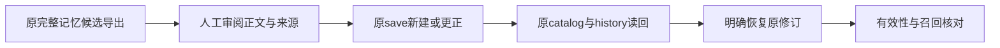

# F10d6a：原记忆保存、更正与恢复的页面旅程

日期：2026-11-14。前继[F10d5](2026-11-14-skill-improvement-console.md)最终本地验收／独立终核在途；本页仅下一片的盘点与验收设计，实施基线须在前继普通发布后固定，不借前继包或CI证明本片。

## 原语义与现有调用链

记忆候选沿原retrospectives.prepare_memory/check_memory/export_memory，明确导出正文／来源及选择身份后，仍由用户走memory.save保存；新建与更正、预期revision、有效期、历史、删除和恢复均归原memory owner。更正省略有效期保持原值，明确null移除；已过期历史恢复不续期，删除清空历史正文与来源，不能恢复。模型approve不取得写入权，也没有Skill的suite／adopt门禁。

原memory.js已有来源／有效期表单、检索／catalog读代际与历史。但save／restore／delete成功后仍无条件关闭全局dialog／refresh／notify；restore／delete／sync按钮未共用原form提交锁，history读取也未绑定发起时的modal关系。这些只属源码观察，先实际复现再选择最小修正，不能把相似代码当作已证明的bug。原UI/helper可复用，若与Skills形成真实跨文件重复，再评估上浮小型公共实现；不预建表单框架或持久前端账本。

## 可验收节点

- [ ] 固定前继普通发布的完整SHA；核所有caller／原HTTP／原CLI／持久owner与资源身份。用原独立安装件先复现可达的迟到／重复／旧modal问题，原件与head保持。
- [ ] 在原页面处理实证需要的view／form生命周期与明确提交，显示原ID／revision／正文／来源／期限；未知回复不自动重发新建。读回与mutation分别处理，不把成功通知当原记录。
- [ ] 原完整候选导出→页面明确保存→原catalog／CLI全文同一；更正及并发revision拒绝，明确恢复旧修订追加历史并保持期限，过期不进入新召回；跨项目隔离与删除不可恢复沿原合同。
- [ ] 比例适当的原suite、非editable最终包及资源身份；真实HTTP／页面迟到成功／错误／原modal替换／重复动作／丢回复后的原记录，三宽、原件保持与线程／进程／端口收尾。fixture只验合同，不宣称模型自动改进或ReMe远端实际可用。
- [ ] 自身原结构审查模板、新fresh-context独立两轴与finding关闭；更新交付／计划／原引用，再普通发布当前开发分支、核完整Ref与本片自己的必要CI／原reviewer终核，不合main。

流程候选接F10d6b：沿原完整export／workflow-definition import、选择新精确版本与原manifest冻结；旧manifest及运行材料保持，不能套记忆save或Skill评分。完整F10汇总／F9d／G1另片，不偷扩本片。
