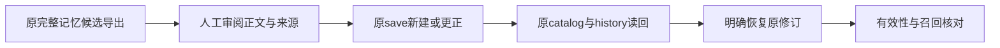

# F10d6a：原记忆保存、更正与恢复的页面旅程

日期：2026-11-14。前继[F10d5](2026-11-14-skill-improvement-console.md)已完成最终本地、新独立两轴、普通发布及自己的CI／原独立终核；本片实施基线固定为 `ed7fac5ba6bbe5ec73da0fed7175c4705116ea5b`。基线阶段先核原安装件memory.js逐字同一并复现可达问题，当时尚未修改产品；随后实施及最终r2结果见文末检查点，不借前继Skill测试或CI证明本片。

## 原语义与现有调用链

记忆候选沿原retrospectives.prepare_memory/check_memory/export_memory，明确导出正文／来源及选择身份后，仍由用户走memory.save保存；新建与更正、预期revision、有效期、历史、删除和恢复均归原memory owner。更正省略有效期保持原值，明确null移除；已过期历史恢复不续期，删除清空历史正文与来源，不能恢复。模型approve不取得写入权，也没有Skill的suite／adopt门禁。

原memory.js已有来源／有效期表单、检索／catalog读代际与历史。但save／restore／delete成功后仍无条件关闭全局dialog／refresh／notify；restore／delete／sync按钮未共用原form提交锁，history读取也未绑定发起时的modal关系。这些只属源码观察，先实际复现再选择最小修正，不能把相似代码当作已证明的bug。原UI/helper可复用，若与Skills形成真实跨文件重复，再评估上浮小型公共实现；不预建表单框架或持久前端账本。

## 可验收节点

- [x] 固定前继普通发布的完整SHA；核所有caller／原HTTP／原CLI／持久owner与资源身份。原安装件7项／5样本复现旧history覆盖Help、save关闭替代Help、重复restore和跨项目sync；另3项／2样本复现未编辑更正改写CRLF。详见交付，不作为修后通过。
- [x] 在原页面处理实证需要的view／form生命周期与明确提交，显示原ID／revision／正文／来源／期限；未知回复不自动重发新建。读回与mutation分别处理，不把成功通知当原记录。
- [x] 原完整候选导出→页面明确保存→原catalog／CLI全文同一；更正及并发revision拒绝，明确恢复旧修订追加历史并保持期限，过期不进入新召回；跨项目隔离与删除不可恢复沿原合同。
- [x] 比例适当的原suite、非editable最终包及资源身份；r2原三suite59项；最终页面77项／35样本及三宽；604产品／两RECORD／283；原件保持与六服务／三浏览器／端口收尾。旧驱动finally错误及只读补核分列，最终新夹具完整生命周期28项通过。fixture只验合同，不宣称模型自动改进或ReMe远端实际可用。
- [ ] 自身原结构审查模板、新fresh-context独立两轴与finding关闭；更新交付／计划／原引用，再普通发布当前开发分支、核完整Ref与本片自己的必要CI／原reviewer终核，不合main。

流程候选接F10d6b：沿原完整export／workflow-definition import、选择新精确版本与原manifest冻结；旧manifest及运行材料保持，不能套记忆save或Skill评分。完整F10汇总／F9d／G1另片，不偷扩本片。

## 当前检查点

最终r2本地行为／包／原件／收尾已通过；自身原模板61.176秒approve，首包发现的R1已实红／实绿，原fresh-context最终本地两轴approve／开放0／0，242固定原引用已核。公共使用说明和当前架构已更新。前片固定发布及自己的CI终核闭合；本片普通发布和自己的CI未执行，不借前片通过。详见交付及证据索引。
