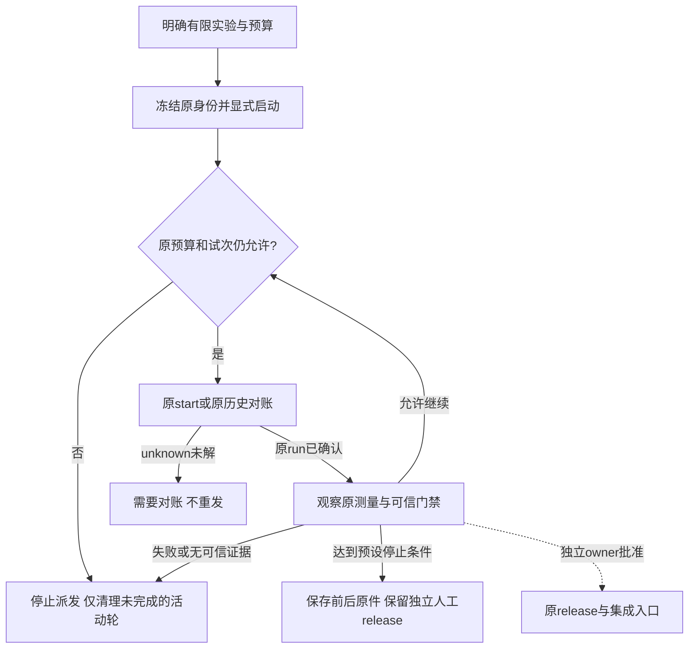

# Q4.2：有界训练循环与停止

日期：2026-11-15。承接[Q总计划](2026-11-15-domain-review-optimization-quality.md)、[Q4.1原多轮索引](2026-11-15-training-round-chains.md)及[测量合同](2026-11-15-training-measurement-contracts.md)。Q4.1人工原证据旅程及其精确发布已闭合。本页先固定实施顺序与需要解决的生命周期问题，**尚未实现自动循环**；实现基线在前一报告片发布后固定。Kernel专家继续保留在原v3提案路径，本片不把循环缩成算子搜索。

## 原owner与完成边界

|职责|继续使用的实现|本片约束|
|---|---|---|
|实验、manifest、runner、初始baseline|`training`／原`reference_training_*`及原本地训练owner|选择明确的既有实验和完整身份；不隐式改baseline、候选或训练语义|
|投递与恢复|`training.start`／`resume_start`及`reference_training_submission`|保留intent→attempt→receipt；unknown先按原历史对账，不能生成新ID或自动重发|
|运行事实|`training.status`／`reference_training_runtime`／原`ExperimentWorkflow`|固定原run及完整初始输入；离线记录不能冒充实时状态|
|测量证据|`training.evidence`／原比较和质量门禁|原manifest、归档、comparator和evidence SHA一致；模型意见不能替代可信门禁|
|批准与集成|原`training.approve`及release owner|测量／门禁通过不授予批准；循环不得伪造release来推进|
|停止与资源|原`training.cancel`／`resume_cancel`／`stop_status`及process owner|精确run取消、投递确认、控制面终态与实际executor停止分别记录|
|跨轮进度和时钟|既有Temporal执行服务上的应用扩展|历史恢复不重置总预算；SQLite／本地报告不新增另一套可变运行状态机|
|结果留存|原训练记录与`training_rounds`不可变链接|保留失败／无收益轮及前后原件；索引不变成调度器或baseline晋升器|

原`ExperimentWorkflow`通过`collect_and_gate`后进入`AWAITING_RELEASE`，等待明确owner凭据，再创建集成任务。因此“测量已完成”“可信门禁通过”“owner批准”“整个workflow结束”是四个不同事实。下一轮不能靠调用approve或等待一次隐式集成来推进。原成功实验的独立release窗口应保留，不把父循环结束自动等同于取消该窗口。

## 可验收子节点

|子节点|实施与可观察结果|验收|
|---|---|---|
|Q4.2a 准入、有限选择和预算冻结|先完成[Q4.2a1只读启动检查](2026-11-15-training-start-admission.md)，复用原preflight和投递状态；a2再冻结显式有限候选、项目注册／修订、完整manifest／spec／runner身份、同一初始baseline与workload、轮次顺序及停止约束。准备／离线读均不调模型、查询服务或运行训练|原manifest漂移、重复实验、异baseline／workload、已有投递／unknown、项目漂移、不可执行预算明确拒绝；总容量／存储范围须先固定，新安装完整读回，原件不改。a2字段和CLI随其实现固定，不提前承诺API|
|Q4.2b 原提交边界和全周期停止|在原owner处解决取消早于run ID、晚到start以及跨恢复deadline；每轮start attempt前消耗试次，跨轮／恢复共用原墙钟与cleanup reserve。未证明这一点前不开放自动派发|真实原提交接缝覆盖deadline前后、取消与start交错、丢回复／原历史对账；预算耗尽不再启动下一轮，超时不能仅靠取消一个worker future来宣称停止|
|Q4.2c Temporal有界控制|原Temporal服务承载新的应用工作流，顺序调用原训练用例；固定输入及原始deadline，显式启动、查询、取消／恢复。测量完成后依原可信证据判断继续或停止，运行中的unknown暂停／停止待对账|试次／墙钟耗尽、无可信证据、无显著收益、质量退化、owner取消与cleanup未确认均有明确结果；不重评统计、不自动批准、不生成新候选或推进baseline|
|Q4.2d 安装后的CPU全流程|公共合成CPU合同示例从准备→显式启动→至少两轮或有效提前停止→重启读回→原多轮证据索引。输出各轮原数据／报告及边界，给一键命令和恢复说明|实际Temporal／原CPU runner，与服务替身结果分列；覆盖成功后无收益、原门禁拒绝、跨轮预算、恢复／lost-ack及精确取消。真实训练／GPU／质量与收益仍按B3资产和oracle单独验收|

每片先更新所属交付与`docs/PLAN.md`，按风险选原接缝测试；产品变化用新非editable包核身份、原结构审查模板及新的fresh-context独立两轴评审，修实证finding后再普通推送当前开发分支，核完整Ref和自己的适用CI。不修改283文件的参考快照；如需扩展原行为，放在已有应用owner或已验证扩展接缝中。

## 预算与停止语义

首版只顺序执行操作者明确选择、已准备的有限候选；候选生成、瓶颈提案、baseline晋升和集成各归原入口。该选择不是任意重复运行同一实验，原experiment ID／run不因循环重启而换新。

预算至少区分总墙钟、最大试次、每次控制调用／轮询和单独cleanup reserve。墙钟包括排队、控制调用、测量和恢复期间，不得每轮重开；计算／派发截止后只允许在原清理预算内精确停止和对账。严格费用或GPU小时在没有可信平台计量前明确不支持，不能用模型调用次数或墙钟估算冒充硬限额。原`reference_budget`目前绑定单个六阶段task，不能把其scope／slots直接当训练循环授权。

原门禁可能把多种失败合成一个结论。实现前先核实际原报告能否区分无收益、质量退化和证据不足：能区分就保留原分类，不能区分就报告其缺口，不另建不可信评分器推断原因。收益阈值与质量合同在看结果前固定；近似改动仍沿原`track`／`allowed_changes`合同，不能每轮悄悄放宽。

## 实现前需要用源码解决的问题

1. 原start还没有run ID时，父级取消／deadline怎样在真正提交边界生效？异步activity取消后，旧线程／进程晚到仍可能提交，必须用原owner的可核fence或等效接缝解决。
2. 当前运行在`AWAITING_RELEASE`，怎样把status中的evidence SHA与原accepted archive绑定，同时保留原人工release？不得仅凭离线归档或Temporal的COMPLETED推断测量成功。
3. 项目注册发生变动后，怎样用原冻结上下文查询／停止既有运行，并显式禁止新派发？恢复与新授权不能共用一个“取当前配置”的快捷入口。
4. 原门禁的无收益／质量失败／证据缺失分类与统计不确定性，具体来自哪份原报告？原格式不足时先列最小原owner扩展，不能让控制工作流另写评分逻辑。

## 独立计划评审落实的验收前提

[fresh-context计划评审](../delivery/2026-11-15-bounded-training-cycles-plan-review.md)对初版两轴approve、阻塞finding 0；下列源码事实并入相应节点。该计划意见不认证后续实现。

- **容量与运行位置。** a2先固定有限选择的总字节、实际部署的Temporal payload／history上限，以及原索引32轮／10 MB限制下的完整结果保存策略。原单manifest为1 MiB，聚合start intent可16 MiB，“有限轮次”不等于传输或索引一定能容纳。不可变引用每次消费核完整SHA，裸路径不算冻结；超限明确拒绝或在原件完整保留后按已定义容量停止，不到多轮完成后再声称整份索引已保存。首版限定原运行环境和存储可达范围，异worker／host缺原文件或本地锁语义时可见拒绝，不推定Temporal自动共享文件。
- **原准入与竞态。** a1本地检查不查询服务，也不证明服务上不存在旧run；已有prepared／unknown／submitted／rejected意图不重新授予启动许可。最终start仍执行原两次preflight。b验证同一registry lock下lookup／full-binding fence与创建的全部顺序，并另外处理最后一次preflight后的晚到RPC；无job不表示没有晚到workflow。成功测量的先前轮不统一fence，以保留原人工release。
- **实际executor生命周期。** 原Temporal start和adapter创建请求均不启动CPU训练进程；c／d明确由哪个应用／进程owner调用原`run-local`及`training_executor.process`，并注册实际应用workflow／task queue。b把Git clone／两臂worktree、runner、归档／跟踪和恢复观察纳入资源／预算验收；只停worker future或看到fence，不代表这些后代已停。复用原执行入口，不另写训练器。
- **预算与原支持范围。** 原Experiment的poll／run／release／cancel窗口有真实范围，控制activity本身也有重试／超时。a／b先证明预算组合可执行，在剩余墙钟中为控制与cleanup留界限；不修改已冻结Experiment来迁就短样例，无法确认停止时报告未确认。
- **注册漂移。** 原status／cancel默认取得当前project，原提交身份和注册检查又绑定execution及registration SHA。b须用真实配置变化验证原运行观察／停止不分叉，并明确拒绝新派发；删掉检查或仅传旧revision均不构成恢复支持。
- **统计与原分类。** 原比较器区分PASS／FAIL／INCONCLUSIVE，但固定样本筛选不提供多次搜索／optional-stopping校正。c保留原比较和不确定性，不解析自由文本重评门禁，不把多轮挑选结果说成累计显著收益；不能细分的门禁失败如实保留。

这些问题是Q4.2a／b的验收义务，当前不宣称已经解决；后续实现和研究结论持续记录到[本片交付](../delivery/2026-11-15-bounded-training-cycles.md)。真实B3、完整Forge和远端隔离继续保持原开放条件。
