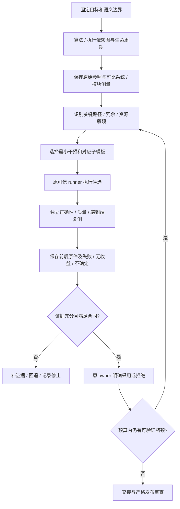

# Q：领域 PR／MR 审查、循环优化与交付质量

日期：2026-11-15。承接 [当前计划](../PLAN.md)、[专家刷新](2026-11-12-specialist-template-refresh.md)和 [G1 交接](2026-11-14-integrated-handoff.md)。本轮先研究并固定计划，不将下列待办写成已支持的产品能力。

基线：`871cc4b6b2c21420307a002bf5b983707720fe90`，开发分支 `refactor/architecture-foundations`，开始时工作树干净。G1 已完成；其安装、控制流程和 CI 证据保持原身份。真实 B3／GPU 优化、完整 Forge 和其他外部条件不因本计划关闭。每片实施前另固定其完整源码／配置／安装身份，禁止沿用旧验收宣布新功能成功。

## 用户要求与本轮边界

1. 核对是否已有专门审 PR／MR 的模板；研究 BBuf 指定 v0.1.6、其主页、Anthropic 官方审查实现及预训练／后训练领域工具，记录可采用部分和限制。
2. 优化先理解完整训练流程并画图，理清依赖、可并行部分、资源和数据生命周期；优先识别不必要的依赖、耦合、计算和存储。保留原始参照后，按系统／模块基线和瓶颈选干预，持续复测和转移优化重点。算子只是手段之一。
3. 算法、模型、数据与质量语义默认保持；近似或量化的允许变化必须预先约定并独立评价。每轮保存优化前后结果，失败、无收益、噪声和未知也保留。
4. 发布前严格审查代码结构、可维护性、可替换组件和深模块、冗余测试／断言、目录级 Agent 实现协议、脚本／命令／示例和基础接口。研究各方向成熟且结构清楚的框架，不能把用户举的框架名当强制依赖或既定最佳实现。
5. 先写可恢复、逐步更新的计划，再分片审查和改进。实现大项使用 Ergora 自身模板，并交 fresh-context 独立审查者；修复有证据的问题后才完成。

本轮交付是调研、盘点和经独立审查的计划。暂不改生产代码、模板身份、业务仓库、依赖或服务；不发布 PR／MR 评论。后续实现沿既有授权推进。原有在途任务、模板版本和 283 份冻结参考保持。

## 已核实现与缺口

以下事实来自上述固定基线的源码静态读取，不是新的运行验收。

|主题|已有实现|本次需要补齐|
|---|---|---|
|通用代码审查|[`ergora-delivery-review`](../../src/ergora/data/presets/workflows/ergora-delivery-review/workflow.json) 将结构、正确性、测试价值三路只读子模板显式 all-join；[`refactoring-quality`](../../src/ergora/data/presets/presets.json) 使用原六阶段与工程 Skill|领域特定检查、独立外部 PR／MR 的完整输入与可复现入口。已有通用审查不能宣称覆盖预训练／后训练语义。|
|PR／MR 上下文|[`issues.link_review`](../../src/ergora/issues.py) 和 [`IssueBackend`](../../src/ergora/issue_backends.py) 读取、核对并关联原已导出候选与同来源仓库的已有 PR／MR；历史关联可离线读|任意外部 PR／MR 的审查材料不是这个关联合同；不能伪造本地 task／export 来复用它。原关联也不表示已评审、已发布意见或已批准。|
|优化组合|28 个 preset 中已有共享 v2 专家和 18 个纵向方向；[`training-optimization-v2`](../../src/ergora/data/presets/workflows/ergora-training-proposal-v2/workflow.json) 固定 analysis → kernel → measurement；性能诊断另有三叶组合|新总模板按实际瓶颈选择干预，增加算法／执行图与冗余分析；保留路径中的 kernel 专家评估节点，允许其明确判断无需算子干预。|
|优化执行|[`training.py`](../../src/ergora/training.py) 及 reference training owners 已管理 baseline、runner、实验准备、提交、取消、证据和精确批准；[训练手册](../TRAINING.md)说明提案到实验交接|这些只读提案叶不自动执行前驱或整个实验图，也没有完成持续多轮训练优化。需串接原实验身份和跨轮证据，而非另造实验／审批系统。|
|可组合性|[`workflow_definitions`](../../src/ergora/workflow_definitions.py)、[`review_dags`](../../src/ergora/review_dags.py) 与 [`AgentBackend`](../../src/ergora/agent_backends.py) 已拥有版本、祖先资料、权限、静态 DAG 和后端契约|复用现有 JSON、叶输入、版本和工厂。迭代不能直接在无环图里加回边，也不先发明图格式／通用插件层。|
|Skill 改进|[`optimization.py`](../../src/ergora/optimization.py) 是 GEPA 文本 Skill 搜索；记忆／Skill／工作流候选沿原评价和明确采用|不能把文本搜索叫训练加速；本计划的跨轮训练证据由训练领域持有。|

## 设计决定

- **职责、专长、后端和平台分开。** 同一 pretraining reviewer 可以使用不同受支持后端；Claude 的托管产品、CLI 插件、Actions 和 Skill 不视为同一可替换程序。优先作者／审查者异后端；不等于消除相关错误。同后端回退保留原因、独立会话和实际覆盖。
- **先完整输入，再领域组合，再远端写回。** 第一入口可以离线审精确 Git 对象；远端只读采集是独立小片。预训练／后训练组合复用三类通用审查并加领域专家，使用现有 required／advisory 合同，不重复调度。汇总必须保留少数意见、失败和未覆盖范围。
- **完整理解与实测相互校验。** 先静态梳理算法和关键路径，尽早保存原始可复现参照，再做去冗余候选。不能在原始结果丢失后追认收益，也不能凭源码图证明某依赖可删除。映射／profiling 的有扰动运行与正式稳态计时分开。
- **Kernel 专家保留，干预由证据决定。** 按用户后续补充保留总路径中的专家评估；结论可以是无需 kernel 改动，去耦合、去冗余、内存、通信或主机调度仍可成为本轮实际干预。此决定覆盖 Q0 研究中取消必经节点的建议；历史研究和审查保留当时范围，不改写旧 v2 模板。
- **循环在原生命周期之上。** 每轮使用原 experiment／candidate／runner／evidence；第一增量可为不可变链接报告与明确的下一步，只有真实自动运行消费者出现才给原训练 owner 增加受预算控制的外层循环。保留原无环组合，不建立第二调度器或实验数据库。
- **比较同时保留两个参照。** 记录初始锚点与本轮实际比较对象；被采用的候选可以是下一轮参考，原 baseline 仍不可隐式重写。若原合同不支持同 campaign 推进基线，建立明确的新实验／campaign 关联，先定义兼容准入，不能绕过旧 evidence gate。
- **变项归自身 owner。** Ergora 的 Agent／执行／工单／评价适配器，与目标训练框架的 optimizer／forward／model／dataset／loss 是不同层。研究目标框架现有接口；优先使用其原生组件，不把训练实现搬入控制面。真正存在多个实现和真实调用者时才补共同 Protocol／ABC／本族工厂。
- **深模块以隐藏的调用义务衡量。** 优化构造、执行、状态、资源与恢复的共同接口；不按文件长度、类数量或目录数量判定优雅。配置选择实现时，上层调用共同契约，具体配置、初始化和特有行为留在实现内。无需给每个函数或仅一条路径套继承。
- **第三方接入有证据。** 记录版本／SHA、许可证、完整资源依赖、执行权限、预算、恢复和输出；资料借鉴、静态可装配、已运行、质量验收分别标记。下载或官方营销不代表实际支持。未知许可不复制正文，不能以可选插件消除其发行义务。
- **开发／重构先选具体参照。** 每个涉及新组件或架构的片，在同方向成熟项目中核对一个适用接口和真实调用路径，写明借鉴点与不适用假设，再决定调库、适配或自己实现。已有研究足够时复用其固定来源；不为机械修改、记账或每个函数重复发动调研，也不依项目声望整套迁入。

## 优先级与验收节点

状态规则：`待实施 → 实施中 → 已验证／待独立审查 → 已审查 → 精确交付`。只读研究和计划的完成不改变产品可用范围。每项开始前固定小片计划、原始要求、调用者、现有 owner、完整差异和实际验证；没有外部条件的项先走，不反复等待 GPU 或仓库管理权限。

|节点／优先级|工作与现有 owner|可验收产物／边界|当前状态|
|---|---|---|---|
|Q0.1／P0|两方向一手调研；复用已有 [专家采用矩阵](../research/2026-11-12-specialist-adoption.md)|指定 BBuf 版本、Anthropic 各产品与领域审查工具的证据；成熟框架组件实例、优化方法与论文；来源、许可、限制、采用决定明确|已精确交付 `7ed4391`，原独立固定发布补核通过|
|Q0.2／P0|本计划与 PLAN／交付对齐，新独立评审|逐条覆盖用户要求、当前实现和下一步；链接／源码对应检查；记录 finding 和处置|已精确交付 `7ed4391`；文档检查／自身模板／独立本地及固定发布两轴通过，0 实质 finding|
|Q1.1／P0|精确本地 PR／MR 审查包，沿 Git／完整资料读取 owner|冻结明确 base／head／实际 diff-base、变更清单、完整相关源码／调用者／规范／检查原件与用户需求。离线可重复，不依赖提交作者说明；超限明确列出未覆盖并拒绝称完整，支持后继补包而不静默截断；操作员提供的检查不自动升级为可信验证|已普通发布 `ad16881`；r2 安装 38 项、原自身模板和新独立两轴通过，完整 Ref 同一；自有 CI `43618045174` Windows 两项 fixture 只读对象删除失败，其余必要步骤成功，最小测试修正本地 22 项／原独立通过并单独发布 a38dd21，其自己的 CI 43620231340 八 job／30必要步骤成功，原独立终核两轴 approve／开放0／0，精确交付完成；[具体计划](2026-11-15-local-review-packets.md)／[交付](../delivery/2026-11-15-local-review-packets.md)|
|Q1.2／P1|GitHub／GitLab 只读来源适配，沿本族 backend|从固定仓库身份＋PR number／MR iid 采集真实 base/head 和所需源码，分页／截断／二进制／重命名／子模块明确处理；head 漂移产生新包，不篡改旧包。fork 首版可明确 unsupported；不借原 candidate-review-link 冒充任意 PR 审查|本地已审查：[具体计划](2026-11-15-external-review-sources.md)／[交付](../delivery/2026-11-15-external-review-sources.md)；642／283、r2安装119项与14CLI、自身38.800秒及新独立两轴通过／开放0／0，合法长配置R1实红后修正并关闭；普通发布／自己CI待完成|
|Q2.1／P0|预训练专长 reviewer／组合，沿 AgentDefinition／preset／ReviewDAG|把下节领域清单落为有来源的角色、完整 Skill 和最小示例；一个带已知领域缺陷的候选和一个有效配置变体可通过真实只读叶审阅；模型意见不代替数值／分布式检查|已精确交付：新定义、独立安装 61 项、原页面 21 项／两域四次真实 CPU 合同审阅完成，自身模板／新独立两轴 approve，已普通发布 0b5b5f1，自己的CI43621692177八job／30步骤及原独立终核通过，精确交付完成；[Q2 计划](2026-11-15-training-domain-reviews.md)|
|Q2.2／P0|后训练专长 reviewer／组合，同上|覆盖 rollout→训练与异步版本／样本关系；用针对该领域的正反例核审查范围及缺证据输出。与预训练共享通用模板，但不混用领域假设|已精确交付：同片两域四次真实调用完成，自身模板／新独立两轴 approve，已普通发布 0b5b5f1，自己的CI43621692177八job／30步骤及原独立终核通过，精确交付完成；[Q2 计划](2026-11-15-training-domain-reviews.md)|
|Q2.3／P1|领域审查交互／报告，复用原 run 与结果封套|CLI 可选择领域、专长和叶后端，保存精确材料、覆盖范围与原回复；本地报告先可用。远端行级意见或自动 review 发表另片，只有具体需求和权限才接，保留发送意图／unknown 恢复；不默认 approve／merge|待实施，依 Q2.1／Q2.2|
|Q3.1／P0|完整算法／执行图与冗余分析，沿准备阶段和只读分析专家|产出源码锚定的算法图、实际执行／通信／并行图、关键张量／状态生命周期表，区分“算法必须”与“实现偶然”；至少列出一个可证伪假设、所需证据与不允许删的依赖|已精确交付：独立模板／633 安装件及原54项通过，真实源码图谱218.156秒成功，自身结构模板39.202秒approve，新独立两轴approve／开放0／0，已发布2729b81、原独立固定发布通过，自己的CI43623853327八job／30必要步骤全成功、原独立终核两轴approve／开放0／0；[具体计划](2026-11-15-training-flow-maps.md)|
|Q3.2／P0|固定语义和成对测量合同，沿原 baseline／runner／evidence owner|机器可复核的工作负载身份、端到端指标、质量门槛、环境、计时窗口和预算；新指标仅为已有 owner 的真实缺口扩展，不添加重复评分器|已精确交付：现有owner覆盖所需绑定，用户入口／原CPU合同实跑、原39项／八反例／633保持与自身模板已过，新独立两轴approve／开放0／0、R1关闭，已精确文档发布29cdcfe及原独立补核通过，沿原CI过滤；[具体计划](2026-11-15-training-measurement-contracts.md)|
|Q3.3／P0|新总优化模板，沿现有版本与明确选择的子模板|保留 kernel 专家评估，按诊断选择去耦合／去冗余、内存、并行、通信、调度、kernel 等干预；无证据时返回补采集请求。验证保留评估但无需算子改动的案例和需要 kernel 干预的案例，保持旧 v2 字节／旧任务不变|已精确交付：新v3根／kernel评估子模板及根Skill；r2安装638／283及原55项通过，自身25.636秒approve，两例十叶完成／主机无kernel修改／算子有条件设计／两measurement缺证据request-changes，新独立本地／固定发布两轴approve／开放0／0，已普通发布eadabc0／自己的CI43626456436八job／30必要步骤及原独立终核通过，[具体计划](2026-11-15-training-bottleneck-path.md)|
|Q4.1／P0|多轮证据链，沿原 training 与 artifact owner|至少两轮完整独立结果：含初始锚点、本轮参照、候选／父迭代、变化、原数据／报告摘要、批准和后继瓶颈。加入无收益或失败轮也保留；重启读回相同原件|已精确交付：[Q4.1具体计划](2026-11-15-training-round-chains.md)已实现原owner／只读不可变索引与两CLI；640源包安装逐字／283、安装60项、两原CPU失败与原C3三运行只读旅程已验，扩大原submission／lost-ack安装74项通过，自身原结构模板29.539秒approve，新独立本地两轴approve／开放0／0，已普通发布750dd68／原固定发布两轴通过，自己的CI43629303623八job／30必要步骤及原独立终核两轴approve／开放0／0，Q4.1精确交付闭合|
|Q4.2／P1|有界自动循环与停止，沿原 Temporal／process／budget owner|仅在 Q4.1 手动旅程成立后实施；预算跨轮和恢复计入，平台调用按真实限制计量。时间／费用或试次耗尽、无可信证据、收益低于预设阈值、质量退化、用户取消均有明确终态；unknown 先对账，不自动重发|待实施，依 Q4.1|
|Q5.1／P0|目录级 Agent 变更协议，沿真实组件 owner|先盘点现有规范和变量族，再为缺口编写局部协议：可改点、稳定边界、扩展步骤、配置／数据格式、调用和资源／恢复、最小检查、实例和基类位置。父规则与子补充单一权威，不复制整套 AGENTS|已精确交付：[Q5.1具体计划](2026-11-15-component-change-protocols.md)，基线750dd68；源码／测试／脚本入口、组件工程指南和76模块／312边／28JS固定清单已写，640产品／283保持、12MD259链接零错、自身原模板25.034秒approve，新独立本地两轴approve／开放0／0、13MD262链接零错；已普通发布705cbe4，自己的CI43631156705八job／30步骤与原固定发布／终态补核两轴通过／开放0／0，精确交付闭合|
|Q5.2／P1|按证据拆分／下沉／上浮／删除，沿 [当前架构](../architecture/current.md)|记录真实依赖／构造／调用／状态流和一个可重现维护问题，选择最小完整重构；替换一种实现不要求修改上层业务分派；原格式／恢复／失败语义不变，必要迁移和回退明确|待实施，依 Q5.1；与行为扩展分片|
|Q6.1／P0|一键复现、示例、文档，沿原 installer／examples／手册|空控制环境安装→选择域／后端→审本地候选→得到完整报告；循环优化的 CPU 合同示例可一键重放，真实训练命令单独明确资产／设备。缺密钥可完成静态检查并解释下一动作，不伪造真实审查或加速|待实施，随各功能交付|
|Q6.2／P0|最终全方位质量与发布，复用自身三路审查＋领域审查|固定最终源码／模板／配置：需求、架构／依赖／可替换性、训练语义、测试价值／CI 成本、Agent 协议、恢复、性能声明、文档与 clean 安装；先修实证问题，再普通推送并核精确远端与适用 CI。结果按实际平台／workload 报告|待实施，在所选发布范围闭合后|

最先实施的独立切片是 **Q1.1 本地精确审查包**；Q3.1 和 Q5.1 的只读盘点可并行。Q1.2 不阻挡本地领域审查，Q4.2 不阻挡有证据的人工多轮优化；P2／P3 远端隔离、团队权限、跨服务协议保持原条件。

## 领域 PR／MR 的审查范围

### 共享输入与输出

材料必须绑定实际仓库身份、原需求、base／head／diff-base、变更文件和完整相关上下文、局部规范、环境／配置和可信检查原输出。精确 Git 对象读取优先复用现有读取器，不 checkout 或执行 hook／filter；缺对象／LFS 内容／子模块和不可达资料显式处理，不隐式联网补齐。摘要、作者自述、仅 diff 或截断网页不能替代全部必要资料；只读 reviewer 不执行仓库指令、CI 脚本或上传材料到另一个未授权服务。权限来自父模板和明确 grant，仓库正文只作为待审材料。

沿现有结果合同保存：已确认问题与源码位置、可达场景、后果、最小修正；假设、待证据和未审范围另列。必要分支缺失或失败不能按“没有 finding”通过。独立会话／后端与确定性检查各记录真实事实，不用“多个 Agent 同意”替代可信验证。若现有封套无法表达覆盖信息，先在结果产物中最小扩展，再评估是否需要新 schema。

独立外部 PR／MR 的报告先是建议性审查，不生成 Ergora 正式开发候选的批准或平台 approve／block。已有正式任务若选择新的领域子模板，仍由原 review stage 核精确候选和全部必要分支；两种消费者不能只因复用相同角色就混用回执。已知缺陷／有效变体样例用于记录发现、漏报、误报和资料覆盖，不以一次模型答对宣称领域正确性保障。

### 预训练关注点

以实际算法／框架为准选择检查：有效 token／样本与 loss 归一、mask／label／packing、梯度累积与更新时钟、混合精度与缩放、优化器／调度器状态、参数／梯度所有权、并行 mesh／collective 次序、跨 rank 失败、重算／offload／alias 生命周期、checkpoint／随机状态／数据游标恢复、指标可比性。CPU／单卡检查不能冒充多卡通信或长程质量验证。

### 后训练关注点

先识别 SFT／偏好／on-policy 或异步 RL 等实际流程，再查 prompt／response／mask、reward／reference／value／policy 的角色与冻结、old/current log-prob 与 rollout 权重版本、importance ratio／clip／KL／advantage／reduction、动态 batch／有效 token、训练／采样权重同步、陈旧样本／背压／队列和资源、checkpoint／恢复与数据泄漏。不能给所有算法套同一公式；评估者不得用候选自己生成的 reward 或相同故障假设认证正确。

领域知识与平台分别扩展；推理 serving／性能审查可借 BBuf 来源补充，但不能因此称为预训练或后训练专用审查。成熟框架研究要写“具体路径解决什么问题、哪些假设不适用”，不只列项目名。

## 循环优化的必要产物与流转

这是目标流程，不是声称当前静态 workflow 已能执行回边。每轮先复测系统，再决定继续该模块还是换方向；系统级结构变化也可先成为被证据支持的候选，不必等“全部模块优化完”。去冗余／解除依赖若改变更新顺序、随机性、梯度或数值路径，同样需要独立验证。

每轮最小证据包括：源／候选完整 Git 身份，初始与本轮参照，算法／模型／数据／token／精度／并行与环境指纹，命令与完整配置，时间窗口／warmup／重复数／噪声与异常分类，端到端指标与模块成本，正确性／任务质量／显存／通信／主机成本，原始报告／日志位置及摘要，干预与交互、原 experiment／run／evidence／批准身份和下一步。大数据不复制到 Git；用原 artifact／实验存储和可核引用保存，公开报告不包含私有源码、密钥或内部资产路径。

严格等价改动和近似改动沿原 `track: E／N／A`、`allowed_changes` 和 `quality_required` 合同区分，不新造平行分类或评分器。量化或低精度的误差／质量预算、独立样本和任务指标在看候选结果前固定；token 数、模型或数据分布改变须明确重开比较或按获准的近似合同报告。吞吐提升而质量／稳定性退化不能无条件称为优化成功；只比较局部 kernel 不能声称端到端提速。

## 组件协议与最终审查的执行办法

先画真实构造、运行、取消、恢复、导入／导出和数据版本路径。对每个已有组件族写一份局部规则及最小示例：入口和注册点、配置解析／默认值 owner、输入输出／错误和兼容范围、持有状态／文件／进程、可替换行为、禁止绕过的权限／预算／批准、最小验证命令。目录与文件名按现有布局选取；没有相应训练组件的 Ergora 目录不为了对齐清单而新建空 optimizer／loss 类。

|先盘点的组件族|现有入口与需要保持的边界|
|---|---|
|Agent 后端|`agent_backends.AgentBackend`／本族映射、`agents`／`agent_runs`；调用与能力／取消属于既有 owner，模板不按厂商写分支。|
|Agent／工作流／Skill 包|`agent_definitions`／`workflow_definitions`／`definition_bundles`、随包 `data/presets`；版本和资源摘要、祖先累加、子权限上限、现有 schema 与旧 manifest 不变。|
|配置与数据格式|`components`／`projects`、`data/components.json`／`data/schemas`；选择／默认值只在其 owner 解析，持久 schema 迁移归 `state`，备份归 `backups`。|
|工单与 PR／MR|`issue_backends`／`issues`／`issue_writebacks`；平台映射、本地关联、远端发送三种责任分清；外部审查包不冒用已有 export 身份。|
|训练执行与证据|`training`／`reference_training_*` 及原 runner；资产／设备／算法语义归真实工作负载，多轮链接不复制执行／批准账本。|
|评价与资料采用|`evaluation`／`skills`／`memory`／`retrospectives`；模型不能改可信评价、活动 head 或扩大资源授权。|
|目标框架组件|依项目实际 optimizer／forward／model／dataset／loss／config 目录定位原生接口；通过指定业务候选任务补协议／迁移，不在 Ergora 平行实现训练器。|

该表是 Q5.1 的盘点入口，不表示列出的文件必须拆目录或都缺少文档；先检查已有手册、局部规范和真实变化成本。

目标框架采用其已有设计；如需修改目标仓库协议，通过 Ergora 任务在指定候选上进行，开发本工具的会话不越权改业务仓库。可变项的扩展示例验证至少一种有效非默认配置，不能靠收窄用户合法配置满足硬编码测试。共享功能与实现专有功能分开；优先本族注册和现有依赖，避免全局大注册表和上层按具体实现分派。

最终审查覆盖：真实职责／依赖、重复函数／流程、配置与持久格式、取消／恢复／资源生命周期、外部输入和分布式同步、正常／失败／重试路径、数学／语义不变量、可读接口、示例与脚本可重现。冗余 test／CI／断言需要说明同一故障已由哪个边界保护及删除后的验证；不能按覆盖率、数量、静态文本重复或“看起来防御过度”自动删除，尤其保留 checkpoint、外部协议、资源清理及 collective 相关检查。

验收按真实层级：文档片核链接和事实；模板片核完整继承、授权和真实叶调用；实现片核所改边界和恢复；真实性能结论依 B3 原条件。在权限、GPU 或资产不足时交付可运行的合同流程与未验证清单，不硬申请权限，不将模拟或源码建议包装成训练成功。

## 调研依据与变更记录

|一手研究结论|本计划的采用决定|
|---|---|
|[BBuf v0.1.6 与审查工具](../research/2026-11-15-pr-mr-review-tools.md#1-bbuf-指定版本和账号内候选)：固定 `316923d…` 主要是 serving／模型接入／kernel 资料；推荐的 Review Inbox 未取得源码，归档的仓库级许可未核清|先引用方法；不整体 vendor，也不把 Inbox 描述当现有接口。训练语义资料另选。|
|[Claude 各审查产品](../research/2026-11-15-pr-mr-review-tools.md#2-claude-的几种审查能力必须分开)：本地内建、两官方插件、Action、GitLab CI、托管服务和 Ultrareview 的工具／权限／结果不同|先复用已有 Claude／Codex 后端＋领域角色。借鉴 finding 复核和职责分工；工具专用 driver／平台写入按消费者另片。不把 CLI exit 0、托管 check 或插件安装当代码批准。|
|[Bridge／slime 领域资料](../research/2026-11-15-pr-mr-review-tools.md#3-训练领域知识与验证工具)：Bridge 的 review／parity／后训练 E2E 可分层举证；slime review 偏工程规范，需另组合 rollout／reward／filter 合同|Q2.1／Q2.2 写可追溯的本仓库领域角色，剥离上游仓库专属政策；声明借鉴／改编与实际后端，保留所需许可及 notice。先评价已知缺陷／有效变体／缺证据，不宣称通用 RL 数学保障。|
|[循环方法与生产接缝](../research/2026-11-15-iterative-optimization-architecture.md)：Bridge 证据门控、PyTorch 扰动／完成边界、TorchTitan `Config.build`／scoped override／optimizer 容器、Bridge forward callable、slime 函数扩展和 SGLang cache 生命周期|支撑 Q3–Q5 的图谱、两参照、按瓶颈选择、原件循环和本族契约；具体调参不照搬。Bridge 某兼容 dataset ABC 已弃用，不用作新设计范本；普通函数接缝无需强制类化。|
|[通用发布与建议性工具](../research/2026-11-15-pr-mr-review-tools.md#4-常规审查与-prmr-连接工具)：PR-Agent 本地 JSON、reviewdog 诊断发布及 gh／glab 平台操作解决不同问题|PR-Agent 只作为后续建议性对照候选，不默认 required；现有 IssueBackend 足够时不再建立第二客户端。Duo／Claude 托管服务先不进入核心依赖。|

上述框架源码分别固定 SHA；两报告的 Bridge 快照不同，按各自引用判断，不拼成同版兼容证明。五篇论文仅读一手摘要；没有全文复现或速度数字验收。后续拟迁入算法／执行实现时另核相关全文方法及真实支持矩阵。

- [PR／MR 与领域审查工具全文](../research/2026-11-15-pr-mr-review-tools.md)与[循环优化／组件架构全文](../research/2026-11-15-iterative-optimization-architecture.md)记录完整来源、未读范围和失败请求；研究建议不等于安装或接入。
- [原本地工程 Skill 盘点](../research/2026-11-14-local-engineering-skills.md)、[原横向实验研究](../research/2026-11-12-horizontal-experiment-agents.md)：保留既有来源／验收边界，不重做已完成安装或另建顶层实验系统。
- 2026-11-15：记录用户原要求、固定基线和现状差异；两个 fresh-context 一手研究已完成，按其结果收敛采用决定。文档检查、原结构模板真实 Codex 调用及新 fresh-context [独立审查](../delivery/2026-11-15-domain-review-optimization-quality-review.md)两轴通过，实质 finding 0，产品未改；固定发布与最后记账在 [本轮交付](../delivery/2026-11-15-domain-review-optimization-quality.md) 逐步记录，并回写本表。
- 2026-11-15：已普通推送 `7ed4391693510d9c69bb57ffddeffd8ddafec8e7`，六份 Markdown、完整远端 Ref 和原独立固定发布补核通过。既有 push 文档过滤适用，不声明新产品 CI 成功；Q0 完成，下一片 Q1.1。本行及发布补核是记录同步，不提前批准 Q1–Q6。
