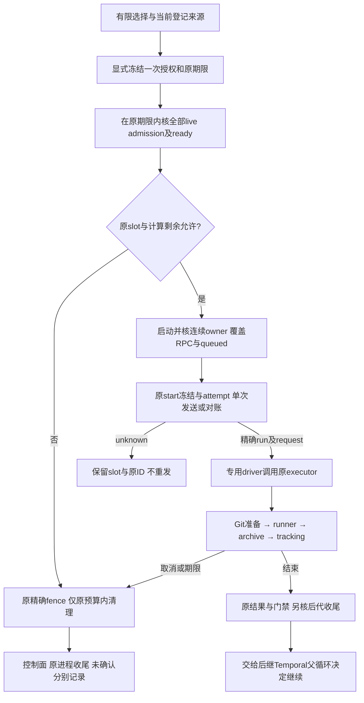

# Q4.2b3：不可续期训练预算与实际执行停止

日期：2026-11-15，计划r2。承接[有界循环](2026-11-15-bounded-training-cycles.md)、[原提交阻断](2026-11-15-training-start-fence.md)与[原登记恢复](2026-11-15-training-frozen-recovery.md)。当前是实施前计划，不表示预算或自动循环已可运行。前置b2正在最终独立验收，源码候选固定在其r4十文件manifest；实施前须用b2实际发布的完整Git身份替换此临时基线，并等待其自己的CI门禁闭合后再推后继产品。Kernel专家保留在v3提案路径，预算不会把专家意见提升为执行或批准。

## 要解决的问题与已核调用链

操作者选择有限已准备候选后，重启、换轮、RPC丢回复不能重新计时或恢复试次；计算截止后不再创建新工作，只在原cleanup reserve内阻断和清理所选活动轮。观察到fence、Temporal控制终态或native result均不足以证明实际进程及后代停止。

已读原实现，以下是源码事实，尚非本片运行验收：

|原owner|已有能力／缺口|
|---|---|
|[training_cycles](../../src/ergora/training_cycles.py)|保存完整有限选择及预算策略，读回明确`origin_authenticated=false / execution_authorized=false / budget_started=false`。外部cycle JSON及SHA不能作为新执行授权；最多32候选／10MB。|
|[reference_budget](../../src/ergora/reference_budget.py)|六阶段task有不可变UTC／boot ID／CLOCK_BOOTTIME期限，跨boot／host或时钟断续拒绝；scope和model slots专属于task，不可假扮训练授权。|
|[原提交](../../src/ergora/reference_training_submission.py)／[原取消](../../src/ergora/reference_training_cancellation.py)|已有attempt-before-send、完整Experiment／memo／run对账、精确本地fence和旧登记恢复；当前没有循环总预算。不得另写start／signal客户端。|
|[原executor](../../src/ergora/data/reference/platform/local/agent_platform/training_executor.py)|`process`在原executor lock内覆盖Git bare clone／两臂worktree、runner、证据archive和MLflow tracking。Git各有单次timeout、archive600秒，均不等于整个循环的共同期限；tracking没有这里显式总deadline。|
|[原Sandbox](../../src/ergora/data/reference/platform/local/agent_platform/sandbox.py)／[process_job](../../src/ergora/data/reference/platform/local/agent_platform/process_job.py)|Sandbox启动monitor用新session；monitor再启动timeout／runner用新session，保存boot／PID／start ticks和terminal。只杀外层executor进程组会漏这些后代。原进程记录有独立锁／超时，不可把其重复启动当重跑训练许可。|
|[processes](../../src/ergora/processes.py)／[stage_driver](../../src/ergora/stage_driver.py)|已有专用driver内Linux subreaper与后代reap；`supervised=True`本身不按timeout截止，依赖stop predicate／外层monitor。不能在共享CLI／HTTP进程启subreaper，不能把传入timeout当已执行的deadline。|
|[原ExperimentWorkflow](../../src/ergora/data/reference/platform/upstream/temporal/perf_temporal/workflow.py)|控制activity独立重试、原排队＋运行窗口及取消等待；adapter创建request不启动executor。新循环需要明确谁调用实际executor，不能靠多开worker假定训练已执行。|

保留283份参考零修改。原生训练、archive、比较器、质量门禁、跟踪、批准和集成票据继续由原owner产生。本片不建立第二训练器、第二实验状态表或新的评分器。

## 分片及验收顺序

|子片|明确交付|本地验收与通过标准|状态|
|---|---|---|---|
|B3.0 合同复核|本计划、实际调用链和失败边界；新的fresh-context两轴计划审查|核期限、来源、试次、晚到提交、真实后代及恢复；不以未来c的实现补本片证明|r1历史request-changes／R1–R2保持；同reviewer已核固定r2两轴approve／开放0／0，仅认证计划|
|B3.1 原生训练授权／不可续期时钟|当前control home内显式授权一个精确有限选择；原登记发布来源和当前revision确认；先保存原授权／时钟，再做全部live admissions，pending与完整ready分开。本地只读预算观察／恢复，不自动派发|首个及后续admission慢至跨截止、部分检查中断／lost-ack恢复，同ID原时钟／完整输入不变且未ready不授执行权；授权fsync及完成发布耗时也计入；原task预算兼容|待前置与计划审查，未实现|
|B3.2 预算进入原提交接缝|首attempt／RPC前启动并确认独立于调用CLI／activity的同授权owner，连续负责RPC→等待request→queued→executor交接至完成／清理；原prepare／dispatch／resume发现绑定的原预算，slot先消耗再发送，unknown不归还|accepted start后CLI返回、native create延迟到deadline后，owner自动精确fence使无新request；held RPC跨截止同样阻断晚到创建。交接无无人监管窗口，本地fence不等待in-flight提交锁，不依赖c|待B3.1|
|B3.3 专用executor driver与全周期停止|只执行已提交、同job／完整Experiment的原queued request；在专用driver里调用原executor，统一覆盖Git／两臂runner／archive／tracking的期限、fence、进程后代和收尾|短真实CPU进程在runner、Git准备及归档／跟踪接缝的取消／超时；真实setsid后代被回收。driver失联／强杀／身份不符显示unknown，不伪造终态；原结果、门禁及归档不改写|待B3.2；先核扩展接缝|
|B3.4 安装与独立终核|新非editable包、原件保持、CLI授权→提交／执行／取消／恢复旅程、自己的代码审查模板、新fresh-context独立产品两轴、普通精确发布及自己的适用CI|源码／安装／服务替身／真实Temporal分别记录；仅关闭已证实范围。手册与PLAN逐步更新|各产品子片各自验收，不等最后一次才查|

B3.1可以作为完整可读的小片先交付，但不能据此声称B3.2／B3.3或自动循环完成。每个产品子片有自身固定源码／包和独立review，不把先前通过转授后继。

## 授权、时钟与试次合同

1. **来源与显式授权。** 选择仍用原`cycle.json`及完整文件SHA。先固定明确cycle ID、当前home／项目／登记发布来源和确认revision，保存不可变原授权及其时钟，再执行全部昂贵live admissions和实际未提交记录检查。原授权的pending状态不授予prepare／dispatch／executor权限；只有全部完整admission仍与原输入匹配、当前revision未漂移且原计算预算尚余，才发布匹配ready完成记录。授权fsync、每次检查、检查间等待和完成发布都消耗这一原期限；完成存储后须再核截止，慢fsync不能使晚到ready成为可执行成功。保存的是本control home的原授权与精确输入身份，不把离线文件自行宣称的project或SHA当授权。此阶段不创建start intent、job或远端workflow。
2. **保存位置与唯一性。** 本control home的训练循环目录持有不可变授权、原输入及有限候选的attempt引用；沿原file lock／原不可变文件发布，不新建SQLite表或服务总线。输入、登记来源、执行目录、boot与授权时刻都固定。同ID部分检查中断／丢回复只读回原时钟和原输入；允许在原剩余时间内补只读核验，不得删记录、重授或重新admit后重开额度。错误／耗尽仍保留原记录。当前项目变动后仅能沿已核原上下文观察／清理，不允许新派发；恢复不隐式迁移安装、home或服务。
3. **原期限。** total wall包含排队、RPC、执行、归档、跟踪、离线与恢复时间；compute deadline为total减cleanup。观察同时核UTC与同boot elapsed，取保守剩余；跨boot／host、时钟断续或缺源拒绝继续，原件保留。控制超时按剩余阶段预算缩减，不足一次操作就停止；严格GPU小时／费用仍不支持。
4. **只共享时钟算法。** 不扩张六阶段task scope或复用model slots充当训练试次。B3.1在原`reference_budget`与训练授权两个真实消费者间提取必要的时钟读取／原时刻一致性／剩余时间计算，保留原task文件形状、摘要及接口；训练来源、slots与状态仍由训练owner持有。若实际实现不能保留旧合同，先列最小兼容设计，不借预算片迁移全部task账本。
5. **试次不可归还。** 原有限候选各最多一次start attempt。写入与原start intent／attempt身份绑定；发送前崩溃保留已消耗／待对账，不能靠超时、NOT_FOUND、取消或换父workflow重新获得slot。并发恢复必须被同一原锁串行化。同一实验一旦绑定原预算，原prepare／dispatch／resume均须发现该持久绑定；不能靠不传CLI selector绕过，也不能迁到另一cycle重新领slot。缺绑定来源则拒绝／unknown，不能降回无预算执行。不得把离线旧cycle复制为新ID再接管既有实验。
6. **停止不篡改先前成功轮。** 只清理授权内活动／不确定轮；已完成、证据有效并等待人工release的先前轮保留原结果及人工入口，不统一加fence。之后c的继续／停止判断仍读取原可信门禁，不凭自由文本另评分。

## 专用执行与可证明的停止范围

**B3.2先建立连续owner，B3.3再增加其实际executor阶段。** owner在首start attempt gate／RPC之前独立启动并确认原授权、boot／PID身份与本地独占锁，调用CLI或activity只是观察者，正常返回／取消观察不能终止它。没有该有效owner不得写start attempt或发送RPC。owner连续覆盖in-flight RPC、等待native request、queued和executor交接至完成或清理，不在获得start receipt后退出；未来c只驱动既有入口，不负责填这个空档。

在计算deadline或操作者取消时，该owner读取已经冻结的原完整start意图，沿原fence接缝实际持久化精确fence，不等待被RPC持有的submission锁；有原run后再沿原取消owner在cleanup reserve内处理控制面。若request尚未出现，原adapter在同registry lock下的后续create必须看到fence；workflow晚到与控制终态仍分列。owner／executor阶段交接保持同一授权和截止责任，交接ack前原owner继续监管；owner被强杀或来源／proc缺失则按下文保留unknown，不从失联推断预算内停止。

原手工`_Submission.fence`会拒绝首次submitted后再加fence；预算owner不得直接调用手工`fence-start`并假定accepted场景成立。其应用扩展须复用原adapter的`fence_and_lookup`，核本预算归属与完整原Experiment／job／路径，沿同registry lock建立阻断；手工入口的既有合同保持。实际支持由B3.2自己的accepted／held两接缝验收。

B3.2自己的验收必须让accepted start的公开调用先返回，再延迟原native create至deadline后，证明自动fence阻断新request；另外用held-start跨截止验证同一机制。测试不能替它另行手工fence，也不能只证明下一次preflight拒绝。这两项不等c或实际训练进程出现才执行。

原executor的锁、输入加载和实际`process`继续复用。新应用入口须先沿原submission核已确认的精确run和原native request／Experiment／runner，不在旧登记恢复中增加新的runner启动权限。现有未受总预算的手工run-local不悄悄宣称受保护；只有明确走新授权入口的执行纳入本合同。

生命周期由**每个所选job的专用driver**持有。driver在工作开始前记录授权、原job、boot和进程身份，子reaper只在该专用进程启用。直接复用`processes.run(supervised=True)`的后代清理算法，给它实际检查共同deadline／精确fence的stop predicate；不得仅设置其无效的timeout参数。父CLI／activity只请求停止和读取该原driver，不抢占其他job／用户进程。

停止结果至少分别呈现：派发已阻断、原Temporal控制状态、native result／fence、driver与已识别后代的收尾、未确认原因。只有实际driver完成回收并留下匹配原输入的完成记录才可说该受管执行已收尾；原executor成功不等于其后代全部结束，反之回收完成也不等于训练成功。PID身份须绑定boot＋start ticks或pidfd，不能按名字、宽泛`pkill`、用户ID或陈旧PID杀进程。

catchable取消／期限到达时，先阻断原job后续创建／release，再让专用driver清理其真实后代，在原cleanup reserve内对账；剩余不足时保留未确认。driver被SIGKILL、宿主重启、缺proc或必要原记录时不能凭锁已释放推断后代消失，也不能自动重跑。先保留具体unknown／人工核原PID和过程记录；本容器没有可委派cgroup或宿主权限时不追加“任意强杀也保证无孤儿”的承诺。若源码显示现有接缝不能满足正常期限／取消的收尾，则本子片保持不支持并记录实际缺口，不能以控制面成功代替。

## 所属模块与实现约束

B3.1实施前固定的最小持久合同如下；具体schema／reader／writer仍属于其产品片，不能只实现writer或仅信任任意外部路径：

|记录|内容与用途|容量与恢复|
|---|---|---|
|原输入`cycle.json`|保存选定离线输入的完整原字节，含原project／顺序候选／admissions及policy；原bytes SHA保持，与外部路径之后是否存在无关|沿原10MB／最多32候选及原严格离线reader，不另加缩窄有效配置的树配额；不得重写成另一编码冒充原bytes SHA|
|原`authorization.json`|版本、明确cycle ID、control home、原输入bytes SHA、当前确认revision、原published登记operation／intent SHA、执行归属、一次冻结时刻／boot／ticks；其完整canonical SHA用于后续绑定|元数据最多1MiB，普通文件／链接规则沿原安全reader；先持久化再live admission。同ID不同完整输入／来源拒绝；原时钟不刷新|
|匹配ready完成记录|原授权canonical SHA、全部完整admission与原输入一致的摘要、检查时当前revision及完成时间；不复制实验结果或替代原start receipt|最多1MiB，完整匹配才表示本地核验完成；缺失／迟到／冲突保留pending、exhausted或unknown。读到ready仍须核原来源／剩余预算，不把一次观察冻结成永久准入|

上表是新授权的本地原记录，不修改旧cycle-plan-v1、task budget或原训练账本。所有完整字节界、重复key／finite JSON、普通文件、canonical与原bytes SHA区分在reader／writer两侧一致执行。slot与native attempt的写入／锁顺序在B3.2固定，不由本地ready提前宣称单次派发已经成立。

- **训练选择和授权：** 沿`training_cycles`及训练应用持有，CLI只解析。若独立执行owner确有必要，应隐藏授权读取、slot状态和driver恢复这组调用义务；不创建每个动作一个转发模块。
- **共享时钟：** 仅提取两个真实消费者需要的纯期限合同，不建通用预算／插件框架。task policy／scope／model slots不改，旧预算仍可完整读取；沿原budget suite检查原摘要与恢复。
- **实际执行：** 独立进程入口有明确资源隔离职责，不能塞进共享web进程。训练driver复用原executor／processes，不复制Git准备、runner、archive或MLflow算法；283参考保持。必要扩展留应用owner或经实际原调用核实的接缝，不靠广泛monkey patch替代生命周期。
- **持久格式：** 原cycle-plan-v1继续是离线输入；授权是不同原记录，不能往旧文件加状态或悄悄修改其版本／coverage语义。新记录先固定完整字段、字节界、canonical／原bytes SHA用途、链接／普通文件规则、恢复和缺源行为，再实现writer／reader的同一合同。
- **验收成本：** 优先原training、budget、processes suite的真实接缝。仅为静默错身份、重复派发、期限续期及后代泄漏补回归；纯文字或不可达guard不加测试。源码、最终安装及真实服务证据分列，修后只重跑实际受影响范围。

真实Temporal父循环归Q4.2c，实际至少两轮／有效提前停止的CPU一键旅程归d；真实GPU／B3和完整Forge沿原资产、质量oracle与权限条件。实施前独立审查和随后每步证据写入[本片交付](../delivery/2026-11-15-training-budget-executor.md)，进度同步[总计划](../PLAN.md)。

## 计划审查处置

[独立r1计划评审](../delivery/2026-11-15-training-budget-executor-plan-review.md)两轴request-changes，需求开放2／维护开放1：R1指出RPC至queued／driver前没有连续截止owner，R2指出首次live checks与持久时钟、部分失败恢复顺序未固定。均接受；本r2把连续owner放入B3.2首attempt前并独立验accepted／held晚到创建，把时钟／pending放在全部昂贵live检查前、完整ready后再核期限，补最小记录与同ID恢复合同。原报告和初版身份保留，当前等待同reviewer复核，不提前记approve。

同reviewer已复核最终r2合同及明确的submitted fence接缝，两轴approve／开放0／0，R1–R2关闭；固定原件17942B／SHA`831127e9aa6a5aad5d0f6fdc65f7cd3e4abf9f16c74203a4eb4d0233b81fe227`保存在ignored `.ergora/checks/training-budget-executor/plan-r2.md`，本段与表格仅同步状态。没有b3产品变化；下一步按B3.1实施前固定b2实际发布基线。
