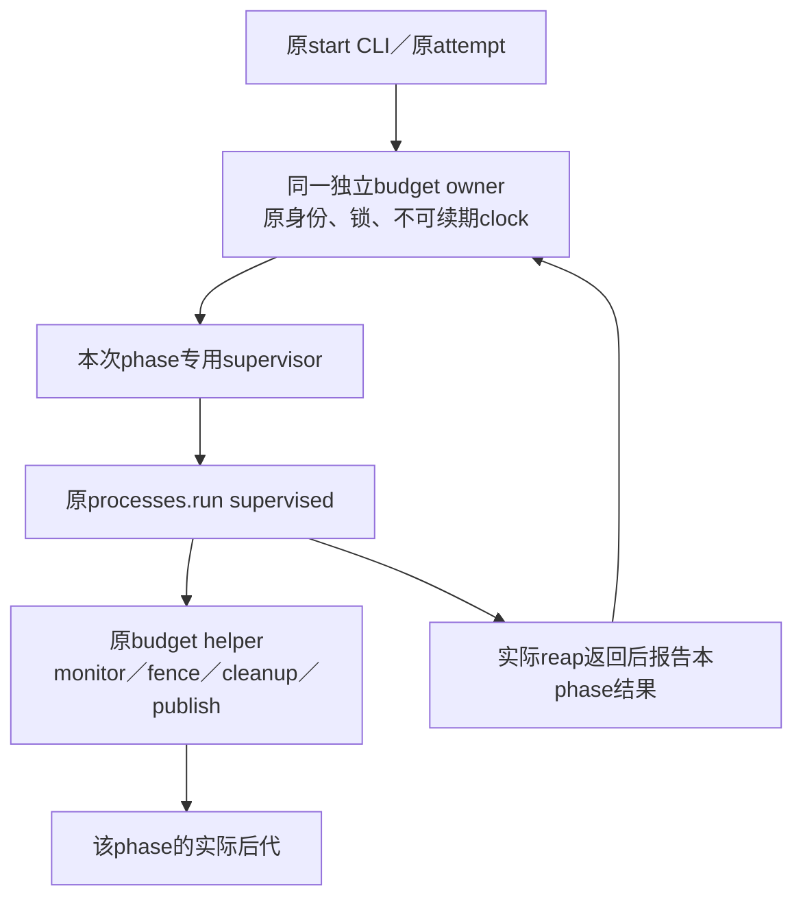

# B3.3a：训练预算阶段的独立进程监督

日期：2026-11-15，设计r3已独立两轴approve／开放0／0，a1实施／a2验收已跑、a3本地两轴通过、精确发布待。承接[全周期合同](2026-11-15-training-budget-executor.md)与[B3.2原提交](2026-11-15-training-budget-submission.md)。本片只整理阶段监督的进程归属，不启用训练executor；kernel专家与所有模板保持原路径。固定产品基线为B3.2提交`75d1ee325288527f67fb1ea814332d1522ff4860`，已普通发布并核完整远端，自己的CI43665465985八job／30必要步骤success且原独立终核两轴approve／开放0／0；远端／CI状态仍按其原片结算，不转授本片。

## 已核问题与目标

现有`BudgetedStart.own → supervise → processes.run(supervised=True)`在独立预算owner自身设置Linux subreaper。`processes._reap_children`在一次调用结束时清理该进程的全部直接子进程，包括收养的孤儿。B3.2各phase串行，符合独占进程的前提；B3.3若直接并行启动executor和fence，任一phase结束都可能杀掉另一phase。这是实际生命周期限制，不是新增通用调度框架的理由。

最小目标是让每个phase有自己的专用supervisor进程，并由该进程复用原`processes.run(supervised=True)`监督一个helper子树。原预算owner保留唯一生命周期锁、缓存、时钟与状态决策，但自身不设subreaper。这样未来执行回收和控制面清理可以各在自己的子树中受同原期限约束；本片仍只串行运行原monitor／fence／cleanup／publish。

## 范围与既有接口

- 原`reference_training_budget`持有生命周期，`reference_training_worker.budget_main`仍是应用进程入口。阶段的启动、停止、收集是一组真实调用义务；优先在这两个owner内隐藏，不建跨领域插件总线。共享`processes.run`及其回收算法不复制、不改变。
- 继续使用原intent、attempt、owner、clock、final及原observations目录。新增的是本次阶段的观察／进程证据，不是训练结果表、授权或新的start slot。原binding、queue和无预算提交保持；283参考文件不改。
- 不启动executor、不新增cycle-execute、不自动消费原queued request，不改变批准、评分、归档、取消ID或原恢复权限。实际B3.3执行接缝和自动循环分别立片。

## 阶段进程契约

1. owner为phase分配唯一观察目录，把原phase、完整已核context和原intent摘要传给专用supervisor。原intent可达16MiB，父owner不能直接同步向PIPE写全部context，也不能用首次超时后`communicate(None)`续写。使用stdlib `selectors.DefaultSelector`与非阻塞PIPE，保留唯一stdin字节偏移，只推进未发送部分，发送完才关闭stdin；同时持续读取stdout字节帧，以至多0.2秒的轮询间隔核原clock和停止标志。stderr沿原观察日志交给子进程，不在父owner同步读取。所有子进程使用argv和原环境引用；不引入shell或密钥快照，也不为传输缩窄既有输入容量。
2. supervisor在运行原helper之前核同一活owner、完整缓存摘要及原clock。TERM／INT只设置停止标志；它在自己的专用进程内调用原`processes.run(supervised=True)`，stop predicate结合该标志、原phase计算／cleanup期限与原owner失联。不能只传无效的supervised timeout参数。
3. owner以`Popen`与短轮询管理该直接子进程；不在owner进程使用`supervised=True`或自行调用`_adopt_children`。计算截止或可捕获取消请求停止当前工作phase，cleanup phase仍受同一总期限约束。不得给每个新phase重新分配wall或cleanup，也不额外缩短有效配置的期限来掩盖收尾竞态。
4. owner不能用无监督`processes.run(timeout=compute_remaining)`提前杀supervisor，随后误称其后代已回收。原`processes.run`在stop predicate触发后执行kill／同步waitpid；OS回收没有严格耗时上界。与原B3.2一样，父owner等待该已开始的安全回收，不能在总截止同一时刻另行强杀reaper。期限后不启动helper／业务／新phase或发布成功；只允许已开始的同子树安全回收，超期如实报告overrun／unknown，不声称预算内已经停止。supervisor异常退出／被强杀或缺完整返回同样是unknown；不按名字或用户杀进程，不从锁释放推断子树已停止。
5. supervisor只有在原`processes.run`实际返回、完成该phase所有后代回收后，才先经stdout PIPE发送绑定原intent／授权／phase身份的`stopped`帧，再读取helper原输出、发送最终结果帧。owner只接受完整匹配的协议帧；子进程返回码、helper业务结果和回收观察分列。`stopped`帧之前绝不以硬杀supervisor代替reap；匹配帧后已无该子树业务，若后续读取／序列化阻塞跨总截止，可仅停止这个已知supervisor并返回unknown，不合成业务结果。父owner直接从可轮询PIPE接收，不能再同步读取完整stdout文件假定瞬时完成。该帧是本次进程观察，不是训练executor停止证据或可恢复授权。
6. 原`final.json`仍由受监督publish helper写入，不回到owner内同步fsync。它的读写使用独立2MiB封套，容纳原可发布结果与新增phase摘要；`training_cycles`的原strict reader／durable writer只增加显式keyword limit，默认1MiB不变，helper仍走原1MiB。耗尽时可缺final；观察只恢复同一已有fence，原final／clock／attempt不改。原已完成native结果、gate与人工release保持。
7. 现存B3.2 owner是旧进程，不把升级后的文件当作该活进程的新能力。不得重启、接管或改写其身份来升级能力。只读旧owner／final继续可用；后继执行功能必须明确识别新owner能力并拒绝旧owner执行，具体格式在B3.3执行设计固定后再加。

supervisor的stop predicate只读原缓存clock及捕获的原owner boot／PID／start ticks，不在谓词中重新读完整来源、DB或做fsync；这些验证仍在其受监督helper内。父owner失联时停止本phase业务并继续回收，不从文件里找另一个owner。阶段返回使用明确`ergora-budget-phase-v1`协议，绑定唯一phase ID、mode、完整context canonical SHA和原intent／授权SHA，包含原`processes.run`返回值及helper结果。helper结果沿原普通JSON reader的1MiB界，阶段封套额外空间单独计算，不把封套开销从有效helper容量扣除；完整来源仍按原容量。返回缺损／冲突／超期不能获得成功或执行权限。该细化与既有安全回收语义仍须独立计划审查，不把OS调度当硬实时保证。

stdout按完整UTF-8 JSON行累计，在尚未EOF时即可识别已flush的完整帧；复用已有strict／finite／duplicate-key JSON解析，不解析截断片段。恰好允许同一身份的`stopped`、`result`两帧且顺序固定；stopped不超过64KiB，result封套不超过2MiB，足以容纳原1MiB helper结果与独立元数据。绑定字段、mode或顺序冲突、尾随多余数据、输入未完整发送、缺帧及结果解析失败均unknown，不重启或补发。本片不建立新的持久协议文件；旧owner仍可调用原四种直接helper模式并得到原普通JSON，只有新明确supervisor入口输出分帧协议。

## 可验收子节点

|节点|交付与通过条件|状态|
|---|---|---|
|B3.3a0 固定设计|核B3.2固定提交、真实调用链、原监督独占前提、所有phase迁移和旧owner边界；新的fresh-context两轴计划审查|r2需求request-changes／R1、结构approve保持；r3同reviewer两轴approve／开放0／0，R1仅设计层面关闭|
|B3.3a1 阶段监督整理|原owner不设subreaper，各phase专用supervisor复用原回收算法；原业务与持久合同保持|原两个owner已接线；首个accepted1通过／21.88秒，新真实phase五项源码通过／144.68秒，产品独立R1已关闭；R2实红后receive边界修正、独立关闭；自身模板R3 final容量实红后r2安装边界通过，自身75.141秒两轴approve，新独立本地两轴approve／开放0／0，R1–R3关闭|
|B3.3a2 回归与真实进程证据|复用原submission／budget fixture，验证accepted／held、正常completed、lost-ack、文件／目录fsync故障与同fence恢复；新增最小真实phase子树接缝，证明不同supervisor不互杀、setsid后代回收、完整大输入慢reader不挡住停止、回收帧前后失联／后处理阻塞分别保持unknown|双子树、setsid、大输入慢／挂起reader、stopped前SIGKILL／后结果阻塞五项通过；回收跨总期限＋TERM及接近原1MiB结果源码分项已过，原失败保留；最终r2完整受影响安装24通过／497.22秒，边界16通过／0.44秒；历史失败保留|
|B3.3a3 安装与交付|最终非editable包逐字／283、受影响安装测试、真实本地控制流程、自身原审查模板及新fresh-context产品两轴、普通精确发布和自己的适用CI|r2 core／SDK各648三方逐字／283／依赖通过，安装24＋16、真实Temporal54.133秒、自身75.141秒approve；新独立本地两轴approve／开放0／0，R1–R3关闭；精确发布／自己的CI待|

新增测试只保护这次进程归属变化带来的实际风险，不为每个phase复制同一套矩阵。已有故障fixture及真实owner身份／锁检查优先复用；明确记录source、安装、SDK替身与真实Temporal各自范围。发生失败保留原运行，修后只重跑受影响范围。

## 后继B3.3执行设计的开放问题

另据[生命周期源码调研](../research/2026-11-15-training-executor-lifecycle.md)继续固定执行片，而不在本片夹带功能：

- 显式执行意图及新owner能力；只允许同原submitted run／完整native request／runner，旧恢复不授runner权限。
- 原`training_executor.process`只有executor lock／started／result，没有完整whole-executor单次attempt；启动后崩溃不得因无result重跑。进程attempt／ack／stopped属于原job的执行证据，不另建实验账本。
- 原executor内部才获取executor.lock。不能外层另开fd持同锁再调用导致自锁，也不能把锁外预检当成最终准入。需核真实可用接缝；若无法在保留283的条件下安全接入，应明确必要协议升级或支持边界，而非复制算法／广泛monkeypatch。
- 计算截止的create gate、精确持久fence、原控制面取消与执行树回收要分别可观察。fence或tracking阻塞不能拖住实际停止；顺序与并行责任必须在新设计中明确。
- Git准备、两臂runner、archive与MLflow均使用原算法；正常截止／取消需实际回收新session后代，SIGKILL／跨boot／缺proc保留unknown。CPU合成旅程不认证GPU、训练质量或性能收益。

逐步证据写入[本片交付记录](../delivery/2026-11-15-training-budget-phase-supervision.md)，进度同步[总计划](../PLAN.md)。只有本片独立审查通过才实施；后继执行设计另审，不由此默认批准。

## 设计审查处置

[r2独立审查](../delivery/2026-11-15-training-budget-phase-supervision-plan-review.md)需求request-changes／开放R1、结构维护approve／开放0。接受R1：受支持Python3.12的首次communicate超时后，公共API不能继续未发送的stdin；独立stdlib实测851968B只发送65536B，原件和失败保持。r3改成本地selector维护一次发送偏移与完整帧缓冲，明确输出界、帧顺序、回收帧实际flush及旧直接helper兼容；不修改共享processes或有效输入容量。当前只有计划修订，无产品变化，等待同片复核。

同片独立续核已批准固定r3：需求approve／结构维护approve，开放0／0，R1仅设计层面关闭。原r2报告完整前缀与实测保留，原23来源、strict parser、283参考及22链接已核；没有产品／测试运行。本段和状态表只同步终核，实施与验收仍按a1–a3逐步结算。
