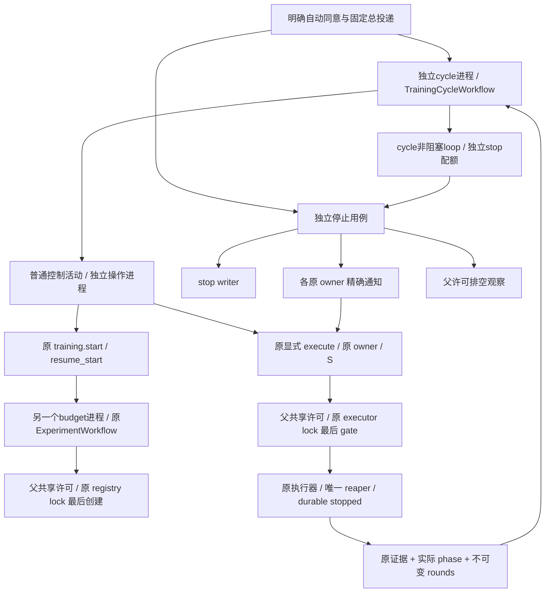

# Q4.2c0.1：有限训练循环的具体合同

日期：2026-11-15。承接[准备草案](2026-11-15-training-cycle-controller.md)及其[独立审查](../delivery/2026-11-15-training-cycle-controller-plan-review.md)。这是具体合同r2：r1独立审查发现R1进程／event loop边界及交付顺序未固定，本版明确分开两个实际worker进程，已获[原reviewer复审](../delivery/2026-11-15-training-cycle-controller-contracts-review.md)需求／维护性两轴approve／开放0／0，R1仅在设计层关闭。本页固定下一片的记录、调用点、停止顺序和容量决策，**尚未实现这些接口**。源码调查基线为 `ac86043d9e11983750bf63b90c0dfcbeea05ea41`；其固定发布已独立两轴通过，自己的CI现已终态七job成功／Windows六个历史夹具setup错误，Q5.2a作最小测试接续；实施和后继产品发布须先闭合该门禁。实际调查见[交付记录](../delivery/2026-11-15-training-cycle-controller.md)。

范围仍为同一可信 Linux／WSL2 主机、相同 control home 与可达的原存储。控制器顺序消费已冻结的最多 32 个既有实验；原六阶段、执行器、实验账本、比较器、人工批准与采用权保持。v3 中的 kernel 专家保留，与依赖／冗余、内存、通信、调度等方向共同提供建议；本控制器不把所有瓶颈转为算子改写。

## 源码依据与所有权

|观察到的源码|本片决策|
|---|---|
|[cycle](../../src/ergora/training_cycles.py)的 `_authorization` 按完整 schema1 重建，`authorize` 在所有 live checks 前保存原 clock；原 ready 不含执行同意|自动执行使用**出生时明确选择的新 authorization schema2**，普通 `cycle-authorize` 仍只产生 schema1。既有 cycle ID 不升级、不补同意、不重开 clock|
|[submission](../../src/ergora/reference_training_submission.py)在原 attempt 前后各 preflight／budget check，RPC 仍可能晚到；[worker](../../src/ergora/reference_training_worker.py)的 lookup 已在原 registry lock 内被调用|保留这些检查，并在实际动作期间持父级共享准入锁；stop 先独立发布拒绝标记，再排空已获准的动作。晚到 workflow 可以存在，但不能绕过 worker 的最后创建 gate|
|[native protocol](../../src/ergora/training_execution_protocol.py)的 owner／capability／context 与 source key 集合严格；选定原生解释器不安装 Ergora 的全部依赖|共享的父级记录／锁读取放在这个**已被 pin 的 stdlib owner**；cycle 应用用例仍由 `training_cycles` 持有。不新增 `GATE_SOURCES` key，不让 native hook 导入 `State`／jsonschema／SDK|
|[原 executor](../../src/ergora/data/reference/platform/local/agent_platform/training_executor.py)的版本化 admission callback 在原 executor lock 内，开始 Git／runner 前执行|在现有 hook 内核新父级许可；外层父级共享准入锁覆盖这一次原 `process`，不复制原 executor，不修改 283 冻结文件或既有 delta|
|[预算 owner](../../src/ergora/reference_training_budget.py)的 live 父进程只 pump pipe／signal；业务锁和存储在独立 S／helper|父停止的 writer、观察、通知与排空不能放进该 live owner 的循环。使用独立受监管操作进程，原 owner 仍只收精确进程通知并驱动原 reaper|
|原 `_serve` 只注册 `ExperimentWorkflow`／原 Activities；async adapter 内含同步文件／锁|保留原 `training-budget-worker` 进程；新增独立 `training-cycle-worker` 进程及 event loop，不在原 `_serve` loop 添加 controller／stop Worker。新进程的普通活动全部异步监管操作子进程，stop queue有独立Worker配额；该边界先于自动派发交付|
|[单轮 completion](../../src/ergora/reference_training_budget.py)核 native terminal／gate／durable stop，不查询实际 Workflow；[原 Workflow](../../src/ergora/data/reference/platform/upstream/temporal/perf_temporal/workflow.py)成功后还有人工 release 窗口|继续下一轮须再核原 run/history/memo、实际 phase 与原 accepted archive；总循环结束不取消已接受测量的旧轮，也不等待用户先 approve 才允许下一轮|
|[rounds.create](../../src/ergora/training_rounds.py)完整嵌入四类 native 观察，并在序列化后核 10 MB；调用当前项目的公共入口|复用不可变索引，每轮只追加一个原候选及原注释；容量或项目漂移导致不能追加时停止，保留已有索引和原实验结果，不造另一实验数据库|

## 1. 明确同意与原授权版本

新增应用用例 `training_cycles.authorize_controller`，后继薄入口名为 `training cycle-controller-authorize`。参数沿原 `project/cycle/directory/input_sha256/expected_revision/confirm`，另须显式确认 `execute_selected=True`。接口与普通 `authorize` 分开，内部复用同一个授权发布算法。它确认的范围是该完整 cycle 中**全部有序候选的一次原 start 与一次原 native launch**，不包括生成候选、重试计算、baseline 晋升、approve／release、发布或合并。

schema2 保留 schema1 的全部原字段，仅增加 `controller`，并把 `schema_version` 改为 2；`sha256` 仍为除自身字段外完整 canonical JSON SHA256。`controller` 的完整字段如下，缺项／多项均拒绝：

|字段|固定语义|
|---|---|
|`protocol`|`ergora-training-cycle-v1`|
|`workflow_id`|`ergora-training-cycle/` 加完整 canonical SHA256；输入为 `{control_home, project, cycle_id, input_sha256}`，不使用重启时新 UUID|
|`task_queue`|`ergora-training-cycle-v1`|
|`execution_scope`|`ordered-selected-native-once`|
|`continuation`|`accepted-archive-pass`；每轮只按原冻结比较门禁，任何否定／未知均不派发下一轮|
|`actor_id`|当前 `unix:uid:username`，同一可信用户环境中的明确操作者记录，不冒充跨用户认证|
|`confirmation`|必须为布尔 `true`|

新授权仍先永久占用 cycle ID、保存原 clock／完整输入，再做原实时 admission。确认不另启动第二个计时器。即使与 schema1 输入、project、预算相同，也不能把已有 ID 改成 schema2。重复同一显式操作只观察／补全原 ready 的持久化；原同意、clock 和候选不变。普通 read／status／resume 均不生成 schema2 或执行请求。

旧 authorization、ready、budget owner schema1／schema2、execution chain 均按其原版本读取。现有 owner 的 source bytes 变化仍令 live admission 拒绝，不借新软件续权；离线 chain 读取不核当前 source，不回写旧原件。`GATE_SOURCES` 的 key 集合保持不变，变更的原文件 hash 在**新 owner 出生时**冻结。新版本不承诺跨软件更新继续执行旧活 owner；原观察／精确清理和原 clock 仍保留。

## 2. 总投递身份与每轮来源

总投递记录归 `training_cycles`，存于原 `<control>/training-cycles/<project>/<cycle>/controller/`。这里只存投递／停止事实，**没有本地可变 current-round／running 状态**。Temporal history 是循环顺序、当前候选和已完成轮次的权威。

- `intent.json`：schema1、kind=`training-cycle-controller-intent`、protocol、control home、project、project revision、cycle ID、input SHA、authorization SHA、workflow ID、task queue、完整 `workflow_input`。`workflow_input` 是以下固定身份：protocol、control home、project、cycle ID、input SHA、authorization SHA；不把完整 10 MB cycle 送进 Temporal。
- `attempt.json`：schema1、intent SHA、workflow ID、完整 workflow input 的 canonical SHA；在唯一 `start_workflow` 前无覆盖发布并同步。已有 attempt 即永久消费总投递机会。
- `receipt.json`：完整 attempt 字段加精确 run ID。原 memo key 为 `ergora.training_cycle_sha256`，值为 intent SHA。与子实验的 memo key 分开。
- `rejection.json`：只记录服务明确拒绝及原冲突身份。无 intent／attempt 的已存在 workflow 不能收为本控制器所有。

提交前查同 ID 的完整 started input；不得只看 ID 或当前 run。投递丢回复后只查原 ID，核完整 started input 与 memo；匹配才补同一 receipt。`NOT_FOUND` 仍是 unknown，不重发、不换 ID。重复 activity 先读原 intent／attempt／receipt；已有 attempt 时只对账。总 Workflow 一次运行，不使用 continue-as-new，不跟随新的 run。

自动单轮仍调用原 `training.start`／`resume_start` 和 `training.execute` 用例；不复制 RPC 或信号逻辑。为区分控制器的原 start 与无关的人工操作，budget binding 增加一个显式版本分支：原三字段 `{cycle_id, authorization_sha256, task_queue}` 保持；自动分支另有 `controller`，其字段为 `{protocol, workflow_id, run_id, intent_sha256, ordinal}`。ordinal 为 cycle 中从 0 开始的原位置。每次消费核总 intent／attempt／receipt、输入／memo及该位置的完整 admission。

schema1 只允许原手工 binding；schema2 只允许完整 controller binding。控制器不会接管没有该 binding、属于其他总 run 或位置不符的原 start。相同 controller activity 丢回复后可以读取它自己已持久化的原 start；原 experiment ID、operation ID、attempt、run 和 launch 全部沿原记录。恢复不因未收到 activity completion 就制造新实验或再用 start slot。

自动 `execute` 先核同意和 controller binding，再从原 start receipt／native request 取得精确 run、job、manifest、request raw SHA 和 project revision。随后调用同一个 `Execution.request`，actor 仍为原操作者；显式同意不是忽略这些核对的开关。已有 request 或 launch 只观察，不重复授权。

## 3. 父停止：可见拒绝、持久确认与活动回收

父停止的 stdlib 记录／锁算法位于现有 `training_execution_protocol`，应用入口与记录路径由 `training_cycles` 持有。新 schema2 授权完成 ready 前持久创建普通 `controller/admission.lock`；以后只打开既有文件，不在 gate 中补建。schema1 不引入该锁。

`stop.json` 是单一、无覆盖的停止请求：schema1、kind=`training-cycle-stop`、protocol、control home、project、cycle ID、input SHA、authorization SHA、总 intent SHA（尚未准备时可为 null）、原操作者、非空 reason、UTC requested_at。第一次停止永久生效；重试只同步并重读同一文件，不改 reason／时间／身份。路径出现但不完整、不匹配或持久化未知时，同样禁止新准入，并将观察结果记为 unknown。

**锁顺序和停止顺序：**

1. start 的实际投递、worker 的原 job 创建、显式 execution request／launch 准入和 native `process` 均先取得该父锁的共享许可；取得后核完整授权／来源／clock及 stop 路径，动作的现有最后 gate 再检查。拿不到共享许可就在原计算窗口内等待或返回 unknown，不另起预算。父锁在这些动作结束／失败时释放；原 registry／executor 锁继续由原算法持有。
2. worker 在进入 `super().create_job_if_absent` 前持共享许可，直到原 registry lock 内 lookup／最终 create 返回；锁内 lookup 再核 stop。native 外层持共享许可覆盖原 `process`，其 admission callback 仍在原 executor lock 内，attempt／ack 前后再核 stop／owner／clock。原 launch 先占用就不返还。
3. 停止入口把 **stop writer 与精确 owner 通知作为独立受监管操作**推进；不先等 registry／executor／父排空锁。所有可能阻塞的原文件读取、fsync 和通知身份查找均在各自 helper 中，不能让一个受阻 writer 卡住其他 owner 通知。live c2 owner 不读取新业务文件。
4. stop 文件一旦可见，后续共享准入者即拒绝。writer 对文件和父目录 fsync 并重读完整身份后，才能报告 `stop_durable=true`；可见本身不等于持久确认。已在可见前获准的动作可能继续产生晚到 RPC／写入，必须继续按原 clock 清理。
5. 独立 drain helper 在 stop 可见后取得父锁的排他许可、再次同步／重读 stop，才报告 `admission_drained=true`。worker／native 的顺序是父共享锁→原 registry／executor 动作；原 submission 自有锁可继续覆盖投递，父共享许可不得依赖任何父排他操作。stop writer 不等这些锁；drain 只持父锁，不获取 submission／registry／executor 锁，也不在持原 native 锁时反向排空父锁。
6. **drained 不等于子树已停。** 客户端退出后服务器仍可能收到原 start；native 进程退出后 reaper 也可能仍在回收其后代。晚到 workflow 的最后创建 gate 仍拒绝；实际执行停止继续取原 c2 `stopped` 同链同步／重读结果。停止响应分别列 `stop_durable`、`admission_drained`、每个活动原 run 的取消观察和 `executor_stop_confirmed`，不把任意一项替代其他项。

父 stop 只撤销新 start／create／execute 的准入，不自动建立全部实验的 native fence。精确通知针对原活 owner；每个 owner 沿原 completion／fence／cleanup 决定当前活动轮的处理。已在总 history 中接受、durable stopped 且处于原人工 release 窗口的前轮不会因后轮停止而被统一取消。总工作流停止时只清理它的活动／未确认轮；对未曾派发的后续候选只拒绝准入。

正常公共停止入口先处理本地 stop 和通知，再尝试总 Workflow signal；Temporal 不可用仍返回本地实际结果。直接通过 Temporal SDK 请求 cancellation 时，总 Workflow 在 catch 中经独立 stop queue 执行同一停止用例；worker 未运行时不能承诺即时本地停机，此时原独立 owner 仍按原墙钟停止。服务器 terminate 不执行 Workflow cleanup；手册须指向本地停止／原 run 对账，不能把 terminate 当可靠回收。

## 4. Workflow、活动和阻塞通路

新的应用 `TrainingCycleWorkflow` 由现有 `reference_training_worker` 提供**新的进程入口**，通过 `reference`／`services` 的 `training-cycle-worker` 启动；实现保持该文件的 source pin。原 `training-budget-worker` 的进程、`asyncio.run(_serve())`、`ExperimentWorkflow` 和 `Activities(BudgetAdapter)` 保留。新 controller 入口拥有另一进程与 event loop，绝不把新 controller／stop Worker放到原 `_serve` loop。因此原 registry／State／文件I/O阻塞不会卡住总 Workflow 的 cancellation catch或其stop消费者。

新进程的同一非阻塞loop注册总Workflow／普通活动及单独stop queue的Worker；两者有独立并发配额。所有新活动的业务文件、锁、同步RPC入口和等待都在独立受监管操作进程中，loop只做异步进程／管道监管；不得以 `async def` 外观或另一个 Worker实例代替这条实际边界。停止writer与各owner通知仍分别隔离，不能在一个有界helper里先同步写完再通知其他owner。c1开放自动派发前，两个真实服务入口、分离进程／loop、queue注册和stop配额必须一并可运行并验收；不能推迟到c2公共交互。

它不是原 `ExperimentWorkflow` 的子类，也不修改原 Workflow。原实验使用原客户端独立 start；因此没有父关闭自动 cancel 旧测量轮的问题。

普通活动只执行一项有界操作：`inspect`／`start-or-reconcile`／`request-execution-or-observe`／`collect-round`。活动参数和结果是身份及原件引用，每次从原完整输入重新核 SHA；一次 activity 不持整个训练进程，也不持数据库事务跨 RPC。SDK event loop 不执行同步原文件／锁／子进程等待；原调用通过已有受监管子进程接口运行，活动取消发送精确本地 stop，不能仅取消 future。

总 start 与 native launch 的 activity 重试最多 1 次；应用主动对账是新的**只读**活动，不能重投原动作。只读活动可有限重试，但同一次操作总时限仍缩为原 compute remaining 与原 control timeout 的较小值。停止活动使用原 total remaining，不占计算余量，不借恢复续期。具体 SDK `start_to_close`／`schedule_to_close` 由当时这个较小值导出；非正则不调度。

总 Workflow 只用 deterministic 分支、history 中的活动结果和 durable timer；不读文件、不用本地 clock。每次普通活动须返回原 compute／total remaining；Workflow 的 timer 仅帮助调度，下一个活动和最后 native gate仍以原 boot／boottime clock 为准。至多一个活动候选，不并行提交两个实验；原 budget owner可以与原单实验 Workflow 同时运行。

## 5. 接受一轮、分类和继续条件

单轮 `measurement_accepted` 必须同时满足以下原绑定：

1. 总 run 和当轮原 start 的完整 intent／attempt／receipt／memo 匹配；job ID、完整 binding、native request raw SHA 均为原件。
2. native result 为 SUCCEEDED，原 gate `passed is True`；原 c2 execution chain 的 `executor_stop_confirmed is True`，不是只看到 result 或 owner final。
3. 原 `training.evidence` 的 `archive_status=recorded`，完整 evidence SHA、manifest、baseline snapshot、comparator SHA 和原 gate report 绑定通过；不把候选自述或单一 comparison JSON 当可信结果。
4. 精确原 Workflow 实际查询到 `AWAITING_RELEASE`，status 的 binding／job／evidence SHA 与以上原件一致；或原 Workflow 已明确完成 `RELEASE_EXPIRED`／`INTEGRATION_TASK_CREATED` 且 outcome 的原 binding／job／report URI 相同。不能用 Temporal COMPLETED 本身通过。查询交错进入 CANCELLING／未知 phase、RPC 错误或新取消事实时不接受；保存观察待对账。
5. 追加原 rounds 索引成功并核完整原件；然后才派发下一候选。再次准入仍核原预算、父 stop、项目／来源及唯一原 slot。

`AWAITING_RELEASE` 是测量接受时的观察，不对未来的 approve／cancel 作承诺。之后人工拒绝／取消该轮不追认未发生的 release，也不改写先前测量观察。下一轮仍比较同一初始 baseline；baseline 晋升是另一个人工操作。

|原可核输出|控制器结果／动作|
|---|---|
|accepted archive 的原 `performance.status=PASS`，并满足以上全部绑定|`measurement_accepted`；有限列表未尽且原预算仍允许时继续；保留原 performance、quality_assessment 与 limitation|
|native SUCCEEDED，但原 gate false／`GATE_FAILED`／没有 accepted archive|`gate_rejected_unclassified`，停止；保存原 gate／负结果，不从 summary 猜测失败原因|
|原 native FAILED／CANCELLED 或实际 Workflow FAILED／CANCELLED|保留原 typed state，停止；不映射为“质量退化”或“无收益”|
|原比较器的 FAIL／INCONCLUSIVE 只出现在未经 accepted archive 认证的 runner 输出|仅作为原报告附件保留；不能标成已认证的 no-benefit／quality failure；停止原因仍为门禁未接受／证据不足|
|identity、clock、source、project、run、durable stop、实际 phase 或索引未知|`needs_reconciliation` 或该明确的本地阻断原因；不派发下一轮|
|全部候选已接受|`selection_complete`；结束总流程，保留每轮人工 release；不自动 approve／merge|

这是原格式的实际能力：`perfctl` 仅在重算比较 PASS 后产生 accepted gate，其他失败可被原 executor合并成自由文本。因此首版**不提供已认证的失败细分**；未来若需要 typed quality／performance 拒绝，须在原门禁所有者的明确版本扩展中另立片，不在控制器中重评或更改冻结算法。原 comparator 的 fixed-sample bootstrap 不含 optional-stopping／multiple-search 校正，多轮结果不声称累计显著收益。

## 6. 容量和完整结果留存

调查的本地 binary 是 Temporal CLI 1.9.1／Server 1.32.0／UI 2.54.1。原 service 的实际 argv 为 `server start-dev` 加 IP／port／持久 SQLite，未配置动态上限。该 server 版本[官方常量](https://github.com/temporalio/temporal/blob/v1.32.0/common/dynamicconfig/constants.go)的默认 per-event blob error 为 2 MiB、warning 为 512 KiB；memo error 为 2 MiB；history error 为 50 MiB／51,200 events、warning 为 10 MiB／10,240 events。另见[官方限制说明](https://docs.temporal.io/workflow-execution/limits)。这些是当前 binary／默认配置的源码依据，不冒充已探测任意远端部署的有效限制。

本控制器采用更小的固定 v1 传输合同：**每个完整编码 input／activity result／signal／query response ≤32 KiB，memo ≤2 KiB**。拒绝大输入，不截断异常文本、完整身份或用户注释；完整大报告留在原不可变文件。最多 32 候选；每个候选至多 256 次有界观察活动，达到上限停止并报告 `observation_capacity_exhausted`。普通失败／重试也消耗观察计数，计数归 history。总 Workflow 在调度下一活动前核 SDK 实际 history length／size；达到 8,000 events 或 8 MiB 时执行原停止用例并结束，预留到服务器 warning 的余量。首次实现必须以实际 SDK 编码和真实 server history 验证这些局部上限；不依靠“32 轮所以一定小”。目标部署配置更低时可见失败并保留原件，不自动调高服务器上限。

cycle 原完整输入仍 ≤10 MB／32 候选；总 intent 只嵌入小 input 的完整身份。每个 activity 消费原 `cycle.json` 的 raw SHA、authorization canonical SHA及总 receipt，不把裸路径当冻结证明。

每轮成功后调用原 `training_rounds.create`，把 cycle 的 `change/next_bottleneck` 原样映射到一条 annotation，目标为稳定的新目录 `controller/rounds/01` 至 `32`，previous 指向前一份完整 report／raw SHA。索引仍完整嵌入原 records／evidence／submission／approval，≤32 轮／10 MB；不改成只存 SHA。活动重试遇到已存在目录只读核其原 predecessor／选定 prefix 与 SHA，不能重采一份不同内容覆盖它。结果给 history 的仅是完整索引路径、raw SHA、轮数和原 identity。

索引序列化超限／单轮已超限／无法追加时停止后续派发，返回容量原因和最后成功 prefix。原实验的 result、gate、accepted archive、comparison、MLflow 和 c2 stop chain 全部仍由原 owner 保留；不得声称新索引已保存。项目 revision 漂移时原 `rounds.create` 的公开入口可能拒绝，本版报告 `index_blocked_project_drift` 并停止，保留旧索引和原实验／冻结注册的可读位置，不把项目漂移后的新采集伪装成已支持的冻结恢复索引。

## 实施分片与验收

|片|实际变更点／不改的 owner|必要验收|
|---|---|---|
|c0.2a 授权与父停止记录|`training_cycles` 的 schema2 出生授权／停止用例；`training_execution_protocol` 的 stdlib 记录／共享许可；薄入口等 c2；原 schema1、ready 与 283 不改|新旧授权、重复／部分 fsync／lost reply、同 ID 不升级／clock不变、普通文件／身份边界、可见 stop 拒绝而 durable unknown 分列|
|c0.2b 原最后 gate 与停止 fan-out|原 `BudgetedStart`／`_Submission`／`BudgetAdapter`／`Execution`／native hook接入共享许可与 binding；原 reaper／executor算法／单slot不改|真实 start 晚到、registry／executor 锁交错、stop 在最后检查前后、attempt／ack窗口、写盘阻塞不挡并行精确通知；drain 与 durable subtree stop 分列；旧链离线读取|
|c1.0 实际worker运行边界|沿原 `reference_training_worker`／`reference`／`services` 增加独立cycle进程入口；原budget进程保留原adapter，cycle进程注册总Workflow／普通活动与独立stop配额。与c1.1一起交付且先验边界，未通过不开放自动派发|真实原registry锁及原State／文件阻塞时，新进程仍能处理SDK父取消；新控制helper读／fsync阻塞不阻塞stop消费者／其他owner通知；明确两个PID／loop和实际queue注册|
|c1.1 总投递与应用 Workflow|`training_cycles` 总 intent／attempt／receipt和现有 worker 注册；复用原单实验客户端；原 SQLite／实验账本不改|完整 input／memo／固定run、重复activity、丢回复只对账、未知禁止下一轮、原时钟跨 worker／server 重启不续期|
|c1.2 测量接受／索引／容量|原 public evidence／runtime／rounds 组合与确定性继续分支；不加评分器或baseline迁移|至少两候选；先前 release 窗口保留；phase／gate／reap交错、门禁拒绝与未分类、10 MB索引超限、实际 payload／history 界与项目漂移|
|c2 公共交互|CLI／HTTP／services 的公共交互只转发已验用例；c1已交付真实进程入口和stop配额，c2不承担新的运行边界|安装后的显式 authorize／start／status／stop／reconcile，服务不可用时本地实际结果，旧配置不隐式启用自动执行|
|d 新可信 CPU 示例|公开脚本／合同／独立有效 oracle，原 runner和原 gate；c2旧负gate例保留其原范围|真实 Temporal 两轮成功或有证据提前停止、lost reply／重启／预算／取消、原所有结果／索引、全部进程收尾；不以合成CPU认证真实ML／GPU／质量／收益|

c0.1 是源码合同交付，先做文档／来源／链接检查与新的 fresh-context 两轴设计审查；不为纯设计加产品测试。产品各片再固定 baseline、完整差异和非 editable 安装，选择可揭示实际竞态的原接缝检查、Ergora 自身原审查模板与新的独立审查，修实证问题后普通推送、核自己的 CI。Q5.2 据证重构、Q6 最终交接和真实 B3／完整 Forge 外部条件均继续开放。
