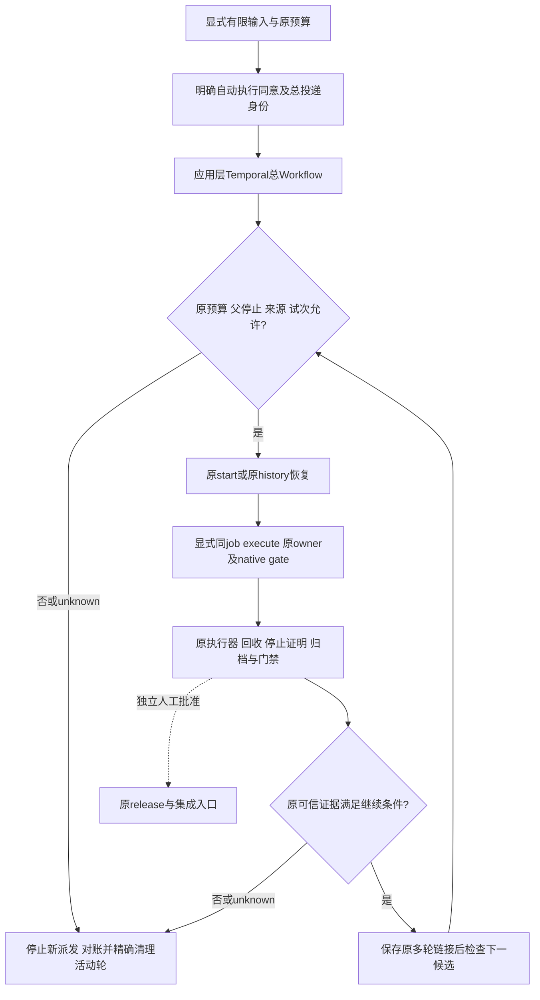

# Q4.2c：有限训练循环的控制器接续草案

日期：2026-11-15。承接[有界循环总计划](2026-11-15-bounded-training-cycles.md)与[B3.3c受管执行](2026-11-15-training-managed-execution.md)。**当前只准备下一片的源码问题、边界与验收顺序，尚未实现控制器。** 本草案已获[新的fresh-context独立准备审查](../delivery/2026-11-15-training-cycle-controller-plan-review.md)需求／维护性两轴approve／阻塞0／0，只允许继续c0.1源码合同调查，未固定具体字段或产品API。 B3.3c2本地验收／独立两轴已通过并精确推送ac86043，其自己的CI及原评审终核闭合后，才固定本片实施baseline并交付后继产品。不得把本草案或c2的单实验CPU生命周期写成自动多轮已通过。

用户要求保持：先梳理算法与执行依赖、去耦合／去冗余，再按可信测量反复识别瓶颈；每轮保留原结果与候选结果，冻结算法、模型、数据和质量合同。kernel专家继续在v3提案路径中，与内存、通信、并行、调度、框架等专业方向配合。本片只顺序消费操作者明确选择的有限实验，不生成候选、不推进baseline、不自动批准／集成。

## 已核源码事实与新增缺口

|职责|已有owner／事实|下一片要解决的问题|
|---|---|---|
|有限输入和原授权|`training_cycles`保存完整cycle、同baseline／workload的最多32个既有实验、原authorization／ready和共同clock|授权已允许单实验控制启动；不能默认把它升级为自动执行全部候选的同意|
|单实验提交|原`training.start`／`resume_start`、intent→attempt→receipt、固定run/history/memo及原单slot|控制器重试／恢复仍须使用这些原记录；unknown不得换ID重发|
|单实验执行／停止|c2的显式execute、出生能力、单次launch、原锁内gate、独立S／reaper及持久stop|控制器须显式取得有限执行同意，再绑定实际原run和native request；普通恢复不得产生新执行请求|
|预算执行服务|`reference_training_worker._serve`目前仅在原预算queue注册原`ExperimentWorkflow`及Activities|还没有总循环Workflow；不能把原worker名称或单实验queue误当总循环已经存在|
|测量完成|`BudgetedStart.completion`用原adapter的native终态、`collect_and_gate`及managed durable stop判断单轮完成|总循环还需复核原证据与实际workflow阶段；成功测量的独立人工release窗口不能被总循环结束统一取消|
|循环恢复|原authorization以boot／boottime／UTC固定共同预算，各实验owner独立监督|缺少父循环取消与晚到／已排队activity之间的准入约束；只取消Temporal future不足以阻止晚到派发|
|结果和索引|原实验账本、比较器、归档及`training_rounds`不可变链接|继续按真实报告分类；索引容量、unknown和多轮统计限制不能由控制器另写评分器掩盖|

具体源码合同已整理到[c0.1合同](2026-11-15-training-cycle-controller-contracts.md)，实际调查与后续结果持续写入[本片交付](../delivery/2026-11-15-training-cycle-controller.md)。调查baseline固定c2发布`ac86043d9e11983750bf63b90c0dfcbeea05ea41`，其自己的CI43684533043／attempt1仍在途；实施baseline在该门禁闭合后确认。c2最终候选wheel为`f1106d11b7c6b074b5f35c5a3d96208267735536cbdd549a6dbbb577f6c93a44`；这只标识设计输入，不认证其尚未闭合的发布门禁。

## 决策与必须先完成的合同

1. **自动执行需要独立明确同意。** 新入口应绑定原control home、project revision、cycle input SHA、authorization SHA、全部有序候选及执行范围。启动总Workflow与允许执行native是可核的显式操作；不能把普通`cycle-authorize`、离线读取、升级或旧owner恢复追认为自动执行同意。具体记录字段与CLI在c0源码核对及独立设计审查后固定，本文不提前承诺接口。
2. **Temporal history管理循环进度。** 新应用Workflow只编排原训练用例；SQLite、报告或新JSON不维护另一份可变轮次状态。总Workflow自己的提交intent／attempt／receipt只证明其投递身份，原每轮run／native request／launch／evidence仍归各自原owner。总workflow ID、完整初始输入／memo匹配、重复拒绝和lost-ack恢复规则须先给出，不能重启时换UUID。
3. **先解决父取消的晚到准入，再开放自动派发。** 需要原授权范围内不可变的停止事实，并在原start准入、原worker最后创建边界及native gate实际执行边界核对。停止事实不得续期授权、替换原run或授予任何重试。活动子树仍沿c2精确通知／回收，原实验的远端取消仍走已有客户端。具体记录由原`training_cycles`拥有，不能用本地“当前轮次”文件替代Temporal history。
4. **保持历史协议可读。** c2严格owner／capability／gate source集合有既有读合同；本片不得随意增加字段使旧链无法离线读取。先核现有被固定的`training_cycles`／budget／gate源码是否足以承载父停止检查；确需新协议时明确版本分支和旧原件测试，不按新代码追认旧活owner的能力。
5. **所有阶段消费同一原clock。** Workflow timer只帮助调度，最终准入和执行停止仍用原boot／boottime预算及cleanup reserve。服务器／worker重启期间时间继续流逝；跨boot、不可达原存储、来源／项目变化、未知投递或未确认停止时停止新派发并如实返回。首版仍限定原Linux／WSL2、相同可信主机与可达存储，不假设Temporal共享文件或提供OS隔离。费用／GPU小时硬配额继续明确unsupported。
6. **每个原实验最多消费一次试次。** 候选列表的有限顺序与原start attempt共同约束试次，恢复不产生新实验ID、start slot或执行launch。开始下一轮前，前轮原证据、可信门禁和实际子树停止必须可核；未知状态先对账。不能为了继续循环伪造approve或关闭人工release窗口。
7. **继续／停止只读原可信输出。** 先列出原报告中可机器读取的PASS／FAIL／INCONCLUSIVE、质量失败及证据缺失字段；无法区分的原因报告缺口，不解析自由文本猜测。收益／质量条件在看结果前冻结，不重新比较样本或偷偷放宽量化容差。多次搜索及optional stopping没有校正时不声称累计显著收益。
8. **容量在消费前检查。** 完整cycle上限10 MB、最多32候选与原索引32轮／10 MB分别存在。Workflow输入／history只放有界身份与完整SHA引用，每次消费核原件；不能静默截断。c0须按实际索引字段给出每轮结果保存和超限停止方式，原实验完整数据与报告即使索引无法继续也必须保留。

拟定调用关系；图中的新总Workflow及父停止合同都尚未实现：

## 分片与可验收节点

|节点|最小完整交付|主要验收与状态|
|---|---|---|
|c0.1 固定源码合同|原总投递身份、执行同意／父停止记录、停止准入的具体调用点，实际原门禁分类与容量策略；列出真实调用者和无需修改的owner|30份源码调查完成；具体合同r2已独立两轴approve／开放0／0，R1进程／loop边界仅设计关闭；不是控制器实现|
|c0.2 父停止与有限执行同意|沿原cycle／start／native锁内gate接线，保留旧单实验接口与历史链|待c0.1；真实晚到start、已排队activity、cancel与native gate竞态均不得越过已生效的停止事实；stop可见但未持久时保持unknown，不假装可重发|
|c1 原Temporal总Workflow|在原应用worker注册总Workflow和必要activities；顺序调用已有用例，原history恢复及预算／停止|待前置；至少两候选、试次／墙钟耗尽、无可信证据、收益／质量门禁停止、loss of reply、worker／server重启与父取消，结果保留原分类|
|c2 公共交互与恢复|薄CLI／HTTP和原服务入口；显式启动、读取、取消及只读恢复说明|待c1；安装后实际命令，旧owner／旧cycle不被升级，原run和全部原始身份可追踪；不新增第二实验账本|
|d 可移植CPU一键示例|新的公开CPU合同、可信oracle／runner和脚本，准备→至少两轮或有效提前停止→重启读回→原索引|待控制器；c2现有无可信attestation的负gate样例只能验证提前停止，不能充当可信成功轮。成功／无收益路径须用独立有效的CPU合同实测，不能伪造报告或削弱原门禁；真实ML／GPU另验|

每个实现片分别固定baseline、完整tracked／untracked范围与安装身份，完成适当回归、自身原审查模板及新的fresh-context独立两轴审查。先修实证finding再普通推送当前开发分支，核该候选自己的CI与原评审终核。进度与实际结果继续更新[总计划](../PLAN.md)及本片交付记录；不以本草案替代Q5.2有据重构、Q6一键交接／严格最终发布或真实B3条件。

2026-11-15 接续状态：前置ac86043自己的CI43684533043／attempt1现已终态七job成功／Windows六个历史夹具setup错误，原reviewer已核失败归属。Q5.2a仅测试接续，自己的CI和独立终核闭合前不进入本控制器产品实施；本片仍只有已独立批准的具体合同。Kernel专家保留在v3路径。
