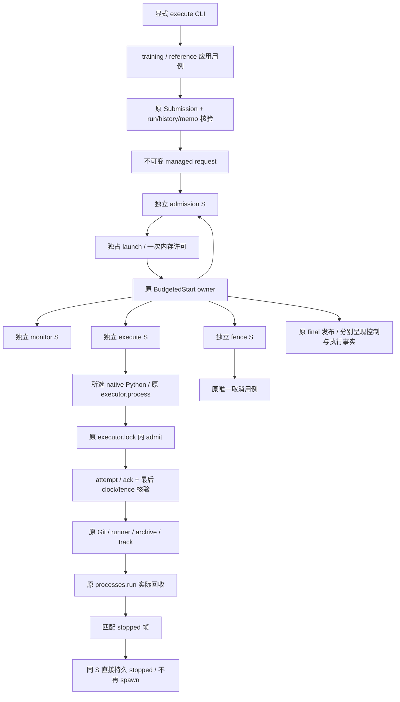

# B3.3c2：执行记录与实际接线合同 r2

日期：2026-11-15。**r1独立审查提出R1–R3；同reviewer固定r2需求／结构两轴approve，开放0／0，三项仅设计层面关闭；前置c1门禁闭合，c2开始实施。** 固定产品基线为c1普通发布 `75285e3271bb93271eaea050ca7812cb0cd98b5a`；c1自己的CI43676697981八job／30必要步骤及原独立终核已闭合，当前只将其作为实施前置，不转授c2验收。本页细化[上位设计c0 r2](2026-11-15-training-managed-execution.md)，设计批准本身不认证execute或owner schema2的产品验收。kernel专家继续保留在v3提案路径。

本片不重写原intent、start attempt/slot、authorization/clock、native process、实验记录或批准算法；仅在原owner和既有phase生命周期接入显式单job执行。逐步状态记入[同片交付](../delivery/2026-11-15-training-managed-execution.md)，每完成一个节点同步[总计划](../PLAN.md)。

## 实际接缝

- `training` 的显式 execute/离线 execution 用例经薄 `reference.training_execution` 进入应用执行 owner。CLI 不直接起 executor。显式execute复用原受监督应用／SDK调用；离线execution沿已有 `reference.training_files` 的随包冻结来源、`-S`与有界独立reader接缝，不先validate或import所选native安装，不依赖 `_Submission`／State／SDK。外层应用仅从既有项目数据取得原已登记路径，向该stdlib reader传完整项目快照与experiment ID；不猜测其它原生状态目录。选定native来源或当前gate漂移在历史原件读完后作为独立观察项，不能挡住历史读取，也不能放宽execute准入。
- 新应用模块 `reference_training_execution` 接受原 `_Submission` / `BudgetedStart`，不 import 这两个 owner，避免 `submission -> budget -> execution -> submission` 环；worker 负责装配。它持有显式请求、原 run/memo 准入、launch 和并行监管的内聚用例。
- 新 stdlib 协议模块 `training_execution_protocol` 同时服务应用 writer/reader、执行 S 和原生 callback。复用 `reference.validate_installation`、`budget_clock`、native `adapter.safe_file`/`read_raw`/`contracts.canonical_sha`；不 import State、yaml、jsonschema、Temporal 或应用 definition_bundles。不得复制原 279 manifest / clock / executor / process reaper 算法。
- 原 `_BudgetPhase` 复用 c1 start/poll/finish 和完整两帧合同。新增 admission/execute 是本域 mode，不是新 backend 族。S 中选择实际 native argv；执行 mode 的 stopped 后直接发布持久 stop，不再 spawn。
- `BudgetedStart.own` 仍拥有 lock、出生 record、catchable signal 和 final；新可执行来源分支调用内聚执行监管，用原 phase；legacy/schema1 行为保持。所有 final 仍由原 publish phase 写，不能为 stop/fsync 另起 publisher。

## 严格 reader / writer

新增 lifecycle record 各最多 1 MiB；UTF-8 finite JSON object，duplicate key 和 bool 伪 int 拒绝。普通文件且完整父路径无链接；`read_raw` 的 FIFO open 可能阻塞，native 协议 reader 须在其自身 owner 用 O_NONBLOCK/O_NOFOLLOW + fstat；不会顺带迁移所有旧 JSON reader。

应用可用原 `training_cycles._record`，但 native 不可导入该模块。协议边界应复用原 native `adapter.publish` 无覆盖临时文件/硬链接与 SHA 算法，补目录同步和既有文件不再授一次性许可的语义；不得把 publish 的 equal bytes retry 当 launch grant。launch 由 execution.lock 持有者先严格观察目标不存在，发布/同步之后才一次返回内存许可。部分目标或异常均消耗，不删除重用。

记录字段按 exact set 检查；缺失/额外字段拒绝。canonical SHA 和完整原 bytes SHA 单独列明。创建 managed-execution 目录后，b 协议会拒绝无 hook 手工接管；目录本身不是执行许可。

## owner schema2

schema2 exact fields：`schema_version:2, intent_sha256, authorization_sha256, pid, start_ticks, boot_id, context_sha256, execution_capability`。schema1 exact 原字段继续读；identity、intent 和 phase 仍 schema1。alive 观察与 record 解析分开：离线观察可读已退出身份；授权必须核 boot/PID/start_ticks 与 owner lock/initializing lock。

execution_capability 为 null 或 exact object：

`protocol:ergora-training-execution-v1, admission_protocol:training-executor-admission-v1, descriptor_sha256, installation, native_python, cycle_ready_sha256, gate_sources`。

`gate_sources` 是相对ergora包路径到完整SHA256的固定映射，exact key set如下；这是实际授权谓词的源码／schema集合，不是用户可配置的import清单。出生即固定，后续路径相同也不能升级。native只逐字核这些应用源码，不import它们。

|实际拥有的谓词／算法|固定来源（包内相对路径）|
|---|---|
|新协议的严格记录／完整context／callback与受管用例|`training_execution_protocol.py`、`reference_training_execution.py`|
|原intent／attempt／receipt／preflight与原登记路径|`reference_training_submission.py`、`reference_training_context.py`|
|同run初始Experiment／history／memo及原取消归属|`reference_training_runtime.py`、`reference_training_cancellation.py`、`reference_history.py`|
|原owner／phase／adapter、应用入口与来源validator|`reference_training_budget.py`、`reference_training_worker.py`、`training.py`、`reference.py`|
|原cycle输入／授权／ready及原published registration读取／投影|`training_cycles.py`、`registrations.py`、`data/schemas/training-cycle-v1.json`、`data/schemas/project-registration-v1.json`|
|上述读取实际依赖的严格JSON／schema／普通文件／State及本地锁|`definition_bundles.py`、`contracts.py`、`asset_trees.py`、`state.py`|
|共享clock、原reaper与包自身bootstrap／validator导入闭包|`budget_clock.py`、`processes.py`、`reference_creation_process.py`、`__init__.py`|
|原native来源权威|`data/reference-manifest.json`、`data/native-runtime/training-executor-admission-v1.json`|

应用的当前项目revision和DB读取仍由原State／training／training_cycles持有；native不复制SQLite或published registration算法。初始登记创建、模板编译与UI不在这个谓词集合，不能以未列的无关新入口替换这些校验。产品接线若实际调用新增授权谓词，必须修改该exact集合及新出生能力，给同片reviewer复核；不能在已有owner上回填字段。第三方应用依赖沿已安装包依赖检查，未声称把所有动态库和同用户写者变成安全隔离。

`cycle_ready_sha256` 是出生时已经由原 `BudgetedStart.source/require_active` 核过的完整原ready对象canonical SHA；它只冻结此原件，不生成另一ready。native interpreter为installation/.venv/bin/python；执行时核sys.prefix、core.ROOT/PYTHON/STATE/CONFIG与原登记，原native第三方包仍从所选venv解析。

## request schema1

exact common：`schema_version:1, kind:training-execution-request, protocol, control_home, project, project_revision, registration_sha256, execution, experiment_id, job_id, workflow_id, run_id, start_intent_sha256, start_attempt_sha256, start_receipt_sha256, authorization_sha256, owner_sha256, native_request_sha256, native_request_semantic_sha256, confirmation:true, actor_id`。

`execution` 为原 intent 中完整执行配置；owner_sha256 固定出生完整 owner。project_revision 严格 int>=1，确认 type bool true，actor 是当前 unix uid/user，不接受任意用户传主体。原 intent/attempt/receipt/native request 仍在原路径，不在新记录复制一套可变原件。读取时以原记录反算全部字段，不能凭字符串 hash 格式即授权。

native request 必须 exact `schema_version:1, job_id, experiment, runner`，并与 start intent 完整 observation 匹配，不只是 job_id。原 request 实际容量仍沿原 1MiB；start intent 原16MiB不变。

## launch / attempt / ack / stopped

launch exact：`schema_version:1, kind:training-execution-launch, protocol, request_sha256, owner_sha256, authorization_sha256, clock_sha256, launch_id, execution_phase_id`；两个 UUID32 在首次消费前固定。可重复读取 launch，但绝不再返回 launch 权。原 start slot 不受影响。

attempt exact：`schema_version:1, kind:training-execution-attempt, protocol, launch_sha256, request_sha256, owner_sha256, run_id, job_id, native_request_sha256, supervisor, executor`；supervisor 和 executor 各 exact boot_id/pid/start_ticks。必须分别为实际 native PPID S 与自身；S 的 PPID 仍等于原 owner，execution_phase_id 从可信入参匹配 launch。native callback 在原 executor.lock 内写入，任何旧/部分 attempt 或 ack 均拒绝。

ack exact：`schema_version:1, kind:training-execution-ack, protocol, attempt_sha256, launch_sha256, request_sha256, owner_sha256, executor`。attempt 同步后才 ack，ack 同步后再核 compute/fence/owner，才返回原 executor 主体。失败不写业务 result，不删消费记录。

stopped exact：`schema_version:1, kind:training-execution-stopped, protocol, request_sha256, launch_sha256, attempt_sha256, ack_sha256, supervisor, process, reaped_at`。`process` 仍原 processes.run exact status/returncode/output。仅在 run 完整 reap 及发出匹配 stopped 帧之后，由同 S 直接读匹配 attempt/ack 并发布/同步。没有 attempt/ack 不补造 stopped；若 hook 前取消，保留原 phase 的实际 reap 观察，但 managed executor_stop_confirmed 仍 unknown。未来可对同一可见stopped原件重新核身份并确认持久性；仅可见、字段完整或SHA匹配都不能单独确认持久stop，具体规则见下节。

## 原锁内最后gate的完整输入与反算顺序

native callback接收原执行S传来的完整cached context C（仍为原 `BudgetedStart.context` 的intent／authorization／policy／project／published_project五项）、同次launch身份和固定execution_phase_id。原owner与context的绑定必须由新协议边界显式执行，不能以“应用已经调用validate_cached”替代：

1. 先严格读出生owner O及同job request/launch。核schema2非null能力、O的完整SHA等于request.owner_sha256及launch.owner_sha256；`canonical_sha(C) == O.context_sha256`。C.intent的完整canonical SHA同时等于O.intent_sha256、原budget identity及request.start_intent_sha256。
2. 从原路径严格重读start intent（原16MiB）、start attempt、receipt及完整native request；全部SHA／run／workflow／job／完整Experiment／runner都反算匹配request，native request原bytes SHA与语义SHA分别核。禁止用payload中的孤立clock、policy或当前同路径runner覆盖C。
3. `C.authorization.sha256 == canonical_sha(C.authorization去掉sha256)`，并同时等于C.intent.budget.authorization_sha256、O.authorization_sha256与request.authorization_sha256。从原control home的该cycle目录重读authorization.json，必须完整等于C.authorization；重读cycle.json原bytes（沿原10MB界），SHA必须等于C.authorization.input_sha256。该原输入的definition.budget完整等于C.policy，project完整等于C.project。ready.json的完整canonical SHA必须等于O.execution_capability.cycle_ready_sha256，且其authorization_sha256等于原授权；缺失或变更拒绝。这里核既有输入身份，不复制原training_cycles._decode／State／登记算法。
4. `launch.clock_sha256`精确定义为 `canonical_sha(C.authorization.clock)`；协议对完整clock调用原budget_clock.validate(clock, C.policy.wall_seconds)，所有compute判断只能调用原remaining(clock, C.policy.wall_seconds, C.policy.cleanup_seconds)。wall／cleanup／control timeout全部来自完整匹配的C.policy，不接受另一个仍合法的policy，绝不把cleanup默认为0。新增admission与execute和原monitor一律使用compute；fence／cleanup／publish才使用total。
5. 对出生已验证的C.published_project登记快照及原intent.observation的native/config来源清单，gate只作当前原件字节／canonical身份复核：四个原native登记文档完整等于快照，baseline_files和experiment.files沿其原state/config前缀映射原目录后逐份核原bytes SHA；不重新生成登记／准备／baseline。C中的登记定义、授权主体与policy是出生冻结权威；当前项目DB／完整初始history／memo和QUEUED同job状态由应用显式请求及admission helper沿原owner在launch前重核，native不另造RPC/DB客户端。两者不是一个跨服务原子事务，后续取消／fence由原独立停止合同收尾，不给重发许可。
6. 重核固定gate_sources、原完整279来源validator／descriptor、实际native prefix/core路径、预定S nonce和真实S/native/原owner进程身份、无精确fence与compute仍有余量。持原executor.lock独占写／同步attempt，再写／同步ack，之后再核原owner／原compute／fence才返回原Git主体。部分记录、source／context／policy漂移、任何失联均拒绝，不写业务result、不归还launch。

上述原件／锁／fsync均在受S监管的子树内；父owner的poll与stop predicate不读这些业务磁盘。原intent、cycle、registration、clock和native执行来源各由原owner定义；本协议只绑定和复核已经授权的同一份内容。

## 同一可见stopped的持久性观察

严格区分 `reap_record_observed`、`durable_stop_confirmed`与native训练结果。只有完整匹配request／launch／attempt／ack／stopped、实际S身份及原process回收顺序成立，才有reap记录观察；只有同一原件的持久性也已确认，`executor_stop_confirmed`才可为true，否则为null／unknown。

原无覆盖publisher可能在link目标后、目录fsync完成前中断，因而离线reader不得把“完整stopped可见”当作持久成功。离线execution允许在有界只读观察进程内确认**同一既有原件**的持久性：先严格读取完整链并保留原bytes SHA，对这些现存普通记录做fsync，再同步managed-execution目录、job目录、training/jobs、training及原native state根，最后重读全部链且原bytes／完整身份保持，才能返回durable_stop_confirmed=true及本次durability_observed_at。缺失原件不创建；读取／同步失败或观察窗耗尽保持unknown。这个观察可在执行预算结束后进行，但不改原clock／final／历史overrun或文件内容，不生成request／launch／attempt／ack／stopped、不启动owner、不返回任何执行权。

写者已reap／发帧但stop发布fsync卡住时，原owner继续交错监管；total后只能结束不再spawn的S，保存实际reap观察和durable unknown。未来reader若同步并核回的是同一可见原件，可以恢复其持久确认；它没有重跑业务或把原未知发布伪改为当时成功。测试须在真实link已可见、目录fsync仍阻塞的窗口核unknown，再用新的有界reader同步／重读同原件确认；所有原文件bytes保持。

## 并行监管与停止

新可执行 owner 同时 start 原 monitor 与 admission 两 S。admission helper 在 compute 内等待明确 request，完整核原 receipt/run/history/memo/RUNNING/native request/owner/source，独占 launch，成功帧只返回一次。同活 owner 收完整结果、仍在 compute 且未取消后以固定 execution_phase_id 只 Popen 一次执行 S；丢帧/Popen 失败一律不复用 launch。

任何一个 phase 的存储卡住，父仍交错 poll 全部 phase，不阻塞 finish 活 peer。compute/catchable cancel 时先 request_stop 全部业务/admission/monitor，再立即 start 原 fence phase；不等 registry/fence/RPC/fsync/reap。fence 结束可 start 原 cleanup；全部 peer 终止才 finish 和发布 final。S 自核原 clock/owner/TERM，父死仍收自己子树。

monitor completion 在 managed namespace 下必须核完整 stop，不能因 native result 先出现就终结 owner；fence 不得因已有 result 跳过仍活业务。旧无 managed request 完成轮仍保持原 manual release、不统一加 fence。owner 只能合并不同观察，不合成训练成功或采用。

_Cancellation 在原明确 prepare/receipt/run 归属后尝试精确本地通知 schema2 owner，pidfd_open 后重核 boot/start_ticks 再 pidfd_send_signal；不可确认只记通知 unknown。远端 signal 仍原 attempt/history，不加第二客户端；旧 owner/schema1 无新执行能力。

## 产品验收顺序

1. 快速 probe：native venv 无应用依赖下 bootstrap/import 边界与 strict records；launch 单次持久窗口；回收后禁止 spawn。
2. 原 submission fixture 扩展原进程/锁/peer接口。实际派生 executor + 绝对 /usr/bin/git、Sandbox runner/new-session child、archive、真实 native track 方法；MLflow 可用本地 HTTP 替身（仍必须调用原 track），明确非真实 MLflow 验收。
3. 覆盖普通 start/只读/恢复不执行、旧 schema1/legacy 不升级；完整 request 与 run/memo 漂移；原锁争用和预检后 started；launch后 Popen前与 hook前强杀、attempt/ack 断点、CLI丢回复不重发；registry/fsync 阻塞不妨碍 reap；result早于reap不完成；stop fsync阻塞持久unknown；所有真实 PID 精确收尾。
4. 新 core/SDK wheel 身份、283保持、受影响原suite、实际CLI/真实Temporal+短CPU。原自身模板与新fresh-context产品两轴审查、普通push/固定Ref/自己的CI。CPU结果不认证真实训练/GPU/质量/收益。

## 源码复核后的补充义务

原 `_training_process` 可用 SDK flag，但显式 execute 不能沿 `_submission` 的 prepare DB reservation 在事务内做远端核验：load 当前 project/revision 后释放 DB，应用 helper RPC/来源核验继续计时，发布前/launch helper 再核原 source；不把新的远端 I/O 塞进 `_setup` 或长 SQLite 事务。

实际critical谓词与完整固定源码集合已在owner schema2段列出，native逐字核而不import应用实现。源改变拒绝新的执行授权；离线观察使用随包固定reader，可说明历史身份与当前漂移，不因upgrade追认新gate。

原 `ExperimentWorkflow` 的业务 phase 大小写为 INITIALIZING/SUBMITTING/QUEUED/RUNNING/...；只接受查询出的 `QUEUED`（或确有消费者需求并固定的 SUBMITTING），且同 job_id 与未 started/result 状态；不能只用 Temporal 状态 RUNNING 容许 CANCELLING/AWAITING_RELEASE。当前约定优先等 native request 已生成后的 QUEUED，未到位显式拒绝，可在同 compute 内重试请求准备，不重发 start。

`processes.run(supervised=True)` 直接 Popen native child，其 PPID 为 S。native child 的环境必须移除应用 PYTHONPATH，改原 installation/local、upstream/platform、upstream/temporal、upstream，bootstrap 仅临时 import 自己 ergora 包；sys.prefix 与 core.PYTHON 各按注册 `.venv` 核，不能把 sys.executable.resolve() 当 venv 路径（通常 Python 是 symlink）。

原 Sandbox 的 process_job 会 start_new_session，但 S 的原 subreaper 收养/回收算法仍是唯一回收机制；当前 Docker 容器与信任确认需实际配置，不以 mock 掉 Sandbox 替代全周期验收。MLflow 原 track 固定 127.0.0.1:5000；若本机已占用，不覆盖旧服务，另选择 network namespace 不可用时保留该外部验收缺口或依现有服务运行，不自行修改冻结 native 源码绕地址。

## 拟定调用图（非当前已交付功能）

图中的 admission / execute / 持久 managed records 均属于 c2；c1 仅交付原 phase 可交错监管接缝。图中的 Body 不获采用或自动 release 权。

`training_executor -> agent_platform.training -> perf_temporal.client` 在冻结原生代码中会导入原 native Temporal SDK。合同的“不导入 SDK”指新协议/gate 模块自身及其复用 validator/clock 的独立导入闭包；不能误写为整个原 executor 完全不使用原生 SDK。验收同时做独立 gate -S 导入与完整原 executor 在所选 native venv 的实际导入/运行，应用 SDK 不作替代。

## 可验收实施节点

|节点|交付与验收|状态|
|---|---|---|
|c2.0 具体合同|原调用者/依赖、严格字段、无重复launch、监督/回收顺序及新fresh-context设计两轴|r1提出R1–R3；r2已获同reviewer设计两轴approve／开放0／0，仅设计关闭|
|c2.1 协议与出生能力|同一严格reader/writer、出生来源与schema1兼容、native gate独立导入及原锁内接线|c1门禁已闭合；协议、schema2出生能力与native原锁内gate已实现，安装与针对性回归已验，最终产品复核待|
|c2.2 显式请求与执行|薄execute/execution入口、同run完整核验、admission/单次launch、真实native process|已实现；R3锁争用旧安装实红／源码修后实绿，最终r6真实CPU通过|
|c2.3 并行停止与恢复|compute/cancel时独立fence、实际子树reap与持久stop、result早于reap不完成、仅观察unknown|已实现；R1–R4均有针对性修正，最终r6持锁取消、七故障、真实项目漂移及四受控拒绝全部通过，R5启动故障修正已验|
|c2.4 安装与旅程|两新安装、原suite、实际CLI/真实Temporal短CPU全周期与所有进程收尾；独立质量/性能另验|r6两安装各652逐字／283／依赖通过，原submission84与processes／architecture24通过／4跳过，91条真实CLI及收尾通过；旧r5八suite188／5另存|
|c2.5 精确交付|自身原结构模板、新fresh-context产品两轴、普通push/固定Ref/自己的CI终态及原reviewer续核|自身旧request-changes与finding保持；最终自身65.888秒两轴approve，整片新独立最终本地两轴approve／开放0／0，发布／自己的CI及原reviewer续核待|

新协议模块有应用writer/reader、执行S、native callback三个真实进程消费者；新应用模块只负责同一受管执行用例，不因文件长度另立通用runner或调度层。原suite扩展有独特接缝才增fixture，不为每种文件形态复制服务矩阵。文档设计只做链接/差异核对，未改产品不新跑模型/训练或全量测试。

## r1独立finding处置

[原独立设计报告](../delivery/2026-11-15-training-execution-records-plan-review.md)r1需求request-changes／结构request-changes，开放R1–R3。全部接受：R1改为随包冻结来源的独立只读reader；R2固定完整cached context／原输入／policy／ready／critical源码及compute模式；R3补同一可见原件的同步重读与持久unknown恢复，不把link可见冒充durable。原r1快照和三项便宜探针保留，当前只是设计修订，待原reviewer固定r2复核；尚无c2产品／执行验收。

以上表格为当前实施进度；下方原r1设计处置与r2设计结论保留其当时范围，不代表产品已通过。当前产品证据见[逐步交付](../delivery/2026-11-15-training-managed-execution.md)。
