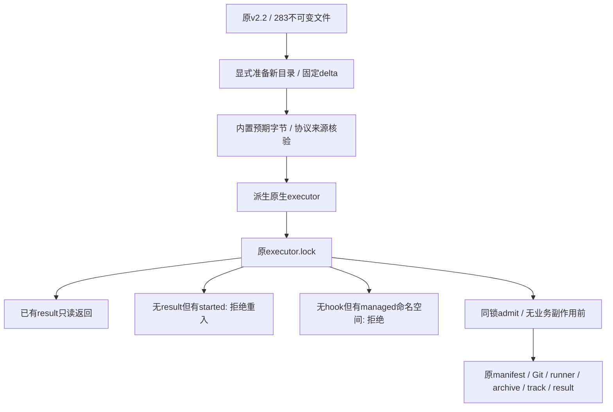

# B3.3b：版本化原生 executor 锁内准入接缝

日期：2026-11-15，计划r2，新的fresh-context独立设计审查两轴approve／开放0／0；R1在设计层关闭，尚未产品实施。固定基线为已普通发布的B3.3a `5182bfa03f536d4090b91014f97eedda1c5d2d3a`；该片自身CI43670140205／attempt1已终态七job成功／一失败，最小[测试观察等待修正](../delivery/2026-11-15-phase-publication-wait-regression.md)优先交付。可先独立设计审查、本地实施，后继产品只在前片CI接续修正的自身CI与终核闭合后推送，不借用前片验收。沿[生命周期调研](../research/2026-11-15-training-executor-lifecycle.md)，不把B3.3a的phase停止帧冒称训练执行证据。kernel专家留在v3路径，本片不改模板。

## 为什么必须先升级接缝

原training_executor.process在内部取得executor.lock；外层另开fd持同锁再调用会自锁。只在锁外检查request／started后再进入原process，会被手工执行器抢先开始、异常退出并留下started；原算法随后仍允许无result时重新进入Git／runner。因此不能用另一个外层slot、复制process、Path/open代理或运行期monkeypatch补出原子性。

本片只交付原生锁内admission hook和明确版本的来源身份，不交付应用执行授权、新owner能力、自动消费queued request或循环优化。后继B3.3c再把该接缝与原已submitted run、显式执行意图、原预算owner和真正stopped证据连接。

## 版本与持久边界

保留已发布reference v2.2及283文件逐字，不改原manifest、旧安装、旧project登记或活owner。新增一个明确的原生协议变体`training-executor-admission-v1`，以随产品固定的最小源代码patch和预期派生文件SHA描述，只覆盖原training_executor.py中必要的锁内接缝；Git、两臂runner、Sandbox、archive、track、result算法继续用原代码，不维护第二份executor实现。

派生源码只能物化到新的空目录：从已经verify的原bundle复制，使用既有Git apply的严格检查／应用，并核输出预期SHA；不在运行进程中改函数，不接受外部任意patch或自声明manifest授权。失败保留新目录供检查，拒绝将部分派生来源当有效安装。记录包含base manifest完整SHA、协议ID、delta SHA与已变更文件的完整预期SHA，其余来源继续按原manifest核。metadata本身不能替代内置预期源字节检查。

原validate_installation保持Path返回合同，能够识别原v2.2或这一内置且逐字匹配的派生协议；识别来源不是执行授权。旧reader不被假装支持新协议，新reader仍能读原安装。新CLI准备动作明确选protocol和新目录，只准备来源，不自动装依赖、建实验、启动服务或运行runner；现有Linux／WSL2执行边界保留。

首次受管执行支持采用新协议初始化的、没有历史执行器的独立native状态目录。不能把已存在的旧started、手工执行进程或活旧owner转为受管执行；旧登记只沿既有original-registration观察／取消／fence。旧二进制若被人为指向新状态目录仍可忽略新协议，此处不声称OS级隔离；支持范围明确要求所有参与该新状态目录的executor使用本协议，不能同时运行旧writer。后继执行片还须在原锁内核无不确定started，不能用该运维前提替代竞态检查。



来源协议仅让原生接缝可识别，不自行连接图中的业务动作。实际受管调用、明确授权和停止证据仍由c片连接，调优专家的提案不提升为执行权。

## 固定来源描述与准备接口

计划新增显式`ergora reference prepare-training --protocol training-executor-admission-v1 --directory NEW_DIRECTORY`，其API沿原reference来源owner，只写新目录；当前版本尚无此命令，不能据本文当作已可运行。无额外来源协议类族或插件总线。结果区分source prepared、dependencies未安装和runtime未启动。

新根目录的`ergora-native-runtime.json`只描述固定来源，字段为：

```json
{
  "schema_version": 1,
  "protocol_id": "training-executor-admission-v1",
  "base_reference_version": "2.2",
  "base_manifest_sha256": "1f39b63b9c4966a0cd3d870047818924238615d10dcf7b85945814f7c8074943",
  "patch_sha256": "45af28237aff0ffd066fe4a91064831facfaf5f6d8d50945081a5214907c93b9",
  "overrides": {
    "platform/local/agent_platform/training_executor.py": "feed0fa7574ad67e9d866adf41659d3288d1e4cc90178be2db830ea124388bca"
  }
}
```

这是r1候选delta的精确值，不是外部JSON可申请的授权。随产品固定descriptor的完整原字节，派生安装descriptor须逐字匹配内置版本（最多64KiB、普通非链接文件），不接受额外字段、重复key、NaN、截断或替换hash。已声明descriptor但无效时必须拒绝，不能退回原v2.2；缺descriptor却有派生源字节同样拒绝。对这一新协议，只有完整279个platform文件逐字（唯一override例外）和descriptor都匹配才返回有效根；原legacy仍保持原来按用途选择的Python文件校验范围。其它原来源／requirements／脚本均保留。r1值如经审查修改，固定新r版本并保留旧探针，不悄悄更新已发布协议。

准备阶段先核原bundle283与base manifest完整SHA，并核内置delta身份；仅在Linux／WSL2创建尚不存在的新目录。在复制任何源码之前，先独占创建空的`ergora-native-runtime.json`，同步文件与新目录；该不完整声明必须被validator拒绝，不能fallback为legacy。然后只复制原manifest列出的279个platform文件，经原Git严格check／apply，核单个override的预期SHA及其余全部278个原文件，最后才写入并同步固定完整descriptor，再按新协议完整核验后返回。源码准备及目录同步使用Linux／WSL2；其它平台可识别已有来源，但不声明原生执行支持。不能让请求选择一个任意patch、override路径或descriptor文件；不修改旧目录、不复制旧状态、venv或服务，也不创建native实验。新descriptor与源字节的校验可用于来源识别，不把相同路径上的代码更换当作旧owner的能力升级。真正的执行source／protocol绑定仍需c片在新owner出生时及原锁内再核。

## 原生hook合同与状态顺序

拟在原process(folder, *, admit=None)的同一executor.lock内：

1. 已有result继续按原观察返回，不追认受管停止或新attempt。
2. 读取原request，若存在started但缺result，在任何Git／runner动作前拒绝。拒绝位于原业务异常归档的try之前，不能生成或覆盖native result来掩盖不确定旧执行。
3. 无hook的手工调用如果发现该job的`managed-execution`保留目录存在（含symlink／部分发布），拒绝业务；此判断同在原锁内。它覆盖已有执行请求、attempt或未完成发布，不让手工调用抢走已交给受管入口的job。受管记录仅链接原job/request/run，不是第二实验状态表。
4. 有hook时，在同锁、第一次started／Git／runner之前调用窄callback，传原folder与完整已读取request。callback失败直接退出，不启动业务也不生成native失败result。后继应用hook负责最后的完整原request字节与语义、owner／clock／fence核验，以及不可重用process attempt／ack的durable publication。
5. hook返回后运行原manifest／fence及原process主体。它不绕过原native门禁，也不自行评分、追踪或发布result。

managed namespace固定为原job下`managed-execution/`，后继process attempt只在`managed-execution/attempt.json`；路径不来自用户配置。b片只保护命名空间和锁内hook，不先实现记录生成；c片固定执行请求、attempt／ack／stopped的完整schema与不可重用语义。callback不在配置中接受任意Python import；只有后继内置受管入口使用此原生调用接缝。普通手工无hook调用不产生受管attempt或能力。即使source protocol有效，也没有执行请求就不能由预算queue自行运行runner。

## owner、权限与后继边界

本片不修改owner.json或原budget intent；旧B3.2／B3.3a owner继续只有控制职责。B3.3c需另立出生时schema／capability合同：新reader兼容旧owner，旧身份不能靠升级代码、补文件或重启获得执行能力；新能力也必须等同原run/request的显式确认。原start attempt仍是唯一start slot，process attempt属于同job的执行生命周期引用。

应用执行必须使用选定native解释器及它原锁定MLflow等依赖；不能因为应用有Temporal SDK就拼接另一个venv的site-packages。B3.3b准备来源不宣称该依赖已安装或MLflow服务可用。后继真正执行时，executor与控制fence各用自己的专用S并行监督，同一原clock，控制fsync／registry锁阻塞不拖住业务停止；native result、reap完成、持久stopped和最终观察分列。缺证据保持unknown，不自动重跑。

## 可验收子节点

|节点|交付／验收|状态|
|---|---|---|
|b0 固定协议|核原process真实锁范围、hook精确位置、attempt相对路径、全参与writer版本边界和派生来源身份；新的fresh-context两轴计划审查|r1独立R1中断准备实红保持；r2同reviewer两轴approve／开放0／0，R1设计关闭|
|b1 新来源准备／身份|原283仍verify；新的空目录来源物化＋内置协议metadata／预期字节；原／新validator、篡改／半成品拒绝，原目录保持|待b0|
|b2 原锁内接缝|不复制原算法；真实子进程争用原executor.lock；started无result及已有受管attempt的手工调用均不能进入业务；拒绝callback不会落started/Git/result；正常无hook干净路径沿原native接缝回归|待b1|
|b3 安装与交付|新非editablecore／SDK逐字／283、受影响安装回归、真实CLI来源准备、原件保持、自身原模板、新fresh-context产品两轴、普通精确发布及自己的CI|待b2|

测试选原training runtime／submission和现有native fixture，不为每个mode复制矩阵。不用mock process返回或只测字符串含hook来证明原子性；保留真正锁内／锁外交错及原生started语义。补一项手工执行器在新入口外层预检后抢锁并留下started的真实竞态，验证新hook永不运行；新接口必须同时防已受管attempt后无hook重入。

改动owner优先沿reference及training native协议边界。若新建局部来源协议模块，需给出来源准备CLI、reference validator和后继native调用者的实际职责；不引入跨工具注册总线或把一次patch做成通用插件系统。文件数、公共配置和低代码能力依实际消费者，不为未来建空接口。

## 不在本片关闭的工作

显式执行请求、new owner schema/capability、完整run/history/memo admission、进程attempt／ack／stopped、实际Git／runner／archive／tracking的预算停止及SIGKILL恢复均归B3.3c；自动有限循环Q4.2c、Q5.2有证据重构、Q6一键复现与严格发布继续开放。CPU协议测试不认证GPU／质量／性能；真实用户workload仍需其明确训练命令与资产／设备／预算。

## b0来源准备探针

已做离线来源物化探针，不运行executor或修改产品：在ignored专用新目录复制一份原training_executor源码，`git -C NEW apply --check PATCH`与实际apply均exit0，派生字节与预期完全相同。原源码SHA256为`e6d2273c5958b0d2327338ebb07aade8b4c6e3ce27eee42c39454bf9af31eed0`，探针patch为`45af28237aff0ffd066fe4a91064831facfaf5f6d8d50945081a5214907c93b9`，派生文件为`feed0fa7574ad67e9d866adf41659d3288d1e4cc90178be2db830ea124388bca`。探针只证明已有Git能物化该固定delta，不是协议、进程或安装验收；正式patch和完整来源descriptor仍须b0审查固定，不能把这个私有原件当发行入口。

逐步状态写入[交付记录](../delivery/2026-11-15-training-executor-protocol.md)，每个节点同步[总计划](../PLAN.md)。r1设计审查只评价这个来源／锁内接缝合同，不能替代后继实际受管执行／自动循环验收。

## b0 r1独立R1与r2合同修正

新fresh-context reviewer在固定518的真实validator上复现：原platform复制完整、descriptor未写时被legacy接纳，违反半成品拒绝。保留r1探针与结论，r2明确上述先持久空descriptor的顺序；已声明但无效一律失败，正常完成才发布完整固定descriptor。新协议完整279校验与legacy原选择范围分开。delta源码／hook／精确SHA均保持r1，修正不增加执行权限、第二账本或可选协议类。[同reviewer复核](../delivery/2026-11-15-training-executor-protocol-plan-review.md)已两轴approve／开放0／0，R1仅设计关闭；10组便宜来源／真实flock／crash探针限其实际范围。产品实施仍待前片CI回归修正的独立交付，不把设计通过当作安装或执行通过。
