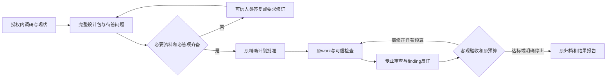

# WA4：设计讨论、可验证节点与循环执行演进方案

日期：2026-11-15。状态：**D1–D4已获用户明确确认；详细实施设计进行中，尚未实施新关卡**。承接[WA1–WA5原始要求](2026-11-15-workflow-evidence-and-human-gates.md)，依据固定a4371c8的[调研复用审计](../delivery/2026-11-15-workflow-research-reuse-audit.md)、[真实运行模型审计](../delivery/2026-11-15-workflow-runtime-capabilities-audit.md)、[设计与知识关卡审计](../delivery/2026-11-15-workflow-design-knowledge-audit.md)。审计范围不包含尚未合入的BR1／BR2或未完成的训练生命周期实现；本方案也不将它们当作已验前提。

## 结论与实施顺序建议

优先补“必要资料／关键问题→详细设计→明确决定→原执行关卡”，随后补逐finding复核和可信脚本／人工节点；训练循环继续沿既有c1b–c1d完成，最后再讨论一般图的Repeat组合。既有资源继承、权限收窄、自有DAG编译与Temporal继续负责定义／执行；本方案不替换调度器、不引入另一实验账本，也不把LangGraph搜索checkpoint当作正式任务状态。

|优先级／小片|应解决的用户问题|沿用的实际owner|前置与可验收边界|
|---|---|---|---|
|P0／WA5a 设计包与就绪检查|设计报告是否完整？必要资料和必答项是否仍缺？|原plan artifact、versioned profile、`reference_task_approval`及原Task／Workflow|先确定下节D1–D3。结构合法但必答项缺失时，原批准及work投递均被阻断并返回精确缺项ID；不增加工作／外部调用计数|
|P0／WA5b 答复、修订与决定|怎样讨论多轮、要求修改、拒绝、撤回与安全恢复？|原批准actor、receipt、intent／attempt／result及原cancel／fence|两轮设计和逐问题原答复均可读；旧批准不能放行新材料，重复／失联只对账原决定；不能将沉默转为同意|
|P1／R1–R3 逐finding反证与成对eval|现有多路review是否误报，研究方法是否真正有效？|原ReviewDAG／review_requests、finding结果与原evaluation|详见[既有审查演进计划](2026-11-15-review-validation-evolution.md)。原finding与validator输出分别保存；已知真缺陷／合法改动用独立oracle评价检出和误报，预算可比；少量示例不能代替总体准确率|
|P1／WA5c 可信非Agent节点|能否硬执行脚本、测试、人工检查，并验证结果？|原受管process／stage与Temporal activity；原结果／证据合同|先接一个真实受信检查节点；跳过、失败、超时／unknown、结果错candidate均不放行。Agent不能修改可信检查后据新检查自批|
|P1／c1b–c1d 本域优化循环|能否按当前瓶颈重复优化并在目标／预算／收益上限停止？|原training／budget／archive／rounds与总Workflow|继续[现有c1计划](2026-11-15-training-cycle-workflow.md)。下一候选前核真实phase、accepted archive、durable stopped及原索引，失败／unknown不越过；baseline与全部旧结果保留|
|P2／WA5d 一般Repeat组合|任意子模板是否可在明确目标和成本上限内反复运行？|版本化definition／compiler与原Temporal runtime|本域闭环验收后再立具体接口片。不得只加图上的回边或prompt而宣称已执行；D4确认前不实现通用循环|
|P2／WA5e CLI／页面与交接|用户怎样看到缺项、设计版本、决定、硬检查和迭代停止原因？|原CLI／HTTP薄入口与console|同一用例供两入口；错误／unknown不自动重发。展示完整当前材料和历史、可操作缺项、原决定身份，不把后端原生review评论充作Ergora批准|

已存在的六阶段和已有profile继续按其冻结版本运行。新关卡以明确的新profile／schema版本引入；不静默改变旧任务语义。安装、真实模型、可信脚本、真实Temporal旅程、GPU／训练质量和外部发布各自验收，不混用结论。

## 最小数据和职责设计

以下是拟议领域对象，不是已经存在的API／格式名。先复用原工件保存与摘要算法，避免为每一种对象新建数据库或通用registry。

|对象|必需内容|责任与边界|
|---|---|---|
|设计包|原task／request／baseline／完整manifest；设计revision与前版摘要；问题定义、研究采用矩阵、现有调用图、方案／取舍、非目标、模块接口、持久格式／迁移／回退、风格规范、工作顺序与验收合同；Markdown／HTML与机器对象绑定同一材料摘要|设计者撰写；原plan owner保存不可变材料。文件摘要只证明材料身份，不能证明设计正确|
|必要知识请求|稳定ID、缺什么／为什么必须、允许的来源、访问范围、所影响的决定与验收；内容／来源／时点摘要和明确缺失状态|读取授权由原资源／权限边界负责；不把内部全文复制进公开报告／模型history；拒绝访问可由人选择缩小范围并形成新设计|
|问题／答复|稳定ID、所针对设计摘要、依据／选项／代价、必答理由／决策人、影响范围；逐轮原答复／actor／时间／引用、supersedes及未决项|保留原答复，不将模型整理冒作人类事件。模型可提出问题与建议，不能自行将声明必答项改为已解决|
|验收合同|可操作输入与命令／可信检查身份、预期关系与容忍度、独立oracle、所需数据／设备／权限、失败／unknown判定、原结果保存与回退|尽量是可执行且与Agent主观操作无关的标准；性能需成对原结果／固定工作负载与质量边界。确需人判断的项应明确为human验收|
|设计决定|稳定ID、精确设计／问题集／验收摘要、可信actor／role、approve／request-revision／reject／withdraw、理由、已解决／仍缺ID、scope／条件与supersedes|沿原可信操作者／授权adapter；不能凭JSON写`human`获得身份。批准的继续权仍归原Workflow|

就绪检查仅能客观验证“声明的必要项已按所选policy解决且引用一致”。它无法证明所有未说出的公司知识都被发现，也不能证明人已理解设计。新资料与答复到达后重新生成设计包；影响接口、验收、权限、算法／数据或方向的变更须有新决定。对纯说明文字是否允许沿用旧决定，在D3明确后再实现，不由模型随意判为无关。

## 明确的执行／恢复关系

图是待确认控制流，不是现有runtime能力证明。设计讨论与代码修正分别计入各自原期限／预算；任何循环都不能刷新父授权或已占用start／launch。等待答复、等待批准、request-revision、已拒绝、已撤回、操作unknown应明确区分。

设计决定前后中断，按同一材料／决定ID和原run/history对账。未知投递不自动重发，不以新设计ID逃避原占用。撤回须阻断未发生动作；对在途进程走原stop／fence及实际回收观察，不把撤回事件称为子树已停止。历史答复、旧批准和旧结果不可覆盖。

## 非Agent节点与循环的最小契约

可信脚本节点优先引用项目登记的check ID／版本及精确实现摘要，而非任意shell字符串。它的argv／cwd／环境变量引用、输入candidate、允许读写范围、预算、成功／失败／unknown和原stdout／stderr／结果引用由执行owner持有；密钥仍只引用外部环境。模板权限只能收窄既有授权，不能借脚本绕过父模板。脚本属于外部副作用时，仍有原attempt与恢复职责；不能默认失败后重试。

人工节点应呈现完整受审材料和明确判断项，返回有身份的决定。模型review的approve不是human决定。普通模型节点、可信测试节点和人工节点可以组合，但须各有typed结果，编译时拒绝无实际runtime消费者的节点。

一般Repeat拟作为有界子工作流组合：body引用明确子模板，until只读取明确结果字段／可信oracle，固定最大轮数、父剩余时间／资源及停止条件。性能的边际收益需写明测量误差与成本口径；无法可靠计算时保留unknown或要求人决定，不让模型一句“差不多”自动放行。达到最大轮数与目标达成是不同终态，所有轮次保留。具体格式、与父子权限／资源继承的整合及SDK确定性边界待单独设计，不提前另造图运行器。

## 需要讨论的产品选择

|ID|推荐方案|可选取舍|
|---|---|---|
|D1 何时强制设计讨论|框架开发／结构重构／算法、数据、权限或验收发生重要变化时，新profile强制完整设计关卡；普通小修复沿项目policy明确选择|可设为全部任务强制，流程更统一但普通修复等待成本更高。不能把既有开发授权当作新产品policy已经决定|
|D2 谁确定必答项／必要资料|项目／模板声明最低policy，任务owner可追加；降低必要级别或接受假设须有权人明确决定并绑定设计版本|全部提出的问题都必须逐项答复／明确免答；遗漏更显眼，但低价值提问也会增加等待。访问拒绝不自动跳过|
|D3 决策与修订|先沿现有单owner；所有设计包变更形成新revision，接口／验收／权限／算法／方向变化必须重新批准；不答沿原到期停止，保留材料与恢复说明|多人按议题决策、可停放的长讨论与文字微调免重批，需要先定义冲突、有效期、可继续人和预算边界|
|D4 通用执行引擎范围|先完成设计／知识关卡、可信检查和本域训练循环；任意Repeat／混合节点图下一阶段再实现，继续用原Temporal|可优先完整混合图，但需要更大的定义版本／编译／恢复迁移，延后现有旅程可用性。不能宣称画图即已执行|

本草案建议上述推荐项，尚未代用户作选择。讨论后将原答复、明确决定、未决项与本设计revision一起保存，再把WA5拆成具体源码范围／客观验收的小片。已有授权的c1b1、BR1／BR2收尾及其他不依赖这些选择的工作继续推进。

## 验收与后续记录

每片至少核一个真实反例和修后同一caller：必答项未答拒绝→补齐一个但仍缺另一个继续拒绝→两轮答复／修订后批准同一完整设计→旧批准不能执行新设计→可信检查失败阻断→重复／中断恢复不重投→拒绝／撤回与实际收尾分别可读。脚本、循环片分别核错candidate／预算耗尽／unknown／退出回收、每轮旧结果保持。可配置值覆盖合法关系，不以默认数值和固定短等待制造限制。

WA4下一步：读完三份审计的具体来源／接口，对本方案进行讨论和必要的独立设计审查；确认范围后登记每片实际owner、schema／旧profile兼容、样例材料、命令和真实旅程。不在方案未确认时修改产品定义／schema／runtime。实现片按根规则更新计划与交付、调用自身审查模板并获得新的独立两轴评审。

2026-11-16：已将D1、D2／D3和D4以三项异步问题提交用户讨论，完整推荐及可选代价如上；当前待真实答复，没有把沉默视作批准。c1／BR等已授权且不依赖这些取舍的工作继续。

2026-11-16后续：用户已对三项异步问题分别明确答复“采用建议范围”“采用上述规则”“采用建议顺序”，[D1–D4决定记录](../delivery/2026-11-16-workflow-design-decisions.md)为当前依据。前文“尚未决定／待答”保留为讨论时历史状态，不再阻塞详细设计；当前正在细化WA5a／b真实owner、版本、原批准／work最后门及恢复，未实施新关卡。该方向决定不代替任何任务候选的精确批准。
