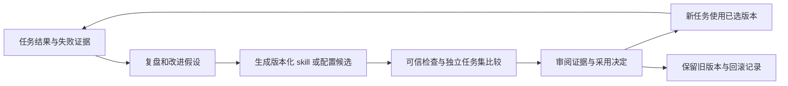

# RSI、长期记忆与持续演进调研

调研日期：2026-10-28。本文是 Ergora 的能力选择与设计建议；当前功能以 [README](../../README.md) 为准，整体产品与分层方案见 [多 agent 工具调研](2026-10-28-multi-agent-landscape.md)。本轮未安装下列候选、启用自动探索、更新模型权重或修改现有执行源码。

## 1. 建议结论

**推荐接入部分现有工具，把“持续演进”做成 all-in-one 中可选、可观察、可暂停的能力。** 优先顺序是可追溯记忆、任务复盘、skill 候选评估、定期研究，随后再评估工作流与代码演化、模型训练。

这里将 RSI 理解为 recursive self-improvement：系统利用工作反馈，提出和评估对自身工作方式的改进。保存一条记忆、写出一份复盘或换一个 prompt 都不自动证明能力提高；这类改进也不等于模型权重发生变化。现有研究工具能支持其中一些循环，不能由此推导出无限、稳定或自主的整体能力增长。

对 Ergora，建议先验证以下组合：

|需求|优先方案|选择理由与取舍|
|---|---|---|
|跨任务、跨会话记忆|保留项目原始证据；优先试接 ReMe 的项目记忆|文件可读、可备份，默认 BM25 无需 embedding；自动提炼仍需要模型，需核对作用域、纠错和并发写入|
|skill / prompt 持续优化|Agent Skills 格式 + Git 版本；GEPA 作为候选优化器|复用通用目录格式与成熟优化接口；需要真实任务集、可信评分和调用预算|
|主动探索新资料|复用 Temporal Schedule，先接版本公告、RSS 或指定资料；复杂问题再调用研究执行器|复用现有调度控制；新增来源、研究执行器与成本控制仍要实现|
|agent 工作方式与架构改进|作为 Ergora 自身仓库中的普通改进任务|沿用任务、分支、验收和独立审查，生产采用有明确版本；比直接热改运行中的核心更易复验|
|算法或训练代码搜索|按任务选择 ShinkaEvolve 或 OpenEvolve|有明确 evaluator 时价值较大；生成程序的执行环境与评估成本由任务负责|
|模型权重改进|后续按需接 Agent Lightning 等训练工具|需要开放权重、训练数据、奖励、GPU 和独立评价；API-only 模型也能先做记忆和 skill 优化|

这是**首轮验证推荐**，并非已选定依赖或已经集成。初版无需同时部署多个记忆数据库，也无需更换整个 agent harness。

## 2. 调研依据与改进对象

本轮取得 **24 份项目官方 README**，补读 Agent Skills 规范、调度与 prompt 优化文档、Codex 记忆接入说明和四份候选许可文件。下表列出 24 个项目资料入口，其中 Letta 与 Letta Code 指向同一现行实现，不作为两套独立候选计数。共 36 项请求，35 项取得内容，见 [来源索引](2026-10-28-evolution-sources.json)。最初猜测的 DGM 仓库地址返回 404，之后从 Sakana 官方页面取得正确仓库；失败请求继续保留，不能据此判断项目不存在。

来源是访问时的 `HEAD` / `latest` 文档快照，摘要只识别取得的内容，不代表固定上游 commit。未统一安装、跑 benchmark 或进行许可证审计；上游给出的效果、成本、规模与独有性宣称没有转写为本项目实测结论。

|改进对象|持久保存什么|如何判断有效|
|---|---|---|
|知识与工作记忆|项目事实、决策、来源、失败经验和适用条件|跨会话正确检索、来源准确、过期事实纠正、项目范围不串用|
|skill 与上下文|操作步骤、工具说明、提示模板、案例和失败条件|固定模型与任务比较成功率、检查结果、成本和回归|
|agent 配置与协作方式|角色说明、工具绑定、允许的工作单元依赖、上下文组合|同一批任务下比较交付效果、取消恢复、人工负担和资源消耗|
|程序与系统架构|版本化代码、接口和数据迁移|行为合同、兼容性、恢复、可维护性与真实项目验收|
|模型参数|训练配置、数据、奖励、checkpoint 与版本|独立数据质量、能力、遗忘与成本评估，保留可恢复基线|

一个可长期恢复的 agent 可以由角色配置、工作历史、批准的 skill 版本、记忆和任务状态重建，不必依赖同一进程或无限增长的一段对话。长期记忆、工作流 checkpoint、正式验收证据各有职责，不应互相替代。

## 3. 候选工具与集成取舍

### 3.1 长期记忆与上下文存储

|项目|当前官方实现与长处|代价、限制与 Ergora 建议|
|---|---|---|
|[ReMe](https://github.com/agentscope-ai/ReMe)|local-first Markdown 记忆，frontmatter / wikilinks；源会话、daily、digest 分层；BM25、可选向量、可重建索引，提供 CLI / Python / HTTP / MCP|优先验证。自动提炼会产生派生结论；需由 Ergora 保留来源、项目范围和采用记录，避免把同一 workspace 的自动整理重复调度|
|[Mem0](https://github.com/mem0ai/mem0)|记忆 SDK、自托管服务与托管平台，围绕用户、session、agent 组织写入和检索|接口清楚，适合服务化候选。当前 README 明确部分最新 benchmark 属于含专有优化的托管平台，不能当成 OSS SDK 的实测能力|
|[Graphiti](https://github.com/getzep/graphiti)|时间知识图谱，事实有效时间、实体关系、episode 来源追踪和增量构图|适合“哪个版本、什么时间仍成立”的关系查询；需自备图数据库、LLM、embedder 及外围服务。它是构图框架，非完整 agent 记忆产品|
|[Cognee](https://github.com/topoteretes/cognee)|将文档、代码和对话组织成可检索知识图谱，支持本地模型、MCP 和自托管|适合项目知识整合；本地无云 API 模式仍会下载模型并使用资源。应按具体检索任务比较收益，再决定是否增加图谱栈|
|[Hindsight](https://github.com/vectorize-io/hindsight)|以 memory bank 和 retain / recall / reflect 组织记忆、观察与 mental models，提供嵌入和服务方式|适合需要记忆推理的候选；要核对实际部署存储、模型开销与项目隔离。本文没有复现其准确率宣传|
|[MemOS](https://github.com/MemTensor/MemOS)|统一记忆接口、memory cube、反馈纠正；同时提供本地插件、自托管和云服务|能力覆盖广；本地插件的 SQLite 路径与自托管 Neo4j / Qdrant 组合不同，不能混为同一种部署或许可范围|
|[memU](https://github.com/NevaMind-AI/memU)|当前形态为共享 LLM wiki，由宿主 agent 从历史提炼并维护 Markdown skill，再提交和检索|轻量、贴近 skill 复用；需核对宿主和操作系统能力矩阵，不能按“支持 Codex”就假定每个平台的自动记忆都可用|
|[OpenViking](https://github.com/volcengine/OpenViking)|用 `viking://` 虚拟文件系统统一 resources、memories、skills；目录摘要支持逐层读取和检索|适合统一上下文服务候选，概念面和运维更多。当前主项目标 AGPLv3，组件分别许可，README 另有再发布相关表述；采用前需核对固定版本全部条款|
|[Letta](https://github.com/letta-ai/letta)|有状态 agent 的项目与迁移入口；当前源码已迁至 `letta-ai/letta-code`，覆盖 harness、App Server 与应用运行时|原 Letta V1 API server 位于 `archive` 分支且已退役。新接入应评估下表的 Letta Code；两行属于同一家族，不能把旧 V1 与当前实现当作两套活跃候选|

ReMe 当前 [Codex 集成文档](https://github.com/agentscope-ai/ReMe/blob/HEAD/integrations/codex/README.md) 已提供自动 recall、完成回合批量记录、MCP 和每日整理；它也明确了已验证的 Codex / Python / FastMCP 版本、hooks 信任和排队保存语义。因此“连上 MCP”不足以证明自动捕获生效，acknowledgement 也不证明记录已经落盘。Ergora 应先通过受控输入和两个独立会话检验，再决定是否采用宿主 hooks。

ReMe 的 `proactive_read` 只读取已生成的兴趣主题，不会自行联网、通知或重写知识库。主动资料研究仍需要单独的触发和执行职责，不能把一个读取接口当成完整自主研究循环。

### 3.2 上下文、skill、工作流与程序优化

|项目|优化机制与长处|代价、限制与建议|
|---|---|---|
|[ACE](https://github.com/ace-agent/ace)|Generator / Reflector / Curator，通过增量更新维护策略 playbook|适合参考复盘与经验整理，不必把整个框架变成运行时依赖；整理出的经验仍需判断是否适用于新任务|
|[GEPA](https://github.com/gepa-ai/gepa)|读取执行反馈，反思、变异、Pareto 选择；可优化 prompt、代码、agent 配置等文本对象，提供 evaluator / adapter|优先试接 skill / prompt 候选。评分质量、预算和保留集决定改进是否可信；支持优化架构不等于已证明可长期改进 Ergora 架构|
|[DSPy](https://github.com/stanfordnlp/dspy)|模块化 LM 程序与优化器，覆盖 prompt、示例及部分权重优化路线，也可用 GEPA|适合已采用 DSPy 的子流程；若仅优化一份 skill，可先直接调用 GEPA，避免整体迁栈|
|[TextGrad](https://github.com/zou-group/textgrad)|用 LLM 文本反馈构造“梯度”与优化过程，接口借鉴 autograd|适合可定义反馈链的实验。文本梯度是方法类比，不代表对任意工具或代码都存在可信数值梯度|
|[EvoAgentX](https://github.com/EvoAgentX/EvoAgentX)|构建、评估和演化 agent workflow，另含工具、记忆与人工交互|覆盖面广，适合作为工作流优化器或比较基线；整体纳入会与现有执行、记忆和控制面重叠，先验证单个可评估边界|
|[OpenEvolve](https://github.com/codelion/openevolve)|LLM 变异、程序种群与多目标搜索，用户提供候选程序和 evaluator|适合算法、参数化程序或内核候选；按正确性先筛选，再比较性能。不能直接继承上游“完全确定性”等宣传|
|[ShinkaEvolve](https://github.com/SakanaAI/ShinkaEvolve)|程序演化、候选档案、并行评价；支持本地 / Slurm，含面向 coding agent 的 skills|很适合有可信 verifier 的科学与性能任务；任务需拥有编译、运行环境和资源预算，不能把局部算法得分直接换算为平台能力|
|[Darwin Gödel Machine](https://github.com/jennyzzt/dgm)|修改 coding agent 自身代码，维护候选 agent 档案，以编程 benchmark 评价后继续分支搜索|是更直接的递归改进研究参照；官方实现包含 Docker 等环境前提，采用成本较高。优先借鉴候选谱系和独立评价，不直接改写在线控制面|
|[Agent Lightning](https://github.com/microsoft/agent-lightning)|当前 v1.0 将 Trainer、API Gateway、Rollout Controller 分开，配合 verl / vLLM 进行 agentic RL|这一路涉及权重训练，应作为研究训练接入；先解决数据授权、奖励、开放模型、GPU、质量与恢复，非默认必装组件|

DGM 的正确仓库来自 [Sakana 官方介绍](https://sakana.ai/dgm/)。它用经验评测选择改进，不是理论 Gödel Machine 对改进收益的数学证明。OpenEvolve / ShinkaEvolve 的可验证程序搜索与“整个系统递归进化”也应分别评价。

GEPA 已有 [自动学习 coding skill 的官方案例](https://gepa-ai.github.io/gepa/blog/2026/02/18/automatically-learning-skills-for-coding-agents/)，因此 skill 生成不需要从头发明算法。另一条可复用路径是现有 MLflow 的 [prompt optimization](https://mlflow.org/docs/latest/genai/prompt-registry/optimize-prompts/) 与 Prompt Registry；该文档要求 MLflow >= 3.5.0，优化接口面向 prompt，并不自动等同完整 skill 目录的注册、校验和发布。采用前需核对项目锁定版本，不在本轮升级当前依赖。

### 3.3 集成型 agent 与主动研究

|项目|已有组合能力|Ergora 的接入判断|
|---|---|---|
|[Letta Code](https://github.com/letta-ai/letta-code)|长期记忆与身份、memory / skill / prompt 更新、harness mods、dream / reflect、定时任务；MemFS 用 Git 跟踪上下文|是非常直接的持续演进产品参照。可评估完整执行后端或接口，不宜为获得记忆而把其所有控制逻辑复制进 Ergora；本地与 Cloud 状态归属需明确|
|[Hermes Agent](https://github.com/NousResearch/hermes-agent)|持久记忆、从经验生成和改进 skill、FTS5 历史检索、定时调度、渠道和多个终端后端|可评估长期专家 agent 后端，也可借鉴“轻量记忆 + 按需 skill”的体验。不能只因其自称唯一自改进 agent 就认定能力独有|
|[Deep Agents](https://github.com/langchain-ai/deepagents)|在 LangGraph / LangChain 上组合文件系统、subagents、上下文管理、持久后端与 skill|适合把研究或专业子任务作为一个可调用 harness；外层项目合同、任务归属、成本和验收仍由 Ergora 管理|
|[DeerFlow](https://github.com/bytedance/deer-flow)|2.0 为全新 super-agent harness，组合 subagents、memory、sandbox、skills、浏览与研究能力|可作为复杂研究执行候选；已经超出早期 deep research 流程，整体嵌入会引入另一套运行和管理职责|
|[GPT Researcher](https://github.com/assafelovic/gpt-researcher)|对 Web 与本地文档开展检索、整理和引用式研究，提供 SDK / Web 使用方式|适合作为有明确问题、来源和预算的研究子任务；引用存在不代表结论正确，需保留原始资料和适用版本|
|[changedetection.io](https://github.com/dgtlmoon/changedetection.io)|监测指定网页变化，可用差异驱动后续研究，浏览器获取按部署配置|适合资料更新触发器。README 的 AI 规则 / 摘要部分含托管服务限定，不能视为自托管开源版自动具备全部 AI 功能|

“记忆 + skill 演化 + 定时研究”已有现成产品组合。Ergora 的相对价值应验证在**项目合同、跨工具采用记录、独立证据和回滚管理**上，而不是仅以加入这些功能宣称新颖或领先。

## 4. 长期记忆如何真正可用

### 4.1 保存原始证据、派生经验和有权限的规则

建议把三类材料分别管理：

|材料|例子|更新方式与使用地位|
|---|---|---|
|原始证据|某提交的测试日志、实验 manifest、官方公告快照|按来源和内容身份保存；记忆摘要引用它，不取代它。必要删除按保留政策传播|
|派生记忆|“在版本 X 的 workload Y 中，设置 Z 导致失败”|允许新增、纠正、废弃，并记录来源、适用条件与版本；检索出来仍是一条待核对的经验|
|有权限的规则|项目验收要求、路径权限、预算、批准的默认 skill|由项目维护者管理；记忆提炼或网页抓取不能自行升级成这些规则|

当前已有任务与作业状态、Git 候选、证据归档、LangGraph / SQLite 搜索 checkpoint 和 MLflow 实验记录；它们不是一个已实现的通用长期知识库。后续记忆接口应消费这些来源，正式任务状态继续由原运行控制层拥有。

第一版可用项目 Markdown / JSON、Git 与 SQLite 检索构成简单基线，再比较接 ReMe 的净收益。记忆元数据至少应表达来源、项目与可见范围、观测时间及有效条件、来源版本、当前状态，以及纠正或替代关系。可重建索引属于派生数据，备份必须覆盖源文件和必要关联记录。

### 4.2 默认以项目为范围

项目 A 的失败经验不能仅因语义相似就成为项目 B 的事实。建议按项目、团队共享和个人偏好明确范围；跨项目分享采用单独的经验导出与审阅，不把业务日志、身份或凭据自动带入公开 skill。

同一项目可以让多个角色读取同一已发布记忆视图。写入先形成带任务来源的候选，归并时保留冲突与时间条件；不要让多个 agent 无记录地覆盖同一条结论。实现时先验证一个写入者或现成存储的并发语义，再决定是否需要更复杂合并。

撤销或删除一条记忆时，应同时处理检索索引、派生摘要、缓存及备份保留政策；失效事实不能靠调低向量相似度解决。删除来源后若无法重建某项结论，应清楚标出其证据缺口。

### 4.3 运行时冻结所用版本

建议任务启动时记录实际使用的模型、harness、skill 内容身份、工具绑定和重要记忆引用。复盘可以提出新候选；在途任务沿用已记录的配置，采用新版开启新的修订或任务。若发现关键记忆错误影响当前任务，应显式中止或重新审查相关决定，不能静默替换上下文后继续沿用旧审批。

在共享 Unix 用户环境中，文件路径、内容摘要和只读约定不构成不可绕过的访问隔离。需要防止其他 agent 改写可信规则时，要由实际执行环境或独立服务权限落实，不能仅靠记忆字段声明。

## 5. skill 如何持续优化并可回退

**格式优先采用 [Agent Skills](https://agentskills.io/specification) 的 `SKILL.md` 目录。** YAML frontmatter 放识别信息，Markdown 写操作流程，支持 `scripts/`、`references/`、`assets/`。Ergora 的评估、采用与回滚记录放在外部任务证据中；先固定 skill 完整目录内容和版本，不另造一套不兼容的 skill DSL。

格式可移植不代表工具权限与运行环境自动一致。各 harness 的发现位置、脚本执行、允许工具、hooks 和上下文加载能力仍需兼容检查；规范中的 `allowed-tools` 标为实验字段，不能把它当作跨工具通用的权限保证。

建议优化循环如下，全部属于未来设计：

首个试点可以只优化一个常用项目 skill：固定现有版本为 baseline，把历史失败按仓库、任务族和时间去重分组，分成候选构造集、迭代验证集和最终保留集。GEPA 可看前两者反馈；最终保留集与可信 evaluator 由维护者侧保管，不能让候选改写或读取答案后冒充泛化提升。

比较需要保留以下证据，而不只看 agent 的自评：

1. **输入身份。** baseline / candidate 目录摘要、模型及参数、harness、工具版本、数据划分与 evaluator 版本。
2. **实际结果。** 业务检查通过率、失败类别、无效外部操作、人工修正次数、延迟、token / 费用和完整原始输出；LLM judge 只能作为其中一类证据。
3. **公平比较。** 同一预算和任务条件下成对运行，保留失败与超时；随机性明显时重复比较，报告样本量和不确定性。换模型或工具版本时重新验证。
4. **采用记录。** 候选提出者、来源任务、评价范围、审查与采用决定、上一版本、适用范围和回退条件；未改善或存在关键回归时保留旧版。

预算至少约束候选数、模型调用或费用、执行时长和并行量；到限额停止搜索并保存当前结果。优化器不能通过修改评分脚本、删失败样本、降低验收标准或改变审批边界提高分数。评价合同本身需要改进时，应作为另一个独立变更评价。

首版建议自动生成候选和报告，由维护者采用。日后若允许对低影响内容自动发布，也必须先定义范围、阈值和回退条件，并以新任务绑定已发布版本；这项能力当前不存在。

## 6. 架构与 agent 自身如何演进

架构改进先建立可检查的目标，例如减少新工具接入代码、缩短首次任务配置时间，或消除一次已复现的恢复失败。不要把“agent 自己觉得架构更好”作为接受条件。

将 Ergora 自身作为一个普通受管项目：为改进建任务，固定基线与允许路径，在独立分支生成实现，经过原有 `inventory → plan → work → integrate → verify → review`，导出候选供维护者采用。现有流程的阶段保持固定；工作单元依赖可以在现有约束内调整，任意修改阶段拓扑需要另行扩展协议和运行时。

候选可以改善角色提示、上下文选择、工具绑定或工作单元划分。核心执行器、合同、策略、验收代码及自身优化机制的修改则应按软件版本发布，完成兼容与恢复验证。特别是持久运行时或数据格式的改变，需要明确旧任务、旧证据和存储迁移方式。

DGM、GEPA 或 EvoAgentX 可以参与生成和比较候选；正式评分合同、权限和采用决定仍由被管理项目之外的可信配置与操作者拥有。递归循环每一代都记录父版本、改进假设、评价集版本、成本和结果，防止只留下获胜候选而失去退化与成本信息。

这能让优化器本身成为未来的改进对象，但不要求把在线任务管理进程设成可自行热改的对象，也不要求为“进化”另起一套工单系统。

## 7. 主动探索新信息如何接入

主动研究应由明确主题或可观察变化触发：依赖版本发布、选定文档变更、某类失败重复出现，或用户设定的研究主题。先保存新旧资料差异、日期、来源版本和适用项目；没有变化时不必再跑完整研究。

建议复用 [Temporal Schedule](https://docs.temporal.io/schedule) 启动有预算的研究任务。初版可先处理 GitHub release / RSS / 指定官方文档，需求增长后再接 changedetection.io 或 GPT Researcher / DeerFlow。该接入尚未实现，现有搜索命令也不因此变成常驻研究服务。

|环节|建议行为|
|---|---|
|订阅|项目自己配置主题、来源、频率、时间窗口和预算，提供暂停与删除入口|
|去重|按来源内容身份、主题与项目记录已处理版本；抓取失败与“没有新内容”分开报告|
|调度|同一主题默认不重叠执行；明确补跑窗口，失败达到条件时暂停，避免离线恢复后堆积高成本任务|
|研究|研究执行器获取有限资料、保存引用与冲突、回答具体问题；网页和外部 skill 内容按资料处理|
|产出|生成项目可读简报、记忆候选或改进任务草案；文献结论和已在本项目验证的结论分别标记|
|采用|资料更新进入记忆或 skill 的评价流程；软件升级、实际训练、外发通知等按各自任务授权执行|

Temporal 的 Schedule pause 只停止未来调度，不会停止已经启动的执行；因此产品里应分别展示“停止后续研究”和“取消当前任务”。同一记忆 workspace 的整理任务只设一个调度所有者，避免同时开启工具内部 dream 和 Ergora 外部调度而重复消耗。

## 8. 与 all-in-one 和低耦合结构的关系

统一界面可以增加“知识与演进”入口，展示项目记忆及来源、候选 skill diff、baseline 比较、待采用项、研究订阅、预算和版本历史。它应与任务、计划、证据视图相连；关系画布仍只编辑协议允许的关系，不能通过拖动一个节点绕过审批。

内部先沿用整体方案的职责划分，不为每个候选工具各建一套平台：

|现有或计划职责|演进能力放在哪里|
|---|---|
|合同与策略|任务允许的改进对象、预算、评价要求、采用权限和版本引用|
|运行控制|研究或优化任务的生命周期、等待、恢复、去重和取消；复用现有运行时|
|执行适配|调用 ReMe、GEPA、研究 harness 或程序搜索工具，返回来源与候选产物；按实际消费者确定最小接口|
|证据与存储|来源、记忆修订、候选谱系、评估报告、采用与回退记录；可选 MLflow 关联|
|项目工单入口|将已形成的改进任务映射到本项目的 GitHub / GitLab 工单；不把全部项目迁到统一 issue 仓库|
|CLI / 控制台|查看、检索、比较、批准采用、暂停订阅和回滚；与后端使用同一合同|

先用公开 API、SDK、CLI 或服务接入，固定支持版本；不从第三方复制整套后台、账号和存储。ReMe / Letta Code 本轮取得的根许可为 Apache-2.0，GEPA / Hermes 为 MIT；实际引入时仍要核对具体组件、依赖、NOTICE 和修改后的分发方式。Ergora 自身许可不会由依赖许可自动决定。

## 9. 推荐实施顺序与验收

|顺序|最小完整切片|必须看到的证据|
|---|---|---|
|1|先迁入并复验现有工作流、源码和三模板|默认项目完成、取消、重启恢复；已有能力可回归。详见整体方案|
|2|项目记忆基线与一个外接候选，优先 ReMe|两个独立会话正确召回并带来源；过期纠正、项目不串用、删除传播、备份恢复、并发和成本验证|
|3|一个 skill 的 GEPA 候选比较|固定 baseline、可信评分与独立保留集、完整失败例和预算；采用新版并能退回旧版|
|4|一个主题的定期研究|无变化不重复研究，预算到限停止；抓取失败可见、可停调度、可取消在途任务，结果进入提案|
|5|配置和有限程序优化|同一任务集比较工作流或工具选择；必要时接 ShinkaEvolve / OpenEvolve，证明质量无关键回归|
|6|平台自身改进与可选权重训练|核心变更通过兼容、迁移、恢复与独立审查；权重训练另有数据、资源和能力评估|

先建立成功率、证据完整性、人工处理成本与模型费用基线，再逐项添加能力。只有记忆检索更快或产出更多 skill，不能代替任务成功和维护成本的改善。后续对外定位可以是**能在项目证据基础上持续改进的协作交付工具**；是否成为竞争优势，要由这些真实验收与比较数据支持。
