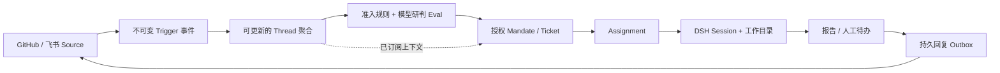

# DeepSeek Super-agent 原型与 Harness：定位、实现及 Ergora 接入评估

日期：2026-11-02。用户给出的[Reddit帖子](https://www.reddit.com/r/DeepSeek/comments/1xkg08h/deepseek_has_opensourced_again_unveils_super/)直接链接到 `deepseek-ai/dsh-superagent-prototype`，本次以它为主要对象，同时核对其 DeepSeek Harness 运行依赖。本文是官方资料与固定源码的静态调研，未安装、构建、认证或运行 DeepSeek 服务，没有跨工具效果或性能比较。

[计划](../PLAN.md) · [本地实际验收](../delivery/2026-11-02-local-e2e.md) · [50个来源文件的固定身份](sources/2026-11-02-deepseek-agents.json)

## 1. 结论与项目身份

**建议借鉴 Super-agent 的授权、消息及人工待办设计，后续把 Harness 作为可选 Agent 后端评价。** Ergora 继续拥有项目合同、可信检查、候选证据、精确批准和训练实验门禁。现阶段整包引入原型会同时带入单GitHub仓库、账号、DSH会话、存储、页面及运维方式，增加与既有执行链的重复职责。

|对象|已核对的身份|成熟度与边界|
|---|---|---|
|[dsh-superagent-prototype](https://github.com/deepseek-ai/dsh-superagent-prototype/tree/6337fc823ce20251c8de8085948165c81aaa701e)|MIT；源码 `6337fc823ce20251c8de8085948165c81aaa701e`，提交2026-10-31；包版本0.1.0|DeepSeek组织中的研究原型。README明确不是官方DeepSeek产品，公开版本不同于内部版本和设计文章，部分文章方案尚未实现。|
|[DeepSeek Harness](https://www.deepseek.com/zh/harness/)|官方主页交叉链接官方仓库；MIT；源码 `ce7073d51254c26cd63b22a60835b8f948deb447`，提交2026-10-30；根包版本0.2.2-alpha.2|通用插件式Agent运行环境，包含Web、Desktop及自动化入口；处于开发预览期，README明确会有破坏兼容的变化。|

GitHub API记录原型仓库创建于2026-10-31，Harness仓库创建于2026-08-13；这些是仓库时间，不能直接称为产品公告日期。本次两个 `/releases/latest` 查询均为404，不据此断言没有tag或npm发行。npm实际观察到 `@deepseek-ai/dsh` 的 `latest/next=0.2.1-rc.5`、`alpha=0.2.2-alpha.2`；`dsh-agent` 的 `latest` 仍为0.1.0-rc.6，`next` 才是0.2.1-rc.5。所有版本和发布时间保存在来源清单，后续安装必须固定整套兼容版本，不能把各包的latest任意混合。

原型安装手册推荐 `dsh@0.2.1-rc.3`，package.json声明 `engines.dsh=^0.2.1-alpha.2`；本次另读的是master上的alpha版本源码快照，没有实际验证两者组合。原型自身要求Node `^22.19.0 || >=24.0.0`，当前Harness源码要求Node `>=24.9.0`，来源与安装目标要分别记录。[原型安装要求](https://github.com/deepseek-ai/dsh-superagent-prototype/blob/6337fc823ce20251c8de8085948165c81aaa701e/docs/006-deployment.md) · [Harness包定义](https://github.com/deepseek-ai/deepseek-harness/blob/ce7073d51254c26cd63b22a60835b8f948deb447/package.json)

用户帖子及转载还谈到外部Watchdog、云端执行与状态分离、设备接入和调度实验。此次文章的X页面请求返回403，未取得可核对的官方全文；本文不复述转载中的加速数字，也不把文章方向算作公开原型已经实现的功能。

## 2. Super-agent 实际怎样组织工作

原型的主要对象是单个GitHub仓库的持续协作：接收GitHub及可选飞书事件，判断是否属于允许的工作，为每张Ticket运行一个独立DSH Session和目录，并把结果回到原讨论。核心通过ports定义授权、评估、执行、存储及回复边界；实际装配仍选择DSH Executor、SQLite Store和现成Source实现。[领域定义](https://github.com/deepseek-ai/dsh-superagent-prototype/blob/6337fc823ce20251c8de8085948165c81aaa701e/docs/001-domain.md) · [实际ports](https://github.com/deepseek-ai/dsh-superagent-prototype/blob/6337fc823ce20251c8de8085948165c81aaa701e/src/core/ports.ts) · [装配位置](https://github.com/deepseek-ai/dsh-superagent-prototype/blob/6337fc823ce20251c8de8085948165c81aaa701e/src/app/runtime.ts)

几个值得保留的设计分别解决真实问题：

- **消息上下文与授权分开。** Thread订阅可以把后续消息交给Ticket，不因此扩大Mandate。显式请求、规则推断的候选与忽略有不同准入条件；主动工作默认observe，只记录“本会接受”。Policy有版本，过期评估失效，结束任务恢复前重新验证授权。它并非每条消息都重新询问人。[授权合同](https://github.com/deepseek-ai/dsh-superagent-prototype/blob/6337fc823ce20251c8de8085948165c81aaa701e/docs/002-authorization.md)
- **Ticket与实际执行分开。** Assignment可以重试或更换，Ticket仍保存上下文、授权及讨论关联。worker并发槽保留一个用于人工跟进或状态请求，慢prepare不阻塞其他任务。运行中、等新消息和等人决定是不同状态。[执行合同](https://github.com/deepseek-ai/dsh-superagent-prototype/blob/6337fc823ce20251c8de8085948165c81aaa701e/docs/003-execution.md)
- **先保存副作用意图再执行。** Engine用事务变更领域状态，Effects持久保存派工/交付/通知，Outbox以消息ID保存pending/sent/dropped回执。重启后恢复排队项，外部写入是否完成仍需各Channel的去重/查询能力；这不是对任意远端服务的恰好一次保证。[Effects源码](https://github.com/deepseek-ai/dsh-superagent-prototype/blob/6337fc823ce20251c8de8085948165c81aaa701e/src/app/effects.ts) · [Outbox源码](https://github.com/deepseek-ai/dsh-superagent-prototype/blob/6337fc823ce20251c8de8085948165c81aaa701e/src/app/outbox.ts)
- **页面优先回答“现在要我做什么”。** 首屏先显示需要人工决定的任务，再显示系统问题和历史；重试、待回答、待审查要有具体动作。细节折叠，正常状态少占空间。[面板设计](https://github.com/deepseek-ai/dsh-superagent-prototype/blob/6337fc823ce20251c8de8085948165c81aaa701e/docs/005-panel.md)

工作目录常用prepare命令创建Git worktree。原型worker/router默认以操作员OS用户的完整访问权限运行，命令包装器与目录划分不构成文件隔离；安装手册还说明插件会修改自身进程的PATH/git配置，应使用专用profile。它要求github.com，暂不支持GitHub Enterprise Server；GitLab没有现成Source。不能直接用它替换用户希望按业务项目选择GitHub/GitLab或完全本地入口的整个控制面。[部署边界](https://github.com/deepseek-ai/dsh-superagent-prototype/blob/6337fc823ce20251c8de8085948165c81aaa701e/docs/006-deployment.md)

合并条件主要在Delivery requirements提示词和GitHub分支保护中，host没有专门的合并决策门禁。`ready`报告、PR关闭和Ticket结束的语义也不同于Ergora的可信verify及精确候选批准。两者若集成，必须显式映射状态，不能让模型报告自动变成验收通过。[原型Merging规则](https://github.com/deepseek-ai/dsh-superagent-prototype/blob/6337fc823ce20251c8de8085948165c81aaa701e/docs/003-execution.md#merging)

## 3. Harness 可复用的运行能力

Harness通过Cordis装配服务、事件与生命周期；Agent接口和注册表与Agent Loop实现分开。profile按有序bundle、profile/home补丁及命令补丁形成有效配置。YAML在这里表达插件装配，不是软件交付合同。Agent有followup、steer、inject、cancel等入口，Session事件用于持久重建，实时流另作展示。[架构](https://github.com/deepseek-ai/deepseek-harness/blob/ce7073d51254c26cd63b22a60835b8f948deb447/docs/architecture.md) · [Agent接口与工厂源码](https://github.com/deepseek-ai/deepseek-harness/blob/ce7073d51254c26cd63b22a60835b8f948deb447/packages/core/agent/src/index.ts)

|能力|固定版本的实际接口及限制|对Ergora的意义|
|---|---|---|
|命令行执行|`dsh headless --json`产生NDJSON；`--session-id`采用已有持久会话，验证cwd和归属。退出0且final.reason完成才表示Agent运行完成，业务检查另验。|最小可选后端候选；需要driver解析，不能直接将事件流当stage-json-v1结果。|
|Python/TS SDK|Python SDK通过stdio JSON-RPC启动同版本打包runtime；显式DSH_HOME；支持run、持久会话resume及通知。恢复历史不恢复shell/浏览器进程，协议响应超时不等于任务已取消。|Python项目可优先评价进程边界SDK，保留native ID及不确定结果，避免导入整套TS核心。|
|ACP|自动化stdio服务器支持创建/恢复/取消和模型选择；只暴露声明支持的标准语义，不能提供全部DSH页面对象。|F8/D5可评价的已有协议；ACP、MCP和A2A分别处理不同边界，不能互相替代。|
|多模型/原生子Agent|pi-ai适配支持多provider及兼容网关；Codex子Agent使用真实app-server，每次新进程/线程/单轮，不支持跟进或resume，保留原生认证权威。|证明DSH并非只能使用DeepSeek模型；仍需实际验证用户网关和各provider能力。无需为了Codex多包一层DSH。|
|Agent Teams|实验性Lead/teammate、共享任务依赖、revision/CAS及直接inbox消息。共享目录，跨进程协作与独立目录不支持；中断不释放任务owner；发送不承担新意图重试/重发去重。|可作为Agent内部协作实现，不能替代Ergora并行worktree、可信集成及持久调度。|
|Skill/信息保存|本地SKILL.md目录、目录优先级、按需加载和失效通知；Session事件、上下文恢复及原型prompt修订各自持久。|可导出已采用Skill供DSH加载。动态编辑和会话历史不等于跨项目语义记忆或经过固定评价的Skill改进。|
|沙箱|Linux后端先探测bwrap，再探测Landlock；不可用时明确失败，报告full/partial。它共享宿主内核和文件系统。|可借鉴功能探测与能力报告；不能从源码支持推导当前Docker中可用，也不替代容器/远端隔离。|

逐项依据：[headless](https://github.com/deepseek-ai/deepseek-harness/blob/ce7073d51254c26cd63b22a60835b8f948deb447/packages/bundle/headless/README.md)、[Python SDK及恢复限制](https://github.com/deepseek-ai/deepseek-harness/blob/ce7073d51254c26cd63b22a60835b8f948deb447/python/sdk/README.md)、[JSON-RPC入口源码](https://github.com/deepseek-ai/deepseek-harness/blob/ce7073d51254c26cd63b22a60835b8f948deb447/packages/sdk/server/src/index.ts)、[ACP](https://github.com/deepseek-ai/deepseek-harness/blob/ce7073d51254c26cd63b22a60835b8f948deb447/packages/acp/acp/README.md)、[pi-ai adapter](https://github.com/deepseek-ai/deepseek-harness/blob/ce7073d51254c26cd63b22a60835b8f948deb447/packages/llm/llm-pi-ai/README.md)、[Codex子Agent](https://github.com/deepseek-ai/deepseek-harness/blob/ce7073d51254c26cd63b22a60835b8f948deb447/packages/subagent/subagent-codex/README.md)、[Teams](https://github.com/deepseek-ai/deepseek-harness/blob/ce7073d51254c26cd63b22a60835b8f948deb447/packages/experimental/agent-team/README.md)、[Skill文件提供者](https://github.com/deepseek-ai/deepseek-harness/blob/ce7073d51254c26cd63b22a60835b8f948deb447/packages/skill/skill-filesystem/README.md)、[沙箱及探测源码](https://github.com/deepseek-ai/deepseek-harness/blob/ce7073d51254c26cd63b22a60835b8f948deb447/packages/sandbox/sandbox-local/src/index.ts)。这些是静态接口证据，本轮均未运行。

Harness默认loop明确没有内置turn预算，需在生命周期策略施加限制；原型的worker并发/等待限制也不能代替任务总成本限制。Agent-loop还记录了根上下文退出时最后turn/end可能未落盘的限制；新适配必须按实际持久回执处理，不由UI空闲推导任务完成。[loop限制](https://github.com/deepseek-ai/deepseek-harness/blob/ce7073d51254c26cd63b22a60835b8f948deb447/packages/core/agent-loop/README.md#known-limitations-and-deferred-work)

## 4. 对长久保存信息与RSI的判断

原型持久保存Trigger、Thread、Mandate、Ticket、Assignment、回复回执及设置/prompt版本；Harness保存会话和模型可见事件。这些支持继续工作和追溯，但需要分别管理领域数据、模型上下文和外部进程。[原型Store](https://github.com/deepseek-ai/dsh-superagent-prototype/blob/6337fc823ce20251c8de8085948165c81aaa701e/src/app/store.ts) · [原型持久化说明](https://github.com/deepseek-ai/dsh-superagent-prototype/blob/6337fc823ce20251c8de8085948165c81aaa701e/docs/007-architecture.md#persistence)

`src/core/memory.ts`实际是测试/临时Engine用的Map repository，不是长期语义记忆系统。prompt/Skill编辑记录修订，不能据此推导有GEPA式搜索、固定评价、比较后采用和回退。原型文档还明确旧记录尚无自动清理，持续运行会增长；保留策略必须与证据引用一起设计。[临时repository源码](https://github.com/deepseek-ai/dsh-superagent-prototype/blob/6337fc823ce20251c8de8085948165c81aaa701e/src/core/memory.ts) · [prompt修订](https://github.com/deepseek-ai/dsh-superagent-prototype/blob/6337fc823ce20251c8de8085948165c81aaa701e/docs/004-prompts.md)

因此Ergora应继续使用已有项目记忆、不可变Skill资产、固定评价及显式采用/回退；把“从失败生成改进候选”接到现有受预算任务。可恢复运行、能主动接任务、能改提示词，分别不构成已经证明整体能力持续提升的证据。

## 5. 推荐接入边界与已有格式

Ergora现有 [agents.invoke](../../src/ergora/agents.py)支持原生工具和带能力声明的 `stage-json-v1` command。已有[组件描述](../../src/ergora/components.py)、[项目绑定](../../src/ergora/projects.py)、[进程管理](../../src/ergora/processes.py)及[兼容保护](../architecture/2026-11-01-compatibility.md)应继续作为真实消费者的扩展入口。本轮没有加入DSH组件，页面也不应显示成已支持。

后续F8最小纵向切片可以选择headless或Python SDK中的一种：固定runtime版本和专用home，在同一模板/候选检查合同下跑一次真实任务；driver传入角色任务、工作目录和预算，验证结构化结果，保存日志/native ID。取消需确认该次活动及后代停止；失联先查询、再决定是否允许重试。能用已有SDK时不重写JSON-RPC，除非实际接口缺口有证据。

关系继续用现有版本化JSON合同，YAML只提供等价配置语法；把角色职责、工作依赖、资料流和工具授权四类关系分开。DSH内部Session lineage、Team事件和Mandate是其运行/授权数据，若接入，应作为带来源的引用与映射，不成为新的全局工作流DSL。会话resume、Temporal恢复和Git候选恢复分别保留自己的ID与状态权威。

|复用方式|建议范围|暂不采用的范围及原因|
|---|---|---|
|直接接现有接口|F8评价DSH headless/SDK/ACP；F10把已采用Skill导出为受支持目录|不把完整Super-agent运行时装成默认必需项；它引入第二套派工、SQLite、账号和管理页。|
|局部迁入/实现|F7的触发ID、授权快照、上下文关联、消息回执；F4人工待办；F6元数据字段和有效配置预览|不直接复制TypeScript Engine到Python；先在自己的所有者内满足实际消费者，保留MIT来源与声明。|
|仅借鉴|Agent接口与loop分离、领域端口、先保存意图、能力探测和状态诚实表达|不将Cordis插件树变成Ergora核心技术要求，不另写与Temporal竞争的持久调度器。|

双方优势是职责侧重的比较：DSH更接近交互式通用Agent运行环境，Super-agent更聚焦仓库事件和人的注意力；Ergora目前已实际验收的差异是候选绑定的软件交付、可信复验与训练证据门禁。没有同任务比较，不能称Ergora模型效果、速度或稳定性优于对方。

## 6. 回写计划的优先项与验收

不改变先完成R4–R8、再补P0/P1的顺序；以下细化已有节点，均未实现：

|优先级 / 节点|加入的具体要求|可验收结果|
|---|---|---|
|P0 / F2|版本固定、实际功能探测、有效配置及停止/启动完成反馈|缺凭据、runner不可用或旧socket未退出有明确状态；不因工具存在就写已可用。|
|P0 / F3,F5|恢复/取消保留native ID；外部副作用的不确定状态与对账；预算与使用量分开|取消请求不冒充停止确认；恢复不盲目重复外部写入；未知费用不写零。|
|P0 / F4|人工待办优先，按等待原因给具体操作|待计划批准、待回答、失败/阻塞、待放行分别从同一权威任务投影；数量与列表一致。|
|P1 / F6,F7|逐项目Source/Channel、Trigger去重、上下文与授权分开；共享schema生成表单|同一事件重投只产生一个任务；引用/机器人消息不扩大授权；审批内容更改形成新修订。主动接单先observe。|
|P1 / F8|固定版本DSH可选后端，明确SDK/CLI协议及能力差异|同一模板无需修改即可切换；真实任务、结构化失败、取消、恢复和候选证据可比较。|
|P1 / F10|prompt/Skill变化先形成候选，经现有评价再采用|失败记录保留，不能由后台生成器自行放宽评分或批准规则。|
|P2 / D3|按真实环境评价Landlock/远端等可选执行边界|实际探测、读写反例和生命周期检查后才声明支持；不要求无宿主机权限的用户强行启用。|

## 7. 验证、限制与交接

本轮核对官方主页、用户帖子到仓库的指向、两个仓库固定提交、许可证、包元数据和npm dist-tags；定向读取Agent/loop/Team/SDK/沙箱及原型授权/执行/存储/页面边界。来源清单保存50个文件SHA256，便于在别的电脑取相同版本复核，不包含第三方源码、登录状态或本机运行数据。

没有执行DSH测试、模型任务、真实GitHub/飞书写入、原型重启或任何隔离探测；没有验证原型与当前Harness源码组合。官方设计文章全文、文章实验和外部Watchdog实现仍无本轮已核对证据。本地L0的Codex/GPU/恢复结果只属于原有Ergora身份，不继承给DSH。

Ergora文档基线为L0交付 `b80d90e`，运行源码仍为 `4fe2ec5`。本轮3份Markdown的84个本地文件链接目标存在，来源JSON解析通过；逐一用 `git show <commit>:<path>`核对50文件的SHA256，全部匹配，`git diff --check`通过。没有生产代码变化，不重跑L0或既有全套CI。

研究报告、来源清单和计划已通过新的[fresh-context独立审查](../delivery/2026-11-02-deepseek-research-review.md)，无未解决findings。初审图表误将Thread也标成不可变，现已拆为不可变Trigger事件和可更新Thread聚合并复核；master上alpha版本的说明也已核对。状态以[节点登记表](../plans/2026-11-01-all-in-one.md#5-执行节点及进度登记)为准。

审查后补齐状态和审查链接，最终4份Markdown的88个本地文件链接、JSON解析和差异检查通过；该收尾不新增运行验收。

本切片按 `refactor/architecture-foundations` 分支提交推送，后续动作仍是R4用例与Skill依赖环整理；DSH运行接入留到F8的独立实现与验收。
