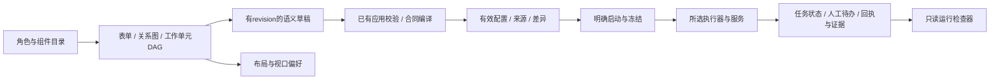

# 低代码图形编辑器：实现方式与 Ergora 设计

调研日期：2026-11-02。范围为与 Ergora 配置、协作关系和任务操作相关的代表性平台及可复用库，并非全部低代码产品普查。结论来自官方文档、固定源码的包描述/许可及部分前端入口；本轮未安装这些平台、运行其编辑器或测量性能。本文是 LC1 的设计建议，F4/F6 仍需单独实现和验收。

## 推荐方向

Ergora 应提供可视化配置与任务操作：从模板起步，选择各角色的实际工具，编辑允许的任务依赖，查看有效配置、验证错误、人工待办与执行证据。先复用已有原生表单与 Cytoscape；F6 用一个完整编辑旅程比较现有方案和 React Flow，再决定是否引入前端构建及框架。完整平台可以作为外部服务接入，不直接把其编辑器和运行时迁入默认安装。

理由来自当前项目边界：Ergora 已有组件 JSON Schema、角色能力、持久草稿、原六阶段编译器和执行快照。图形界面的价值在于把这些能力连成易理解的操作，而正式合同与状态仍由已有应用用例和执行器拥有。现有功能和待实施范围见[当前架构](../architecture/current.md)与[实施计划](../plans/2026-11-01-all-in-one.md)。

## 平台如何实现页面

|平台|已核实的交互/源码事实|值得参考|对 Ergora 的成本或限制|
|---|---|---|---|
|[Node-RED 编辑器](https://nodered.org/docs/user-guide/editor/)|顶部部署操作、中央工作区、两侧可移动面板；有节点面板、分组、子流、搜索、导入导出与调试。固定编辑器包5.0.9，palette源码独立管理分类和节点|组件发现、逐步展示、图与调试面板配合|自身消息流及部署语义不同；Apache-2.0，仍需保留适用声明|
|[n8n 工作流](https://docs.n8n.io/build/understand-workflows/workflow-components.md)|节点、连接、便签及分组；官方说明编辑自动保存到草稿，发布版本用于生产执行；editor-ui包声明Vue和Vue Flow|草稿/发布/执行分离，保存或发布的进度与失败可见|Sustainable Use与企业文件另有许可，不视为MIT组件；本轮Canvas源码路径404，内部实现只核对包依赖|
|[Langflow](https://docs.langflow.org/concepts-flows)|类型化输入/输出端口，模板起步和可序列化flow；自定义组件的元数据、inputs/outputs与方法定义行为。flowStore有节点/边变更与连接处理；包同时声明`@xyflow/react`和旧`reactflow`|组件描述驱动属性/端口，节点配置和工具实现分离|MIT；其Python组件执行模型与Ergora正式证据合同不同，不能仅凭依赖声明推断已全面迁至某一图版本|
|[Dify Workflow Studio](https://www.dify.ai/workflows)|官方描述画布、节点调试、人工输入、版本与DSL导出；固定入口确实组合ReactFlowProvider、连接处理/校验回调及状态store|设计与运行视图衔接，选节点看输入输出及错误|修改版Apache-2.0含多租户与前端标识条件；只参考交互原则，不复制其画面或组件。产品宣传不等于本轮实测|
|[Appsmith](https://docs.appsmith.com/build-apps/overview)|以widget、datasource、query/JS组成应用；选择widget后装载属性面板，固定入口关联Redux选择及属性控件注册|选中对象→属性检查器，表格/详情/操作页面|主要解决应用页面布局；整体表达式/查询/组件平台超过当前需求。核对根Apache-2.0及选定文件，不推断所有企业目录同许可|

上述产品共同体现三类机制：组件元数据提供可发现的操作和属性；画布或页面树承担选择与空间组织；应用状态将属性编辑、图编辑和JSON预览同步。图形库负责选择、缩放、拖拽和连线，平台另外实现校验、版本、服务调用及运行观察。仅装一个图形库不会自动获得可靠执行与恢复。

页面布局搭建和工作流编排解决不同问题。Appsmith一类适合做业务页面、数据源及操作；Node-RED/n8n/Langflow一类适合表达处理步骤与连接。Ergora目前需要固定导航下的配置编辑器和任务页，无需先开发可任意拖拽整个网站的页面设计器。

## 可直接使用的库

|候选|可提供|Ergora仍需实现|建议|
|---|---|---|---|
|已有[Cytoscape.js](https://js.cytoscape.org/)|框架无关图展示、布局、选择、缩放及JSON；MIT，项目已有随包资产|有语义的端口、属性表单、编辑命令、撤销重做、合同投影、键盘替代操作|先保留当前DAG与关系概览；不把Canvas序列化直接当执行协议|
|[React Flow](https://reactflow.dev/learn)|节点/端口/边、视口和选择；官方有键盘/读屏支持及性能指引；固定`@xyflow/react`包12.12.1，MIT|业务连接限制、可发布配置、版本冲突、运行快照、错误及用户流程|F6优先试验候选；引入React/打包有维护成本。免费核心不意味着所有Pro示例均可搬用|
|[JSON Forms](https://jsonforms.io/docs/)|JSON Schema描述数据，独立UI Schema描述布局，支持条件显示/禁用及自定义renderer；有React/Vue/Angular集成；MIT|领域校验、revision保存、后端权威错误、凭据引用和运行能力展示|复杂嵌套/条件表单出现后与当前轻量表单比较。固定HEAD为3.9.0-alpha.2，只作研究身份，不推荐直接安装预发布版本|

React Flow官方[无障碍](https://reactflow.dev/learn/advanced-use/accessibility)文档说明焦点、Tab/方向键和ARIA支持；[性能](https://reactflow.dev/learn/advanced-use/performance)文档建议稳定组件/回调引用、细粒度状态订阅和折叠大型节点树。这些是实现指引，不是对Ergora帧率、容量或WCAG符合性的测试结论。JSON Forms[规则](https://jsonforms.io/docs/uischema/rules)也只负责显示/启用条件；隐藏字段不替代服务端授权或领域约束。

本轮未新增npm/Python依赖，未接入上述第三方平台，也未改变现有CSP。引入库时需要另行核对选定稳定版本、随包许可、构建产物和离线资源；用户运行已构建发行包应无需安装Node。

## 建议的信息结构与页面分区

建议桌面页面采用顶部项目/模板/修订及验证/保存操作、左侧可搜索角色/组件、中央编辑区域、右侧所选对象属性、下方可折叠的错误/预览/运行结果。顶部必须能区分未保存、已保存草稿、验证失败、已冻结运行，以及异步操作的未决状态。窄屏改为列表和分步表单，属性面板用抽屉；保存和关键错误不能依赖横向拖动画布才可找到。

关系分别呈现：

|关系|事实来源|允许操作及校验|
|---|---|---|
|角色→工具绑定|项目bindings、组件能力与模板角色合同|选择兼容实现，显示已配置/已安装/已认证/已连通的实际状态；缺能力由后端拒绝|
|工作单元依赖|已有`work_units[].depends_on`|表单和连线编辑同一语义草稿；拒绝环、非法范围及缺失依赖|
|通信与事件流|后续F7–F9实际会话/事件/授权接口|在真实支持操作完成后开放；当前不能用画线制造已接入的通信能力|
|运行路径和证据|冻结配置、任务阶段、回执及精确候选身份|只读观察与有明确后果的批准/取消/恢复操作；画布位置不改变运行状态|

原六阶段中集成、可信验证和独立审查的门禁保留；画布不开放删除门禁来“让图能运行”。模板规定必需角色和结果，具体工具实现由绑定选择。对于当前正式开发，用户编辑的是合同允许的工作单元DAG，而不是任意改写六阶段生命周期。

## 数据与低代码扩展边界

沿用版本化JSON和JSON Schema表达配置，Agent Skill继续采用标准目录；不为拖拽另造一种协作DSL。组件元数据继续归`components.json`；属性面板读取现有configuration schema。若需要更复杂布局，独立UI Schema只描述展示，不生成第二套字段类型和业务默认。

语义草稿、布局偏好、运行记录分别拥有身份与生命周期：拖动节点或缩放不改变执行摘要；修改绑定、依赖或策略必须产生可检查修订；运行只消费冻结内容。图、表单和JSON预览应从同一份语义草稿派生。JSON导入先服务端验证，不能依次更新多个视图形成半次保存；未知或暂不支持的字段明确报错，不静默丢弃。

低代码接入的边界是“已有工具适配 + 声明式字段/能力 + 可见安装与操作”。只添加一项组件描述不会获得新的执行能力。新的外部协议仍需适配其输入输出、超时、取消、恢复及产物；UI可由元数据复用。后端继续使用已有严格jsonschema与业务校验，浏览器表单校验只给即时提示。凭据使用引用，图和项目导出不读取环境中的密钥值。Appsmith式任意JS表达式与在线任意Python组件暂不引入Ergora默认界面。

## 对应计划与可验收节点

|节点|建议增量|验收方式|
|---|---|---|
|F1.1（本轮实现，验收单独记录）|统一有效绑定、来源与revision，独立调用/正式任务保存视图|CLI/API一致，页面读同一快照；旧项目不回写、后续编辑不换在途工具|
|F1.2/F1.3|项目注册分步表单需要的单一用例、投影、导入预览和恢复信息|先CLI/API一致与冲突/中断验收，再在F4接页面|
|F4.1|从项目到模板、角色、任务创建与详情的连续导航；人工待办与结果检查器|浏览器走通正式启动/批准/证据查看；缺服务和未决取消显示真实状态|
|F6.1|限范围原型：列表/表单、节点属性、连线、JSON预览；比较Cytoscape与React Flow|同一两开发模板往返不改语义、布局不改摘要；记录构建体积/交互/维护差异，再定库|
|F6.2|统一编辑状态和命令、撤销重做、保存revision、错误定位|表单/连线/JSON一致；冲突保留未保存输入；跨项目/迟到响应不污染当前草稿；回退重做可复验|
|F6.3|分组/搜索/键盘替代、窄屏列表、运行只读叠层|390px主操作可达，键盘完成增删依赖；50/200/500节点数据集实测操作延迟并公开条件，不能只凭库宣传声称大图能力|

草稿自动保存、发布和多人实时协作分别有成本。优先显式保存与revision冲突保护，正式启动时显示冻结差异；稳定后再加自动保存。多人协作需真实冲突与权限需求支持后再评估CRDT，不由本轮文档或Dify入口中的协作hook推断Ergora需要同一方案。

## 固定来源与核查范围

以下完整提交均由官方仓库`git ls-remote … HEAD`于本日取得，再通过固定raw URL读取文件。共7仓库、18份成功文件，另有n8n Canvas路径1次404；不是已安装版本或推荐版本。包依赖声明只证明所声明的技术栈，不证明每条运行路径都使用它。未复制第三方源码进入发行包。

|仓库/完整提交|实际核对文件（相对仓库根）|
|---|---|
|[Node-RED `22d019c4eccac31d95f3b6167c7334de72ef02a6`](https://github.com/node-red/node-red/tree/22d019c4eccac31d95f3b6167c7334de72ef02a6)|`LICENSE`、`packages/node_modules/@node-red/editor-client/package.json`、同包`src/js/ui/palette.js`|
|[n8n `0db01ce46717bacc717101b9d46cf26a40204a59`](https://github.com/n8n-io/n8n/tree/0db01ce46717bacc717101b9d46cf26a40204a59)|`LICENSE.md`、`packages/frontend/editor-ui/package.json`；`…/src/components/canvas/Canvas.vue`未取得|
|[Dify `24da932967e9dfac79c65db8c85632b4aaea5204`](https://github.com/langgenius/dify/tree/24da932967e9dfac79c65db8c85632b4aaea5204)|`LICENSE`、`web/package.json`、`web/app/components/workflow/index.tsx`|
|[Langflow `b5c54a64e685b7e50fd3bc76e965ad718fc2dea3`](https://github.com/langflow-ai/langflow/tree/b5c54a64e685b7e50fd3bc76e965ad718fc2dea3)|`LICENSE`、`src/frontend/package.json`、`src/frontend/src/stores/flowStore.ts`|
|[Appsmith `3de45f002282352bca8b8c059f85fd9bc490924b`](https://github.com/appsmithorg/appsmith/tree/3de45f002282352bca8b8c059f85fd9bc490924b)|`LICENSE`、`app/client/package.json`、`app/client/src/pages/Editor/PropertyPane/index.tsx`|
|[xyflow `1bc405cd113618c17fd181b931a9fe573bec9fee`](https://github.com/xyflow/xyflow/tree/1bc405cd113618c17fd181b931a9fe573bec9fee)|`LICENSE`、`packages/react/package.json`|
|[JSON Forms `2c5fae62a8aace19970ac037d122fa6428cd0436`](https://github.com/eclipsesource/jsonforms/tree/2c5fae62a8aace19970ac037d122fa6428cd0436)|`LICENSE`、`packages/core/package.json`|

原始成功/失败URL、字节数和SHA256记录在本项目忽略证据目录的`research/identities.json`；需要复查时从表内固定提交获取同名文件。Dify旧文档节点URL本轮两次不可访问，相关产品描述采用官方Workflow Studio页，并以固定入口限定源码结论。研究没有使用文档镜像。许可表是本轮选型限制记录，不是对全仓所有文件或未来发行条件的保证。
