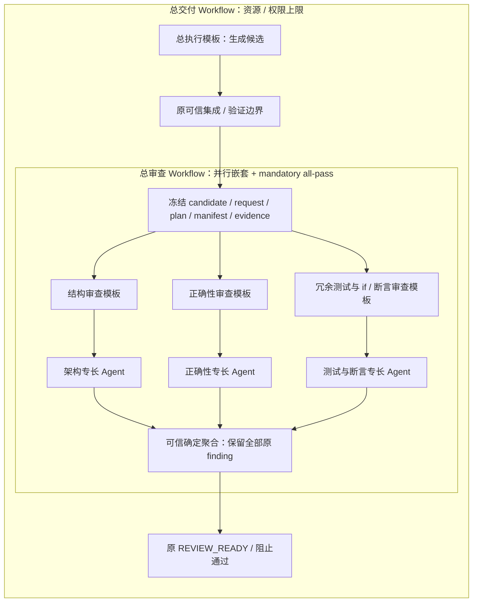

# 可嵌套工作流模板：固定源码观察与最小准入模型

日期：2026-11-08。**Ergora 尚未实现这里要求的通用嵌套工作流。** 当前工作单元 DAG、草稿和画布不等于可复用子工作流运行器。用户要求的结构是：结构审查、正确性审查、冗余测试与 `if` / 断言检查各自成为独立模板；总审查模板并行调用三者并汇合；总执行模板与总审查模板串行承接；每个叶子 Agent 仍独立配置职能、专长、Skill、MCP、权限和后端，执行与审查优先使用不同后端。

本次新增要求还包括：Workflow 模板本身可声明 Skill、MCP、上下文和权限；一个运行实例必须完整继承其全部结构祖先的 Skill 指令与上下文，资源只能追加，权限不能越过父模板。父子权限可以在同一新配置修订中一起调整，但最终完整祖先链及项目、操作者上限仍须成立，已批准运行不变。

本文是研究和设计建议，未改变生产实现、schema、计划或测试。Ergora 源码观察固定在 `bf99bd47220572fd721546a2eeb5b1b2739a57b5`；[既有研究](2026-11-08-agent-composition.md)、[ADR0004](../architecture/decisions/0004-agent-composition.md)和[AC 计划](../plans/2026-11-08-agent-composition.md)提供上下文，不能当作功能已经交付的证明。并行进行的 AC1.2 修复不属于本研究范围。以下分别标明外部实现事实与 Ergora 建议。

## 1. 当前真实边界

|已读实现|观察|对本需求的结论|
|---|---|---|
|[drafts.py](../../src/ergora/drafts.py)、[reference.validate_input](../../src/ergora/reference.py)|草稿保存 `kind/input/revision/validation`，保存前调用原开发任务输入校验；入口只接受 `repository-governance` 和 `large-change`。|保存一份输入草稿，没有解析 WorkflowDefinition 或递归启动子工作流。|
|[大型变更输入 schema](../../src/ergora/data/reference/platform/templates/large-change/input.schema.json)、[治理输入 schema](../../src/ergora/data/reference/platform/templates/repository-governance/input.schema.json)、[contracts.validate_task](../../src/ergora/data/reference/platform/upstream/platform/dev_platform/contracts.py)|工作单元含 `id/depends_on/paths/instructions`；语义校验已有未知依赖、依赖环、路径包含关系及无序单元写范围重叠检查。|已存在有界工作 DAG；节点不是“任意 Agent 或 Workflow 引用”。|
|[portable workflow schema](../../src/ergora/data/reference/platform/upstream/platform/portable/schemas/workflow.schema.json)|`stages`、`development-lifecycle`、`dependency-dag`、人工 gate 和 `REVIEW_READY` 均为固定值；不是通用拓扑 schema。|不能仅增加子模板字段就宣称原运行时支持嵌套。|
|[DevelopmentWorkflow](../../src/ergora/data/reference/platform/upstream/platform/dev_platform/workflow.py)|`units()` 按已完成依赖启动工作单元，受 `max_parallel_units` 限制，依赖回执交给隔离 worktree；`run()` 明确编排 inventory → plan / 人工批准 → work → integrate → verify → review。|“六阶段硬编码、阶段内有工作 DAG”这一前提准确；需要保持原质量合同，而不是把已有 DAG 重写成第二套持久调度器。|
|[画布](../../src/ergora/data/console/workflow.js)|编辑 `input.work_units`、依赖、路径和任务说明。|图形存在不证明有工作流递归引用、独立子运行或嵌套恢复。|
|[Activities.poll](../../src/ergora/data/reference/platform/upstream/platform/dev_platform/activities.py)|核回执作业身份、精确候选、必需产物与检查；verify 要求可信 CI；review 要求显式独立通过，排除作者 ID / session。|这些门禁必须继续拥有最终准入；Agent 的通过文本、子图结束或进程 exit 0 都不能替代它们。|

当前 `authors()` 按现有阶段键排除 `verify/review`，`job_id` 也按既有 stage 派生。迁入嵌套时必须显式设计“实际写参与记录”和实例路径身份；直接把新 review 子节点塞入原 `results` 字典，不能自动获得正确的作者排除和唯一作业身份。[DevelopmentWorkflow](../../src/ergora/data/reference/platform/upstream/platform/dev_platform/workflow.py)

## 2. LangGraph 实际提供的组合语义

本节主源码固定为 `langchain-ai/langgraph@e5e37b5d70dbfd93c7006bd90a658c6179a95946`，沿用前轮版本；官网为本次取得的动态文档快照，不能把其所有示例参数都推定为任意历史版本可用。原 `durable-execution.md` 本次请求重定向到 `persistence.md`；具体恢复边界据当前 Checkpointers、Fault tolerance、Interrupts 和固定源码核对，未把重定向页面冒充原文。

|主题|官方文档与固定源码观察|Ergora 应借鉴的语义|
|---|---|---|
|定义与执行|`StateGraph` 是 builder，节点为 `State -> Partial<State>`，须 `compile()` 后执行；节点和 reducer 是 Python 函数。[LG-graph][lg-graph]、[固定 state.py][lg-state]|借鉴显式端口、状态及编译边界。**这不是官方可移植 JSON 工作流格式**；Ergora 的版本化配置与准入由自身定义。|
|嵌套与状态隔离|可直接把 compiled subgraph 作为节点，共享同名状态通道；不同 schema 可在 wrapper 内显式映射输入、输出，私有消息历史留在子图。[LG-subgraphs][lg-subgraphs]|默认子运行私有状态、显式输入输出映射；仅共享必要的候选与证据引用。schema 私有字段不是 OS、凭据或权限隔离。|
|并行 reducer|每个状态键有自己的合并规则。固定 `LastValue.update` 同一步收到多个值会拒绝；不是任意并发写都能“最后一个覆盖”。列表追加也不保证业务结果次序。[LG-graph][lg-graph]、[LastValue][lg-last]、[并行文档][lg-flow]|每叶子向自身稳定路径写结果，再按冻结节点顺序确定聚合；不让审查者并发覆盖一个 `review.status` 或 findings 列表。|
|多父汇合|`add_edge([a,b], join)` 等待所有指定父完成，源码用 `NamedBarrierValue`。分别连 `a→join`、`b→join` 不是同一语义：不同长度分支可让 join 在不同 super-step 多次执行。[state.py][lg-state]、[LG-control-flow][lg-flow]|首版静态图明确 `depends_on` 为全部必需依赖完成后执行一次；不能靠看起来相同的连线推导 all-join。|
|动态 fan-out|`Send` 可在运行时把不同输入发送给同一节点的多个实例；reducers 合并结果。`defer=True` 等待图内所有 pending tasks，并非仅等待某个父集合；条件分支未选择某个 list-join 父时，该 join 不会运行。[Send 源码][lg-types]、[LG-control-flow][lg-flow]|动态分支需要额外的展开身份、终止和汇合规格。用户当前需求用静态、有限的嵌套 DAG 即可，不必先支持 `Send`、任意条件或循环。|
|重复引用与持久状态|当前文档区分默认 per-invocation（`None`，调用内继承父 checkpointer）、per-thread（`True`，跨调用积累）和 stateless（`False`）。per-thread 并行工具调用会冲突；函数内调用的 namespace 还受调用次序影响。[LG-subgraphs][lg-subgraphs]|同一定义可多处引用，但每个引用位置必须实例化独立运行和资源解析结果；定义复用不等于共享会话、checkpoint 或可变实例。|
|namespace 的源码依据|固定 `_loop.py` 用 subgraph 调用计数追加 namespace；`_own_checkpoint_config` 对 `checkpointer=True` 移除 task ID，保留每线程历史；`_algo.py` 构造任务 namespace。[loop][lg-loop]、[main][lg-main]、[algo][lg-algo]|不能用显示名称、数组次序或“第几个调用”充当持久子运行身份。采用冻结局部节点 ID 组成的完整实例路径。|
|checkpoint 与失败恢复|checkpointer 在 super-step 边界保存状态；同一步已成功节点的 pending writes 可供恢复，区别于完整历史 checkpoint。`exit/async/sync` 的落盘时机和崩溃窗口不同。[LG-checkpointers][lg-checkpoints]、[loop][lg-loop]|明确准入意图、逻辑操作及回执何时已持久；不能仅凭“有 checkpoint”承诺外部副作用 exactly-once。|
|interrupt / replay|interrupt 恢复会从节点开头重跑，多次 interrupt 的 resume 值按调用次序对应；wrapper 内子图 interrupt 也会重跑父 wrapper 开头。[Interrupts][lg-interrupts]、[固定 interrupt][lg-types]。历史 replay 会重新执行所选 checkpoint 之后的 LLM、API、interrupt；默认子图在父层被视为一个 super-step，内部历史粒度另有配置。[Time travel][lg-time]|人工批准必须绑定精确 manifest、计划和决策身份。恢复、重试和主动重放是不同操作；不能重放外部写入、换新候选或把旧批准自动搬到新执行。|
|副作用幂等|重试是节点至少一次执行；稳定幂等键应来自事先持久状态，且外部服务须支持去重。提交成功但回执丢失时仍是 unknown，应查询对账。[LG-fault-tolerance][lg-fault]|继续复用 Ergora 原意图、原生身份及对账；不把新 attempt 当成允许重复启动原生作业的理由。|

LangGraph 支持的图迁移也不等于 Ergora 已批准任务允许热换配置：文档说明恢复使用当前编译的图，重命名待恢复节点、改变 schema 或 interrupt / task 顺序可能破坏恢复。Ergora 的批准与可追溯要求更强，应冻结原实例展开与执行版本，显式迁移。[LG-graph][lg-graph]、[LG-interrupts][lg-interrupts]

## 3. 少量对照：ADK 与已有 Temporal

Google ADK 的 Sequential / Parallel / Loop 文档能说明“顺序列表、并行分支、有限或条件终止循环”这三种组合；编排由程序决定，叶子可以调用模型。**本轮固定 Python 源码 `google/adk-python@1cb926d5b8d702261ec82a26d3f1c4296e0db7d7` 已把三类标记为 deprecated in favor of Workflow**，当前文档也提示 Python / Go 的新工作流替代，因此不建议为了本需求新接这三个旧类。[顺序文档][adk-seq-doc]、[循环文档][adk-loop-doc]、[Sequential][adk-seq]、[Parallel][adk-par]、[Loop][adk-loop]

固定源码的 ParallelAgent 明说只隔离分支会话历史，session state 仍共享；官网旧模板页对 state 的概括不能覆盖这一版本的明确实现。Sequential 共用 InvocationContext；BaseAgent 子实例已有父对象时不能再挂到另一个父对象。Loop 的 `max_iterations=None` 可无限循环。这些都支持“复用不可变定义、为每个引用构造运行实例、明确有界终止”，不能证明自动具备授权、完整祖先资源继承或 checkout 隔离。[Parallel][adk-par]、[BaseAgent][adk-base]、[Loop][adk-loop]、[模板文档][adk-par-doc]

Ergora 已在 [pyproject.toml](../../pyproject.toml) 固定 `temporalio==1.34.0`，本研究以官方 tag `1.34.0` 解析到 `temporalio/sdk-python@a4c2bb38c3bad43498dfa6bd849e8d85bb684e94` 核接口。Temporal 的 `start_child_workflow` 返回已启动子工作流 handle，`execute_child_workflow` 等待其完成；子工作流事件进入父 history。Activity 也可先取得 handle，再集中等待，因此并行叶子不要求引入另一个持久引擎。[Temporal-child][temporal-child-doc]、[固定 child API][temporal-child]、[Activity execution][temporal-activity-doc]、[固定 activity API][temporal-activity]

Temporal 的父关闭策略与取消传播是不同设置；固定 API 默认 `ParentClosePolicy.TERMINATE` 和 `WAIT_CANCELLATION_COMPLETED`。取消“启动子工作流的 task”也不等于取消已经启动的子工作流。Workflow 要求确定性，不在其中直接做网络、进程、磁盘副作用；`workflow.wait` 是 `asyncio.wait` 的确定性替代。上述保证仍不等于外部模型进程已经停止，原 submit / poll / fence 合同继续必要。[固定 child API][temporal-child]、[SDK README：determinism / cancellation][temporal-readme]、[DevelopmentWorkflow.stop](../../src/ergora/data/reference/platform/upstream/platform/dev_platform/workflow.py)

**建议保留 Temporal 为唯一持久编排事实所有者。** 第一版可把静态嵌套定义递归展开为带层级路径的确定性执行计划，在一个新版本 Temporal workflow 内调用原外部执行桥；SQLite 保留既有准入意图与投影。需要独立历史、时限或生命周期时，再选择同一 Temporal 下的 child workflow。不是每一层模板都必须对应一个 child workflow，也不同时启用 LangGraph checkpointer 与 Temporal 来竞争同一阶段的恢复决定。LangGraph 将来若作为局部候选生成 adapter，重试与外部作业归属仍须只有一个明确所有者。Temporal 本身通过 history / replay 恢复 Workflow 状态，这不替代领域准入和外部副作用对账。[Workflow Execution 文档][temporal-execution-doc]

## 4. 建议的最小领域模型

以下字段组是 **Ergora 提案**，不代表当前 CLI 可导入格式，也不声称参考框架原生实现了这些领域规则。

|对象|最小内容与消费者|
|---|---|
|`AgentDefinition`|稳定定义 ID、版本与内容摘要；可承担职能、专长、提示、Skill / MCP / 资料请求、权限请求、后端 binding 与预算默认值。只描述叶子配方，不保存子图、会话或任务状态。沿用 ADR0004 的资源与 adapter 准入。|
|`WorkflowDefinition`|独立 ID / 版本 / 摘要、输入输出合同、模板自身指令 / Skill / MCP / 上下文、权限与对子级的授权上限、局部节点、依赖和显式映射、mandatory / advisory 与固定聚合策略、局部及全局限额引用。它描述组合，不能伪装成一个拥有所有权限的万能 Agent。|
|`WorkflowNode`|稳定局部 ID；明确二选一的 `agent` 叶子引用或 `workflow` 嵌套引用，均固定版本与摘要；`depends_on`、输入输出映射、职责 / scope、必需性与有限覆盖。相同定义引用两次必须有不同局部 ID。|
|递归冻结 manifest|根定义、所有递归定义与每个实例路径、资源来源和静态有效继承结果、实际后端 / 版本 / 模型已知项、有效权限、已知上下文，以及未来运行态输入的 schema / 来源 / 绑定规则、预算、聚合 / 编译 / 执行合同版本。纳入创建 / 批准身份链；实际运行态材料另在子调用前形成不可变快照。|
|`WorkflowRun / NodeRun / Attempt`|稳定根实例 ID、结构父路径、完整节点路径、逻辑操作 ID、attempt、定义 / manifest / 输入摘要、原生作业与 Temporal Workflow / Run ID、状态、取消与对账回执、产物 / findings / usage。定义 ID、运行 ID 与后端 session ID 分开。|

第一版只支持静态、有界 DAG 嵌套：端口映射是受限字段 / 产物引用，不执行任意 Python、模板表达式或 YAML 对象构造。节点在全部依赖成功后仅启动一次；失败、缺失、超时、取消和未知状态均阻止依赖节点运行。review 分支可以按冻结策略收齐在途 findings，不能让后续阶段通过。可信批准、集成、CI 验证和审查聚合由现有领域合同及受控桥接承担，不作为用户可随意替换的普通 Agent 节点。

递归模板引用图与每层执行 DAG 要分别查环；还要在展开前后检查最大深度、实例数、叶子数、输入 / 证据字节、总时限、费用 / token、后端配额和全根并发。各层并发上限不能相乘绕过全根上限；同一定义反复引用也占实例和预算。最终允许的界限必须有真实消费者与边界验收，不把旧工作单元容量或画布容量直接宣传为嵌套执行容量。

写范围沿全部祖先收窄，每个 checkout / worktree 同时只有一个写 owner；不同路径声明也不允许两个写者共享可变 checkout。只读审查须绑定精确候选，写者在独立 worktree 执行，经原可信集成与验证再交给审查；叶子结果不能直接修改根候选、父授权、门禁或聚合规则。[既有路径 / DAG 校验](../../src/ergora/data/reference/platform/upstream/platform/dev_platform/contracts.py)、[ADR0004](../architecture/decisions/0004-agent-composition.md)

## 5. 祖先资源强继承与权限收窄

这是用户明确要求的 **Ergora 自身合同**，并非 LangGraph、ADK 或 Temporal 自动提供的能力。**首版所有祖先 Workflow 声明的 Skill 指令与上下文都全量必需，以下 `required` 只指这份完整集合，没有 optional inheritance 开关。** Skill 目录内按需调用的脚本 / supporting assets 与必读指令分别处理。类继承只适合帮助理解“资源追加、不能削弱祖先”；这里没有任意方法覆盖、权限协变或共享可变父对象。

祖先是当前运行实例从根到该节点的结构路径。依赖前驱是数据流来源，不因此成为父模板；兄弟模板不会自动共享会话、Skill、上下文、MCP 或权限。同一子模板出现在两个父路径下，会产生两个独立实例及各自的有效资源集合。复合 Workflow 自身不调用模型，不能宣称它已经“读过”；其资源必须继续传递到该实例的每次实际叶子调用，若内部另有协调 Agent，该 Agent 也是须完整装载的叶子。

|规则|确定性准入与运行要求|
|---|---|
|只增资源|按根 → 当前 Workflow → 叶子 Agent 的固定次序求有效资源集合；子级可追加自身材料，不能删除、替换、可选化或通过输入映射隐藏祖先的 required Skill 指令 / 上下文。祖先上下文与任务端口是分开的受控输入。|
|合并 / 去重|按冻结声明顺序与稳定资源 ID 合并。相同身份、版本、内容及装载方式可只传一份字节，但保留全部声明来源和祖先路径。不能仅按文件名、显示名称或原文件摘要去重；渲染参数、输入映射、物化后的完整字节身份也须一致。|
|版本冲突|首版对同逻辑 Skill / MCP / context ID 的不同版本、摘要、服务端点或不相容配置明确拒绝，不用 last-wins 丢掉祖先版本。若将来支持并存，须有独立命名空间与后端装载合同；不能预先假定同一工具名可安全重载。|
|完整装载|每次实际叶子调用须完整装载所有祖先 required Skill 指令和所声明上下文，再加自身材料；目录列表、可访问链接、资源摘要或一段摘要均不能替代原文。完整 Skill 树身份与 supporting assets 可用性另记，不能用“目录已挂载”冒充必需指令已进入运行。|
|运行态上下文|创建时只能冻结静态声明、已知内容和未来输入的 schema / 来源端口 / 装配规则，不能提前冻结父运行尚未生成的正文。子调用前沿原父实例、不可变产物 ID / 摘要完整物化，保存该次调用快照并绑定实际 prompt；恢复沿原快照，不读取“最新父状态”。动态材料装配后重新核 scope、授权、内容与容量。兄弟或其他前驱的可变状态不能混入祖先上下文。|
|容量与续读|编译时检查已知静态材料、后端容量及运行态输入的有界合同，不能假称已测得未来父产物的实际 token 量。父运行材料在子调用前完整物化 / 快照后，再检查该次有效总材料、容量与预算，才允许该叶子开始。无法完整装载时拒绝，或使用事先明确支持且能核对完整装载的机制；普通按需可读、未执行的续读建议和默默截断均不满足本合同。尚未通过实际装配检查的叶子不能显示为 ready。|
|提示优先级|可信阶段约束 / 已批准授权在先；Workflow 指令按根到叶保留，子级可补充但不能削弱祖先；再叠加叶子职责与专长。资料、仓库内容和输入映射保留其数据身份，不能借自然语言提升权限。结构化策略冲突在准入拒绝，不能仅靠提示排列执行权限。|
|权限关系|对子级的有效授权始终在父有效授权内，根又受项目 / 操作者上限约束；路径、网络、MCP 工具和可执行能力按各自语义校验。所请求的 mandatory 能力不满足时拒绝，不能静默取交集后继续。继承 required 资源与所选收窄权限不相容时也必须拒绝。|
|新增资料与 MCP|资源声明的 union 不等于权限 union。新增 readable 资料仍须在父 scope 内；新增 MCP 服务、工具或 Skill 脚本所需能力必须已被有效授权。MCP 继承保留服务描述及来源，实际工具 allowlist 不能越过父 allowlist / capability 上限；必需工具被拒绝即不准入。凭据只保存 secret / 环境引用，冻结非秘密配置与授权身份，不把密钥正文传播给所有叶子。|
|装载证据|manifest 保存有序祖先链、原始与物化上下文摘要、合并结果和装载方式；每叶子回执可核实际 prompt / 原生配置 / 必需资源装载证据。**这证明交付或装载，不证明模型理解、遵守指令或具有所标专长。** 权限保证仍来自真实 adapter / OS / 工具执行边界。|

允许在同一配置修订中同时调整父级与子级的 grant / request，并增加资源。编辑器应预览受影响的祖先、成员、有效权限、完整材料和预算差异；对最终整棵实例树重做上述检查，原子保存一个自洽的新 revision 及其版本化引用。若还需提高更高祖先权限，也必须一起满足该链和项目 / 操作者上限。不能由子节点在运行中自动抬父权限，也不能保存半更新的可执行根。新任务采用新修订；已批准或在途 manifest、会话和原批准保持原身份，不能活动指针热换。

## 6. 用户所需组合与六阶段投影

下图是 **设计示例，尚未实现**。每个审查模板可继续嵌套自己的多个专长叶子；例中为了展示最小闭环，各含一个叶子。总执行产出经过可信验证的候选之后，总审查才接收同一个候选和证据身份。

“总执行 → 总审查”是可见模板关系；原六阶段合同仍投影为 `inventory → plan / approval → work（执行子图）→ integrate → verify → review（审查子图）`。总执行若覆盖多个阶段，须声明它使用的兼容开发合同，由可信桥接保留原人工批准、集成及验证边界；模板连线不能删除这些 gate，也不能在原完整六阶段后再无意重复一套正式 review。第一步可以只让 `work` / `review` 接收已准入子图，逐步开放跨这些槽位的组合预览。

所有 mandatory 审查叶子都拿到同一个精确候选、需求、已批准计划与可信验证证据。后端选择比较实际写作者后端集合，默认 `prefer-distinct`，无合格不同后端时明示回退原因并冻结；`require-distinct` 不满足则拒绝。每个审查者有独立会话和参与来源，不把改名、换 role 或子模板包装当成独立；不同 harness 也不证明底层模型误差独立。[ADR0004](../architecture/decisions/0004-agent-composition.md)

聚合由可信代码执行 `all mandatory pass`，任何 request-changes、错误、缺失、超时、取消、候选不符或未知状态均不得通过；advisory 单列。原始 findings、覆盖、原生回执及身份全部保留，展示可以去重但不能抹除来源或失败；不增加一个 LLM 用多数票覆盖原 finding。冗余测试 / 断言审查交付可核对的理由和建议，不自行删除必需测试、放宽可信检查或修改权限。修复生成新候选时，旧批准与 findings 继续绑定旧候选，新候选重走适用验证 / 审查。

组合回执需有显式新版本及旧六阶段投影合同，逐叶子保留 actor / session / 候选证据；聚合器不能捏造一个“新的独立 reviewer”并把多份来源塞进旧单 actor 字段冒充原生兼容。

## 7. 持久身份、取消和批准

建议用稳定根实例 ID 与冻结局部节点 ID 组成路径，例如 `run/review/structure/check-api`；重复引用同一定义的位置有不同路径。它不依赖显示名称、画布位置、数组重排或后端 session。Ergora 逻辑实例 ID 与 Temporal 实际 Run ID 分开，保存其历史关联；每次 attempt 有独立回执，但传输重试同一逻辑副作用继续用同一操作幂等键，不能因 attempt 递增而盲目再次启动。

取消沿结构子树传播：停止新调度，发送原生取消 / fence，逐子节点核终结；不能把 Python task cancel、Temporal 子运行终止或“已发取消”当成外部进程已停。未确认者保留 `CANCEL_UNCONFIRMED` / `NEEDS_RECONCILIATION` 或新版本中的等价状态，并按原 job / workflow / session 身份查询；超时、丢失回执和查询 NOT_FOUND 不能直接重发。若使用 child workflow，必须显式选定父关闭、取消与清理策略，不能依赖默认 terminate 跳过外部对账。[SDK 取消语义][temporal-readme]、[既有 stop / fence](../../src/ergora/data/reference/platform/upstream/platform/dev_platform/workflow.py)

递归 manifest 必须在执行与批准前冻结所有定义字节与版本、祖先链及静态资源合并结果、完整 Skill 树 / 已知 prompt 与上下文、MCP 非秘密配置与 secret 引用、有效权限和实际执行保证、后端解析结果、工作范围、端口映射、预算、聚合及编译 / 执行合同版本。未来父产物只冻结其合同与绑定规则；生成后、子调用前将完整材料快照、父实例身份、候选 / 证据摘要及实际 prompt 绑定为该次不可变调用记录。它受原准入规则约束，不假称正文在创建时已存在。根摘要应进入新的准入 envelope，连同原 spec / request / plan 及候选身份被真实核对；没有被核对的 sidecar 不足以保护批准。修改任意被引用子模板、已知祖先资料或权限应产生新修订 / 根摘要，旧运行仍使用原冻结树和已保存调用材料。

旧请求、运行、批准及证据不隐式重写；旧单 binding / 固定六阶段继续沿原合同读取和恢复，新嵌套能力走显式版本。保留必要的旧 workflow / worker 行为及冻结资源，防止新代码改变 Temporal replay；若不具备所需执行版本，应明确阻止并指引恢复，不用活动最新定义重建旧任务。这里是迁移验收要求，不宣称现有实现能跨任意上游升级恢复。

## 8. 最小可验收出口与渐进迁入

|出口|验收应观察到的行为|
|---|---|
|两种定义 / 两种节点|单独导入 AgentDefinition、WorkflowDefinition 不执行；上述三个审查模板可独立运行，也可作为总审查的三条并行分支，再与执行模板串接。保存 / 预览明确显示当前兼容 stage 与可信 gate。|
|静态展开|未知引用 / 摘要、递归引用环、层内 DAG 环、缺失必需端口、错误静态映射类型、超深 / 超实例 / 不合法静态预算均在启动任何叶子前拒绝；运行态输出、材料容量在相应子调用前再次核验。刚好达到界限可执行，超过界限拒绝。|
|依赖与隔离|长短不同的三条分支只能触发一次 all-join；同子模板两个引用有不同状态 / session / 操作路径；兄弟状态不污染，依赖材料只有显式允许的映射。|
|祖先完整继承|至少三层嵌套，逐叶子实际原生输入含全部祖先 required Skill 指令 / 上下文及自身材料；去重保留来源，活动资源变化不改变旧运行；输入映射不能删祖先材料。父运行随后生成的上下文在子调用前完整快照，恢复不得替换为最新值，兄弟与未映射前驱不混入。|
|资源冲突 / 容量|相同 ID 不同版本 / 内容、父子必需材料与权限不相容、必需 MCP / Skill 不受后端支持或完整上下文超容量，均执行前明确拒绝；不静默覆盖 / 截断 / 降级。|
|权限修订|单改子级越父权限拒绝；同一新修订调整所需父 / 子权限，在完整祖先链和项目上限成立时准入；预览差异和影响范围，原子保存，新任务生效，已批准任务身份不变。|
|叶子专长与不同后端|每叶子独立指令 / Skill / MCP / 权限 / 后端 / 预算有实际消费者及装载回执；prefer / require distinct 的满足、明确回退、拒绝都可核，作者参与和会话排除保留。|
|候选与审查|三者绑定同一候选；一个 mandatory request-changes、失败、丢失、超时或候选不符即可阻止通过；全部原 finding 与来源可取回，advisory 不能掩盖必需失败。|
|scope 与写 owner|同一 checkout 第二写者拒绝；并行执行者用隔离 worktree；新增 readable 资料 / MCP 工具不能越父授权，必要执行边界不支持时拒绝。|
|重试 / 取消 / 对账|在准入后、原生启动后、回执返回前等窗口中断，恢复沿稳定路径和原身份对账，不重复启动、不继承新活动定义、不把未知当成功或已停。取消覆盖整个子树及原生清理。|
|批准和旧运行|改任意后代、祖先 required 材料或授权使新根摘要变化，旧批准不能沿用；已有固定六阶段数据原样读取 / 恢复，原精确计划、可信 CI、候选门禁与 REVIEW_READY 出口保持。|

建议迁入次序是：先完成现有缺陷修复和 AC2 后端所有权整理；在 AC3 的定义、真实装载、权限和冻结设计中加入独立 WorkflowDefinition、结构祖先强继承及递归 manifest；再做静态展开 / 准入与原六阶段桥接；之后用三模板并行 all-pass 和执行串接形成一个小闭环；最后让 CLI / 画布编辑同一份版本化语义。每片按实际实现、验证、独立审查分别验收。本研究不直接改 AC 计划状态，也不将 AC4a 的成员列表当成已覆盖本次嵌套需求。

|可复用|Ergora 必须拥有|首版暂缓|
|---|---|---|
|已有 Temporal Python SDK 的活动 / 子工作流 / history / 定时 / 取消；原 submit / poll / fence、精确候选门禁；现有 JSON Schema、内容定址 Skill 资产、后端 SDK / MCP 客户端、Cytoscape。LangGraph 提供可借鉴的图与状态语义。|Agent / Workflow 两种定义；实例级祖先资源强继承、权限准入和真实能力矩阵；版本引用与递归冻结；工作范围和写 owner；作者参与 / 审查独立性、mandatory all-pass 与 findings 保存；原生副作用意图及对账；旧六阶段投影和升级兼容。|动态拓扑学习、运行中热换、任意 Python / 可执行 YAML、无限循环、动态 fan-out、多数票覆盖 finding、自动抬父权限、所有 Agent 全互通、第二套顶层持久引擎；无实际能力验证的通用插件 / 资源继承承诺。|

## 9. 来源身份与未运行范围

原始下载、固定 Ergora 文件快照、字节摘要、重定向与阅读范围清单位于忽略目录 `.ergora/checks/nested-workflows/`；`source-identities.json` 区分实际引用 / 定向阅读与仅下载材料。取得文件和 hash 不代表逐行审计全部实现。固定源码版本如下，本文未读取另一 LangGraph 或 ADK 源码版本。

|来源|固定身份 / 本次阅读范围|
|---|---|
|Ergora|`bf99bd47220572fd721546a2eeb5b1b2739a57b5`；草稿、输入校验 / schema、portable workflow 合同、画布工作单元、DevelopmentWorkflow 与回执 gate；本地另读当前计划与 AC1.2 交付背景。|
|LangGraph|`e5e37b5d70dbfd93c7006bd90a658c6179a95946`；`graph/state.py` 的定义 / add_edge / compile / barrier、`types.py` 的 Send / interrupt、`channels/last_value.py`、`pregel/main.py` 的 checkpointer 解析 / namespace、`_loop.py` 的 namespace / 写入 / checkpoint 相关段、`_algo.py` 的任务 namespace / scratchpad。|
|Google ADK Python|`1cb926d5b8d702261ec82a26d3f1c4296e0db7d7`；Sequential / Parallel / Loop 的编排、状态 / 终止及弃用说明，BaseAgent 的父关系 / clone。官网旧模板三页只定向读其说明与限制，Python 源码优先。|
|Temporal Python SDK|`1.34.0` → `a4c2bb38c3bad43498dfa6bd849e8d85bb684e94`；child / activity API 的 handle、等待、ID、取消 / 父关闭参数，README 的确定性 / asyncio 取消；官方 child-workflow、Activity Execution 与 Workflow Execution 恢复说明。|
|变化中的官方文档|LangGraph Graph API / Subgraphs / Checkpointers / Fault tolerance / Interrupts / Time travel 与控制流页；本次抓取日期 2026-11-08。durable-execution 重定向及 ADK 文档 / 固定 Python 源码区别已在正文说明。|

本轮未安装或运行 LangGraph / ADK，未启动新的 Temporal 服务或嵌套 workflow，未验证真实模型、MCP 认证、跨平台嵌套恢复、权限隔离或质量 / 性能收益；也未执行生产 / 测试修改、用户库迁移、提交或推送。报告中的验收表和图是后续实现出口，不是已经通过的运行结果。只做本报告的本地链接、来源字节身份与文本格式核查。

[lg-graph]: https://docs.langchain.com/oss/python/langgraph/graph-api
[lg-subgraphs]: https://docs.langchain.com/oss/python/langgraph/use-subgraphs
[lg-flow]: https://docs.langchain.com/oss/python/langgraph/graph-api-control-flow
[lg-checkpoints]: https://docs.langchain.com/oss/python/langgraph/checkpointers
[lg-fault]: https://docs.langchain.com/oss/python/langgraph/fault-tolerance
[lg-interrupts]: https://docs.langchain.com/oss/python/langgraph/interrupts
[lg-time]: https://docs.langchain.com/oss/python/langgraph/use-time-travel
[lg-state]: https://github.com/langchain-ai/langgraph/blob/e5e37b5d70dbfd93c7006bd90a658c6179a95946/libs/langgraph/langgraph/graph/state.py
[lg-types]: https://github.com/langchain-ai/langgraph/blob/e5e37b5d70dbfd93c7006bd90a658c6179a95946/libs/langgraph/langgraph/types.py
[lg-last]: https://github.com/langchain-ai/langgraph/blob/e5e37b5d70dbfd93c7006bd90a658c6179a95946/libs/langgraph/langgraph/channels/last_value.py
[lg-loop]: https://github.com/langchain-ai/langgraph/blob/e5e37b5d70dbfd93c7006bd90a658c6179a95946/libs/langgraph/langgraph/pregel/_loop.py
[lg-main]: https://github.com/langchain-ai/langgraph/blob/e5e37b5d70dbfd93c7006bd90a658c6179a95946/libs/langgraph/langgraph/pregel/main.py
[lg-algo]: https://github.com/langchain-ai/langgraph/blob/e5e37b5d70dbfd93c7006bd90a658c6179a95946/libs/langgraph/langgraph/pregel/_algo.py
[adk-seq-doc]: https://adk.dev/agents/workflow-agents/sequential-agents/
[adk-par-doc]: https://adk.dev/agents/workflow-agents/parallel-agents/
[adk-loop-doc]: https://adk.dev/agents/workflow-agents/loop-agents/
[adk-seq]: https://github.com/google/adk-python/blob/1cb926d5b8d702261ec82a26d3f1c4296e0db7d7/src/google/adk/agents/sequential_agent.py
[adk-par]: https://github.com/google/adk-python/blob/1cb926d5b8d702261ec82a26d3f1c4296e0db7d7/src/google/adk/agents/parallel_agent.py
[adk-loop]: https://github.com/google/adk-python/blob/1cb926d5b8d702261ec82a26d3f1c4296e0db7d7/src/google/adk/agents/loop_agent.py
[adk-base]: https://github.com/google/adk-python/blob/1cb926d5b8d702261ec82a26d3f1c4296e0db7d7/src/google/adk/agents/base_agent.py
[temporal-child-doc]: https://docs.temporal.io/develop/python/workflows/child-workflows
[temporal-activity-doc]: https://docs.temporal.io/develop/python/activities/execution
[temporal-execution-doc]: https://docs.temporal.io/workflow-execution
[temporal-child]: https://github.com/temporalio/sdk-python/blob/a4c2bb38c3bad43498dfa6bd849e8d85bb684e94/temporalio/workflow/_workflow_ops.py
[temporal-activity]: https://github.com/temporalio/sdk-python/blob/a4c2bb38c3bad43498dfa6bd849e8d85bb684e94/temporalio/workflow/_activities.py
[temporal-readme]: https://github.com/temporalio/sdk-python/blob/a4c2bb38c3bad43498dfa6bd849e8d85bb684e94/README.md
